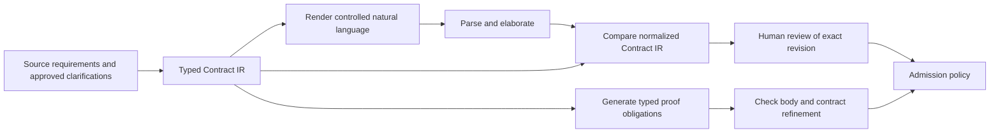
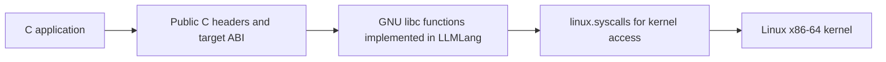
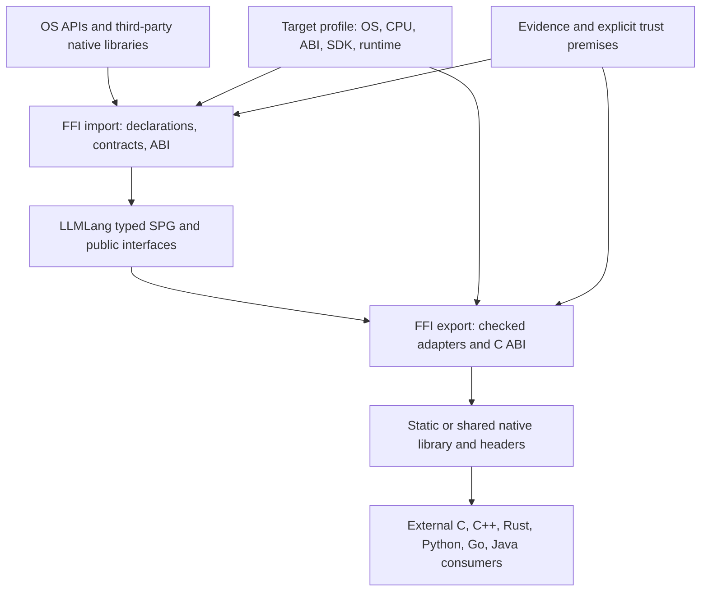
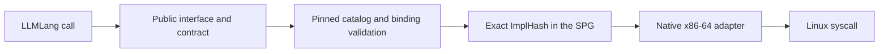

# LLMLang Research and Development Plan

## 1. Plan scope

This plan tracks the remaining research, engineering, decisions and validation gates in dependency order. See the [research register](RESEARCH.md) for results and the [design questions](#open-design-questions) below for stable LL identifiers.

Only explicitly accepted project decisions enter the candidate specification in `draft/`.

The stages are ordered. Work inside a stage may proceed in parallel when its dependencies are satisfied. A later stage may be explored early, but it must not be treated as architecturally settled before its prerequisites pass their exit criteria.

## 2. Status vocabulary

Use these statuses for each item:

- **Researched** — a research document or substantial analysis exists. This does not mean the question is conclusively resolved.
- **Prototyped** — an executable prototype or focused experiment exists.
- **Partially validated** — some claims have supporting evidence, but acceptance criteria remain unmet.
- **In progress** — active work or an explicit next experiment exists.
- **[WIP human]** — pending an independent human review, participation, an explicit project decision, or a specifically required input or authorization from a person. Keep the item open and skip that step during autonomous research. Continue separable technical work and retain the dependency in any affected exit criteria.
- **Not started** — no substantial research has been recorded yet.
- **Decision pending** — alternatives have been investigated, but an explicit design decision remains open.
- **Accepted** — an explicit project decision has been recorded in a durable design document. A recommendation alone is not acceptance.

Status applies to the current evidence, not to how important the topic is. Where the repository contains related research but not a direct answer to the exact question, mark the item as partially researched rather than complete.

## 3. Stage overview

| Stage | Name | Main outcome | Gate |
|---|---|---|---|
| 0 | Research inventory and evidence hygiene | A reconciled map of existing work, claims, prototypes, gaps, and decisions | Every existing research area is mapped; evidence and decision status are explicit |
| 1 | Semantic foundation and identity | A coherent model of SPG, semantic objects, contracts, and immutable identities | Canonical semantic objects, identity boundaries, and contract relations are sufficiently defined |
| 2 | Formal semantics and verification foundation | A small formal core with independently checkable claims and explicit proof boundaries | A reference semantics and a sound, reproducible verification slice exist |
| 3 | Dependency graph, incremental computation, and cache | Sound impact analysis and cache reuse/invalidation model | Dependency completeness and cache-key soundness are demonstrated on representative changes |
| 4 | Semantic storage, versioning, and Git integration | Durable repository representation and semantic merge workflow | Clone, history, diff, merge, conflict handling, and recovery are demonstrated |
| 5 | Types, execution model, runtime, and POSIX | A small executable language/runtime slice with explicit platform boundaries | A vertical slice preserves its declared semantics on a selected target |
| 6 | Translation, backends, and optimization | Multiple target realizations and evidence-backed implementation selection | Two backends agree with reference semantics for the selected subset |
| 5–6 (cross-cutting) | RT-37 embedded firmware and RT-38 OS kernels | Freestanding profile and bootable bounded pilots | Explicit runtime closure, independent target evidence and trust boundaries; firmware precedes kernel |
| 5–7 (cross-cutting) | Cross-platform native interoperability and bidirectional FFI | Target profiles, native library import/export and ABI/contract evidence | Per-target bidirectional conformance and explicit support/assumption matrix (§6.6) |
| 7 | Scale, ecosystem, collaboration, and adoption | Measured feasibility and operational model for real projects | Performance, storage, collaboration, trust, and usability criteria are measured |

---

# Stage 0 — Research inventory and evidence hygiene

[Research results](RESEARCH.md#stage-0--research-inventory-and-evidence-hygiene)

**Order:** first; can run alongside maintenance of existing prototypes.  
**Purpose:** establish what the current research corpus actually proves and what remains open.

### 0.1 Reconcile the research corpus

**Estimated research complexity:** **2/10** — repository-wide inventory, duplicate/orphan audit, traceability, and reproducibility checks.

- [ ] [WIP human] Obtain an author attestation or an authoritative archival record for Scenario 16 and resolve only the historical claim supported by that source. The archival crosswalk already records the observed gap.

Complete the semantic duplicate, supersession, orphan and contradiction review. Verify translation parity, external URLs, upstream snapshot completeness, and outstanding historical run provenance. Obtain independent claim review.

### 0.2 Establish research quality and decision rules

**Estimated research complexity:** **3/10** — mostly methodological analysis and consistency checks.

  - Remaining external dependencies: corpus-wide audit of older reports/prototypes, claim-level IDs and falsifier/impact records, independent human review, and maintainer approval.
  - Remaining external dependencies: independent human adjudication of the quality-review queue, maintainer approval of the proposed evidence vocabulary/gates, and corpus-wide claim provenance/reproduction/source-correspondence review.
  - Remaining external dependencies: allocator replays on representative workloads and additional targets; Lean 4.36.0 and LLVM tools for RT-32/RT-13 reproductions; persistent RT-19 publication/coordinator implementations for design-level recovery and concurrency tests; corpus-wide claim reproduction.
  - Remaining external dependencies: independent reproduction of the RT-19 crash/publication design, fresh allocator runs on representative parallel workloads, and tool/source compatibility validation beyond the RT-32 fixture.
  - Remaining external dependencies: uniform claim-level result labels and independent review/reproduction across the corpus; maintainer adoption of the Stage 0.2 quality vocabulary.
  - Remaining external dependencies: corpus-wide application of the boundary check; independent review of the claim cohort and proposed quality protocol; maintainer adoption; and exact source-bound claim links for any future draft change.

- [ ] [WIP human] Record the two independent review dispositions for the 24-document quality queue and the separate eight-claim handoff.
- [ ] [WIP human] Record maintainer approval of the proposed research quality vocabulary, review protocol and draft-transfer gates.

**Exit criteria:** every existing research artifact is discoverable from an index; every major claim has an explicit evidence level; unresolved questions are linked to [open design questions](PLAN.md#open-design-questions) or a clearly identified research item. See the [external evidence and approval dependencies](#external-evidence-and-approval-dependencies).

---

# Stage 1 — Semantic foundation and identity

[Research results](RESEARCH.md#stage-1--semantic-foundation-and-identity)

**Order:** after Stage 0 inventory; foundational for all later stages.  
**Purpose:** define what a LLMLang program is and what exactly its identities commit to.

### 0.3 Research taxonomy and cross-aspect dependency map

Use the [research taxonomy](research/research-management/RESEARCH-TAXONOMY.md) and [dependency map](research/research-management/RESEARCH-DEPENDENCY-MAP.md) to track affected areas and edges.

Continue validating and revising dependency edges as research produces evidence.

## 1.0 Intent, requirements, and human-validated formalization (RT-02)

**Estimated research complexity:** **7/10** — the core workflow is represented in Scenarios 15, 17, and 18, but faithful reconstruction, semantic-difference detection, human review effectiveness, and end-to-end evidence remain to be researched.

Research the complete path from a user's request to an accepted, traceable business contract and then to implementation evidence. The reconstructed explanation must be generated from the typed/formal model, not simply paraphrased from the original prompt.

- [ ] [WIP human] Compare deterministic, LLM-assisted, independent-pass, and hybrid reconstruction strategies. In primary fidelity experiments, prevent the reconstruction generator from seeing the original prompt; use the source separately for semantic-difference analysis.
  - [ ] [WIP human] Provide a pinned, stand-alone reconstruction model and runner that receives only the typed requirement model for live comparisons. The source stays with the comparison oracle.
Resolve backend adoption and source correspondence, and obtain human approval.
Review the exact approval binding and decide production authorization. Bind each decision to the semantic and evidence revision, scope, review round, and reviewer grant. Keep formal admission as a separate disposition.
- [ ] [WIP human] Run controlled human-review studies comparing prompt-only, formal-only, reconstruction-only, and reconstruction-plus-scenarios/provenance; include domain stakeholders and predeclare thresholds.

Validate human-review effectiveness and extend the evaluation to broader requirement classes.

**Exit criteria:** every accepted normative clause is traceable to source/decision evidence; reconstruction faithfully exposes the supported formal semantics and marks unknowns; seeded semantic mutations are detected; human reviewers can identify seeded interpretation defects at predeclared thresholds; approval is bound to the exact semantic revision; implementation verification remains separate.

## 1.1 Semantic Program Graph and program representation

**Estimated research complexity:** **10/10** — the complete SPG model must reconcile graph structure, object lifecycle, identity, evolution, and downstream consumers.

- [ ] [WIP human] Decide artifact granularity: operations, interfaces, contracts, types, implementation components, tests, models, and proofs.

Define the canonical schema and identity rules. Validate wider language and repository correspondence.

## 1.2 Semantic identity, hashes, and canonical encoding

**Estimated research complexity:** **8/10** — foundational identity and hash boundaries affect caching, dependencies, proofs, merge, and artifact storage.

**Terminology prerequisite:** Review [`draft/GLOSSARY.md`](draft/GLOSSARY.md) before changing this section or related RT-20/RT-24/package identity work. Use the glossary spelling `ImplHash` and preserve the distinct proposed identities `OpHash`, `ImplHash`, `CCHash`, optional `CandidateSetHash`, and conformance-evidence identity. The glossary is a proposal, not an accepted schema or hash-envelope decision.

- [ ] [WIP human] Select the production wire format and approved digest suites under LL-004.
- [ ] [WIP human] Approve production allocation authority, namespace, and historical execution or retention policy under LL-002.

Decide canonical envelopes, dependency boundaries, stable-ID lifecycle, and exact `OpHash` and `ImplHash` payloads after cross-aspect synthesis.

- [ ] [WIP human] Approve the production identity envelopes after cross-aspect synthesis and record the decision under LL-001 and related open decisions.

## 1.3 Contracts and compatible implementations

**Estimated research complexity:** **6/10** — requires formal compatibility/refinement criteria and evidence rules, integrated with identity and call binding.

Define canonical contract and operation semantics, establish general native correspondence, and resolve authority and production implementation-selection policy.

### 1.3.1 Public interfaces and verified provider binding (RT-05/20; proposed)

- [ ] [WIP human] Obtain independent review of the public-interface evidence and approve any normative semantics for the selected profiles.

**Status:** proposed; [public-interface research](research/semantic-representation/RT-05/PUBLIC-INTERFACES-AND-CONTRACT-REFINEMENT.md). **Exit gate:** independent review and positive/negative evidence across relevant semantic profiles; no change to accepted single-toolchain compatibility decision.

### 1.3.2 Contract IR and controlled natural-language rendering

**Goal.** Build a versioned, backend-independent Contract IR that can express the contract families in the verification coverage matrix. For every supported clause, produce controlled natural language (CNL) suitable for review. CNL is a human-readable syntax with a formal grammar, typed vocabulary, and defined interpretation. FRETISH provides a model for scoped temporal clauses. Function contracts, state changes, resource ownership, and proof assumptions need additional clause forms. [Verification coverage](research/formal-verification/VERIFICATION-COVERAGE.ru.md) · [FRETISH comparison](research/language-design/RT-02/RT-02-FRETISH-REQUIREMENT-BACKEND-COMPARISON-2026-11-25.md)

**Completion boundary.** Publish a supported profile for every contract family below, with explicit applicability limits, a reference semantics, a checked rendering path, and at least one verification or evidence route for the supported slice. Track expressibility, renderability, and verification coverage separately. A clause can be expressible and renderable even when the Toolchain cannot discharge its proof obligations. An unsupported clause or unresolved premise must remain visible and must block unconditional admission wherever policy requires it.

The CNL round trip checks that the review text preserves the formal contract. Human review assesses whether that contract reflects the requirements. Machine verification checks the implementation and binding under stated assumptions. Track all three outcomes separately and bind them to the exact revision before applying admission policy. [RT-02 reconstruction and human validation](research/language-design/RT-02/RT-02-REQUIREMENT-RECONSTRUCTION-AND-HUMAN-VALIDATION.md) · [ADR-020](draft/adr/020-immutable-objects-and-implhash-calls.md)

#### 1.3.2.1 Work packages and exit criteria

| Order | Work package | Deliverable and exit criterion |
|---|---|---|
| 1 | Define the semantic foundation and coverage matrix | Specify typed binders, values and numeric models, pre-state and post-state, outcomes, traces, termination and environmental assumptions. For each family below record admitted constructs, observations, and conditions for meaning, rendering and verification. Include a small executable reference model or independently checkable semantics for every supported slice. |
| 2 | Define the Contract IR schema and identity | Specify versioned nodes, type checking, exact references, composition and canonicalization. Separate semantic content from source anchors, review metadata and prose. Define `ContractHash` inputs, version compatibility and migration rules. Check deterministic normalization, rejection of invalid references and preservation of order where observable. Reuse SPG types and identities where applicable. |
| 3 | Deliver a scalar end-to-end slice | Implement typed preconditions, outcome-specific postconditions, explicit arithmetic and overflow semantics, and a pure function with success and error cases. Generate separate obligations for implementation-to-provided-Contract conformance and provided-to-public refinement. Use Boogie + Z3 first and cross-check a shared family in Lean. Reject a matching signature with a strengthened public precondition and reject a body that violates its own contract. [ADR-018](draft/adr/018-formal-verification-backends.md) |
| 4 | Build a formal CNL frontend and renderer | Specify the grammar, clause templates, operator precedence, quantifier scope, controlled terminology and presentation version. Render every supported node deterministically. Parse and type-check emitted text independently. Use a clause identifier and explicit scope for each clause. Require `elaborate(parse(render(contract))) = normalize(contract)` for the supported profile under the same vocabulary and revision context. Treat this as structural agreement under specified normalization. Provide a grammar-directed argument or mechanized result where feasible, backed by positive fixtures and negative mutations. |
| 5 | Expand by contract family | Add state and frames, modular calls and loops first. Then add supported slices for effects, ownership and lifetimes, temporal protocols, foreign assumptions and resource models. Every addition supplies semantics, IR nodes, CNL syntax and rendering, positive and negative cases, a verification route or explicit evidence policy, and documented exclusions. |
| 6 | Build review and exact-revision admission | Produce a review packet with controlled prose, clause-to-source traceability, explicitly resolved and unresolved assumptions, scenario tables, counterexamples and a semantic diff between revisions. Preserve approval of meaning separately from proof outcomes. Pin the delivered packet and approval to the exact contract, source and relevant profile revisions. Re-evaluate approvals after relevant changes. Run the controlled human study before claiming reviewer benefit. |
| 7 | Integrate and publish support | Integrate parsing, rendering, verification and binding in the Toolchain. Check independent consumer use, reproducible runs with pinned versions, retained evidence, incompatible schemas, partial translations and stale approvals. Publish the supported coverage matrix and the limits of any human study. |

#### 1.3.2.2 Contract family coverage

The development scope includes every class in the [verification coverage matrix](research/formal-verification/VERIFICATION-COVERAGE.ru.md). The rows below are required work, including the later profiles. The evidence routes describe an implementation sequence. A route counts as supported only for its declared semantics and evidence policy. Backend selection follows [ADR-018](draft/adr/018-formal-verification-backends.md).

The [MVP release record](tools/llmlang_mvp/RELEASE.md#contract-ir-coverage-for-plan-13) maps the executable scalar and bounded trace coverage to these families. The broader models and evidence routes below remain part of the roadmap.

| Contract family | Required Contract IR and controlled natural language | Profile and validation boundary |
|---|---|---|
| Preconditions and admissibility | Typed inputs, domains, ranges, nullability, validated references, required input state, quantifier bounds and admissibility of a callee's arguments. Distinguish caller obligations from provider promises. | Start with scalar Boogie + Z3 checks. Test boundaries and contradictory or vacuous preconditions. |
| Functional postconditions | Relate inputs and pre-state to success values, error values and post-state. Include existence, uniqueness, ordering, collection contents and other admitted quantified properties. | Start with scalars, then add supported aggregate and collection models. Document theories and quantifier limits for each backend. |
| Invariants and algebraic laws | State, representation and loop invariants, inductive invariants over data structures and algebraic laws with their domain and side conditions. | Generate initialization, preservation and use obligations. Use Lean for supported induction and algebraic models. |
| Machine arithmetic and representation | Integer width and signedness, overflow and narrowing policies, supported floating-point modes, byte order, data layout and codec properties. Render exact units, modes and exception cases. | Check arithmetic in the selected numeric model. Validate byte encodings, floating-point and layout claims against the declared target profile. |
| Frames, effects and order | Read and write sets, dependency on the pre-state, unchanged locations, allowed events and required event order. Distinguish a permitted effect from a required one. | Begin with explicit frames on a closed state model. Add shared state and ordered effects only with defined observations and alias semantics. |
| Ownership, aliasing and lifetimes | Acquire, borrow, transfer and release resources, permitted aliases, lifetime and validity constraints, exactly-once cleanup and matching allocator or provider obligations. | Start with closed ownership and cleanup models. Require explicit assumptions for resources handled by external code. |
| Errors, cancellation, cleanup and failure atomicity | Separate success, error, cancellation and partial completion. Specify error causes, cleanup order, preserved state, rollback and residual external effects on each outcome. | Test failures at relevant transition points. Claim atomicity only for the modeled scope and observable effects. |
| Termination of loops and recursion | Distinguish partial correctness from termination. Express explicit well-founded measures, strict decrease, bounds and mutually recursive groups. | Start with annotated loops in Boogie + Z3. Extend with Lean for supported well-founded recursion and composition. |
| Protocols and state transitions | Initial, intermediate and terminal states, guarded transitions, legal event sequences, invariants, and obligations across calls or sessions. | Check finite protocol models with stated bounds. For inductive claims, provide separate proof obligations and a model correspondence. |
| Time, concurrency and progress | Scope, trigger, response, exceptions, time units, inclusive or exclusive deadlines, safety and liveness, scheduling and fairness assumptions, and supported concurrency or memory models. Distinguish complete executions and prefixes. | Compare supported temporal forms against FRETISH with exact trace and end-of-trace semantics. Evaluate TLA+ as a candidate with explicit model bounds. Use checked proofs where policy requires stronger evidence. |
| Authority and information flow | Principals, permissions, capability scopes, delegation and revocation, authorized reads and writes, confidentiality or noninterference, and permitted release of information. | Validate exact policy and state revisions. For properties comparing executions, state the compared inputs, observations and attacker model. Keep unsupported policies and assumptions explicit. |
| Cost and resource budgets | Input-size measures, time, memory, I/O or operation-count units, worst-case or amortized bounds, termination assumptions, exact provider and hardware or runtime model. Include lower bounds and optimality claims where explicitly modeled. | Start with abstract operation counts and Lean-checkable bounds. Treat native latency and memory as separate claims with explicit platform and measurement assumptions. |
| Refinement, equivalence and preservation | Compare public and provided Contracts, or two exact implementations or transformations, under an explicit observation model. Include outcomes, state, ordered traces and applicable assumptions. | Check input-domain inclusion and preservation of public guarantees. Use Lean for supported relational and translation claims. |
| Modular and foreign contracts | Represent public, required and provided Contracts, exact callee identity, conditional caller reasoning, separate body conformance, and environment or foreign assumptions. Present ABI applicability separately. | Check against the exact binding and discharge premises before reporting unconditional guarantees. Require separate evidence for the native ABI boundary. |
| Evidence applicability and assumption closure | Record how a result applies to the exact clause, profile, subjects, dependencies, assumptions, translator, backend and evidence artifact. Render open premises and case scope in the review packet. | Keep this in linked evidence and admission records. Verify dependency closure, invalidate stale evidence and prevent evidence metadata from changing `ContractHash`. |

For each family, publish exact versioned coverage entries for the constructs, observation model, translation grammar, test corpus and verification route. Include positive fixtures, boundary cases, counterexamples and unsupported cases. Track each family through semantics, typed IR, lossless CNL rendering and evidence admission. Completion requires a validated profile for every family and an explicit coverage decision for extensions beyond each profile.

#### 1.3.2.3 Review and verification gates

- [ ] Use the [contract formalization corpus](research/formal-verification/CONTRACT-FORMALIZATION-CORPUS/README.md) to test fidelity to requirements and the [proof-obligation benchmark](research/formal-verification/PROOF-OBLIGATION-BENCHMARK/README.md) to test obligation generation, routing and evidence admission.
- [ ] For every supported clause form, test omitted and inserted clauses, changed quantifiers or polarity, shifted deadlines, wrong pre-state or post-state references, swapped assumptions and guarantees, and silently weakened effects. Reject partial or lossy rendering as a complete review packet. A correct rendering of a wrong contract must still fail any applicable comparison with approved requirements or scenario oracles.
- [ ] Verify implementation conformance and refinement separately. Check that the provider accepts all inputs and states admitted by the public contract, preserves its guarantees, and carries applicable assumptions. Bind evidence to both Contracts, the interface revision, the selected `ImplHash`, the semantic profile and relevant tool versions.
- [ ] Keep `UNKNOWN`, `UNSUPPORTED`, tool errors, conditional evidence and source-confirmed counterexamples distinguishable. Require a checked correspondence between each backend translation and the source claim. Test invalidation after changes to the contract, binding, assumptions and applicable renderer or verifier versions.
- [ ] [WIP human] Compare controlled prose alone with prose plus scenarios and provenance using the pinned review protocol. Record false approvals, missed defects and review time. Confirm results across more than one class of requirements before generalizing. [Controlled review protocol](research/language-design/RT-02/RT-02-CONTROLLED-REVIEW-PROTOCOL-2026-11-25.md)

**Design choice to evaluate.** Compare a single extensible CNL grammar with a shared clause grammar plus typed tables or traces for effects and temporal protocols. Both candidates must cover every formal clause in their declared profiles. Free-form summaries may aid navigation. Approval applies to the exact checked review packet and its formal revision. Use failures from the [round-trip mutation pilot](research/language-design/RT-02/RT-02-CLAUSE-ROUNDTRIP-AND-MUTATION-2026-11-25.md) to test the distinction between rendering fidelity and agreement with requirements.

## 1.4 Core language semantics (RT-03)

**Estimated research complexity:** **7/10** — substantial remaining work on source correspondence, effects, paths, calls, cancellation, resources, and independent review.

- [ ] [WIP human] Independently review the cross-aspect profile, approve any selected semantics, and authorize transfer into `draft/`.

Select a semantic profile, evaluation strategy and effect model after establishing source correspondence.

**Next work:** integrate the typed-call, owned-result return, cleanup-disposition/composition, bounded-recursion/fuel, actor-progress, and AST-path probes into a grammar-bound source-to-model account. Compare varied satisfiable/unsatisfiable formula families and timeout/unknown behavior; model mutation/version boundaries; bind a parser/IR extractor to branch-node coverage; make effect order/payload observable in cross-profile summaries; and obtain independent human/formal review. Cover call-boundary unwinding, ownership transfer/return, asynchronous cancellation, cleanup divergence, and termination-budget exhaustion before expanding the expression fragment. Keep profile A–D alternatives open.

### 1.4.1 Type, effect, ownership, and capability alternatives (RT-04)

**Estimated research complexity:** **8/10** — several mutually constraining systems must form one coherent static and runtime model.

- [ ] [WIP human] Approve a production capability issuer and trust policy after platform and concurrency evidence is available.
- [ ] [WIP human] Independently review the comparative report and validate RT-03↔RT-04 dependency assumptions.
- [ ] [WIP human] Approve the hash-bearing field registry and the admissible proof-transfer policy after cross-aspect review.

Validate source- and snapshot-bound call-graph completeness, source-to-CFG and path-condition completeness, ordered effect summaries, row unification and handler coverage, capability evidence, and concurrent revocation. Obtain independent review and reconcile RT-05 identity and RT-07 proof boundaries before fixing hash boundaries or selecting an architecture.

## 1.5 Prior-art study for semantic representation and identity

**Exit criteria:** a reviewed semantic object model; explicit identity table and canonicalization proposal; contract compatibility vocabulary and evidence model; remaining foundational decisions registered in [open design questions](PLAN.md#open-design-questions).

---

# Stage 2 — Formal semantics and verification foundation

[Research results](RESEARCH.md#stage-2--formal-semantics-and-verification-foundation)

**RT-36 — Formal verification assumptions, trust boundaries and conditional proof management (P0; research proposed).** [RT-36 — Formal Verification Assumptions, Trust Boundaries and Conditional Proof Management](research/formal-verification/RT-36/RT-36-FORMAL-VERIFICATION-ASSUMPTIONS-AND-TRUST.md); [Issue #436](https://github.com/aivibeflow/LLMLang/issues/436). Exit: typed premise and authorization model, status/closure semantics, independently checked conditional/discharge pilot, exact binding and revocation tests, adversarial benchmark, reproducible evidence and independent review. Keep local theorem checks, system closure and policy admission distinct.

**RT-33 — Proof backend selection and verification orchestration (P0; comparative experiments in progress).** Investigate a backend-independent Contract IR / proof-obligation pipeline that classifies obligations and selects or combines Lean, SMT, TLA+, or other engines using explicit capability profiles. Define conservative abstention, translation correspondence, trust boundaries, cross-backend evidence composition, result states, provenance, and incremental invalidation. Evaluate using the contract formalization corpus plus state-transition/concurrency cases. This generalizes RT-32; it does not make Lean the universal verifier or select any backend as normative. See [RT-33](research/formal-verification/RT-33/RT-33-PROOF-BACKEND-SELECTION-AND-ORCHESTRATION.md) and [issue #390](https://github.com/aivibeflow/LLMLang/issues/390). The [kernel-checked symbolic correspondence](research/formal-verification/PROOF-OBLIGATION-BENCHMARK/SYMBOLIC-TRANSITION-CORRESPONDENCE.md) covers every register-state boundary in the Lean transition model for arbitrary integer inputs. The [Lean-owned SMT query experiment](research/formal-verification/PROOF-OBLIGATION-BENCHMARK/SYMBOLIC-SMT-QUERY.md) emitted the proved typed mismatch predicate as SMT-LIB for three controls and replayed the solver model. Source representation, general SMT-LIB denotation, and checked certificates remain open.

**RT-33 benchmark expansion:** establish a multi-label Proof Obligation Benchmark that separates obligation forms from semantic domains, covers boundary/negative/conditional/composed cases, and evaluates obligation generation, backend planning, translation correspondence, verification, evidence aggregation, and abstention independently. Start with a small representative seed set; the up-to-80-case matrix is a coverage target, not a fixed quota. See [benchmark](research/formal-verification/RT-33/PROOF-OBLIGATION-BENCHMARK.md) and [case template](research/formal-verification/RT-33/PROOF-OBLIGATION-BENCHMARK-TEMPLATE.md). Proposed [executable seed corpus](research/formal-verification/PROOF-OBLIGATION-BENCHMARK/README.md) and follow-up experiments are tracked under LL-029.

**Order:** after the semantic objects and contract boundaries from Stage 1 are stable enough to formalize.  
**Purpose:** make language meaning precise and ensure that verification claims are independently checkable.

## 2.0 Automatic complexity inference and resource verification (RT-34)

**Priority:** P0 foundations and pilot, P1 advanced domains. Obtain independent benchmark adjudication, define production cost semantics, and establish broad implementation correspondence. [RT-34](research/formal-verification/RT-34/RT-34-AUTOMATIC-COMPLEXITY-INFERENCE.md) · [Benchmark plan](research/formal-verification/RT-34/RT-34-COMPLEXITY-BENCHMARK.md) · [Issue #412](https://github.com/aivibeflow/LLMLang/issues/412).

- [ ] [WIP human] Compare inference vectors using benchmark cases with explicit adjudication status (CX-19).
  - [ ] [WIP human] Independently adjudicate benchmark cases and record the accepted labels.

Dependencies: RT-03/04 semantics/types, RT-07/08 evidence, RT-05/11 identities/cache, RT-26 resource enforcement, RT-32/33 proof generation and orchestration. Exit: reproducible scoped experiment, checked cost proofs and source correspondence, explicit assumptions and abstention, comparative evidence and no normative selection without review.

## 2.1 Formal semantics of the language

**Estimated research complexity:** **8/10** — requires a precise executable semantics and correspondence with source programs.

Define canonical language rules and composition across fragments. Establish general source and backend correspondence.

## 2.2 Proof architecture and proof boundary

**Estimated research complexity:** **8/10** — includes trusted computing base, assumptions, evidence scope, and compositional proof boundaries.

Establish general frontend correspondence and production proof policy. Obtain an explicit decision on the Logos trust basis.

## 2.3 Lean, Logos, SMT, and solver integration

**Estimated research complexity:** **8/10** — solver behavior, proof evidence, timeout/UNKNOWN handling, and source binding must be validated.

Extend source correspondence and certificate-profile admission. Resolve upstream trust disposition.

## 2.4 Verified SPG-to-Lean pipeline (RT-32)

**Estimated research complexity:** **9/10** — requires a sound connection between authoritative LLMLang semantics, typed SPG, generated Lean terms, proof obligations, and independently checked evidence.

**Research brief:** [RT-32 — Verified SPG-to-Lean Pipeline](research/formal-verification/RT-32/RT-32-VERIFIED-SPG-TO-LEAN-PIPELINE.md). Coordinate with RT-03/05/07/08/09/11/24. This is a Toolchain/formal-verification research goal, not a new LLMLang surface-language feature or a decision to make Lean the runtime.

Define production decoding, establish source correspondence across profiles, and resolve issuer governance and deployment.

**Exit criteria:** a non-trivial function is translated from SPG without a separately authored Lean implementation; generated obligations cover its declared contract and termination; the Lean kernel checks the proof; source-to-Lean correspondence covers the admitted subset; adversarial fixtures reject incorrect or stale evidence; provenance binds proofs to exact semantic and toolchain identities; conditional caller proofs remain visibly unproven until every dependency is discharged through compatible checked evidence.

## 2.5 Correctness of optimization and translation

**Estimated research complexity:** **9/10** — semantic preservation across lowering and optimization needs version-pinned corpora and independent validation.

**Prior art:** Lean, SMT solvers, TLAPS, Dafny, K Framework, Vellvm, Alive2.

Extend source, graph and backend correspondence, integrated CI coverage and production proof policy.

**Exit criteria:** a small, executable reference semantics; at least one end-to-end, independently checked proof path with explicit assumptions; a documented trusted computing base; reproducible CI validation.

---

## 2.6 Dafny language and verification transfer study (cross-cutting; Stage 2)

- [ ] [WIP human] Run controlled human and pinned-model readability and proof-guidance trials on the Dafny/LLMLang examples.

**Deliverable:** construct-by-construct transfer matrix, candidate contract/syntax proposal, reproducible example corpus, and recommendation on Dafny reuse versus an independent LLMLang verifier.

Broaden the construct mapping, propose candidate source syntax, validate general translation, and decide which Dafny ideas to transfer.

# Stage 3 — Dependency graph, incremental computation, and cache

[Research results](RESEARCH.md#stage-3--dependency-graph-incremental-computation-and-cache)

**Order:** after Stage 1 identity and Stage 2 semantic/proof boundaries are sufficiently defined.  
**Purpose:** compute only what has actually been invalidated while preserving soundness.

## 3.1 Semantic dependency model

**Estimated research complexity:** **8/10** — completeness across static, dynamic, external, generated, aliased, and recursive dependencies is foundational.

- [ ] [WIP human] Reconcile the candidate subset with the canonical SPG schema and formal semantics before normative adoption. Requires accepted SPG identity envelopes and a selected formal observation profile.

Reconcile the dependency model with the accepted SPG schema and formal semantics. Establish general source soundness and Toolchain integration.

## 3.2 Incremental analysis and invalidation

**Estimated research complexity:** **5/10** — focused binding/invalidation experiments are tractable, though production completeness remains difficult.

Integrate with the compiler, validate performance on representative workloads, and define canonical invalidation policies.

## 3.3 Semantic build and cache graph

**Estimated research complexity:** **6/10** — requires sound action keys, dependency closure, and demonstrated invalidation/reuse.

Classify determinism and define production formats, dependency discovery, registry authority and remote operation. Keep the append-only `language-components.toml` registry, LanguageVersion and ToolchainIdentity distinct.

## 3.4 Quantify compilation speedup

**Estimated research complexity:** **5/10** — controlled benchmark design and measurement; conclusions depend on representative workloads and hardware.

- [ ] [WIP human] Provide representative LLMLang build/edit workloads and controlled hardware before calibrating production costs and wall time.

Extend workload coverage, benchmark on controlled hardware, integrate with the LLMLang pipeline, and calibrate its stage weights.

**Exit criteria:** a dependency-completeness policy; sound action-key model; tests showing that relevant changes invalidate all affected results and irrelevant changes preserve valid results; reproducible benchmark data.

---

## 3.5 Verification artifact cache and incremental proof reuse (RT-11/32/33/36)

**Priority:** P0 (exact local reuse and sound admission), P1 (advanced and distributed reuse). [Execution brief](research/formal-verification/RT-33/VERIFICATION-BACKEND-INTEGRATION-AND-ARTIFACT-CACHE.md) · [Persistent modular/closed cache](research/formal-verification/RT-32/RT-32-PERSISTENT-PROOF-CACHE-2026-11-25.md) · [8,192-profile invalidation comparison](research/formal-verification/RT-32/RT-32-INCREMENTAL-PROOF-INVALIDATION-2026-11-25.md).

**Exit criteria:** independently replayable real proof artifacts from at least Lean and SMT, explicit scope for temporal checking, no unexplained false admissions in the adversarial corpus, soundness argument with declared TCB, reproducible comparative performance evidence. No target speedup, backend, physical format or normative semantics is selected. Keep RT-32 modular/closed receipt evidence and historical results intact.

# Stage 4 — Semantic storage, versioning, and Git integration

[Research results](RESEARCH.md#stage-4--semantic-storage-versioning-and-git-integration)

**Order:** after identity and dependency boundaries are stable enough to persist.  
**Purpose:** make semantic programs durable, portable, reviewable, and mergeable in ordinary repositories.

Defer semantic merge implementation and benchmarking until cross-aspect synthesis. [ADR-014](draft/adr/014-git-semantic-merge.md).

## 4.1 Semantic object storage

**Estimated research complexity:** **6/10** — storage, immutable snapshots, recovery, and identity integration.

Define canonical SPG object envelopes and authority. Validate distributed recovery and power-loss durability.

## 4.2 Git representation and repository model

**Estimated research complexity:** **6/10** — repository mapping and semantic versioning need consistency with SPG identity.

[ADR-024](draft/adr/024-package-directory-and-protobuf-dumps.md) selects package directories with separately indexed, independently compressed Protobuf records and LZ4 as the initial codec.

- [ ] Specify the versioned wire schema, record framing, index encoding, canonical profile, and file partitioning policy. Validate reconstruction, deterministic export, and independent range reads against the SPG identity and lineage model.

## 4.4 Git integration workflow

- [ ] [WIP human] Provide selected native operating systems and filesystems for platform-specific Git merge and checkout validation.

### 4.5 End-to-end semantic merge and synchronized commit lifecycle

**Estimated research complexity:** **10/10** — spans graph validation, merge, Git synchronization, failure recovery, and exact-state guarantees.

**Study these documents as one set before changing this workstream:**
- [Git Representation and Semantic Merge](research/toolchain-and-collaboration/RT-15/GIT-REPRESENTATION-AND-SEMANTIC-MERGE.md) — primary research source for repository representation and semantic merge rules.
- [ADR-014](draft/adr/014-git-semantic-merge.md) — accepted architectural direction.
- [RT-20](research/toolchain-and-collaboration/RT-20/RT-20-LLM-PATCH-PLANNING-AND-HASH-PROPAGATION.md) — caller impact, per-call-site migration/preservation, hash propagation, and verified completion.
- [RT-22](research/toolchain-and-collaboration/RT-22/RT-22-LLMLANG-GIT-REPOSITORY-AND-WORKTREE-MCP.md) — repository/worktree operations, merge reconciliation boundary, commit preparation, and recovery.
- [RT-23](research/toolchain-and-collaboration/RT-23/RT-23-SINGLE-INSTANCE-TOOLCHAIN-AND-INCREMENTAL-MULTI-WORKTREE.md) — shared semantic state, versioned interface mappings, incremental worktree views, and synchronized semantic/filesystem commit.
- [RT-19](research/toolchain-and-collaboration/RT-19/RT-19-TOOLCHAIN-SERVER-AND-SEMANTIC-DEVELOPMENT-API.md) — semantic Change Set/Snapshot lifecycle and transport-neutral API.

The documents have explicit ownership boundaries and reciprocal links. Re-read the complete set together whenever merge, rebase, cherry-pick, semantic export/import, or commit behavior changes.

**Detailed candidate contract:** [RT-24 — Canonical Semantic Representation, Diff, and Three-Way Merge](research/toolchain-and-collaboration/RT-24/RT-24-CANONICAL-SEMANTIC-REPRESENTATION-DIFF-AND-MERGE.md). RT-24 is a research proposal, not an accepted format or merge decision. Its identity/SPG reconciliation is recorded in [RT-24 Identity and SPG Reconciliation](research/toolchain-and-collaboration/RT-24/RT-24-IDENTITY-AND-SPG-RECONCILIATION.md), with the scenario comparison in [RT-24 Identity Architecture Decision Matrix](research/toolchain-and-collaboration/RT-24/RT-24-IDENTITY-DECISION-MATRIX.md). There is no standalone RT-05 specification in the current repository; the relevant evidence is distributed across Studies 05–08, RT-03, Semantic Dependency Index research, and the executable prototypes.

**Refined execution order:**
- [ ] [WIP human] Decide Stable Entity ID + Content Hash versus content-addressed values with explicit lineage/selection after completing RT-03/RT-04 semantic reconciliation and the decision gates recorded in the matrix.
- [ ] [WIP human] Reconcile the selected identity model with RT-03 language semantics and RT-04 type/effect research before freezing hash-relevant fields and canonical SPG object/edge schemas.

**Required sequence:**
- [ ] [WIP human] Provide representative LLMLang repositories and a controlled target platform for assessing production lifecycle performance.

Reconcile canonical representation, identity and schemas. Implement general semantic diff and merge, multi-commit replay and conflict handling, and concurrent Git publication after synthesis. [ADR-014](draft/adr/014-git-semantic-merge.md).

**Dependency:** canonical SPG/identity and import/export decisions from Stages 1 and 3; RT-20 impact-plan correctness; RT-19 semantic API; RT-22 repository/worktree contract; RT-23 shared-state and synchronized-commit runtime.

**Exit criteria:** clean clone reconstructs the exact declared semantic state; commits map deterministically to semantic snapshots and mapping revisions; repository-level semantic merge works for independent and conflicting changes; merged graphs pass RT-20 impact/hash/caller checks; the exact validated semantic state and selected regular files are synchronized into one recoverable Git commit; merge/rebase/cherry-pick, fallback, interactive resolution, and crash recovery are tested.

---

# Stage 5 — Types, execution model, runtime, and POSIX

[Research results](RESEARCH.md#stage-5--types-execution-model-runtime-and-posix)

**Order:** after the semantic core and initial proof boundary; a small vertical slice should be chosen early.  
**Purpose:** define what programs mean when executed and how LLMLang interacts with systems.

## 5.1 Type system and data model

**Estimated research complexity:** **8/10** — overlaps the unresolved RT-04 type, ownership, effect, and capability architecture.

Design and review a cohesive type system covering primitive, algebraic and dependent representations, polymorphism, native ownership and typestate, effects, inference and provider compatibility.

## 5.2 Execution semantics and runtime architecture

**Estimated research complexity:** **9/10** — combines execution, resource lifecycle, cancellation, scheduling, concurrency, and observable behavior.

Extend mixed-order semantics, source correspondence and backend validation.

## 5.3 POSIX architecture and conformance

**Estimated research complexity:** **9/10** — platform profiles, API semantics, conformance evidence, and runtime boundaries.

- [ ] [WIP human] Select initial POSIX edition and explicit conformance profile.
- [ ] [WIP human] Select the initial Linux architecture after reviewing the bounded syscall and target-profile evidence.

Select the POSIX profile, broaden conformance testing, and integrate it with the runtime.

The [§8.2 Linux syscall package implementation plan](#82-linux-syscall-package-implementation-plan) covers the native x86-64 syscall ABI and its public LLMLang contracts.

**Exit criteria:** a small typed executable subset; reference execution; one POSIX vertical slice with explicit contracts and conformance scope; tests for observable behavior and error cases.

### 5.3.1 Implement glibc in LLMLang

**Goal** — implement the GNU C Library in LLMLang for Linux, starting with Linux x86-64 and the System V C ABI. Implement library behavior in LLMLang and use `linux.syscalls` for kernel access. Document any low-level adapters used for entry points or machine-specific operations. The portable POSIX layer backed by system libraries is a separate LLMLang profile. A pinned glibc release defines the coverage target. [Linux syscall package plan, §8.2](#82-linux-syscall-package-implementation-plan) · [RT-10 POSIX architecture](research/runtime-and-systems/RT-10/POSIX-RUNTIME-ARCHITECTURE.md) · [GNU C Library manual](https://sourceware.org/glibc/manual/latest/html_node/)

#### Function groups and end-to-end examples

| Group | Example functions | End-to-end example |
|---|---|---|
| Memory, strings, and conversions | `memcpy`, `memmove`, `strlen`, `strtol`, `qsort` | Parse numbers and copy between overlapping buffers. |
| Allocation and memory mapping | `malloc`, `calloc`, `realloc`, `free`, `mmap` | Grow a buffer and handle allocation failure. |
| Files, directories, and streams | `open`, `read`, `stat`, `readdir`, `fopen`, `fwrite`, `printf` | Copy a file and print formatted output from C. |
| Processes, signals, time, and IPC | `fork`, `execve`, `waitpid`, `sigaction`, `clock_gettime`, `pipe`, `poll` | Launch a child process with redirected output. |
| Sockets and name services | `socket`, `connect`, `recv`, `getaddrinfo`, `getpwnam_r` | Exchange data over local TCP and resolve names with a pinned Name Service Switch (NSS) configuration. |
| Threads and synchronization | `pthread_create`, `pthread_join`, `pthread_mutex_lock`, `pthread_cond_wait`, `sem_wait` | Pass data through a shared queue and test wakeups and cancellation. |
| Locales, Unicode, and encodings | `setlocale`, `strcoll`, `mbrtowc`, `iconv`, `gettext` | Sort in a specified locale and handle an incomplete multibyte sequence. |
| Math and floating point | `sin`, `exp`, `strtod`, `fesetround`, `fetestexcept` | Check rounding, NaN handling, and floating-point exceptions. |
| Dynamic loading and GNU extensions | `dlopen`, `dlsym`, `dlvsym`, `getopt_long`, `asprintf` | Load a library with a versioned symbol and parse long options. |

The table lists initial work groups. The pinned release inventory defines full coverage. It includes headers, types, macros, exported symbols and symbol versions, plus the startup objects, loader, modules, and data required by the declared profiles. Record each item's interface origin (ISO C, POSIX, GNU, or Linux), dependencies, support status, and evidence.

The diagram follows a call from C. Memory and string algorithms can run entirely within the library. Operations that need the kernel use the native syscall package.

#### Milestones and acceptance criteria

1. **Pin the target profile and reference.** Select the glibc release, minimum Linux version and configuration, compiler versions, linking modes, and environment settings. Build a versioned API and ABI inventory from the reference headers and artifacts. Track source compatibility, observable behavior, and binary compatibility separately.
2. **Build the first static slice.** Implement minimal program startup and termination, `errno`, `memmove`, `strlen`, `read`, `write`, and `_exit`. Run an independently compiled C client and check its output bytes, errors, and exit status. Check that the startup objects, runtime, and generated code let the target executable run without the host glibc.
3. **Expand the API and behavioral tests.** Add allocation, file I/O, stdio and variadic calls, processes, signals, and time, then networking and threads. Cover resource ownership, errors, partial I/O, `EINTR`, thread-local `errno`, cancellation, and cleanup. Expand coverage to DNS and NSS, locales, encodings, `libm`, and GNU extensions. Compare defined behavior against the reference in a pinned environment and add dedicated boundary tests.
4. **Validate binary compatibility separately.** Build shared artifacts and check ELF symbols and symbol versions, calling conventions, public structure layouts, thread-local storage, and startup objects. Then check the loader, relocations, dynamic loading, and required modules. Run representative C binaries linked against the reference release in an isolated test environment without recompiling them. Publish results for each claimed configuration and set of symbol versions.

**Exit criteria** — map the entire declared profile to the inventory and cover it with contracts, behavioral tests, and applicable ABI checks. For each release, publish a CI coverage matrix, limitations, and reproducible results. Claim a full replacement for the selected profile once all required coverage is complete and independently built consumers pass.

## 5.4 Freestanding embedded and real-time firmware (RT-37)

**Priority:** P0 shared foundation; P1 pilot. [Research brief](research/runtime-and-systems/RT-37/README.md) · [Issue #440](https://github.com/aivibeflow/LLMLang/issues/440).

**Required MCU target families:** STM32F1, STM32F4 and ESP32. These are research targets, not currently supported production devices. Preserve generic Cortex-M and RV64 research; ESP32-C3/C6-class RV32 is distinct from RV64.

| MCU family / profile | CPU and instruction set | Initial integration candidates |
|---|---|---|
| STM32F1 | ARM Cortex-M3, ARMv7-M / Thumb-2 | STM32F103; CMSIS, STM32CubeF1 HAL/LL; bare metal and optional FreeRTOS |
| STM32F4 | ARM Cortex-M4 with FPU, ARMv7E-M / Thumb-2 | STM32F407; CMSIS, STM32CubeF4 HAL/LL; bare metal and optional FreeRTOS |
| ESP32 (original) | 32-bit Xtensa LX6, single/dual core by SoC | ESP32 DevKit-class board; ESP-IDF and FreeRTOS; separately investigate minimal bare-metal closure |
| ESP32 family extension candidates | Xtensa LX7 (S2/S3), RV32 RISC-V (C3/C6) | Pin exact SoCs and SDKs; evaluate independently, including ABI, radio/ROM dependencies and runtime restrictions |

- [ ] [WIP human] Select and provide exact physical boards for each MCU family for calibrated timing, peripheral and deployment validation.

Vendor references: [STM32F1](https://www.st.com/en/microcontrollers-microprocessors/stm32f1-series.html), [STM32F4](https://www.st.com/en/microcontrollers-microprocessors/stm32f4-series.html), [ESP32 family comparison](https://docs.espressif.com/projects/esp-idf/en/v5.0/esp32/hw-reference/chip-series-comparison.html), [Espressif board selection](https://docs.espressif.com/projects/esp-techpedia/en/latest/esp-friends/get-started/board-selection.html). See [RT-37 target details](research/runtime-and-systems/RT-37/README.md#target-families-and-device-profiles).

**Dependencies:** RT-03/04/07/08/09/10/13/16/32/33/34/36; Stage 6 native lowering. **Exit:** reproducible profile comparison and firmware execution evidence, explicit unsupported operations and trust boundaries. No language rule selected.

---

# Stage 6 — Translation, backends, implementation selection, and optimization

[Research results](RESEARCH.md#stage-6--translation-backends-implementation-selection-and-optimization)

**Order:** after a reference semantics and a stable semantic subset exist.  
**Purpose:** realize the same source semantics on multiple targets without making any target language the source of truth.

## 6.1 Translation architecture

**Estimated research complexity:** **9/10** — source semantics and preservation obligations must survive multiple translation stages.

- [ ] [WIP human] Decide whether backends consume typed SPG directly or a normalized target-independent semantic IR.

Select the canonical IR and establish general preservation across lowering.

### 6.1.1 Required bidirectional translation study (RT-30)

**Research brief:** [RT-30 — Bidirectional Semantic Translation](research/compiler-and-translation/RT-30/RT-30-BIDIRECTIONAL-SEMANTIC-TRANSLATION.md). Coordinate with RT-13, RT-28, and RT-29. Extend the translation and importer coverage beyond the restricted semantic profiles, validate production provenance and general translation obligations, and measure shared runtime lifecycle and dispatch costs.

## 6.2 Backend selection and cross-backend validation

**Estimated research complexity:** **9/10** — requires at least two independently validated realizations of a shared semantic subset.

Broaden platform and effect coverage and select initial targets.

## 6.3 LLVM backend

**Estimated research complexity:** **9/10** — lowering, UB/poison, target behavior, and source-to-IR preservation.

- [ ] [WIP human] Supply and approve representative application workloads and a controlled measurement environment for production-facing backend comparisons.
- [ ] [WIP human] Decide whether one backend or mode-specific backends (Debug/Release/JIT) are justified by the combined correctness, performance, portability, and maintenance evidence.
- [ ] [WIP human] Record the selected initial configuration, explicit non-goals, unsupported target combinations, fallback behavior, and criteria for revisiting the decision.

Select backend candidates, compare measurements, and extend the target matrix, lowering validation and target-specific correctness evidence.

## 6.4 Implementation discovery, selection, and optimization

Evaluate production selection policy on broader workloads and compose it with concurrent lifecycle handling.

**Exit criteria:** two backends preserve the same reference semantics for a defined subset; target limitations are explicit; implementation selection never bypasses operation identity or compatibility evidence.

## 6.5 OS kernels and verified microkernel feasibility (RT-38)

**Priority:** P1. [Research brief](research/runtime-and-systems/RT-38/README.md) · [Issue #441](https://github.com/aivibeflow/LLMLang/issues/441).

- [ ] [WIP human] Provide the selected physical platform and measurement environment for hardware timing, SMP and DMA validation.

**Dependencies:** RT-37 profile/pilot, RT-03/04/07/08/09/10/13/16/32/33/34/36 and Stage 6 lowering. **Exit:** reproducible feasible or falsified kernel profile and bounded pilot evidence, explicit proof/TCB gaps. No full-kernel verification or production readiness claim.

## 6.6 Cross-platform native interoperability and bidirectional FFI (cross-cutting)

[ADR-019 — Bidirectional native library interoperability](draft/adr/019-bidirectional-native-library-abi.md) records the accepted architecture for this requirement.

Obtain explicit human decisions on native platform support and releases. **Priority:** P0 for the shared target/ABI model and first three hosted OS families. P1/P2 for additional target profiles as listed below.

**Goal:** LLMLang programs must be able to consume operating-system APIs and third-party native libraries, and LLMLang must be able to produce native libraries consumable by programs written in other languages. Preserve public semantic contracts across implementations and platforms; check binary compatibility independently. POSIX is an optional system-library facade, not a requirement of the language or every target.

### 6.6.1 Target research matrix

All listed OS/architecture pairs are in scope for research and eventual feasibility/conformance assessment, not claims of existing support. ARM64 means AArch64; x86-64 means AMD64; RISC-V 64 means RV64. Priorities order investigation, not exclusion. Record exact supported OS releases, SDKs, deployment constraints, architectures, ABI variants, and toolchains before claiming support.

| OS | CPU architectures | Shared libraries | Static libraries | Object format | Research priority |
|---|---|---|---|---|---|
| Linux | x86-64, AArch64, RV64 | .so | .a | ELF | P0 |
| macOS | AArch64, x86-64 | .dylib | .a | Mach-O | P0 |
| Windows | x86-64, AArch64 | .dll (and import library) | .lib (MSVC), .a where applicable | PE/COFF | P0 |
| FreeBSD | x86-64, AArch64 | .so | .a | ELF | P1 |
| Android | AArch64, x86-64 | .so | .a | ELF | P1 |
| iOS | AArch64 | dynamic frameworks / .dylib subject to platform packaging and loading rules | .a / static frameworks | Mach-O | P1 |
| OpenBSD | x86-64, AArch64 | .so | .a | ELF | P2 |
| NetBSD | x86-64, AArch64 | .so | .a | ELF | P2 |

The hosted matrix contains 16 OS/CPU pairs. Existing freestanding research additionally covers ARM Cortex-M (initial Cortex-M3, Thumb) in [RT-37](research/runtime-and-systems/RT-37/README.md) and RV64 (initial RISC-V QEMU microkernel target) in [RT-38](research/runtime-and-systems/RT-38/README.md). For these targets, investigate static archives, object-level C ABI and explicit runtime closure; do not assume a host OS or dynamic loader. Keep hardware/privilege profiles and any later RTOS profiles separate from hosted targets. Required embedded MCU families in §5.4 are STM32F1 (Cortex-M3), STM32F4 (Cortex-M4F) and ESP32 (Xtensa LX6); evaluate ESP32-family Xtensa LX7 and RV32 variants separately. Static archives/object-level interoperability, vendor SDK bindings and explicit runtime closure are required research topics; hosted matrix counts remain unchanged.

### 6.6.2 Architecture and research vectors

The diagram describes proposed import and export paths, not an implemented pipeline. Both directions bind an exact target profile and evidence; external consumers need not understand LLMLang's internal SPG.

- Compare a portable C ABI baseline with platform-native adapters (e.g. POSIX/libc, Windows API, Apple SDK, Android NDK); assess direct LLVM/native emission versus generated Rust/C shims and embedded runtimes. C ABI maximizes reach but cannot directly represent all semantic types or ownership; generated adapters add translation and runtime dependencies that must be explicit. Investigate language-specific bridges only where justified, without conflating C ABI compatibility with C++ ABI, JNI or other managed-runtime conventions.
- Compare static linking, load-time shared linking and runtime symbol resolution where supported. Record symbol visibility, versions, loader/search policy, dependency closure, relocation and code-signing/package constraints. A platform restriction may make a particular mode unsupported without eliminating the entire OS target.
- Compare header-driven binding generation with manually reviewed contracts: headers describe representation and declarations but do not by themselves establish behavioral guarantees. Keep externally supplied contracts, assumptions, provider identity and ABI descriptors separately versioned and auditable.

### 6.6.3 Work packages and acceptance gates

- [ ] [WIP human] Supply the selected hosted OS SDKs, native runtime profiles and approval for the platform conformance scope outside the confirmed Linux x86-64 route.
- [ ] [WIP human] Review the resulting support matrix and select production profiles, availability of native runners/devices and required SDK access; record any platform restriction or unresolved target rather than silently dropping it.

**Dependencies:** RT-03/04 (source semantics, effects, ownership), RT-05/20 (public interface identity and provider binding), RT-09 (C ABI/layout), RT-10 (OS/runtime boundary), RT-11 (cache identity/invalidation), RT-12 (libraries/packages), RT-13/29/30 (translation and backend alternatives), RT-16 (security), RT-18 (versioning), RT-32/33/36 (proof/evidence and foreign assumptions), RT-37/38 (freestanding profiles).

**Exit:** a reproducible, versioned support/evidence matrix covering every listed target pair and applicable interoperability mode; a bounded bidirectional native pilot on each admitted profile; explicit unsupported, unresolved and conditional cases; verified source/adapter obligations and audited artifact/ABI correspondence; independently reviewable reports with counterexamples and linked evidence. Before marking the research complete, update the taxonomy, dependency map and option matrix and include the results in the final compatibility audit. No production support or normative ABI is implied by this plan.

---

# Stage 7 — Scale, ecosystem, collaboration, and adoption

[Research results](RESEARCH.md#stage-7--scale-ecosystem-collaboration-and-adoption)

**Order:** after the core vertical slice; some prior-art research can start earlier.  
**Purpose:** determine whether LLMLang remains practical for large codebases and real teams.

## 7.1 Performance and scalability

- [ ] [WIP human] Compare with Rust, Go, and C++ workflows on representative projects.
  - [ ] [WIP human] Provide or approve the representative projects and comparison workloads for the three toolchains.
- [ ] [WIP human] Approve representative package, cache and concurrent Toolchain workloads and provide the controlled allocator measurement environment.
  - [ ] [WIP human] Select the supported allocator and integration policy after the compatibility and workload gates.
  - Select target and link modes before production approval.
- [ ] [WIP human] Approve participation of representative upstream maintainers and any live submission, collaboration or migration cutover. Continue independent studies with synthetic repositories and approved evidence.

## 7.2 Libraries, packages, templates, and artifact ecosystem

**Estimated research complexity:** **6/10** — identity, indexes, providers, publication, provenance, and operational policy.

### 7.2.1 Package indexes and dynamic package delivery

- [ ] [WIP human] Accept the stable manifest schema, canonical hash encoding and digest algorithm after independent validation.
- [ ] [WIP human] Select the production interpretation for independent target dependency edges and associated compatibility policy.
- [ ] [WIP human] Run and retain representative small/medium/large benchmark baselines on controlled hardware; CI measurements are exploratory and are not acceptance thresholds.
  - [ ] [WIP human] Provide the controlled measurement environment and representative Store workloads for package baseline acceptance.

Measure controlled-hardware baselines and define large-scale acceptance criteria. Define a persistent immutable-object backend and public snapshot read contract for enumeration, dependency edges and streaming payloads. Decide the wire format, codec, provider protocol, cache index, manifest schema, canonical encoding and digest algorithm.

- [ ] [WIP human] Approve the real publisher and rights authorities, license interpretation and production retention or release policy.

Define operational policy, benchmarks and trust implementation for packages, indexes and providers.

## 7.3 Parallel development and collaboration

- [ ] [WIP human] Approve the production reviewer and publisher roles and supply real reviewer participation for effectiveness checks.
- [ ] [WIP human] Supply an approved representative multi-contributor workload and real team participation for collaboration acceptance.

Validate the end-to-end team workflow.

## 7.4 Security, trust, and reproducibility

**Estimated research complexity:** **5/10** — current threat model and fixture prototype narrow the next experiments, but full operational security remains larger.

- [ ] [WIP human] Approve production trust roots, authorized evidence issuers and signing or transparency policy.

Design and evaluate persistent multi-client authorization, concurrency and crash injection, sandbox testing, signed or authenticated evidence, and operational approval policy.

## 7.5 Developer experience and adoption

**Estimated research complexity:** **10/10** — controlled comparative evaluation with real users/agents, correctness, repair effort, cost, and performance.

- [ ] [WIP human] Evaluate learning curve and review quality for human developers.
- [ ] [WIP human] Evaluate LLM authoring workflows without treating generated output as trusted. Supply a pinned live model runner and controlled workload for the comparative workflow. [Independent validation pilot](research/security/RT-16/RT-16-INDEPENDENT-VALIDATION-2026-11-25.md)
- [ ] [WIP human] Supply representative adoption workloads and approve operational thresholds and any actual canary or cutover.

Implement and evaluate LLMLang behavior, human and agent usability, review quality, context and token use, repair effort, scope violations and adoption criteria in a controlled study.

**Exit criteria:** representative large-project benchmarks; working collaboration and recovery workflows; documented trust/security model; practical developer workflow evaluated with real tasks.

## 7.6 Toolchain Server and semantic development API (RT-19)

**Estimated research complexity:** **5/10** — bounded API, persistence, synchronization, MCP, and recovery experiments.

Select the API contract, persistent storage backend, multi-file synchronization algorithm and MCP surface. Validate the implementation against ADR-015.

**Exit criteria:** deterministic round-trip identity; stale/conflicting mutations rejected; accepted snapshots immutable; multiple workspaces isolated; crash/restart and export interruption recover safely; external edits are detected; MCP adapter independently tested; authorization and benchmark results documented.

---

## 7.7 LLM patch planning, caller migration, hash propagation, and verified commit (RT-20)

**Estimated research complexity:** **6/10** — significant multi-step validation and identity/dependency integration.

Validate action kinds, prerequisites and evidence sufficiency, dynamic dependency completeness and behavioral compatibility. Integrate validation-gated Git commits with the Toolchain Server.

**Exit criteria:** a complete server-validated plan precedes all mutations; every relevant call site has an evidence-backed compatibility decision; contract and hash propagation are independently correct; old/new behavior and shared-caller version splits work; every planned change is enforced and unplanned changes are rejected; commit is created only for the exact candidate that passed all mandatory checks.

## 7.8 Knowledge Context and Task Context (RT-14)

**Estimated research complexity:** Knowledge Context **7/10**; Task Context **6/10**; integrated workflow validation **8/10**. Knowledge Context depends on sound identity, dependency, provenance, and access boundaries. Task Context has a narrower object/lifecycle scope but must integrate with Change Sets, patch planning, delegation, and completion gates.

These are two separate research requirements. Do not collapse them into one generic Context object before their responsibilities and invariants are understood.

### 7.8.1 Knowledge Context — LL-026

Research a bounded, versioned, provenance-preserving description of the information available to an LLM agent for a task.

- [ ] [WIP human] Supply representative tasks and approved live agent access to measure context precision, recall and task outcomes.

### 7.8.2 Task Context — LL-027

Research a typed, versioned object describing the task an agent is expected to perform and the obligations that govern completion.

### 7.8.3 Joint integration and exit criteria

- [ ] [WIP human] Compare agent performance with full-context, bounded-context, and deliberately incomplete-context conditions; measure task success, missed constraints, scope violations, token/context cost, review effort, and recovery behavior.

Resolve the schema, syntax, lifecycle and architecture for LL-026 and LL-027.

## 7.9 AI-oriented syntax experimentation and MCP session observability (RT-31)

[ADR-022 — Syntax dialects with shared semantics](draft/adr/022-syntax-dialects-and-shared-semantics.md) records the accepted frontend and semantic identity model.

**Estimated research complexity:** **9/10** — requires a stable semantic oracle, multiple equivalent syntax frontends, controlled model evaluations, reliable error attribution, and privacy-aware session recording.

- [ ] [WIP human] Provide access to the approved model and provider profiles for live runs and record the exact authorized configuration.
- [ ] [WIP human] Approve promotion of any tested change to the production syntax, instruction or Toolchain profile.
- [ ] [WIP human] Obtain approved live model and representative task observations and independent human review before reporting live success, uncertainty, token/cost, latency or review effort.

**Research brief:** [RT-31 — AI-Oriented Syntax, Semantic Separation, and Toolchain Optimization](research/language-design/RT-31/RT-31-AI-ORIENTED-SYNTAX-AND-TOOLCHAIN-OPTIMIZATION.md).

**Coordination:** RT-03/05/07/08/09 establish semantic meaning, identity, compiler boundaries, and correctness oracles; RT-14/19/22 establish agent context, MCP/Toolchain and repository session provenance; RT-16 governs privacy and trust; RT-18 governs evolution; RT-24 and RT-30 inform canonical representation and cross-language preservation.

Decide the IR/AST boundary, profile design, logging schema, retention policy and optimization process. Evaluate concrete syntax and define the scope of session-content capture.

**Exit criteria:** at least three syntax profiles cover a common semantic subset; profile transformations pass independent semantic-equivalence checks; controlled model evaluations produce reproducible, uncertainty-aware comparisons; session recording supports privacy controls and reliable error attribution; improvement proposals are checked against held-out regression tasks.

## 7.10 Semantic Function Discovery and Retrieval (RT-35)

**Estimated research complexity:** **8/10** — requires a canonical semantic description, retrieval-quality benchmarks, sound compatibility checks, snapshot-consistent indexes, and safe ambiguity handling.

- [ ] [WIP human] Measure selected production tenant policy and runtime isolation against an authorized representative deployment.
- [ ] [WIP human] Approve representative quality, workload coverage and performance thresholds for a selected production model/index before release.

**Research brief:** [RT-35 — Semantic Function Discovery and Retrieval](research/semantic-representation/RT-35/RT-35-SEMANTIC-FUNCTION-DISCOVERY-AND-RETRIEVAL.md).

**Coordination:** RT-03/04 define function meaning and compatibility; RT-05/24 define canonical semantics and immutable identity; RT-06/11 constrain dependency-aware indexing and cache invalidation; RT-07/08 provide soundness and evaluation gates; RT-09/19 define compiler/Toolchain integration; RT-12 defines package/library discovery scope; RT-14/31 inform agent intent and evaluation; RT-16 governs authorization and trust; RT-18 governs versioning; RT-20 constrains exact call binding and caller compatibility.

Evaluate semantic fingerprints and KNN/ANN for discovery. Keep exact function hashes authoritative for calls.

**Exit criteria:** a canonical description/fingerprint proposal and benchmark corpus exist; structured, vector, and hybrid baselines are compared; compatibility and ambiguity handling pass negative controls; a bounded prototype resolves candidates to exact hashes against a pinned snapshot; index lifecycle, security, and stale-result behavior are tested.

---

# 4. Cross-cutting prior-art research

This is a continuous comparative track. It informs the stages above but does not replace LLMLang-specific experiments.

| System / technology | Research focus | Relevant stages |
|---|---|---|
| LLVM | IR, lowering, optimization, backend and ABI boundaries | 2, 5, 6 |
| Rust | Ownership, borrowing, lifetimes, type system, systems runtime | 5, 6, 7 |
| Lean | Formalization, proof checking, trusted kernel, executable semantics | 2 |
| TLAPS | Proof of system properties and compositional reasoning | 2 |
| SMT solvers | Constraint encoding, solver protocols, proof evidence, unknown results | 2, 3 |
| Dafny | Contract/proof syntax, modular verification, Boogie/SMT workflow, compiler boundary, possible syntax/backend transfer | 1, 2, 5; focused cross-cutting study |
| K Framework | Executable formal semantics and language definition | 2 |
| Vellvm | Formal LLVM semantics and compiler correctness | 2, 6 |
| Alive2 | Translation validation for LLVM optimizations | 2, 6 |
| Bazel / Skyframe | Dependency graphs, incremental evaluation, action caching | 3 |
| Salsa | Incremental computation and dependency tracking | 3 |
| Adapton | Demand-driven incremental computation | 3 |
| Nix | Reproducible, content-addressed builds and dependency isolation | 3, 4, 7 |
| Git | Object model, DAG history, merge drivers, mergetool integration | 4 |
| Unison | Content-addressed code identity and semantic naming | 1, 4 |
| POSIX | Standardized interfaces, conformance, implementation-defined behavior | 5 |
| C / C++ ABIs | Interoperability, memory layout, calling conventions, platform boundary | 5, 6 |
| Package and artifact registries | Distribution, trust, provenance, licensing, retention | 7 |

For each system, record: the specific problem it solves, its model, what can be reused, what cannot be reused, the assumptions it makes, and the LLMLang experiment needed to validate applicability.

---

# 6. Research vectors and integrated specification synthesis

The project must not treat an individual research report as producing one mandatory answer. Each research may identify multiple promising development vectors (approaches, design choices, or internally coherent option families), including assumptions, trade-offs, constraints, evidence, and unresolved questions.

## 6.1 Required output of each research

Each research report should, where applicable, provide:

- A clearly scoped aspect of LLMLang and the questions investigated.
- Multiple viable development vectors rather than only one preferred recommendation. Do not manufacture alternatives when only one viable vector is known.
- For each vector: principles, assumptions, benefits, costs, risks, limitations, and evidence.
- Compatibility requirements, constraints, and known incompatibilities with other aspects.
- Upstream dependencies and downstream impact, linked to the dependency map.
- Open questions and confidence/evidence level; distinguish facts from hypotheses and recommendations.

For each new report, update the research taxonomy and affected dependency-map edges before marking the research complete.

## 6.2 Cross-aspect dependency model

Maintain explicit directed relationships:

- **Requires:** one aspect/vector depends on another.
- **Constrains:** a choice narrows viable choices elsewhere.
- **Influences:** a choice changes trade-offs without making other choices impossible.
- **Conflicts with:** two choices cannot coexist under stated assumptions.
- **Enables:** a choice makes another capability or vector practical.

Each edge must record rationale, affected vectors, direction, and confidence. Revisit edges when evidence changes assumptions. Use the map to identify foundational topics, downstream topics, feedback loops, and parallel work.

## 6.3 Research order

Research order is dependency-driven, not simply the order topics were proposed. The current provisional sequence is:

1. Goals, constraints, and semantic foundations.
2. Program representation and identity.
3. Core language semantics, types, effects, ownership, and concurrency.
4. Specification and verification model.
5. AI-native authoring and change model, including separate Knowledge Context and Task Context research (LL-026 and LL-027).
6. Build, incremental computation, and tooling.
7. Version control and collaboration.
8. Runtime, deployment, interoperability, and ecosystem.

This is a dependency hypothesis, not a rigid serial schedule. Independent subtopics may proceed in parallel using explicit provisional assumptions.

## 6.4 Synthesis: from vectors to complete specifications

After relevant research coverage is sufficient:

1. Normalize vectors into a common decision/option model, preserving links to evidence.
2. Identify mutually compatible, conditionally compatible, dependent, and conflicting vectors.
3. Construct the Cartesian product of viable vector sets as the initial candidate specification space.
4. Eliminate or mark combinations violating explicit compatibility constraints; do not silently treat every combination as valid.
5. Preserve traceability from each candidate choice to research, evidence, assumptions, and dependency edges.
6. Compare complete candidate specifications as integrated wholes using shared criteria: coherence, correctness, expressiveness, simplicity, feasibility, performance, incremental behavior, AI-agent usability, interoperability, and evolvability.
7. Use pairwise/local analysis only as diagnostic tools; the primary comparison unit is the complete candidate specification.
8. If exhaustive enumeration is impractical, use documented constraints, equivalence classes, staged enumeration, or representative sampling without losing promising vectors.

## 6.5 Synthesis status

See the [research register](RESEARCH.md#results-reconciled-from-main) for completed synthesis experiments.

| Activity | Status | Exit condition |
|---|---|---|
| Conduct and complete aspect research | **In progress** | Resolve gaps in semantic validation, reference semantics, types, effects, ownership and security. |
| Normalize vectors and validate compatibility | **In progress** | Extend normalization and validate constraints across workstreams. |
| Generate candidate specification space | **In progress** | Enumerate compatible integrated candidates or document constraints and representative sampling. |
| Compare complete candidate specifications | **In progress** | Evaluate common integrated workloads, obtain approved inputs and complete independent review. |
| Select and baseline a specification direction | **Not started** | A coherent candidate is selected with rationale and unresolved risks recorded |

# 7. Cross-stage invariants

These invariants guide every research and implementation stage:

1. **Semantic source of truth:** target languages, generated code, and backend IRs do not redefine LLMLang semantics.
2. **Explicit operation identity:** a call identifies the intended immutable operation semantics; analogue discovery is a separate optimization.
3. **Explicit implementation identity:** a concrete implementation has its own identity, including all semantics-relevant inputs.
4. **Evidence is scoped:** tests and proofs apply only to the exact subjects, assumptions, targets, and tool versions they cover.
5. **Unknown is not proven:** unsupported, incomplete, ambiguous, or unchecked cases fail closed.
6. **Sound incremental reuse:** a result is reused only when all result-determining dependencies are captured and unchanged.
7. **Semantic changes propagate by identity:** hash-relevant changes alter the appropriate identity and invalidate dependent results automatically.
8. **Provenance is not semantics:** authorship, history, and audit data do not alter semantic identity unless explicitly defined as behaviorally relevant.
9. **No silent weakening:** a backend or runtime must report restrictions and unsupported semantics rather than silently dropping guarantees.
10. **Research is not specification:** only reviewed and explicitly accepted decisions enter `draft/`.

---

# 8. Immediate execution order

The [Research State 2026-11-19](research/research-management/RESEARCH-STATE-2026-11-19.md) consolidates the new corpus, evidence levels, open questions, and synthesis gates recorded in the research continuation work. The [Research Preparation Pack](research/preparation/README.md) contains scoped briefs for the planned work below; those briefs are not research results. The priorities below incorporate the cumulative research content of PR #47. Experiments and prior-art comparisons inform candidate vectors; they do not select semantics or authorize transfer into `draft/`.

1. **Close the shared source-semantics and type/resource gap.** Compare typed calls, owned-resource results, transfer/return, cleanup failure composition and ordering, ordered effects, cancellation, and recursion/fuel across RT-03 profiles and RT-04 type/resource alternatives. Validate real-runtime conformance, migration, schema/ABI policy and semantic identity boundaries. Extend hard-formula coverage and negative-result checking, and require parser/source correspondence, general alias/call/loop analysis and independent review.

   Extend source and runtime correspondence and compare full profiles using static admission, ordered effects, live capabilities, and completion evidence. [COR-13 follow-up](research/language-design/RT-03/RT-03-04-SHARED-SEMANTICS-CORPUS.md#cor-13-follow-up-on-foreign-resource-lifetimes)

2. **Advance identity and dependency completeness in parallel where independent.** Reconcile stable IDs, content-derived values, explicit lineage, and scoped selectors against import, rename/move, duplication, split/merge, recursive groups, call-site edits, and branch conflicts. Bind calls to explicit contract/implementation choices; test negative and fallback dependency reads; retain `UNKNOWN` when completeness or provenance is absent. Do not settle OpHash/ImplHash or canonical SPG fields by implication.
3. **Complete the evidence and backend-preservation gate.** Continue Scenario 34's source-to-query proof from explicit wire-envelope assumptions through the supported encoder and program fragment. For LL-020 / Scenario 96, extend the version-pinned source-to-LLVM corpus from integer overflow and partial operations to memory bounds, provenance, and optimization-sensitive facts. Run a narrow shared workload against reference semantics and a second implementation/backend, comparing results, ordered effects, errors, resources, diagnostics, and rejected constructs. Keep the QF_LIA profile restricted and fail closed.

   **Integrated Rust foundation study (RT-29):** map Rust's language capabilities, compiler/runtime techniques, libraries, package/build ecosystem, and interoperability to LLMLang's capability model. Separate Rust as semantic prior art from Rust as an implementation substrate; classify every capability by layer (language, compiler/Toolchain, runtime/library, external service), record mismatches and non-transferable guarantees, and validate high-impact candidates with pinned reproducible probes. Consume existing Rust scenarios and generated-Rust evidence rather than repeating them. No Rust semantics or component is adopted by this study.
4. **Run representative workloads and human/agent evaluations.** Use RT-01's shared acceptance criteria and CLI corpus with C/Python host references when LLMLang candidates can execute it. Define workload weights before aggregate scoring; measure task success, repair attempts, diagnostics, context/token use, review quality, and scope violations separately from correctness.
5. **Extend security and operational-lifecycle evidence.** Build on RT-16's threat model and policy fixtures with persistent multi-client authorization, concurrent reservation, crash recovery around apply/accept/commit/push/publication, hostile build-worker sandbox cases, and authenticated evidence/provenance. Specify which lifecycle actions require human or policy approval.
6. **Continue package/cache validation without fixing speculative wire formats.** For RT-11/12/19/23, measure controlled cold/warm and scoped-change cases, implement a public immutable snapshot adapter and canonical dependency extraction against the SPG, and extend manifest/cache-index validation. Keep ZIP, binary index, codec, and provider choices provisional until the contracts and resource bounds are validated.
7. **Refresh the option matrix and synthesis gates from results.** Record evidence class, assumptions, confidence, unknowns, compatibility constraints, and falsifiers for each surviving vector. Compare complete candidate specifications only after major criteria have evidence; publish workload-weight sensitivity and preserve failed or unknown cases.
   **Freestanding feasibility:** start RT-37 profile constraints alongside the shared semantics and backend gates, then run the embedded firmware pilot before RT-38 microkernel experiments; both contribute evidence to the final compatibility audit. [RT-37](research/runtime-and-systems/RT-37/README.md) · [RT-38](research/runtime-and-systems/RT-38/README.md).

   **Native interoperability:** develop the shared target/ABI model and first Linux, macOS and Windows import/export pilots in parallel with Stage 6; extend to all 16 hosted OS/CPU pairs and the applicable freestanding profiles under [§6.6](#66-cross-platform-native-interoperability-and-bidirectional-ffi-cross-cutting) before the final compatibility audit.

8. **[Run the final feature compatibility and feasibility audit after all other research is complete](https://github.com/aivibeflow/LLMLang/issues/370).** This is the final cross-cutting research activity, not an early filter for individual research proposals. Start it only after all other registered aspect research, required follow-up experiments, evidence reviews, and candidate-vector synthesis have reached their documented completion gates. Re-read the then-current feature registry and the relevant research, option-matrix, and dependency-map evidence; do not rely on earlier preliminary estimates or assume the registry's current feature count will remain unchanged.

   - [ ] [WIP human] Clear the final audit's documented prerequisites. Record the outstanding independent review and applicable TODO decision dispositions, then verify completion of the required evidence and integrated candidate gates in #370 before starting the audit. The baseline RFC in #371 depends on this audit and candidate selection.

   - Assess every registered feature and every materially relevant feature pair or group for compatibility and feasibility. Distinguish direct contradictions from conditional tensions, dependencies, scope limitations, unresolved evidence, and ordinary implementation difficulty.
   - Use explicit classifications: **Compatible**, **Conditional**, **Conflict**, **Impossible**, **Unresolved**, and **Not Selected**. A **Conflict** or **Impossible** finding must identify the exact assumptions and requirements that cannot jointly be satisfied; complexity, cost, or lack of a current prototype is not by itself proof of impossibility.
   - For each conditional relationship, state the conditions, required architectural mechanisms, and guarantees or scope restrictions. For each conflict, document the evidence, affected feature vectors, possible resolutions, and which guarantees or capabilities each resolution would weaken or remove.
   - Check both pairwise relationships and higher-order interactions; pairwise compatibility alone must not be treated as proof that a complete feature set is coherent. Include determinism/concurrency, verification/completeness, dependency-analysis soundness/completeness, cross-language translation, SPG identity/versioning, merge behavior, ownership/FFI/resource lifetimes, and any additional interactions exposed by the completed research.
   - Produce a traceable compatibility/feasibility matrix covering the full registry, a conflict-and-limitation register, and a concise executive assessment. Every finding must link to the relevant feature IDs, research evidence, assumptions, and dependency-map edges. Explicitly mark unreviewed or insufficiently evidenced relationships rather than silently treating them as compatible.
   - Update the research taxonomy, dependency map, option matrix, and this plan with the audit results and resulting follow-up decisions. The audit must not silently delete or rewrite feature requests; proposed changes require explicit rationale and traceability.

   **Expected output:** `research/FEATURE-COMPATIBILITY-AND-FEASIBILITY-AUDIT.md` (or a successor path recorded in the plan), with supporting machine-readable matrix if useful. **Exit condition:** every current registry feature has an explicit assessment; all material pairwise and higher-order interactions are classified or explicitly marked unresolved; every claimed conflict/impossibility is evidence-backed; and remaining limitations and decisions are recorded for specification synthesis.

9. **[Draft the RFC after the final audit and candidate comparison](https://github.com/aivibeflow/LLMLang/issues/371).** Select and baseline only a coherent candidate with explicit rationale, compatibility evidence, and unresolved risks. A narrower RFC may proceed earlier only if it clearly scopes and labels unresolved design choices. Under ADR-014, defer end-to-end semantic-merge implementation/benchmarks until synthesis narrows the representation and merge policy.

   - [ ] [WIP human] Approve the selected RFC baseline or record a decision to revise it. Keep the final compatibility audit as a separate prerequisite.

## 8.1 MVP implementation plan

Deliver one reproducible LLMLang CLI application from a clean checkout. Use Calculator as the end-to-end workload, with Hello and Echo as runtime smoke tests. Start on Linux x86-64 with one source dialect, one typed SPG subset, and Rust code generation. Preserve the existing full Contract IR roadmap and accepted architectural requirements as the scope for later milestones. [Reference workloads](research/language-design/RT-01/RT-01-REFERENCE-WORKLOADS.md) · [Calculator candidate source](draft/examples/0003-calculator/main.llmlang) · [ADR-016](draft/adr/016-compiler-bootstrap.md)

### 8.1.1 Ownership and integration boundary

The MVP workstream includes the Contract IR language, its formal semantics, typed grammar and versioned representation, as well as the LLMLang frontend and SPG, the interpreter and native backend, verification and evidence admission, controlled natural-language rendering and review, and CLI and CI integration. Use the typed Contract IR interface as the boundary for parallel implementation.

- [x] Freeze the [versioned scalar Contract IR](tools/llmlang_mvp/CONTRACT-IR.md) with typed input and diagnostics, numeric and overflow rules, callable signatures, scoped clauses, outcomes and canonical contract identity.
- [x] Integrate the typed interchange with the frontend, SPG, execution and verification and reject unsupported schemas and profiles explicitly. [Contract IR roadmap](#contract-ir-and-controlled-natural-language-rendering)

### 8.1.2 Implementation sequence

1. **Freeze the executable subset and observations.** Specify the syntax and semantics needed by Calculator, including `Bool`, `I64`, typed functions, locals, branches, explicit errors, signed division, overflow, and evaluation order. Separate the scalar core from CLI parsing and I/O behind a small runtime boundary. Fix the input record and token-separator policy for the selected reference cases.
2. **Implement the frontend and typed SPG.** Parse and type-check candidate source, lower it to canonical SPG, and retain source spans for diagnostics. Resolve a public name in a pinned catalog, record the selected `ImplHash`, and preserve separate required, public and provided Contract references. Reject missing, ambiguous or stale bindings. Demonstrate deterministic reconstruction from the checkout. [ADR-014](draft/adr/014-git-semantic-merge.md) · [ADR-020](draft/adr/020-immutable-objects-and-implhash-calls.md)
3. **Implement the interpreter and native backend.** Execute the same typed SPG in a reference interpreter and in a native artifact generated through the Stage 0 Rust route. Pin the target, compiler and runtime inputs. Compare values, errors and CLI observations with the existing reference workloads. [ADR-016](draft/adr/016-compiler-bootstrap.md)
4. **Integrate verification and human review.** Translate scalar obligations to Boogie + Z3. Check body conformance and public-contract refinement separately, and validate counterexamples against source semantics. Use the Contract IR schema to render the supported clauses in controlled natural language and independently reparse and compare the normalized IR. Present text, source references and assumptions at the exact revision. Keep human approval separate from machine evidence and reject stale or insufficient evidence at the binding gate. Cross-check one shared claim family in Lean as specified by ADR-018. [ADR-018](draft/adr/018-formal-verification-backends.md)
5. **Wire the CLI and CI.** Document reproducible commands for checking, reviewing, building and running the application from a clean checkout. Run the same fixture suite through both execution paths on the pinned target. Report byte-exact stdout and stderr, exit status, exact inputs and tool versions. Exercise verification failures in CI as well as successful runs.

### 8.1.3 MVP acceptance

The [scalar implementation](tools/llmlang_mvp/README.md) provides a Rust Stage 0 compiler, reference interpreter, versioned typed Contract IR, controlled rendering, exact-revision signed approval and Boogie + Z3 checks with counterexample replay. The [release record](tools/llmlang_mvp/RELEASE.md) reports reproducible checks, the proof and test scopes, and the bounded trace coverage. The full contract-family roadmap remains open.

- [x] A clean checkout produces a native Calculator executable through the documented commands, and the frontend reconstructs the same canonical SPG on repeated runs.
- [x] The interpreter and native executable agree with the applicable RT-01 reference cases for Calculator. Hello and Echo pass the documented smoke tests. The conformance report lists every case in scope and the remaining exclusions.
- [x] A reviewer can see the full controlled rendering of the MVP contract, with checked round-trip fidelity and exact revision identity.
- [x] One conforming provider binds successfully. Stronger preconditions and body violations fail separate checks. An old `ImplHash` binding stays unchanged when a replacement is published. Stale approval or a mismatched binding blocks admission.
- [x] The [release record](tools/llmlang_mvp/RELEASE.md) states the supported profiles and links the reproducible checks.

Full self-hosting, additional dialects, semantic Git merge, broader native ABI support, and the full contract-family rollout follow this CLI milestone. An agent workflow over MCP can build on the same typed change, validation and review interfaces after the CLI path is reproducible. [ADR-015](draft/adr/015-toolchain-server-semantic-api.md) · [ADR-017](draft/adr/017-mcp-agent-object-format.md)

## 8.2 Linux syscall package implementation plan

The LLMLang `linux.syscalls` package must cover every native Linux x86-64 ABI syscall for a pinned kernel revision. Applications import typed operations with public contracts. The Toolchain binds them to a concrete provider at build time. AArch64, RV64, x32 and the 32-bit compatibility ABI are outside this roadmap.

### 8.2.1 Baseline and binding

The Calculator scalar MVP already provides a typed SPG, an interpreter, Rust code generation, separate public and implementation contracts, Boogie/Z3 verification, and the `review`, `check`, and `build` commands. Add cross-module imports, I/O types and effects for the package. Keep Calculator as a regression check and use Echo as the first consumer. [Scalar MVP](tools/llmlang_mvp/README.md)

The build resolves qualified names through a pinned catalog and records the public interface revision, public and provided contract hashes, target ABI, and exact `ImplHash`. The native adapter owns syscall numbers and the calling convention. Publishing a new provider preserves the old binding. An explicit update requires checking that the evidence still applies. [ADR-020](draft/adr/020-immutable-objects-and-implhash-calls.md) · [RT-10 adapters](research/runtime-and-systems/RT-10/RT-10-LINUX-SYSCALL-ABI-ISOLATION-2026-11-25.md)

The diagram follows the call from import to native execution. The build pins the public revision and the selected implementation.

### 8.2.2 Inventory and coverage boundary

Select a kernel tag and build a versioned inventory from the `common` and `64` entries in `syscall_64.tbl`. Record each entry's number, name, milestone, implementation status, and kernel version or configuration dependencies. CI checks the inventory against the pinned table. [Linux x86-64 syscall table](https://github.com/torvalds/linux/blob/master/arch/x86/entry/syscalls/syscall_64.tbl)

Full coverage requires a provider for every active syscall and documentation of the selected kernel's behavior for historical and reserved entries. Record the availability conditions for configuration-dependent calls. Track the package's implementation status separately from `ENOSYS` returned by a particular system.

### 8.2.3 Development milestones

| Milestone | Scope and completion criteria |
|---|---|
| **1. Package on top of the MVP** | Expose `read` and `write` through the public interface. Specify one syscall per operation, actual progress, partial results, EOF, errors, and applicable effects. Echo runs through the selected native provider and Calculator passes regression checks. |
| **2. Files and descriptors** | Add `openat`, `close`, positional and vectored I/O, metadata, directories, links, permissions, locking, and descriptor operations. Contracts specify ownership and borrowing. The file-copy example preserves data across partial writes and releases resources on errors. |
| **3. Time, waiting, and IPC** | Cover clocks, timers, pipes, poll/epoll, eventfd, signalfd, queues, and the remaining calls in this group. Test timeouts, interruptions, and preservation of partial progress. |
| **4. Processes, signals, and memory** | Cover process creation, execution, and waiting, signals, attributes and limits, memory mapping, page protection, and synchronization. Test resource inheritance and calls that do not return on success. |
| **5. Sockets and network I/O** | Cover socket creation, connecting, accepting connections, message transfer, addresses, and socket options. Contracts describe socket states and input and output structures. |
| **6. Command interfaces and complex structures** | Complete `ioctl`, `fcntl`, `prctl`, `bpf`, `perf_event_open`, the `io_uring` family, and the remaining calls in this group. Document types, constraints, and coverage for supported commands and structure variants. |
| **7. System and uncommon calls** | Implement calls for namespaces, mounts, quotas, keys, security policies, modules, auditing, and administration. Test privileged operations and system state changes in disposable VMs. |
| **8. Coverage closure** | Reconcile every entry with the selected kernel revision's table and publish coverage by syscall, command, and configuration. CI reports new and changed entries when the kernel tag advances. |

### 8.2.4 End-to-end examples for milestones 1–5

All five examples import the package's public interface and run as end-to-end checks on Linux x86-64.

1. **Echo** through `read` and `write`. Echo writes exactly the number of bytes read.
2. **File copy** through `openat`, `read`, `write`, and `close`. Handle partial writes and close both descriptors on success or error.
3. **Wait for data in a pipe** through `pipe2` and `poll`. Show a timeout on an empty pipe and readiness to read after a write.
4. **Launch a child process** through `fork`, `execve`, and `wait4`. Run a short command and return its exit status.
5. **TCP Echo on `127.0.0.1`** through `socket`, `bind`, `listen`, `connect`, and `accept`. Establish a local connection, exchange bytes, and close the sockets.

Contract documentation and internal test scenarios are sufficient for milestones 6–8.

### 8.2.5 Syscall acceptance criteria

- **Public contract.** Specify argument and result types, admissible states, errors, and effects. Document what the kernel reads or changes in buffers and structures, and who releases each resource.
- **Native provider.** Bind the provider to the exact interface revision. Check conformance to its provided contract and refinement of the public contract separately. Record kernel and ABI assumptions, and distinguish verified properties from experimental results in `review`.
- **Contract tests.** Cover argument passing, result decoding, applicable success and error outcomes, partial progress, interruption, and state changes. The build rejects missing, ambiguous, or stale bindings.
- **Command coverage.** Track syscall and command coverage separately for `ioctl` and similar interfaces. Each supported command has a contract. Pin driver commands to the exact userspace API (UAPI) and version.

### 8.2.6 First task

Pin a kernel tag, build the complete inventory, and take `read` and `write` through the full path from public contracts and import resolution to running the native Echo example in CI.

## 8.3 External evidence and approval dependencies

For production recovery, bind source, SPG, dependencies and authorization to Git and filesystem recovery. Integrate persistent storage with an authenticated multi-client environment and record the maintainer decision on production backend selection under ADR-015.

The open inputs below affect implementation selection. Record the result in the linked study at its exact scope and revision when the input becomes available. Continue evidence collection for eligible work while each input is pending.

| External input | Release condition |
| --- | --- |
| [human wip] Independent review of research claims and evidence quality | Stage 0.2 and [#285](https://github.com/aivibeflow/LLMLang/issues/285) have two pending review artifacts. A reviewer records adjudication against the archive-pinned [24-document queue](research/quality-audit/2026-11-23-root-census-observations.json) and the separate [eight-claim handoff](research/quality-audit/2026-11-23-independent-review-handoff.md). Independent reviews are unavailable. Keep the review gate pending until the two artifacts have independent dispositions. |
| [WIP human] Maintainer approval of the review method and candidate decisions | The [quality review protocol](research/research-management/QUALITY-REVIEW-PROTOCOL.md) and case-specific evidence gates remain proposed. Record explicit approval for §0.2 conventions and use the applicable [decision records](PLAN.md#open-design-questions) for architecture adoption. Baseline RFC selection follows [#370](https://github.com/aivibeflow/LLMLang/issues/370) and [#371](https://github.com/aivibeflow/LLMLang/issues/371). |
| [WIP human] Production Toolchain API and storage adoption | Maintainers approve the detailed acceptance semantics and production storage selection under [ADR-015](draft/adr/015-toolchain-server-semantic-api.md) for [#337](https://github.com/aivibeflow/LLMLang/issues/337). Existing scoped prototype checks remain eligible. |
| [WIP human] Original author or archival execution records | The [eight original-run provenance gaps](research/research-management/RT-00/RT-00-QUALITY-RULES-PROVENANCE-RECHECK-2026-11-23.md) need attested original source state and execution data where recoverable. If recovery fails, record the missing information and retain independent reruns under their own identities. Historical provenance affects §0.1 and §0.2 evidence claims. |
| [WIP human] Scenario 16 archival or author record | The [scenario crosswalk](research/research-management/RT-00/RT-00-A-SCENARIO-CROSSWALK-RECONCILIATION-2026-11-23.md) and [history recheck](research/research-management/RT-00/RT-00-B-12-TEXT-OVERLAP-2026-11-24.md#scenario-16-boundary) preserve the numbering gap. An author or archive record can establish the intended scope or location. |
| Upstream reference scope and foreign-contract evidence | Verify hosted rendering of the MCP `#meta` fragment. Claims that depend on omitted references or foreign providers still require authoritative contract evidence. [RT-36](research/formal-verification/RT-36/RT-36-FORMAL-VERIFICATION-ASSUMPTIONS-AND-TRUST.md) and [CF-008](research/formal-verification/CONTRACT-FORMALIZATION-CORPUS/cases/CF-008-linux-pipe-transfer.md) identify how undischarged assumptions constrain the claim. |
| [WIP human] Logos native computation and upstream rule trust decision | Record an explicit trust disposition or adopt a restricted proof; audit the upstream rule build before treating the runtime verdict as a checked source refutation. |
| [WIP human] Production solver backend and protocol decision | Production selection still needs representative formula/workload coverage, CPU/memory/descendant/concurrency limits, target-platform runners, Lean/JSON/Logos/CPC integration, and either an explicit trusted-backend decision or independently checked UNSAT certificates. Persistent-worker lifecycle remains unmeasured if retained as a candidate. |
| [WIP human] Stakeholder, developer and reviewer participation | The controlled human-review comparison in [RT-02 / #287](https://github.com/aivibeflow/LLMLang/issues/287) has a [pinned packet and scoring protocol](research/language-design/RT-02/RT-02-CONTROLLED-REVIEW-PROTOCOL-2026-11-25.md). Recruitment and responses from domain stakeholders and engineering reviewers remain [WIP human]. Adoption evaluation in [#336](https://github.com/aivibeflow/LLMLang/issues/336) needs representative human-developer and reviewer observations. |
| [WIP human] Access to a source-blind RT-02 reconstruction runner | The live [RT-02 / #287](https://github.com/aivibeflow/LLMLang/issues/287) comparison requires a pinned provider and model version, invocation settings, and a stand-alone runner that accepts the typed model without the original prompt. The deterministic routing pilot remains separate evidence. |
| [WIP human] Access to selected model and provider versions for controlled experiments | [RT-31 / #342](https://github.com/aivibeflow/LLMLang/issues/342) needs the selected provider and model profile together with exact toolchain, task, configuration and environment records. Record unavailable profiles as coverage gaps in the comparative result. |
| [WIP human] Representative workloads and controlled measurement hardware | Compile-speedup [#318](https://github.com/aivibeflow/LLMLang/issues/318), scalability [#332](https://github.com/aivibeflow/LLMLang/issues/332), and package delivery [#333](https://github.com/aivibeflow/LLMLang/issues/333) need the representative workloads and environment required by their measurement gates. Pin target hardware or emulator/toolchain revisions for [RT-37 / #440](https://github.com/aivibeflow/LLMLang/issues/440) and [RT-38 / #441](https://github.com/aivibeflow/LLMLang/issues/441) and record when timing evidence applies only to an emulator. Applying the [checked seL4 design correspondence](research/runtime-and-systems/RT-38/RT-38-SEL4-REFINED-LOOKUP-2026-11-24.md) to LLMLang needs a checked source model and separate native implementation evidence. |
| [WIP human] Physical Cortex-M3 register, DMA and timing evidence | An authoritative target register contract and board observations are needed before transferring emulator MMIO or timing results to physical devices. The [DMA lease model](research/runtime-and-systems/RT-37/RT-37-DMA-LEASE-OWNERSHIP-2026-11-24.md) needs a concrete controller contract for descriptor identity, quiescence, queue drain, cache visibility and device address ranges. |
| [WIP human] Authorized native performance-counter measurement | Selection of cycle- or instruction-based resource contracts requires a measurement environment with usable events and explicit target and scheduling scope. |
| [WIP human] Native checkout on selected filesystem profiles | Cross-platform exit evidence needs native checkouts on the selected case-insensitive or normalization-sensitive filesystems with pinned OS, filesystem and Git versions. |

Complete Stage 0 technical claim and experiment review under [#284](https://github.com/aivibeflow/LLMLang/issues/284) and [#285](https://github.com/aivibeflow/LLMLang/issues/285).

## 8.4 GitHub issue index

The issue numbers below are navigation links, not execution priorities. Execute the research work packages in the dependency-aware stage/order defined by this plan and the predecessor gates in each issue. Complexity estimates and detailed checklists are maintained in the issue bodies. Research 18 has one canonical active issue (#318); the duplicate #301 is closed.

| Research order | Work package | GitHub issue |
|---:|---|---:|
| 01 | Reconcile the research corpus | [#284](https://github.com/aivibeflow/LLMLang/issues/284) |
| 02 | Research quality and decision rules | [#285](https://github.com/aivibeflow/LLMLang/issues/285) |
| 03 | Research taxonomy and cross-aspect dependency map | [#286](https://github.com/aivibeflow/LLMLang/issues/286) |
| 04 | Intent, requirements, and human-validated formalization (RT-02) | [#287](https://github.com/aivibeflow/LLMLang/issues/287) |
| 05 | Semantic Program Graph and program representation | [#288](https://github.com/aivibeflow/LLMLang/issues/288) |
| 06 | Semantic identity, hashes, and canonical encoding | [#289](https://github.com/aivibeflow/LLMLang/issues/289) |
| 07 | Contracts and compatible implementations | [#290](https://github.com/aivibeflow/LLMLang/issues/290) |
| 08 | Core language semantics (RT-03) | [#291](https://github.com/aivibeflow/LLMLang/issues/291) |
| 09 | Type, effect, ownership, and capability alternatives (RT-04) | [#292](https://github.com/aivibeflow/LLMLang/issues/292) |
| 10 | Formal semantics of the language | [#293](https://github.com/aivibeflow/LLMLang/issues/293) |
| 11 | Proof architecture and proof boundary | [#294](https://github.com/aivibeflow/LLMLang/issues/294) |
| 12 | Lean, Logos, SMT, and solver integration | [#295](https://github.com/aivibeflow/LLMLang/issues/295) |
| 13 | Verified SPG-to-Lean pipeline (RT-32) | [#296](https://github.com/aivibeflow/LLMLang/issues/296) |
| 14 | Correctness of optimization and translation | [#297](https://github.com/aivibeflow/LLMLang/issues/297) |
| 15 | Semantic dependency model | [#298](https://github.com/aivibeflow/LLMLang/issues/298) |
| 16 | Incremental analysis and invalidation | [#299](https://github.com/aivibeflow/LLMLang/issues/299) |
| 17 | Semantic build and cache graph | [#300](https://github.com/aivibeflow/LLMLang/issues/300) |
| 18 | Quantify compilation speedup | [#318](https://github.com/aivibeflow/LLMLang/issues/318) |
| 19 | Semantic object storage | [#319](https://github.com/aivibeflow/LLMLang/issues/319) |
| 20 | Git representation and repository model | [#320](https://github.com/aivibeflow/LLMLang/issues/320) |
| 21 | Semantic diff, merge, and conflict resolution | [#321](https://github.com/aivibeflow/LLMLang/issues/321) |
| 22 | Git integration workflow | [#322](https://github.com/aivibeflow/LLMLang/issues/322) |
| 23 | End-to-end semantic merge and synchronized commit lifecycle | [#323](https://github.com/aivibeflow/LLMLang/issues/323) |
| 24 | Type system and data model | [#324](https://github.com/aivibeflow/LLMLang/issues/324) |
| 25 | Execution semantics and runtime architecture | [#325](https://github.com/aivibeflow/LLMLang/issues/325) |
| 26 | POSIX architecture and conformance | [#326](https://github.com/aivibeflow/LLMLang/issues/326) |
| 27 | Translation architecture | [#327](https://github.com/aivibeflow/LLMLang/issues/327) |
| 28 | Required bidirectional translation study (RT-30) | [#328](https://github.com/aivibeflow/LLMLang/issues/328) |
| 29 | Backend selection and cross-backend validation | [#329](https://github.com/aivibeflow/LLMLang/issues/329) |
| 30 | LLVM backend | [#330](https://github.com/aivibeflow/LLMLang/issues/330) |
| 31 | Implementation discovery, selection, and optimization | [#331](https://github.com/aivibeflow/LLMLang/issues/331) |
| 32 | Performance and scalability | [#332](https://github.com/aivibeflow/LLMLang/issues/332) |
| 33 | Package indexes and dynamic package delivery | [#333](https://github.com/aivibeflow/LLMLang/issues/333) |
| 34 | Parallel development and collaboration | [#334](https://github.com/aivibeflow/LLMLang/issues/334) |
| 35 | Security, trust, and reproducibility | [#335](https://github.com/aivibeflow/LLMLang/issues/335) |
| 36 | Developer experience and adoption | [#336](https://github.com/aivibeflow/LLMLang/issues/336) |
| 37 | Toolchain Server and semantic development API (RT-19) | [#337](https://github.com/aivibeflow/LLMLang/issues/337) |
| 38 | LLM patch planning, caller migration, hash propagation, and verified commit (RT-20) | [#338](https://github.com/aivibeflow/LLMLang/issues/338) |
| 39 | Knowledge Context (LL-026) | [#339](https://github.com/aivibeflow/LLMLang/issues/339) |
| 40 | Task Context (LL-027) | [#340](https://github.com/aivibeflow/LLMLang/issues/340) |
| 41 | Joint integration and exit criteria | [#341](https://github.com/aivibeflow/LLMLang/issues/341) |
| 42 | AI-oriented syntax experimentation and MCP session observability (RT-31) | [#342](https://github.com/aivibeflow/LLMLang/issues/342) |
| 43 | Final feature compatibility and feasibility audit | [#370](https://github.com/aivibeflow/LLMLang/issues/370) |
| 44 | Draft the LLMLang RFC after final audit and candidate comparison | [#371](https://github.com/aivibeflow/LLMLang/issues/371) |

The package work has separate implementation details in Stage 7.2 and the semantic storage work in Stage 4. Do not skip a gate because a document or prototype exists: each artifact is evidence for only the claims and inputs it actually covers, not proof that its design is correct or complete.

---

**Additional tracked research directions:** [RT-37 / #440](https://github.com/aivibeflow/LLMLang/issues/440) (Stage 5.4) and [RT-38 / #441](https://github.com/aivibeflow/LLMLang/issues/441) (Stage 6.5); order is determined by the dependency gates above.

# 9. Maintenance
- Update this plan when scope, sequencing, dependencies or acceptance gates change. When a task is complete, move its entry and supporting evidence to [RESEARCH.md](RESEARCH.md). For partially completed work, keep the remaining action and its acceptance criteria here.
- Keep stable item names and links where possible so other documents can refer to them.
- Add new work to the appropriate stage rather than appending an unprioritized backlog.
- Record cross-stage dependencies explicitly.
- When a design question is resolved, move its decision record to [RESEARCH.md](RESEARCH.md#accepted-decisions) and link the authoritative project document.
- Keep implementation bugs and short-lived tasks in the appropriate issue/task tracker; this document is the ordered research and development programme.
- Review this plan whenever the research corpus or architecture changes materially.

## 9.1 Open design questions

Keep the LL identifier, tracking issue, status and priority with each question. The priorities below apply to design choices. The stage sequence and exit criteria above govern research execution.

Open items still require investigation, Discussion items are being explored, and Decision needed items await a project decision. Record accepted decisions in the [research register](RESEARCH.md#accepted-decisions).

### 9.1.1 Stage 0.2 review follow-up

Complete the independent [24-document review queue](research/quality-audit/2026-11-23-root-census-observations.json) and separate [eight-claim review](research/quality-audit/2026-11-23-independent-review-handoff.md). Have reviewers assess actual claims, including reports without structural warnings. Resolve the eight original-run provenance/host gaps where archival evidence is available, and obtain explicit maintainer approval before adopting the proposed protocol. Track this work in [§0.2](#02-establish-research-quality-and-decision-rules) and [#285](https://github.com/aivibeflow/LLMLang/issues/285).

### 9.1.2 Operation identity and calls

#### 9.1.2.1 LL-001 — Define the canonical OpHash envelope

- **GitHub issue:** [#344](https://github.com/aivibeflow/LLMLang/issues/344)

- **Status:** Open
- **Priority:** P0
- **Question:** What exact canonical semantic data is committed by an Operation Hash (OpHash)?
- **Context:** We have agreed on the principle that a call explicitly names an immutable semantic operation version. OpHash must identify the exact operation semantics, not merely a logical function name or a replaceable implementation.
- **Options to investigate:**
  - Hash the canonical interface and contract together.
  - Include selected semantic context (for example, effects, capability requirements, ABI/calling convention, or target constraints) only when it changes the operation's meaning.
  - Define a dedicated Operation Definition artifact that references these components by typed hashes.
- **Recommendation:** Prefer a dedicated, typed operation-definition envelope with explicit references to interface and contract artifacts, plus only those additional fields that affect call semantics. Avoid duplicating their full content in multiple places.
- **Related:** [Global Semantic Artifact Store](research/packages-and-ecosystem/RT-12/GLOBAL-SEMANTIC-ARTIFACT-STORE.md), section 3.6.

#### 9.1.2.2 LL-002 — Define Operation Stable ID lifecycle

- **GitHub issue:** [#345](https://github.com/aivibeflow/LLMLang/issues/345)

- **Status:** Open
- **Priority:** P1
- **Question:** How is an Operation Stable ID created, preserved, split, merged, deprecated, or replaced as an operation evolves?
- **Context:** Stable ID identifies the logical lineage; OpHash identifies one immutable semantic version and is the call target. These roles must not collapse into one identifier.
- **Options to investigate:** Explicit author-assigned IDs; tool-generated IDs with explicit lineage operations; rules for split/merge and unrelated operations with equivalent contracts.
- **Recommendation:** Keep lineage changes explicit and auditable; never infer identity solely from names or contract similarity.
- **Related:** [Global Semantic Artifact Store](research/packages-and-ecosystem/RT-12/GLOBAL-SEMANTIC-ARTIFACT-STORE.md), section 3.6.

#### 9.1.2.3 LL-003 — Specify contract-based analogue discovery and substitution

- **GitHub issue:** [#346](https://github.com/aivibeflow/LLMLang/issues/346)

- **Status:** Open
- **Priority:** P1
- **Question:** How does tooling discover operations with equivalent or compatible contracts, and what evidence is required before an implementation can serve a call addressed by a particular OpHash?
- **Context:** Analogue discovery is an optimization/reuse mechanism, not call identity resolution. A candidate must not silently change the meaning of a call.
- **Options to investigate:** Exact contract-hash match; structural contract comparison; proof of refinement/equivalence; explicit verified adapters for non-identical contracts.
- **Recommendation:** Separate candidate discovery from acceptance. Require evidence against the exact OpHash and target constraints; otherwise do not substitute transparently.
- **Related:** [Global Semantic Artifact Store](research/packages-and-ecosystem/RT-12/GLOBAL-SEMANTIC-ARTIFACT-STORE.md), sections 3.6 and 9.

---

#### 9.1.2.4 Public interfaces — cross-cutting extension of LL-001, LL-002, LL-003 and LL-008

- **Status:** Open; candidate research, not a decision.
- **Priority:** P0 for identity and verification foundations.
- **Question:** How do stable qualified names resolve to exact public operation revisions, how are providers selected, and how do independent body and refinement obligations establish conformance?
- **Open:** namespace/alias/lineage rules, operation groups, exact catalog and binding identities, variance, state abstraction, progress/resources, unknown evidence, publication authority, caller-specific stronger contracts, compatible revision migration, separate ABI/source compatibility.
- **Recommendation:** retain exact OpHash/ImplHash invocation modes and single provider-owned Contract references. Do not introduce a redundant identity or mandatory dynamic lookup.
- **Related:** [public interface proposal](research/semantic-representation/RT-05/PUBLIC-INTERFACES-AND-CONTRACT-REFINEMENT.md), [Plan §1.3.1](PLAN.md#131-public-interfaces-and-verified-provider-binding-rt-0520-proposed).

---

### 9.1.3 Semantic identity and artifact store

#### 9.1.3.1 LL-004 — Choose canonical encoding and hash algorithm policy

- **GitHub issue:** [#347](https://github.com/aivibeflow/LLMLang/issues/347)

- **Status:** Open
- **Priority:** P0
- **Question:** What canonical serialization, domain separation, digest format, and hash-algorithm migration policy should LLMLang use?
- **Context:** Stable content identities are foundational to SPG nodes, dependencies, reproducible builds, and OpHash.
- **Options to investigate:** Canonical typed binary encoding versus canonical structured text; algorithm-tagged digests; explicit migration/dual-hash strategy.
- **Recommendation:** Specify typed canonical encoding and domain separation before standardizing any digest spelling. Keep algorithm identity explicit in the digest representation.
- **Related:** [Global Semantic Artifact Store](research/packages-and-ecosystem/RT-12/GLOBAL-SEMANTIC-ARTIFACT-STORE.md), sections 4–5.

#### 9.1.3.2 LL-005 — Define hash-relevant dependency edges and cycles

- **GitHub issue:** [#348](https://github.com/aivibeflow/LLMLang/issues/348)

- **Status:** Open
- **Priority:** P0
- **Question:** Which SPG relationships affect an artifact's content identity, and how are semantic cycles represented without ambiguous recursive hashing?
- **Context:** The dependency graph may contain relationships that are descriptive, evidentiary, or semantic. Only a well-defined subset should propagate content hashes.
- **Options to investigate:** Acyclic hash-dependency graph with non-hash-relevant back-references; canonical group/root objects for mutually recursive components.
- **Comparison to run:** Measure invalidation costs when Contract-level bindings and implementation closures are pinned separately.
- **Recommendation:** Keep the hash-dependency relation acyclic for the initial model; represent other graph relations separately until a canonical cyclic-group scheme is justified.
- **Related:** [Global Semantic Artifact Store](research/packages-and-ecosystem/RT-12/GLOBAL-SEMANTIC-ARTIFACT-STORE.md), section 5; [Libraries and Templates](research/packages-and-ecosystem/RT-12/LIBRARIES-AND-TEMPLATES.md), section 5.

#### 9.1.3.3 LL-006 — Decide artifact granularity for the initial SPG/store

- **GitHub issue:** [#349](https://github.com/aivibeflow/LLMLang/issues/349)

- **Status:** Open
- **Priority:** P1
- **Question:** Which entities must be independently addressable in the first model, and what is the smallest useful reusable unit?
- **Context:** Candidate entities include operations, interfaces, contracts, types, expressions, implementation components, tests, models, and proofs. Excessive fragmentation can make the graph difficult to manage.
- **Recommendation:** Start with stable semantic boundaries that support independent reuse, verification, or change-impact analysis; do not require every expression to become a global artifact.

- **Related:** [Global Semantic Artifact Store](research/packages-and-ecosystem/RT-12/GLOBAL-SEMANTIC-ARTIFACT-STORE.md), sections 4 and 6.

#### 9.1.3.4 LL-007 — Separate target-profile semantics from implementation identity

- **GitHub issue:** [#350](https://github.com/aivibeflow/LLMLang/issues/350)

- **Status:** Open
- **Priority:** P1
- **Question:** Which target/environment properties belong in an implementation's hash context, and which belong only in a binding or target profile?
- **Context:** Architecture, ABI, data layout, kernel/libc versions, and feature configuration may affect semantics, but including irrelevant environment details would prevent safe reuse.
- **Recommendation:** Hash only properties that can affect the artifact's interpretation or behavior; keep deployment-selection constraints in the binding when they do not alter the artifact itself.
- **Related:** [Global Semantic Artifact Store](research/packages-and-ecosystem/RT-12/GLOBAL-SEMANTIC-ARTIFACT-STORE.md), sections 3.5, 5, and 8.

#### 9.1.3.5 LL-008 — Define compatibility evidence and evidence reuse rules

- **GitHub issue:** [#351](https://github.com/aivibeflow/LLMLang/issues/351)

- **Status:** Open
- **Priority:** P1
- **Question:** What evidence is required for a binding to claim compatibility, and when may tests/proofs be reused after surrounding artifacts change?
- **Context:** Hash equality is not behavioral equivalence; tests, declarations, and formal proofs are different evidence strengths and must be tied to exact inputs and assumptions.
- **Recommendation:** Bind evidence to exact artifact hashes, target profile, assumptions, and tool versions. Reuse only when all proof/test-relevant inputs are unchanged or a sound reuse rule is established.
- **Related:** [Global Semantic Artifact Store](research/packages-and-ecosystem/RT-12/GLOBAL-SEMANTIC-ARTIFACT-STORE.md), section 9.

#### 9.1.3.6 LL-009 — Define registry trust, provenance, licensing, and retention policy

- **GitHub issue:** [#352](https://github.com/aivibeflow/LLMLang/issues/352)

- **Status:** Open
- **Priority:** P2
- **Question:** How are artifacts published, signed, mirrored, licensed, revoked, cached, and garbage-collected across registries?
- **Context:** Content addressing establishes integrity, not trust, ownership, or redistribution rights.
- **Recommendation:** Keep artifact identity separate from attestations and policy. Defer registry topology and advanced trust policy until the semantic artifact model is stable.
- **Related:** [Global Semantic Artifact Store](research/packages-and-ecosystem/RT-12/GLOBAL-SEMANTIC-ARTIFACT-STORE.md), section 10.

---

### 9.1.4 Language, packages, and templates

#### 9.1.4.1 LL-010 — Decide whether Package is part of the SPG

- **GitHub issue:** [#353](https://github.com/aivibeflow/LLMLang/issues/353)

- **Status:** Open
- **Priority:** P1
- **Question:** Is Package a first-class semantic graph object or a distribution-level container referencing SPG objects?
- **Context:** This affects the boundary between program semantics, distribution, dependency resolution, and provenance.
- **Recommendation:** Initially keep Package as a distribution/identity concept unless a concrete semantic use case requires it inside the SPG.
- **Related:** [Libraries and Templates](research/packages-and-ecosystem/RT-12/LIBRARIES-AND-TEMPLATES.md), sections 3 and 12.

#### 9.1.4.2 LL-011 — Define Library identity and publication requirements

- **GitHub issue:** [#354](https://github.com/aivibeflow/LLMLang/issues/354)

- **Status:** Open
- **Priority:** P1
- **Question:** Is Library a package subtype, a reusable semantic role, or both; and what minimum public specification must a library expose?
- **Context:** Consumers need to know which claims are verifiable when implementation details are private or opaque.
- **Recommendation:** Treat Library as a reusable component role and require machine-readable public contracts for semantic integration; make verification limits explicit for opaque implementations.
- **Related:** [Libraries and Templates](research/packages-and-ecosystem/RT-12/LIBRARIES-AND-TEMPLATES.md), sections 3 and 12.

#### 9.1.4.3 LL-022 — Define the package content, index, and dynamic-provider model

- **GitHub issue:** [#355](https://github.com/aivibeflow/LLMLang/issues/355)

- **Status:** Open
- **Priority:** P1
- **Question:** What logical content model, human-readable manifest schema, binary index format, compression and sparse-lookup strategy, and provider protocol should support both static packages and dynamically assembled packages?
- **Context:** Consumers need to inspect package contents and merge indexes efficiently without downloading all objects. A provider should be able to receive exact root Content Hash values and construct an archive from its local content store, including the exact required dependency closure. Indexes may become large enough that whole-file decompression or full in-memory loading is undesirable. An initial TOML manifest schema and package-identity proposal now exist. The archive prototype parses the v1 manifest and recomputes the prototype logical index and Package Content Root Hash; the canonical typed encoding and digest algorithm remain research-only, not normative.
- **Options to investigate:**
  - A human-readable text manifest (TOML is the current candidate), separated from the compact binary indexes.
  - A compact sorted index loaded wholly into memory for small packages.
  - Independently compressed sorted blocks with a block directory for larger indexes.
  - Optional one-level or hierarchical sparse indexes for random access to large or remote indexes.
  - Static prebuilt archives versus dynamic provider-built archives sharing one logical package model.
  - Provider operations for metadata query, index retrieval, dependency resolution, package construction, and exact object retrieval.
- **Recommendation:** Use a human-readable text manifest, with TOML as the current candidate; do not encode the manifest as a binary index. Reserve compact binary encoding for canonical machine indexes (and object payloads whose own formats require it). Keep the package index compact and sorted by explicitly specified keys; support binary search and deterministic streaming merge. Investigate independently compressed blocks as the scalable representation and make sparse lookup optional/derived, not mandatory for every package. A generated `INDEX.md` may aid browsing but is not authoritative. Treat dynamic packaging as materialization of exact requested roots plus an explicit required-dependency closure against one consistent content-store snapshot. Never silently substitute a different dependency hash. Compute logical package identity from a canonical typed projection, not raw manifest text or archive bytes; separate it from provider metadata, timestamps, signatures, compression, and transport. An exploratory executable prototype now exercises the candidate PMI invariants; its algorithm, table shapes, and current test coverage are not normative. A first logical schema for Objects, Dependencies, Exports, and Modules plus a deterministic in-memory merge prototype has also been added; it is not a streaming or binary index implementation. See [Package Manifest and Content Identity](research/packages-and-ecosystem/RT-12/PACKAGE-MANIFEST-AND-IDENTITY.md) and [Package Identity Prototype 01](research/packages-and-ecosystem/PROTOTYPES/PACKAGE-IDENTITY-01/README.md).

- **Next gaps:** finalize dependency-kind and condition semantics; decide empty-module and Stable ID rules; determine whether further identity-bearing tables are required; measure disk-backed traversal and ZIP central-directory memory; implement and test a real Content Store snapshot adapter; investigate multi-provider composition; extend manifest-to-index checks to cache-index payloads and any future identity-bearing tables; evaluate archive container alternatives and measure ZIP central-directory memory overhead before selecting a scalable archive design. Binary index block representation, compression, sparse lookup, provenance, and trust remain subsequent work.
- **Related:** [Package System: Static and Dynamic Packages](research/packages-and-ecosystem/RT-12/PACKAGE-SYSTEM.md), [Package Manifest and Content Identity](research/packages-and-ecosystem/RT-12/PACKAGE-MANIFEST-AND-IDENTITY.md), [illustrative manifest.toml](research/packages-and-ecosystem/examples/package/manifest.toml), [Libraries and Templates](research/packages-and-ecosystem/RT-12/LIBRARIES-AND-TEMPLATES.md), [Global Semantic Artifact Store](research/packages-and-ecosystem/RT-12/GLOBAL-SEMANTIC-ARTIFACT-STORE.md), and research area RT-12.

#### 9.1.4.4 LL-012 — Define template instantiation and migration semantics

- **GitHub issue:** [#356](https://github.com/aivibeflow/LLMLang/issues/356)

- **Status:** Open
- **Priority:** P2
- **Question:** How are template instances represented, customized, detached, and migrated when a template changes?
- **Context:** Template updates must not silently overwrite local modifications or rewrite existing programs.
- **Options to investigate:** Copied semantic objects with provenance; parameterized references; hybrid model with explicit generated/customized/detached states.
- **Recommendation:** Instantiation should produce ordinary traceable SPG objects; updates should be explicit migrations represented as reviewable change sets.
- **Related:** [Libraries and Templates](research/packages-and-ecosystem/RT-12/LIBRARIES-AND-TEMPLATES.md), sections 6–8 and 12.

---

### 9.1.5 Runtime and system interfaces

#### 9.1.5.1 LL-013 — Select the initial POSIX edition and conformance profile

- **GitHub issue:** [#357](https://github.com/aivibeflow/LLMLang/issues/357)

- **Status:** Open
- **Priority:** P1
- **Question:** Which POSIX edition and which mandatory/optional/implementation-defined feature profile should the first LLMLang POSIX library target?
- **Context:** Conformance claims are meaningless without a precisely scoped edition and profile.
- **Recommendation:** Choose a small, explicit POSIX Core profile first; record optional and implementation-defined behavior separately.
- **Related:** [POSIX Runtime Architecture](research/runtime-and-systems/RT-10/POSIX-RUNTIME-ARCHITECTURE.md), section 13.

#### 9.1.5.2 LL-014 — Choose the LLMLang-facing POSIX API shape

- **GitHub issue:** [#358](https://github.com/aivibeflow/LLMLang/issues/358)

- **Status:** Open
- **Priority:** P1
- **Question:** Should the public API mirror POSIX closely, or expose a safer typed façade while preserving a documented mapping to POSIX semantics?
- **Context:** A direct mapping improves familiarity and portability; a typed façade can make ownership, errors, and capabilities explicit but may change the surface API.
- **Recommendation:** Preserve POSIX behavioral compatibility while allowing LLMLang types to express ownership, errors, and capabilities more precisely. Validate with concrete API examples before deciding.
- **Related:** [POSIX Runtime Architecture](research/runtime-and-systems/RT-10/POSIX-RUNTIME-ARCHITECTURE.md), section 13.

#### 9.1.5.3 LL-015 — Define the first portable and native runtime vertical slices

- **GitHub issue:** [#359](https://github.com/aivibeflow/LLMLang/issues/359)

- **Status:** Open
- **Priority:** P1
- **Question:** Which minimal functions and runtime mechanisms should be implemented first to validate both the portable runtime and the native Linux syscall runtime?
- **Context:** The project needs a bounded end-to-end milestone exercising compiler semantics, errors, resources, and ABI boundaries.
- **Recommendation:** Select a small shared-contract slice (for example, process startup, basic file I/O, and error handling) before expanding the API.
- **Related:** [POSIX Runtime Architecture](research/runtime-and-systems/RT-10/POSIX-RUNTIME-ARCHITECTURE.md), section 13.

#### 9.1.5.4 LL-016 — Select initial native architectures and isolate syscall ABI details

- **GitHub issue:** [#360](https://github.com/aivibeflow/LLMLang/issues/360)

- **Status:** Open
- **Priority:** P2
- **Question:** Which Linux architectures should be supported first, and how should architecture-specific syscall stubs and ABI details be isolated?
- **Context:** Native runtime portability depends on keeping architecture-specific mechanics behind explicit target-specific artifacts.
- **Recommendation:** Begin with one target architecture for the first vertical slice, but define an abstraction boundary that permits additional architectures.
- **Related:** [POSIX Runtime Architecture](research/runtime-and-systems/RT-10/POSIX-RUNTIME-ARCHITECTURE.md), section 13.

#### 9.1.5.5 LL-017 — Define the trusted low-level runtime boundary

- **GitHub issue:** [#361](https://github.com/aivibeflow/LLMLang/issues/361)

- **Status:** Open
- **Priority:** P1
- **Question:** Which runtime components may initially be implemented as trusted assembly, compiler intrinsics, or external code, and how is that trust boundary represented?
- **Context:** Native syscall entry and a small number of machine-specific operations may be difficult to express or verify in the initial language implementation.
- **Recommendation:** Minimize the trusted computing base, enumerate every trusted primitive, and expose explicit contracts and verification limits.
- **Related:** [POSIX Runtime Architecture](research/runtime-and-systems/RT-10/POSIX-RUNTIME-ARCHITECTURE.md), section 13.

#### 9.1.5.6 LL-018 — Specify POSIX concurrency and environment-dependent semantics

- **GitHub issue:** [#362](https://github.com/aivibeflow/LLMLang/issues/362)

- **Status:** Open
- **Priority:** P2
- **Question:** How should LLMLang's memory/concurrency model relate to POSIX threads, signals, blocking I/O, scheduling, and Linux kernel ordering guarantees?
- **Context:** These behaviors are observable and cannot be treated as incidental implementation details.
- **Recommendation:** Define the language memory model independently, then specify explicit refinement/compatibility mappings for POSIX and kernel behavior.
- **Related:** [POSIX Runtime Architecture](research/runtime-and-systems/RT-10/POSIX-RUNTIME-ARCHITECTURE.md), section 13.

#### 9.1.5.7 LL-019 — Scope POSIX conformance and formal-verification claims

- **GitHub issue:** [#363](https://github.com/aivibeflow/LLMLang/issues/363)

- **Status:** Open
- **Priority:** P1
- **Question:** How are optional and implementation-defined POSIX behaviors represented, tested, and verified, and what exactly does a conformance or proof claim cover?
- **Context:** A single “POSIX-compatible” label can hide unsupported options, assumptions, and unverified environment behavior.
- **Recommendation:** Publish feature-scoped conformance and evidence claims with explicit assumptions and exclusions.
- **Related:** [POSIX Runtime Architecture](research/runtime-and-systems/RT-10/POSIX-RUNTIME-ARCHITECTURE.md), sections 10 and 13.

---

#### 9.1.5.8 LL-020 — Define LLVM backend role and semantic boundary

- **GitHub issue:** [#364](https://github.com/aivibeflow/LLMLang/issues/364)

- **Status:** Open
- **Priority:** P1
- **Question:** Should LLVM be the initial native-code backend, an optional backend among several, or only one implementation of a replaceable backend interface; and what exact semantic guarantees must the LLMLang-to-LLVM lowering preserve?
- **Context:** LLVM can provide IR processing, optimization, target code generation, object emission, and JIT infrastructure. LLVM IR/bitcode is not the canonical semantic representation of LLMLang, and LLVM's own semantics (including poison/undefined behavior, overflow flags, pointer rules, floating-point flags, and memory ordering) may not match LLMLang semantics.
- **Options to investigate:**
  - LLVM as the initial optimized native backend, an optional backend, or one backend behind a stable LLMLang-owned interface.
  - Cranelift as a candidate for fast Debug compilation and/or JIT workloads; do not assume it is a replacement for LLVM without comparative evidence.
  - A direct native backend for a narrowly justified target/use case where measured requirements cannot be met through existing backends.
  - WebAssembly through LLVM or a dedicated toolchain, evaluated as a target/runtime profile rather than assumed to be a separate compiler architecture.
  - A mode-specific strategy (for example, different backends for Debug, Release, and JIT) only if the same semantic conformance requirements can be demonstrated.
  - A target support matrix covering architecture, operating system, ABI, object format, linker, sysroot/system libraries, runtime, and required tooling.
- **Recommendation:** Keep every backend behind a replaceable boundary and preserve SPG/LLMLang semantics as the source of truth. Treat LLVM as the leading existing native-code candidate, not as an irrevocably selected or mandatory backend. Establish a small semantic subset and conservative lowering contract before implementation claims. Select the initial backend and any Debug/Release/JIT split only after reproducible, same-workload comparisons of compile latency/throughput, runtime behavior, output size, memory use, target coverage, diagnostics/debug information, toolchain burden, and semantic-conformance evidence. Do not build a custom backend merely for architectural purity. Treat LLVM verification/compilation as distinct from proof of source-contract correctness.
- **Decision gate:** Resolve this item only when the target support matrix, benchmark protocol and workload corpus, semantic-conformance gates, candidate results, maintenance costs, and explicit rationale for the initial backend configuration are recorded. Unknown or unsupported target/semantic combinations must remain explicit; a favorable benchmark cannot compensate for missing correctness evidence.
- **Related** — [LLVM Backend Architecture](research/compiler-and-translation/RT-13/LLVM-BACKEND-ARCHITECTURE.md) · [Translation and Target Backends](research/compiler-and-translation/RT-13/TRANSLATION-AND-TARGET-BACKENDS.md) · [LLVM integer preservation evidence](research/compiler-and-translation/RT-13/RESEARCH-SCENARIO-96A-LLVM-INTEGER-PRESERVATION.md)

#### 9.1.5.9 LL-021 — Define semantic action caching and incremental compilation

- **GitHub issue:** [#365](https://github.com/aivibeflow/LLMLang/issues/365)

- **Status:** Open
- **Priority:** P0
- **Question:** What is the canonical model for cacheable compiler/tooling actions, their Action Keys, dependency closure, environment inputs, and reusable outputs/evidence?
- **Context:** Semantic Hash identifies immutable program meaning; it is not sufficient as a build cache key. A computation's result can also depend on action implementation, toolchain, target, configuration, runtime, and other environment inputs. Tests and proofs must be reusable only for the exact inputs and assumptions they cover.
- **Options to investigate:** Cache at file/module/function/action granularity; byte-deterministic versus semantically deterministic outputs; local/workspace/remote/global cache layers; optional cache-index files in package archives; language-version versus compiler-build version granularity; conservative handling of incomplete dependencies and nondeterministic actions.
- **Recommendation:** Model compilation and analysis as a typed dependency graph of actions. Keep Semantic Hash, Action Key, and Artifact Hash distinct. Permit reuse only when dependency closure and all result-determining inputs are captured; otherwise invalidate conservatively or mark the action non-cacheable. Every result records a composite `LanguageVersion`, the digest of the append-only ordered component registry used to interpret it, and a separate `ToolchainIdentity`; these are distinct Action Key inputs whenever result-determining. The initial registry is `language-components.toml`; its entries are append-only and new coordinates are appended only at the end. Permit optional package-distributed cache indexes for validation, compilation, tests, and proofs; key them by exact Action Key (not bare object hash), address payloads by Artifact Hash, and ensure cache metadata never affects semantic package identity. Reuse across behavior-changing toolchain versions is forbidden unless explicit compatibility evidence exists.
- **Related:** [Semantic Compilation Cache](research/toolchain-and-collaboration/RT-11/SEMANTIC-COMPILATION-CACHE.md), [Package System: Static and Dynamic Packages](research/packages-and-ecosystem/RT-12/PACKAGE-SYSTEM.md), [Global Semantic Artifact Store](research/packages-and-ecosystem/RT-12/GLOBAL-SEMANTIC-ARTIFACT-STORE.md), [Formal Verification](research/formal-verification/RT-07/LLMLang-FORMAL-VERIFICATION.md).

#### 9.1.5.10 LL-024 — Define the Toolchain Server and semantic development API

- **GitHub issue:** [#367](https://github.com/aivibeflow/LLMLang/issues/367)

- **Status:** Discussion
- **Priority:** P0
- **Question:** What transport-neutral Toolchain API, workspace/Change Set lifecycle, storage contract, transaction model, and repository synchronization protocol should LLMLang provide to agents and other clients?
- **Context:** The Development Engine RFC already makes structured semantic changes the intended machine interface and treats MCP as an optional adapter. It does not yet define durable workspace handles, mutation envelopes, storage/recovery semantics, multi-agent concurrency, or how accepted semantic snapshots are synchronized safely to canonical text files and Git.
- **Options to investigate:** An in-memory engine with explicit checkpoints; a persistent embedded semantic/workflow store; a shared remote service; MCP-native implementation versus a transport-neutral domain API with MCP/CLI/IDE adapters. Git-visible repository inputs must remain sufficient to reconstruct accepted source meaning under ADR-014.
- **Recommendation:** Start with a modular monolith, transport-neutral typed API, in-memory prototype, and a storage abstraction designed to admit a persistent embedded backend. Keep accepted SPG snapshots immutable; use expected-hash preconditions and optimistic concurrency; separate semantic acceptance, filesystem export, Git commit, and push. Do not make an external database the sole source of truth.
- **Related:** [RT-19 — Toolchain Server and Semantic Development API](research/toolchain-and-collaboration/RT-19/RT-19-TOOLCHAIN-SERVER-AND-SEMANTIC-DEVELOPMENT-API.md), [ADR-015](draft/adr/015-toolchain-server-semantic-api.md), [Toolchain Prototype 01](research/toolchain-and-collaboration/PROTOTYPES/TOOLCHAIN-SERVER-01/README.md), [Development Engine RFC](research/toolchain-and-collaboration/RT-14/RFC-DEVELOPMENT-ENGINE.md), [Git semantic repository](research/toolchain-and-collaboration/RT-15/GIT-SEMANTIC-REPOSITORY.md), [ADR-014](draft/adr/014-git-semantic-merge.md).

#### 9.1.5.11 LL-023 — Define complete LLM patch planning and validation-gated commit

- **GitHub issue:** [#366](https://github.com/aivibeflow/LLMLang/issues/366)

- **Status:** Discussion
- **Priority:** P0
- **Question:** How must the Toolchain determine, before implementation, every function version and call-site reference that will change when a callee evolves, while allowing different callers to preserve or migrate to different immutable callee versions?
- **Context:** Function versions are being explored as content-addressed objects identified by hashId. A changed callee can require caller contract changes and/or caller hash changes when a hash-relevant reference is rewritten. These are distinct propagation relations. A caller that needs new behavior may migrate, while another must preserve the old callee version. Shared callers may need version splits. The agent must execute every approved plan item, and Git commit must be gated by successful validation of the exact candidate.
- **Questions to resolve:** Call-site identity and reverse-reference completeness; compatibility evidence for migrate/preserve/adapt/fork; contract propagation boundaries; hash closure and entry-point roots; version splitting for shared callers; plan revision and approval; evidence invalidation; exact-tree commit, concurrency, retries, and failure recovery.
- **Recommendation:** Introduce a versioned Change Impact Plan with separate Dependency Analysis and Change Implementation Plan views. Make compatibility decisions edge-specific. Validate completeness server-side before permitting mutations. Enforce every planned function/reference change. Expose one authorized completion operation that validates and audits the frozen candidate and creates a Git commit only if all mandatory gates pass; keep remote push separate.
- **Related:** [RT-20 — LLM Patch Planning, Caller Migration, Hash Propagation, and Verified Commit](research/toolchain-and-collaboration/RT-20/RT-20-LLM-PATCH-PLANNING-AND-HASH-PROPAGATION.md), [RT-19](research/toolchain-and-collaboration/RT-19/RT-19-TOOLCHAIN-SERVER-AND-SEMANTIC-DEVELOPMENT-API.md), [Development Engine RFC](research/toolchain-and-collaboration/RT-14/RFC-DEVELOPMENT-ENGINE.md), [RT-05 identity research](research/packages-and-ecosystem/RT-12/GLOBAL-SEMANTIC-ARTIFACT-STORE.md), [RT-06 dependency research](research/semantic-representation/RT-06/RESEARCH-SCENARIO-25-FORMAL-SEMANTIC-DEPENDENCY-ANALYSIS.md).

#### 9.1.5.12 LL-028 — Define backend-independent proof selection and evidence orchestration

- **GitHub issue:** [#390](https://github.com/aivibeflow/LLMLang/issues/390)
- **Status:** Open for implementation and evaluation. [ADR-018](draft/adr/018-formal-verification-backends.md) records the accepted initial backend profile.
- **Priority:** P0
- **Question:** How should LLMLang classify proof obligations and select, combine, and validate backends such as Lean, SMT, and TLA+ without making backend-specific semantics authoritative or silently weakening a contract?
- **Context:** Contract meaning and authoritative LLMLang semantics must remain independent of proof engines. A single contract may generate heterogeneous obligations, and one obligation may benefit from complementary or independent backends. RT-32 investigates one Lean route; it does not settle whether all evidence should reduce to Lean.
- **Questions to resolve:** Obligation taxonomy and typed planner inputs; versioned backend capability profiles; deterministic and auditable selection/abstention; backend-specific translation correspondence; proof certificates and trusted computing base; combination of complementary/diverse results; finite model bounds and environment assumptions; proven/disproven/unknown/unsupported/error semantics; evidence provenance and dependency closure; caching and invalidation; whether Lean is useful as an optional checker for selected results without requiring universal reduction to Lean.
- **Recommendation:** Keep Contract IR backend-independent. Select one or more backends per proof obligation from explicit capability profiles, and abstain when required semantics or evidence strength is unsupported. Preserve each translation/correspondence obligation and all assumptions. Never aggregate partial, unknown, unsupported, or untrusted results into proven.
- **Related:** [RT-33](research/formal-verification/RT-33/RT-33-PROOF-BACKEND-SELECTION-AND-ORCHESTRATION.md), [RT-32](research/formal-verification/RT-32/RT-32-VERIFIED-SPG-TO-LEAN-PIPELINE.md), [RT-07](research/formal-verification/RT-07/LLMLang-FORMAL-VERIFICATION.md), [contract formalization corpus](research/formal-verification/CONTRACT-FORMALIZATION-CORPUS/README.md).

#### 9.1.5.13 LL-029 — Build a representative proof-obligation benchmark

- **Status:** Open — proposed executable seed infrastructure in [#393](https://github.com/aivibeflow/LLMLang/issues/393); independent validation, backend integration and evaluation remain open. See [seed corpus and follow-ups](research/formal-verification/PROOF-OBLIGATION-BENCHMARK/README.md).
- **Priority:** P0 (supports RT-33)
- **Question:** Can the Toolchain reliably generate a complete and sound obligation set, classify heterogeneous obligations, select eligible verification backends, validate translations, and aggregate evidence without hiding uncertainty?
- **Context:** The CF corpus (CF-001–CF-005) tests semantic fidelity of natural-language-to-contract formalization, not the downstream proof pipeline. RT-33 requires representative obligations beyond simple array algorithms and explicit tests for unsupported or incomplete evidence.
- **Scope:** Instantiate the multi-label taxonomy in [the Proof Obligation Benchmark](research/formal-verification/RT-33/PROOF-OBLIGATION-BENCHMARK.md): six obligation forms and ten semantic domains. Cover boundary, negative, conditional, and composed cases; include multi-backend scenarios and explicit abstention tests. Evaluate contract formalization, obligation generation, and backend verification as separate layers.
- **Recommendation:** Start with a small seed set spanning structurally different domains and at least one multi-backend case. Expand toward the proposed 80-case coverage matrix only where cases add distinct semantic or planner coverage; do not treat 80 as a quota.
- **Related:** [RT-33](research/formal-verification/RT-33/RT-33-PROOF-BACKEND-SELECTION-AND-ORCHESTRATION.md), [Proof Obligation Benchmark](research/formal-verification/RT-33/PROOF-OBLIGATION-BENCHMARK.md), [CF corpus](research/formal-verification/CONTRACT-FORMALIZATION-CORPUS/README.md), [Issue #390](https://github.com/aivibeflow/LLMLang/issues/390).

### 9.1.6 AI authoring contexts

#### 9.1.6.1 LL-026 — Define the Knowledge Context model

- **GitHub issue:** [#368](https://github.com/aivibeflow/LLMLang/issues/368)

- **Status:** Open
- **Priority:** P1
- **Question:** What versioned, provenance-preserving, bounded representation defines the knowledge made available to an LLM agent for a specific development task, and how can the Toolchain assemble it without silently omitting required or exposing unauthorized information?
- **Context:** A Knowledge Context is intended to describe the information an agent may rely on: selected requirements, contracts, design decisions, implementation objects, dependency information, diagnostics, verification evidence, project documents, and explicitly admitted external sources. It is not a runtime variable scope, an unstructured prompt, or automatically the same thing as the complete semantic dependency closure.
- **Questions to resolve:** Source and trust classes; exact object/snapshot/version references; required versus optional entries; deterministic selection versus relevance ranking; completeness and omission evidence; stale, conflicting, unavailable, or unknown inputs; token/size budgets; access control, redaction, and data minimization; context manifest identity and provenance; cache/reuse and invalidation; relationship to semantic dependencies, snapshot identity, and action-cache identity; agent-facing rendering and retrieval APIs.
- **Recommendation:** Research an immutable context manifest pinned to an explicit baseline, with typed entries, source provenance, inclusion rationale, required/optional status, access restrictions, and explicit completeness/unknown outcomes. Do not claim completeness from relevance ranking alone, and do not silently treat missing or stale sources as absent.
- **Related:** RT-14 AI-native authoring; RT-05 representation and identity; RT-06 dependency analysis; RT-16 security and trust; RT-19 Toolchain Server; [Development Engine RFC](research/toolchain-and-collaboration/RT-14/RFC-DEVELOPMENT-ENGINE.md); [Open-question research program](research/research-management/RESEARCH-PROGRAM-OPEN-QUESTIONS-2026-11-19.md).

#### 9.1.6.2 LL-027 — Define the Task Context model

- **GitHub issue:** [#369](https://github.com/aivibeflow/LLMLang/issues/369)

- **Status:** Open
- **Priority:** P1
- **Question:** What explicit, versioned object describes an agent's development task, its scope, constraints, expected outputs, dependencies, and completion obligations throughout planning, execution, review, and handoff?
- **Context:** A Task Context should distinguish the task being performed from the Knowledge Context supplied to inform it, from runtime execution state, and from authorization grants. It may refer to a baseline snapshot, target semantic objects, requirements, a Knowledge Context, a Change Set, a Change Impact Plan, acceptance criteria, and required validation evidence.
- **Questions to resolve:** Task identity and revision lifecycle; objective and traceability to requirements; in-scope and out-of-scope objects; constraints and non-goals; prerequisites and dependency ordering; expected deliverables; acceptance and verification obligations; state transitions, cancellation, retries, delegation, decomposition, and handoff; concurrent agents and ownership; approval boundaries; binding to baseline snapshots and Change Sets; provenance and audit history; relationship to RT-20 planning and RT-19 workspace transactions.
- **Security boundary:** A Task Context describes what work is requested and what obligations apply; it MUST NOT itself grant capabilities or elevate authority. Authorization must be evaluated through the independent RT-16 capability and policy model.
- **Recommendation:** Research a typed task record with explicit objective, scope, constraints, linked Knowledge Context and baseline, expected outputs, prerequisites, and machine-checkable completion obligations. Keep lifecycle and schema alternatives open until they are tested against multi-step and delegated agent workflows.
- **Related:** RT-14 AI-native authoring; RT-02 requirements and intent; RT-16 security and trust; RT-19 Toolchain Server; RT-20 patch planning; [Development Engine RFC](research/toolchain-and-collaboration/RT-14/RFC-DEVELOPMENT-ENGINE.md); [Open-question research program](research/research-management/RESEARCH-PROGRAM-OPEN-QUESTIONS-2026-11-19.md).

#### 9.1.6.3 LL-030 — Define assumption identity, conditional proof closure and trust policy

- **Status:** Open
- **Priority:** P0
- **Question:** How should explicit foreign/environment/TCB premises, authorization, evidence, closure, consistency and invalidation be represented and exposed without equating assumptions with proofs?
- **Recommendation:** Compare typed versioned claims and scoped authorization, PDG property-specific dependency closure, independent status dimensions, and strict versus conditional admission. Preserve exact provider/contract/ABI identities and distinguish proof from trust approval. Coordinate with LL-008, LL-009, LL-017, LL-019 and LL-028.
- **Related:** [RT-36 — Formal Verification Assumptions, Trust Boundaries and Conditional Proof Management](research/formal-verification/RT-36/RT-36-FORMAL-VERIFICATION-ASSUMPTIONS-AND-TRUST.md), [Issue #436](https://github.com/aivibeflow/LLMLang/issues/436).

## 9.2 Deferred engineering tasks

### 9.2.1 DEFERRED-001 — Repair canonical query semantics Lean module

- **GitHub issue:** [#343](https://github.com/aivibeflow/LLMLang/issues/343) (Deferred / someday; excluded from the active execution sequence).

- **Status:** Deferred / someday
- **Priority:** P3
- **Task:** Reintroduce and complete the canonical query semantics proof prototype, then add it to the Lean build only after it compiles and its theorem is kernel-checked.

- **Prior attempt:** See the [record of the failed Lean experiment](RESEARCH.md#historical-prototype-failures).
- **Suggested approach when resumed:** Start with a small supported constructor subset (for example literals, symbols, negation, addition, and subtraction); design a structurally recursive evaluator or a non-dependent helper with an explicit size measure; prove the subset's translation/evaluation theorem first; then extend operators incrementally. Handle list-valued Boolean operators only after defining and testing their exact fold/identity semantics. Keep every increment behind the pinned Lean CI gate and do not add unproved `sorry`/unsafe/partial shortcuts.
- **Acceptance criteria:** The module builds under the pinned Lean 4.34.0 and Logos revision; the semantic-preservation theorem is accepted by Lean's kernel without `sorry` or untrusted shortcuts; positive and adversarial tests pass; the active Lean CI workflow remains green. The result must still be described as query-level correspondence only, not source-program-to-query or whole-program correctness.
- **Related:** `research/PROTOTYPES/DEPENDENCY-GRAPH-01/logos_binding/LLMLangLogosBinding.lean`, `SourceQuerySemantics.lean`, and Scenarios 29–33.

## 9.3 Maintaining design questions

- Add a new item when a discussion exposes a durable unresolved design question, not for every implementation task or transient note.
- Search this register before adding an item; extend an existing ID when the question is the same.
- Use the stage sections for research tasks and milestones, and link implementation bugs to their issues.
- When discussion resolves a question, move the record with its stable ID and decision summary to [RESEARCH.md](RESEARCH.md#accepted-decisions). Link the durable decision document.
- If a decision is later reopened, preserve its history and explain why the prior decision is being reconsidered.
- Review this file when changing foundational documents so that resolved or newly discovered questions do not drift out of sync.
