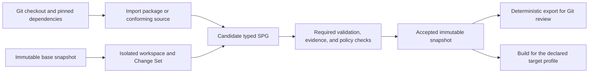
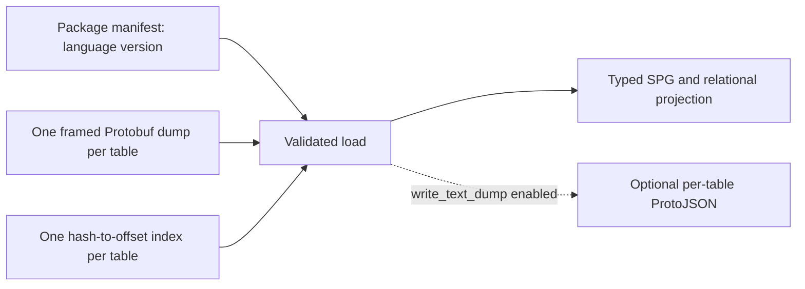
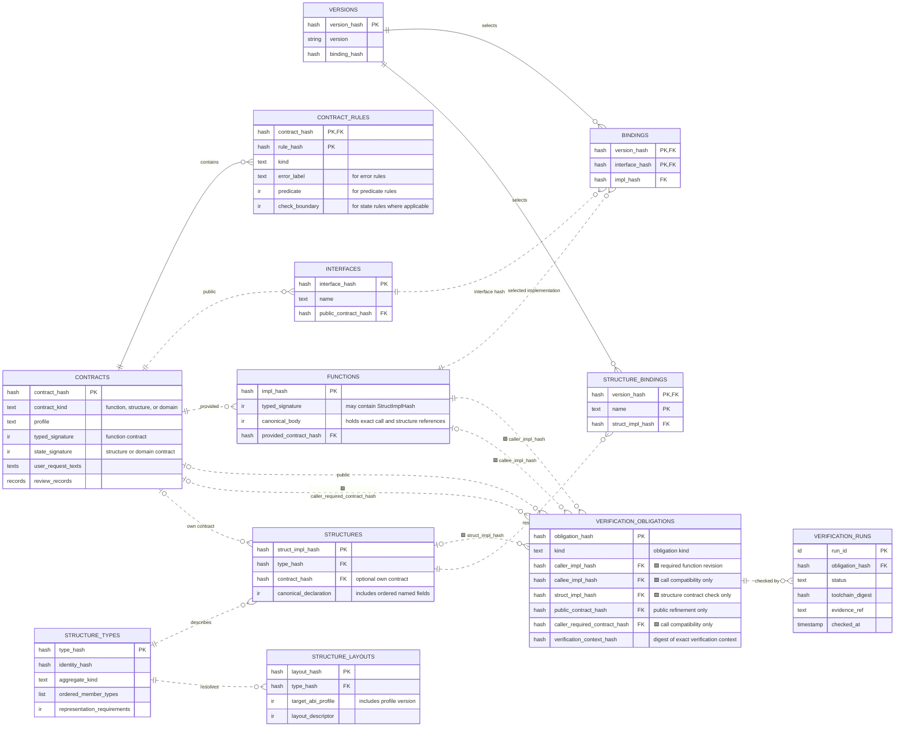

# LLMLang architecture RFC

- **Status** — Living draft based on accepted architecture decisions
- **Maintenance** — [ADR and RFC contribution rule](../CONTRIBUTING.md#keep-the-rfc-in-sync-with-adrs)

## Purpose and scope

LLMLang is a language and toolchain for developing software with coding agents. Its architecture lets people review the behavior a program is supposed to provide, agents propose changes to its semantic representation, and independent tools check those changes against explicit contracts. The Semantic Program Graph (SPG) is the shared typed representation of program objects and their relationships. This RFC describes how the accepted architecture fits together. Implementation and conformance are reported separately.

## From repository to accepted program

The diagram follows two ways to produce a candidate SPG. The Toolchain can reconstruct one from versioned inputs and pinned dependencies, or apply a structured Change Set to an immutable base Snapshot. Acceptance checks the candidate and its evidence before publishing a new Snapshot. Export produces repository files for that exact Snapshot. A subsequent Git commit or push has its own lifecycle. Compilation uses the selected Snapshot and the target profile. The diagram describes architecture rather than implementation coverage.

## Language, identity, and contracts

- **Source dialects.** A build declares dialect and frontend versions. Conforming dialects lower their supported constructs into the same typed SPG with the same observable semantics, exact call bindings and applicable semantic identities. Source locations and formatting can be retained for tooling. A renderer can emit a dialect for the subset it supports, with a reparse and equivalence check.
- **Immutable objects and calls.** Changes produce new semantic objects or component versions. `ImplHash` identifies a canonical implementation with its provided contract and hash-relevant dependencies. A caller retains its required contract reference. A resolved direct call pins its exact callee. A public interface can resolve by qualified name in a pinned catalog, but changing its concrete provider requires an explicit new binding and applicable evidence. The build rejects missing pins and incompatible calls. Build-time callable compatibility is scoped to one coherent Toolchain version.
- **Behavioral verification.** A public interface revision specifies the contract callers can rely on. Provider admission checks the callable signature and two distinct obligations. The body must satisfy the provided contract, and that contract must refine the public contract for the applicable profile and assumptions. Evidence binds to the exact revisions.
- **Structures and managed state.** Structures have named typed fields and a canonical member sequence. Identity Hash describes shape, Type Hash adds representation requirements, Layout Hash binds the resolved target layout, and Function ABI Hash describes the call boundary. Structure and domain contracts add state invariants and permitted transitions. All due obligations must hold together. Inconclusive static compatibility is rejected by default, with explicit profile-dependent options for compatibility analysis that preserve individual invariant obligations. A contract can defer a check to a defined boundary while intermediate state stays private. Managed-state commit publishes the whole verified change or retains the previous state. Applicable contract guarantees survive supported inheritance, composition, and template specialization.

## Development and storage

- **Git and semantic merge.** Git versions and distributes the authoritative program inputs. The content-addressed semantic store is reconstructible from the checkout and declared dependencies. Git IDs describe physical history, semantic hashes describe logical content, and action keys describe computations and their inputs. Merge compares base, ours, and theirs as semantic states. A Git driver can invoke the merge, and repository-wide validation gates acceptance. Ambiguous or invalid merges produce diagnostics.
- **Toolchain and agent access.** The transport-neutral Toolchain API owns semantic operations, errors and policy. Workspaces isolate changes against a base Snapshot. Change Sets carry typed operations, expected hashes, provenance and validation evidence. Optimistic concurrency rejects stale writes. The Toolchain enforces authorization and acceptance and starts as a modular monolith. MCP exposes operations and read-only views. Agent-facing SPG objects use JSON by default and refer to other graph objects by ID.

### Repository package format

A program package is a Git-tracked directory with a separate package manifest and declared dependencies. The manifest carries the required `language_version`. The loader reads it before table records and rejects missing, invalid, or unsupported versions. The repository profile defines the physical encodings, file names, and deterministic record order.

Each table in that profile has one binary dump and one companion index, including empty tables. A dump stores the table's Protobuf records in independently compressed frames, initially using LZ4. The index maps each Content Hash to the zero-based byte offset of its frame. The companion dump identifies the data file, and the frame header supplies the compressed length. The loader can consult a validated cache by hash before reading the payload. On a miss, it checks the frame bounds, decodes the record, and verifies its hash. Scanning verified records can reconstruct the index. A fixed repository profile produces identical package bytes for identical logical content.

The persistence library accepts `write_text_dump` on save and load. It defaults to `false`. When enabled, save exports the same Protobuf messages used to write each binary table, and load exports the validated decoded messages. Both emit one additional ProtoJSON file per table in record order. Load writes the text files to a separate output location. Text exports leave canonical package bytes and semantic identities unchanged.

### Relational SPG projection

The Toolchain builds the projection from validated canonical package inputs. Versions select exact interface implementations and structure declarations. A structure declaration stores its ordered named field types and can pin its own contract. Functions refer to exact structure declarations by `StructImplHash` in their signatures or bodies. Structural types share representation requirements and resolve layouts for particular target profiles.

Functions, structures, and domains share the contract and rule tables. Function contracts use typed callable signatures, while state contracts declare the typed variables used by invariants and transitions. State rules capture their check boundaries where applicable. Contract identity uses canonical rule sets, and source requests and signed review records remain attached as metadata.

The Toolchain derives call dependencies from canonical function bodies. Verification obligations identify the exact function through `caller_impl_hash`. Call compatibility also pins the callee and the contract required by the caller. A structure contract check pins the exact structure revision and binds the applicable state contracts, rules, and boundaries through the verification context. Public refinement pins the public contract. The provided function contract is resolved from the relevant function revision. Attempt records retain status and evidence by obligation hash. Admission uses evidence applicable to the exact context.

Every obligation requires `caller_impl_hash`. Call compatibility additionally requires `callee_impl_hash` and `caller_required_contract_hash`. Public refinement additionally requires `public_contract_hash`. Structure contract checks additionally require `struct_impl_hash`. Body conformance has no additional subject or contract reference. Kind-specific fields are absent for other obligation kinds. An obligation with no applicable result has unchecked status for admission.

The logical schema below covers all twelve tables. PK and FK denote primary and foreign keys. Multiple PK labels form a composite key. `hash` identifies a digest, `ir` a typed intermediate representation, and collection fields hold the listed values. Fields are required unless marked optional or restricted to an obligation or rule kind. The green marker identifies obligation fields added or renamed by the caller-scoped design.

## Verification, bootstrap, and native artifacts

- **Verification routes.** Typed obligations retain backend-independent meaning. The initial routes are Boogie with Z3 for supported automated obligations, Lean for supported kernel-checked proofs and cvc5 with Logos for supported certificate checks. TLA+ remains a candidate for bounded concurrent and progress models. Evidence records source and dependency revisions, assumptions, profile and tool versions. Reports distinguish proved and conditional claims, source-confirmed counterexamples, inconclusive or unsupported cases, tool errors and bounded results.
- **Compiler bootstrap.** Stage 0 is a Rust compiler for a declared LLMLang subset that emits Rust. It translates the LLMLang compiler sources for the Stage 1 build. Stage 1 rebuilds the same sources to obtain Stage 2. The bootstrap suite checks the self-hosted stages and their outputs.
- **Native interoperability.** Import OS or third-party libraries using explicit provider, ABI and linkage declarations. Compile exported LLMLang interfaces as native libraries for supported target profiles, starting from the target C ABI. Verify representation, callable ABI and provider provenance. Behavioral conformance requires its own evidence.
- **Embedded library contracts.** A supported shared-library build embeds `llmlang_contract` by default, with an explicit per-output opt-out. Its records describe each implemented public interface revision and its target ABI binding. The initial carriers are an ELF note, a PE resource, and a Mach-O section in each applicable slice. Embed before signing and check the final artifact so consumers can inspect contracts without running library code.

## Boundaries and open work

JSON through MCP, indexed Protobuf in Git packages, and `llmlang_contract` in native binaries belong to different boundaries. They serve agent-facing exchange, repository reconstruction, and native library inspection, respectively. Open work includes the complete language grammar, hash encodings, several runtime semantics including nested transactions and reentrancy, full target coverage, and validation of the database implementation and migration. The [scalar MVP] exercises a narrower profile. Broader conformance depends on the relevant semantics, implementation and evidence.

[scalar MVP]: https://github.com/aivibeflow/LLMLang/blob/53584d5089c05717c518cd4b5c3996b166f97d22/tools/llmlang_mvp/README.md

## Sources

- [ADR-014: Git repository representation and semantic merge](adr/014-git-semantic-merge.md)
- [ADR-015: Toolchain Server and semantic development API](adr/015-toolchain-server-semantic-api.md)
- [ADR-016 — Bootstrap the LLMLang compiler from source](adr/016-compiler-bootstrap.md)
- [ADR-017 — Default object format for agent interaction through MCP](adr/017-mcp-agent-object-format.md)
- [ADR-018 — Formal verification backends](adr/018-formal-verification-backends.md)
- [ADR-019 — Bidirectional native library interoperability](adr/019-bidirectional-native-library-abi.md)
- [ADR-020 — Immutable semantic objects and calls pinned by ImplHash](adr/020-immutable-objects-and-implhash-calls.md)
- [ADR-021 — Structures and target data layout](adr/021-structures-and-data-layout.md)
- [ADR-022 — Syntax dialects with shared semantics](adr/022-syntax-dialects-and-shared-semantics.md)
- [ADR-023 — Immutable components and single-version Toolchain compatibility](adr/023-immutable-components-and-toolchain-compatibility.md)
- [ADR-024 — Package directories and indexed Protobuf dumps](adr/024-package-directory-and-protobuf-dumps.md)
- [ADR-025 — Optional embedded library contracts](adr/025-optional-embedded-library-contract.md)
- [ADR-026 — Structure contracts and invariant verification](adr/026-structure-contracts-and-invariant-verification.md)
- [ADR-027 — Relational projection for the scalar SPG](adr/027-scalar-spg-relational-projection.md)
- [ADR-028 — Relational projection for structures](adr/028-structure-relational-projection.md)
- [ADR-029 — Caller-scoped verification obligations](adr/029-caller-scoped-verification-obligations.md)
- [ADR-030 — Per-table package dumps and optional JSON text dumps](adr/030-per-table-package-dumps.md)
