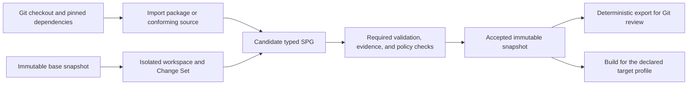
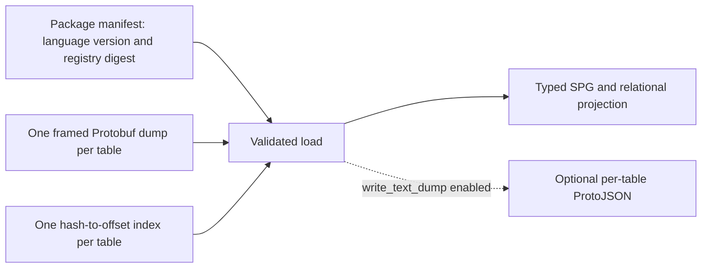
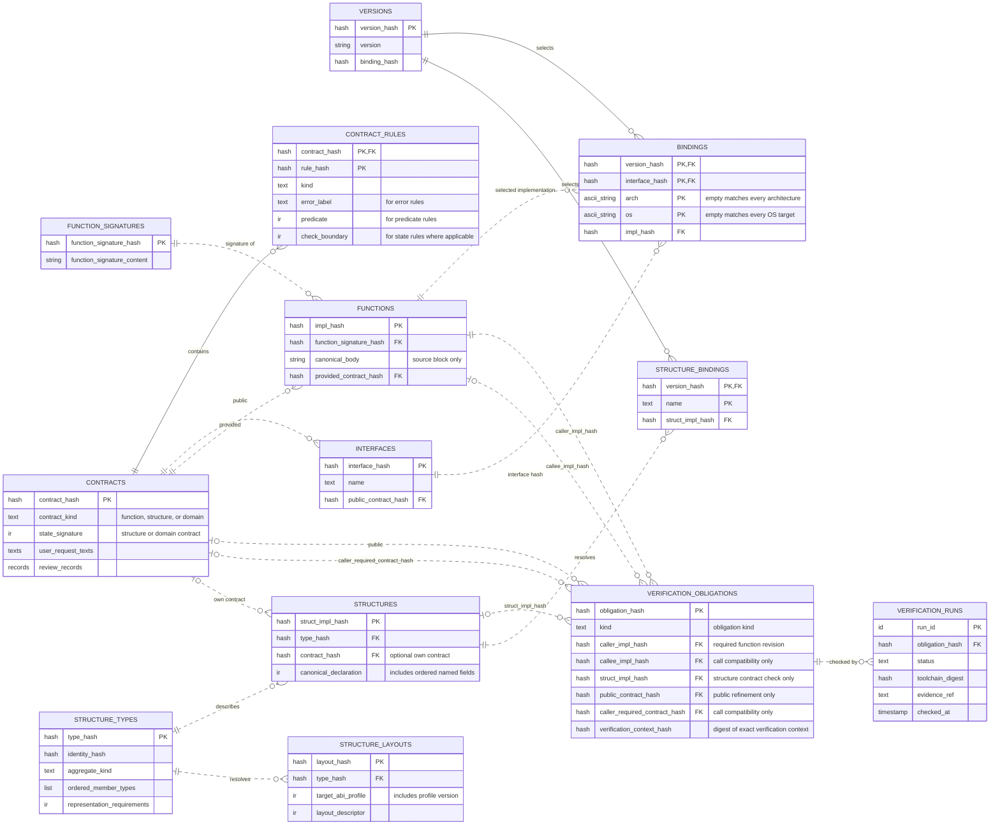

# LLMLang architecture RFC

- **Status** — Living draft based on accepted architecture decisions
- **Maintenance** — [ADR and RFC contribution rule](../CONTRIBUTING.md#keep-the-rfc-in-sync-with-adrs)

## Purpose and scope

LLMLang is a language and toolchain for developing software with coding agents. Its architecture lets people review the behavior a program is supposed to provide, agents propose changes to its semantic representation, and independent tools check those changes against explicit contracts. The Semantic Program Graph (SPG) is the shared typed representation of program objects and their relationships. This RFC describes how the accepted architecture fits together. Implementation and conformance are reported separately.

## From repository to accepted program

The diagram follows two ways to produce a candidate SPG. The Toolchain can reconstruct one from versioned inputs and pinned dependencies, or apply a structured Change Set to an immutable base Snapshot. Acceptance checks the candidate and its evidence before publishing a new Snapshot. Export produces repository files for that exact Snapshot. A subsequent Git commit or push has its own lifecycle. Compilation uses the selected Snapshot and the target profile. The diagram describes architecture rather than implementation coverage.

### Program entry points

A package is a program for the selected startup mode when the corresponding public interface has a valid binding for the build target in the selected snapshot and its implementation has a permitted signature. The binding pins the implementation by `ImplHash`. Ordinary startup performs the required runtime initialization and calls `main() -> ExitStatus` or `main(args: LaunchArgs) -> ExitStatus`. `LaunchArgs` is an ordered sequence of byte arguments and `ExitStatus` is numeric. Embedding and other modes that transfer control directly invoke `_entry` without additional LLMLang runtime initialization. The startup profile defines the `_entry` signature and calling convention.

## Language, identity, and contracts

- **Built-in functions.** Every LLMLang built-in function name starts with `builtin__`, with two underscores after `builtin`. For example, the system call built-in is named `builtin__syscall`. Only code in the package named `builtin` may reference or call a built-in function directly. The toolchain checks the owning package of each implementation, including dependency and unbound implementations. The `builtin` library wraps supported primitives in typed interfaces. Consumers call those interfaces through bindings and retain their required contracts.
- **Source dialects.** A build declares dialect and frontend versions. Conforming dialects lower their supported constructs into the same typed SPG with the same observable semantics, exact call bindings and applicable semantic identities. Source locations and formatting can be retained for tooling. A renderer can emit a dialect for the subset it supports, with a reparse and equivalence check.
- **Immutable objects and calls.** Changes produce new semantic objects or component versions. `ImplHash` identifies a canonical implementation with its provided contract and hash-relevant dependencies. A caller retains its required contract reference. A direct call pins an exact, platform-independent callee. A qualified public name resolves to an interface revision in a pinned version. The build selects its implementation through a binding for the target. The build rejects missing pins and incompatible calls. Build-time callable compatibility is scoped to one coherent Toolchain version.
- **Behavioral verification.** A public interface revision specifies the contract callers can rely on. Provider admission checks the callable signature and two distinct obligations. The body must satisfy the provided contract, and that contract must refine the public contract for the applicable profile and assumptions. Evidence binds to the exact revisions.
- **Structures and managed state.** Structures have named typed fields and a canonical member sequence. Identity Hash describes shape, Type Hash adds representation requirements, Layout Hash binds the resolved target layout, and Function ABI Hash describes the call boundary. Structure and domain contracts add state invariants and permitted transitions. All due obligations must hold together. Inconclusive static compatibility is rejected by default, with explicit profile-dependent options for compatibility analysis that preserve individual invariant obligations. A contract can defer a check to a defined boundary while intermediate state stays private. Managed-state commit publishes the whole verified change or retains the previous state. Applicable contract guarantees survive supported inheritance, composition, and template specialization.

### Composite language version

The language definition identifies the grammar, types, and semantics used to
interpret, validate, compile, and verify LLMLang artifacts.
`language-components.toml` defines the coordinate order with one nonempty
`components` array of unique identifiers matching `[a-z][a-z0-9_]*`.
The initial order is `syntax`, `core_semantics`, `type_system`,
`effects_execution`, and `modules_packages`. Registry changes require
review. New identifiers can only be appended, and every existing identifier
keeps its name, position, and meaning, including after retirement.

A version contains one coordinate per component of its registry snapshot.
Each coordinate is written as canonical decimal matching `0|[1-9][0-9]*`.
The coordinate identifies that component's immutable revision. The version
`1.3.2.1.0` selects revisions 1, 3, 2, 1, and 0 in the initial order. An
older tuple can be zero-extended for comparison when its registry is a
verified prefix of the newer one. Preserve the original registry identity
for provenance. Cross-version compatibility requires explicit, validated
evidence.

Compute the registry digest as SHA-256 over the ASCII bytes
`LLMLANG\0language-component-registry\0` followed by each identifier's
unsigned 32-bit big-endian byte length and ASCII bytes in registry order.
Each `\0` denotes a single zero byte. Encode the result as `sha256:`
followed by lowercase hexadecimal.

The language version and registry digest identify the language definition.
Toolchain identity, target profile, package release, standard-library
version, and repository encoding have separate lifecycles. Cached action
results record language version, registry digest, toolchain identity, and
any applicable target, configuration, and tool component identities.
Result-determining inputs belong in the Action Key. Proof evidence must
also apply to the exact obligation and its language context. Cache and
provenance fields do not themselves redefine semantic package or object
identities.

### Scalar function contracts

Scalar contracts use `I64`, `U64`, and `Bool` parameters and success
results. The `put_contract` operation takes rules. The `put_function`
operation takes a canonical signature string such as
`(value: I64) -> Bool`. The owning package's language definition selects
the signature grammar and type rules. For each contract application, the
checked function supplies the names and types available to its rules.
The same contract can apply to different signatures if all its rules
type-check in each context. Parameters exclude `result`, `quotient`, and the
`builtin__` prefix.

| Rule kind | Required payload | Meaning |
| --- | --- | --- |
| `requires` | `predicate` | Restricts admissible inputs. |
| `ensures` | `predicate` | Constrains a successful return on admissible inputs. |
| `error_declaration` | `error_label` | Declares a unique error label within the contract. |
| `error_guard` | `error_label`, `predicate` | Constrains when the declared error may occur. |

Predicates are expression strings or JSON Booleans. They can read
parameters, and `ensures` can also read the typed success value `result`.
The predicates for each clause group are conjoined, with an empty group
meaning true. For admitted inputs, an outcome is either a typed value that
satisfies the success clauses or a declared label whose guards hold. A guard
permits its error when true.

Predicates support decimal integer and `True` and `False` literals,
variables, parentheses, unary minus, `*`, `+`, `-`, `quotient(a, b)`,
comparisons, and `not`, `and`, and `or`. Equality and inequality require
matching operand types. Ordered comparisons and arithmetic require integers.
A comparison chain forms a conjunction of adjacent comparisons. At the function
boundary, `I64` and `U64` use their signed and unsigned 64-bit ranges. Predicate
arithmetic uses mathematical integers, and `quotient` truncates toward zero
and returns zero at a zero divisor. Program arithmetic can produce checked
errors independently of predicate arithmetic.

The derived proof input has schema `llmlang-contract-ir/scalar-v1`.
It contains ordered `parameters` with `name` and `type`, the success type
`returns`, Boolean term lists `requires` and `ensures`, and an `errors`
map from labels to Boolean guard lists. Terms carry an `op` and a `type`
of `Bool` or mathematical `Int`. Literals carry `value`, using decimal
strings for integer literals. Variables carry `name`. Operators carry
ordered `args`. Lowering expands comparison chains and flattens nested
conjunctions or disjunctions of the same kind. The verifier checks the
interface bounds separately.

The body must conform to its provided contract. At an export or exact call,
the public or caller-required precondition must imply the provided precondition,
and every outcome allowed by the provider on that domain must meet the
public or caller-required guarantees. Actual call arguments must meet the
pinned required precondition. Each checked input domain must be inhabited.
Boogie and Z3 check these obligations in the draft server. A reference
evaluator replays candidate counterexamples, and the revision-bound report
relates confirmed failures to the exact functions and contracts. A missing
or inconclusive proof supplies insufficient evidence for publication.

## Development and storage

- **Git and semantic merge.** Git versions and distributes the authoritative program inputs. The content-addressed semantic store is reconstructible from the checkout and declared dependencies. Git IDs describe physical history, semantic hashes describe logical content, and action keys describe computations and their inputs. Merge compares base, ours, and theirs as semantic states. A Git driver can invoke the merge, and repository-wide validation gates acceptance. Ambiguous or invalid merges produce diagnostics.
- **Toolchain and agent access.** The transport-neutral Toolchain API owns semantic operations, errors and policy. Workspaces isolate changes against a base Snapshot. Change Sets carry typed operations, expected hashes, provenance and validation evidence. Optimistic concurrency rejects stale writes. The Toolchain enforces authorization and acceptance and starts as a modular monolith. MCP exposes operations and read-only views. Agent-facing SPG objects use JSON by default and refer to other graph objects by ID.

### MVP package authoring through MCP

`llmlang-server` supports creating and editing a scalar package through its Toolchain API. The MCP adapter exposes structured JSON tools and read-only Resources for scoped graph objects, dependencies, and reports. `create_package` opens a workspace on an empty snapshot. `import_package` reconstructs a snapshot from its manifest and verified table files, and `open_workspace` opens an isolated view of that snapshot for editing. `inspect_workspace` returns the revision and current package selection. The v9 draft retains source-backed workspaces and snapshots across restart.

`apply_change_set` applies typed operations for versions, dependencies, contracts, implementations, interfaces, bindings, calls, and entry points. A batch can refer to objects created in the same request. The server checks the expected revision and object or binding preconditions, resolves references, and validates the complete candidate before advancing the revision. A failed batch leaves the workspace untouched. A retry with the same request and idempotency key returns the stored result.

`verify_workspace` provides a preview report. `commit_workspace` invokes verification on the exact requested revision and checks authorization, applicable review policy, and revision freshness before publication. Verification covers body conformance, public contract refinement, and exact call compatibility. Every successful commit publishes an immutable snapshot and writes its package directory to the configured destination. It returns the snapshot ID and package location. A failed commit preserves the previous package and accepted catalog. An interrupted commit must recover to a consistent package and catalog before either is served as committed. The MVP server enables per-table ProtoJSON by default on successful commits for debugging. Commit requires a source-backed workspace and verification for its profile. `build_package` builds a selected committed snapshot for a supported target. The package directory can be imported in a fresh server process and tracked in Git.

### Repository package format

A program package is a Git-tracked directory with a separate package manifest
and declared dependencies. The manifest selects the package's language
definition with two required string fields.

| Field | Meaning |
| --- | --- |
| `language_version` | Exact dot-separated version tuple for the identified registry snapshot. |
| `language_component_registry_digest` | Digest identifying the ordered language component registry snapshot. |

The loader resolves both fields before interpreting language-dependent records.
Each dependency supplies its own manifest. Missing fields, unknown registry
digests, malformed tuples, and unsupported combinations reject the load.
The repository profile defines the physical encodings, file names, and
deterministic record order. Repository profile v9 implements this manifest
format. Its migration maps the v6 and v7 draft version `0.1.0` to
`0.1.0.0.0` under the initial registry and rebuilds signature references
before regenerating managed packages.

Each table in that profile has one binary dump and one companion index, including empty tables. A dump stores the table's Protobuf records in independently compressed frames, initially using LZ4. The index maps each Content Hash to the zero-based byte offset of its frame. The companion dump identifies the data file, and the frame header supplies the compressed length. The loader can consult a validated cache by hash before reading the payload. On a miss, it checks the frame bounds, decodes the record, and verifies its hash. Scanning verified records can reconstruct the index. A fixed repository profile produces identical package bytes for identical logical content.

The function signature table has its own dump and companion index. In repository profile v9, `FunctionRecord.canonical_body` is a Protobuf `string` containing the source block. The corresponding ProtoJSON field is a JSON string. Scalar structured bodies stay in memory. When converting a package with inline signatures, validate the original records under their profile, produce canonical signature strings, and rebuild function rows with verified references. Publish the converted package only after checking the reconstructed typed signatures, implementation identities, and bindings.

The persistence library accepts `write_text_dump` on save and load. It defaults to `false`. When enabled, save exports the same Protobuf messages used to write each binary table, and load exports the validated decoded messages. Both emit one additional ProtoJSON file per table in record order. Load writes the text files to a separate output location. Text exports leave canonical package bytes and semantic identities unchanged.

### Relational SPG projection

The Toolchain builds the projection from validated canonical package inputs. Versions select exact structure declarations and provide the bindings used to select exact interface implementations for a build target. A structure declaration stores its ordered named field types and can pin its own contract. Functions refer to exact structure declarations by `StructImplHash` in their signatures or bodies. Structural types share representation requirements and resolve layouts for particular target profiles.

Each `FUNCTIONS` row references one `FUNCTION_SIGNATURES` row through `function_signature_hash`. The signature row stores `function_signature_content` as canonical text encoding ordered parameter names and types, the result type, and exact type references. Its primary key is a digest computed under the applicable signature encoding. In repository profile v9, the signature digest covers the canonical UTF-8 text, language version, and registry digest from the owning package. The signature text carries the parameter and result syntax, and the manifest supplies the grammar and type rules. Several functions can share one signature row. Reusing a hash requires a byte-for-byte match. Publish each function and its signature reference atomically.

`FUNCTIONS.canonical_body` in a stored package contains only the function's source block as a UTF-8 string. Verification obligations record resolved call pins. The Toolchain resolves the signature from the package or its pinned dependencies, verifies the hash and canonical text, and parses the text into a typed signature with validated type references. A missing signature or unresolved pin rejects the import. The recovered signature supplies parameter declarations for body checking and callable compatibility and participates in computing `ImplHash` from the reconstructed canonical implementation. The provided contract reference resolves to a function contract.

Each `INTERFACES` row stores a public name and a `public_contract_hash`
foreign key to a function contract. Its `interface_hash` identifies those
two values. The selected binding supplies the implementation and therefore
the callable signature for that build target. Different bindings of a
public interface may select different signatures. Validate the public
rules in the context of each bound implementation before accepting the
Change Set and prove refinement before publishing the package.

Functions, structures, and domains share the contract and rule tables.
Function contracts carry rules without a stored signature. The checked
implementation supplies the signature for its provided contract, its
bound public contract, and any contract required by a caller. State
contracts declare typed variables for invariants and transitions and set
check boundaries where applicable. Request texts and review records are
package metadata.

A scalar rule hash covers its kind and applicable payload fields under
`llmlang-server-rule-v1`. The contract hash covers `kind`, `state_signature`
(null for a function contract), `language_version`,
`language_component_registry_digest`, and lexicographically sorted distinct
rule hashes in `rules` under `llmlang-server-contract-v3`. The interface
hash uses `llmlang-server-interface-v1` with `name` and
`public_contract_hash`. These hashes are
lowercase hexadecimal SHA-256 over `llmlang-spg-content/v1\0` followed by
compact UTF-8 JSON of `{"key":DOMAIN,"content":OBJECT}`, with recursively
sorted object keys and preserved array order. Predicate spelling
participates in identity. The server reports typed Contract IR by
implementation hash and contract hash.

The Toolchain derives call dependencies from canonical function bodies. Verification obligations identify the exact function through `caller_impl_hash`. Call compatibility also pins the callee and the contract required by the caller. A structure contract check pins the exact structure revision and binds the applicable state contracts, rules, and boundaries through the verification context. Public refinement pins the public contract. The provided function contract is resolved from the relevant function revision. Attempt records retain status and evidence by obligation hash. Admission uses evidence applicable to the exact context.

Every obligation requires `caller_impl_hash`. Call compatibility additionally requires `callee_impl_hash` and `caller_required_contract_hash`. Public refinement additionally requires `public_contract_hash`. Structure contract checks additionally require `struct_impl_hash`. Body conformance has no additional subject or contract reference. Kind-specific fields are absent for other obligation kinds. An obligation with no applicable result has unchecked status for admission.

The logical schema below covers all thirteen tables. PK and FK denote primary and foreign keys. Multiple PK labels form a composite key. `hash` identifies a digest, `ir` a typed intermediate representation, and collection fields hold the listed values. Fields are required unless marked optional or restricted to an obligation or rule kind.

#### Platform-specific bindings

`BINDINGS` has the primary key `(version_hash, interface_hash, arch, os)`.
`version_hash`, `interface_hash`, and `impl_hash` reference `VERSIONS`,
`INTERFACES`, and `FUNCTIONS`, respectively. Each key is unique. A qualified
name identifies one interface revision per version across its binding rows.
The version's `binding_hash` covers both target columns and the implementation
hash of each row. Repository profile v9 stores both columns in Protobuf
fields 6 and 7 and includes both in the key used for the record Content Hash.

`arch` and `os` are required, case-sensitive ASCII strings. Each value must
fully match `[A-Za-z0-9_-]*`. Each empty string `""` matches any registered
value in its column. The build request supplies a nonempty registered target
pair. A binding with two nonempty values must use a registered pair. A binding
with one nonempty value must use a registered value from that column.

| `arch` | `os` |
| --- | --- |
| `x86_64` | `linux` |
| `aarch64` | `linux` |
| `i686` | `linux` |
| `x86_64` | `windows` |
| `aarch64` | `windows` |
| `aarch64` | `macos` |
| `x86_64` | `macos` |
| `aarch64` | `android` |
| `armv7` | `android` |
| `x86_64` | `android` |
| `i686` | `android` |
| `aarch64` | `ios` |
| `aarch64` | `ios-simulator` |
| `x86_64` | `ios-simulator` |

The `ios` target identifies an iPhone device. The `ios-simulator` target
selects the simulator's compiler target and SDK.

For public entry points and interface calls, the Toolchain selects an exact
pair first, then a row with one matching nonempty value, then a row with both
columns empty. If an architecture-only row and an OS-only row both match and
no exact row exists, the build reports ambiguity with both keys. If no row
matches, the build reports the missing implementation with its interface,
version, architecture, and OS. An invalid selected row fails validation at
its priority. Each provider must match the callable signature and refine the
public contract on every supported target covered by the row.

An interface call retains its pinned version context, interface revision,
and required contract until the build selects a binding. The call
compatibility obligation records the exact `callee_impl_hash`, and its
verification context identifies the build target, its ABI, and the selected binding.
Evidence is reusable only when it applies to those inputs. The same source
snapshot can therefore resolve an interface call to different providers
when built for different targets. Direct calls retain their exact callee
across targets.

## Verification, bootstrap, and native artifacts

- **Verification routes.** Typed obligations retain backend-independent meaning. The initial routes are Boogie with Z3 for supported automated obligations, Lean for supported kernel-checked proofs and cvc5 with Logos for supported certificate checks. TLA+ remains a candidate for bounded concurrent and progress models. Evidence records source and dependency revisions, assumptions, profile and tool versions. Reports distinguish proved and conditional claims, source-confirmed counterexamples, inconclusive or unsupported cases, tool errors and bounded results.
- **Compiler bootstrap.** Stage 0 is a Rust compiler for a declared LLMLang subset that emits Rust. It translates the LLMLang compiler sources for the Stage 1 build. Stage 1 rebuilds the same sources to obtain Stage 2. The bootstrap suite checks the self-hosted stages and their outputs.
- **Native interoperability.** Import OS or third-party libraries using explicit provider, ABI and linkage declarations. Compile exported LLMLang interfaces as native libraries for supported target profiles, starting from the target C ABI. Verify representation, callable ABI and provider provenance. Behavioral conformance requires its own evidence.
- **Embedded library contracts.** A supported shared-library build embeds `llmlang_contract` by default, with an explicit per-output opt-out. Its records describe each implemented public interface revision and its target ABI binding. The initial carriers are an ELF note, a PE resource, and a Mach-O section in each applicable slice. Embed before signing and check the final artifact so consumers can inspect contracts without running library code.

## Boundaries and open work

JSON through MCP, indexed Protobuf in Git packages, and `llmlang_contract` in native binaries belong to different boundaries. They serve agent-facing exchange, repository reconstruction, and native library inspection, respectively. Open work includes the complete language grammar, hash encodings, several runtime semantics including nested transactions and reentrancy, full target coverage, and validation of the database implementation and migration. The [draft server](server/README.md) supports contract proofs for the checked scalar fragment. The [standalone scalar MVP release] records earlier evidence for the CLI and its Stage 0 compiler. Broader conformance depends on the relevant semantics, implementation and evidence.

The repository profile must specify the exact signature text grammar, digest encoding, and physical record format.

### Proposed unified compilation and contract verification

The owning manifest's language version and registry digest select the
semantics of source and contract rules. A common typed SPG would supply
the compiler and the verifier with the same bodies, outcome semantics, and
exact call relationships. The compiler would lower the reachable functions
through one package path using the requested target and bindings. The
verifier would check body conformance, refinement, and applicable state
invariants against those same semantics, and report unsupported
constructs or provider evidence at the affected obligation.

The v9 draft implements the removal of the semantic `profile` column and
package creation argument and migrates the existing packages. The same
checked scalar body feeds proof generation and Rust code generation in
the package compiler. Unsupported obligations name their functions and
contracts. General proof support for external effects and mutable state
remains open.

[standalone scalar MVP release]: https://github.com/aivibeflow/LLMLang/blob/138ba12f754967c9fbc6c0adbf29fc8d591836a3/draft/llmlang_mvp/RELEASE.md

## Sources

- [ADR-014: Git repository representation and semantic merge](adr/014-git-semantic-merge.md)
- [ADR-015: Toolchain Server and semantic development API](adr/015-toolchain-server-semantic-api.md)
- [ADR-016 — Bootstrap the LLMLang compiler from source](adr/016-compiler-bootstrap.md)
- [ADR-017 — Default object format for agent interaction through MCP](adr/017-mcp-agent-object-format.md)
- [ADR-018 — Formal verification backends](adr/018-formal-verification-backends.md)
- [ADR-019 — Bidirectional native library interoperability](adr/019-bidirectional-native-library-abi.md)
- [ADR-020 — Immutable semantic objects and calls pinned by ImplHash](adr/020-immutable-objects-and-implhash-calls.md)
- [ADR-021 — Structures and target data layout](adr/021-structures-and-data-layout.md)
- [ADR-022 — Syntax dialects with shared semantics](adr/022-syntax-dialects-and-shared-semantics.md)
- [ADR-023 — Immutable components and single-version Toolchain compatibility](adr/023-immutable-components-and-toolchain-compatibility.md)
- [ADR-024 — Package directories and indexed Protobuf dumps](adr/024-package-directory-and-protobuf-dumps.md)
- [ADR-025 — Optional embedded library contracts](adr/025-optional-embedded-library-contract.md)
- [ADR-026 — Structure contracts and invariant verification](adr/026-structure-contracts-and-invariant-verification.md)
- [ADR-027 — Relational projection for the scalar SPG](adr/027-scalar-spg-relational-projection.md)
- [ADR-028 — Relational projection for structures](adr/028-structure-relational-projection.md)
- [ADR-029 — Caller-scoped verification obligations](adr/029-caller-scoped-verification-obligations.md)
- [ADR-030 — Per-table package dumps and optional JSON text dumps](adr/030-per-table-package-dumps.md)
- [ADR-031 — LLMLang Server and MCP package authoring for the MVP](adr/031-llmlang-server-mcp-package-authoring.md)
- [ADR-032 — Program packages with bound `main` or `_entry` interfaces](adr/032-program-package-main.md)
- [ADR-033 — Store function signatures in a separate table](adr/033-function-signature-storage.md)
- [ADR-034 — Prefix built-in function names with `builtin__`](adr/034-built-in-function-prefix.md)
- [ADR-035 — Select platform-specific implementations through bindings](adr/035-platform-specific-bindings.md)
- [ADR-036 — Split binding targets into architecture and operating system](adr/036-canonical-platform-identifiers.md)
- [ADR-037 — Define the scalar function contract language](adr/037-scalar-contract-language.md)
- [ADR-038 — Version LLMLang through language components](adr/038-composite-language-version.md)
- [ADR-039 — Compile and verify one versioned LLMLang program (proposed)](adr/039-unified-compilation-and-contract-verification.md)
