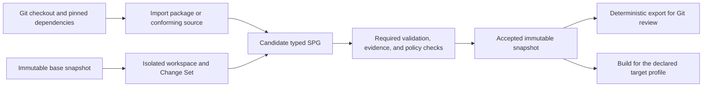

# LLMLang architecture RFC

- **Status** — Living draft based on accepted architecture decisions
- **Source baseline** — [LLMLang main at `53584d50`](https://github.com/aivibeflow/LLMLang/tree/53584d5089c05717c518cd4b5c3996b166f97d22), covering ADR-014 through ADR-026
- **Maintenance** — [ADR and RFC contribution rule](../CONTRIBUTING.md#keep-the-rfc-in-sync-with-adrs)

## Purpose and scope

LLMLang is a language and toolchain for developing software with coding agents. Its architecture lets people review the behavior a program is supposed to provide, agents propose changes to its semantic representation, and independent tools check those changes against explicit contracts. The Semantic Program Graph (SPG) is the shared typed representation of program objects and their relationships. This RFC explains how the accepted architecture fits together. The linked ADRs carry the precise decision scopes and boundaries. Status in an ADR records an architecture decision. Implementation and conformance are reported separately. [ADR-014] · [ADR-015] · [ADR-020]

## From repository to accepted program

The diagram follows two ways to produce a candidate SPG. The Toolchain can reconstruct one from versioned inputs and pinned dependencies, or apply a structured Change Set to an immutable base Snapshot. Acceptance checks the candidate and its evidence before publishing a new Snapshot. Export produces repository files for that exact Snapshot. A subsequent Git commit or push has its own lifecycle. Compilation uses the selected Snapshot and the target profile. The diagram describes architecture rather than implementation coverage. [ADR-014] · [ADR-015] · [ADR-018] · [ADR-019] · [ADR-022] · [ADR-024]

## Language, identity, and contracts

- **Source dialects.** A build declares dialect and frontend versions. Conforming dialects lower their supported constructs into the same typed SPG with the same observable semantics, exact call bindings and applicable semantic identities. Source locations and formatting can be retained for tooling. A renderer can emit a dialect for the subset it supports, with a reparse and equivalence check. [ADR-022]
- **Immutable objects and calls.** Changes produce new semantic objects or component versions. `ImplHash` identifies a canonical implementation with its provided contract and hash-relevant dependencies. A caller retains its required contract reference. A resolved direct call pins its exact callee. A public interface can resolve by qualified name in a pinned catalog, but changing its concrete provider requires an explicit new binding and applicable evidence. The build rejects missing pins and incompatible calls. Build-time callable compatibility is scoped to one coherent Toolchain version. [ADR-020] · [ADR-023]
- **Behavioral verification.** A public interface revision specifies the contract callers can rely on. Provider admission checks the callable signature and two distinct obligations. The body must satisfy the provided contract, and that contract must refine the public contract for the applicable profile and assumptions. Evidence binds to the exact revisions. [ADR-020] · [ADR-018]
- **Structures and managed state.** Structures have named typed fields and a canonical member sequence. Identity Hash describes shape, Type Hash adds representation requirements, Layout Hash binds the resolved target layout, and Function ABI Hash describes the call boundary. Structure and domain contracts add state invariants and permitted transitions. All due obligations must hold together. Inconclusive static compatibility is rejected by default, with explicit profile-dependent options for compatibility analysis that preserve individual invariant obligations. A contract can defer a check to a defined boundary while intermediate state stays private. Managed-state commit publishes the whole verified change or retains the previous state. Applicable contract guarantees survive supported inheritance, composition, and template specialization. [ADR-021] · [ADR-026]

## Development and storage

- **Git and semantic merge.** Git versions and distributes the authoritative program inputs. The content-addressed semantic store is reconstructible from the checkout and declared dependencies. Git IDs describe physical history, semantic hashes describe logical content, and action keys describe computations and their inputs. Merge compares base, ours, and theirs as semantic states. A Git driver can invoke the merge, and repository-wide validation gates acceptance. Ambiguous or invalid merges produce diagnostics. [ADR-014]
- **Package representation.** A program package is a directory containing data dumps, separate indexes and declared dependencies. Dumps contain framed, independently compressed Protobuf records, initially using LZ4. Index entries expose offsets, lengths and Content Hashes before decode. A validated cache can supply the object by hash. The reader verifies decoded content and can rebuild an index by scanning the frames. A versioned repository profile defines reproducible bytes for a given logical package. [ADR-024]
- **Scalar SPG relational projection.** The derived schema indexes versioned interface bindings and call dependencies. A call dependency pins the caller, callee, and required contract. Scalar contract identity uses a canonical set of typed rules, and the contract retains source requests and signed review records as metadata. Verification evidence is keyed by its exact obligation and context. Database implementation and migration validation remain open. [ADR-027](adr/027-scalar-spg-relational-projection.md)
- **Toolchain and agent access.** The transport-neutral Toolchain API owns semantic operations, errors and policy. Workspaces isolate changes against a base Snapshot. Change Sets carry typed operations, expected hashes, provenance and validation evidence. Optimistic concurrency rejects stale writes. The Toolchain enforces authorization and acceptance and starts as a modular monolith. MCP exposes operations and read-only views. Agent-facing SPG objects use JSON by default and refer to other graph objects by ID. [ADR-015] · [ADR-017]

## Verification, bootstrap, and native artifacts

- **Verification routes.** Typed obligations retain backend-independent meaning. The initial routes are Boogie with Z3 for supported automated obligations, Lean for supported kernel-checked proofs and cvc5 with Logos for supported certificate checks. TLA+ remains a candidate for bounded concurrent and progress models. Evidence records source and dependency revisions, assumptions, profile and tool versions. Reports distinguish proved and conditional claims, source-confirmed counterexamples, inconclusive or unsupported cases, tool errors and bounded results. [ADR-018]
- **Compiler bootstrap.** Stage 0 is a Rust compiler for a declared LLMLang subset that emits Rust. It translates the LLMLang compiler sources for the Stage 1 build. Stage 1 rebuilds the same sources to obtain Stage 2. The bootstrap suite checks the self-hosted stages and their outputs. [ADR-016]
- **Native interoperability.** Import OS or third-party libraries using explicit provider, ABI and linkage declarations. Compile exported LLMLang interfaces as native libraries for supported target profiles, starting from the target C ABI. Verify representation, callable ABI and provider provenance. Behavioral conformance requires its own evidence. [ADR-019] · [ADR-021]
- **Embedded library contracts.** A supported shared-library build embeds `llmlang_contract` by default, with an explicit per-output opt-out. Its records describe each implemented public interface revision and its target ABI binding. The initial carriers are an ELF note, a PE resource, and a Mach-O section in each applicable slice. Embed before signing and check the final artifact so consumers can inspect contracts without running library code. [ADR-025]

## Boundaries and open work

JSON through MCP, indexed Protobuf in Git packages, and `llmlang_contract` in native binaries belong to different boundaries. They serve agent-facing exchange, repository reconstruction, and native library inspection, respectively. The ADRs leave open the complete language grammar, hash encodings, several runtime semantics including nested transactions and reentrancy, and full target coverage. The [scalar MVP] exercises a narrower profile. Broader conformance depends on the relevant semantics, implementation and evidence. [ADR-017] · [ADR-021] · [ADR-023] · [ADR-024] · [ADR-025] · [ADR-026]

[ADR-014]: https://github.com/aivibeflow/LLMLang/blob/53584d5089c05717c518cd4b5c3996b166f97d22/draft/adr/014-git-semantic-merge.md
[ADR-015]: https://github.com/aivibeflow/LLMLang/blob/53584d5089c05717c518cd4b5c3996b166f97d22/draft/adr/015-toolchain-server-semantic-api.md
[ADR-016]: https://github.com/aivibeflow/LLMLang/blob/53584d5089c05717c518cd4b5c3996b166f97d22/draft/adr/016-compiler-bootstrap.md
[ADR-017]: https://github.com/aivibeflow/LLMLang/blob/53584d5089c05717c518cd4b5c3996b166f97d22/draft/adr/017-mcp-agent-object-format.md
[ADR-018]: https://github.com/aivibeflow/LLMLang/blob/53584d5089c05717c518cd4b5c3996b166f97d22/draft/adr/018-formal-verification-backends.md
[ADR-019]: https://github.com/aivibeflow/LLMLang/blob/53584d5089c05717c518cd4b5c3996b166f97d22/draft/adr/019-bidirectional-native-library-abi.md
[ADR-020]: https://github.com/aivibeflow/LLMLang/blob/53584d5089c05717c518cd4b5c3996b166f97d22/draft/adr/020-immutable-objects-and-implhash-calls.md
[ADR-021]: https://github.com/aivibeflow/LLMLang/blob/53584d5089c05717c518cd4b5c3996b166f97d22/draft/adr/021-structures-and-data-layout.md
[ADR-022]: https://github.com/aivibeflow/LLMLang/blob/53584d5089c05717c518cd4b5c3996b166f97d22/draft/adr/022-syntax-dialects-and-shared-semantics.md
[ADR-023]: https://github.com/aivibeflow/LLMLang/blob/53584d5089c05717c518cd4b5c3996b166f97d22/draft/adr/023-immutable-components-and-toolchain-compatibility.md
[ADR-024]: https://github.com/aivibeflow/LLMLang/blob/53584d5089c05717c518cd4b5c3996b166f97d22/draft/adr/024-package-directory-and-protobuf-dumps.md
[ADR-025]: https://github.com/aivibeflow/LLMLang/blob/53584d5089c05717c518cd4b5c3996b166f97d22/draft/adr/025-optional-embedded-library-contract.md
[ADR-026]: https://github.com/aivibeflow/LLMLang/blob/53584d5089c05717c518cd4b5c3996b166f97d22/draft/adr/026-structure-contracts-and-invariant-verification.md
[scalar MVP]: https://github.com/aivibeflow/LLMLang/blob/53584d5089c05717c518cd4b5c3996b166f97d22/tools/llmlang_mvp/README.md
