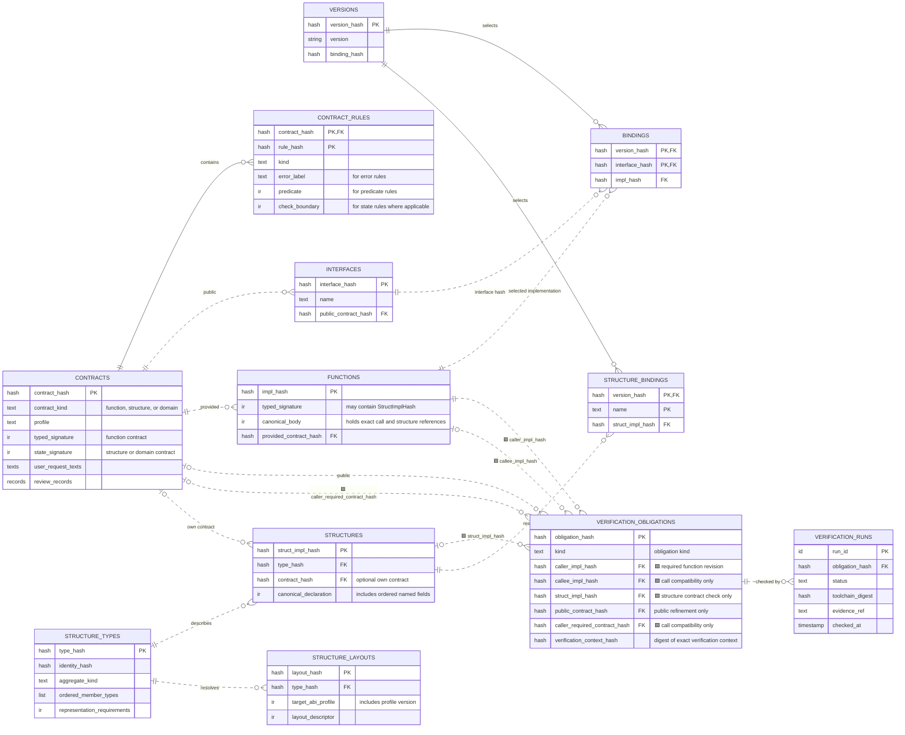

# SPG relational schema for caller-scoped verification

This is the full logical schema for [ADR-029](adr/029-caller-scoped-verification-obligations.md) on the [ADR-028 baseline](adr/028-structure-relational-projection.md). The green marker 🟩 identifies new or renamed obligation fields. The schema contains twelve tables. PK and FK mean primary and foreign key. Multiple PK labels in one box form a composite key.

