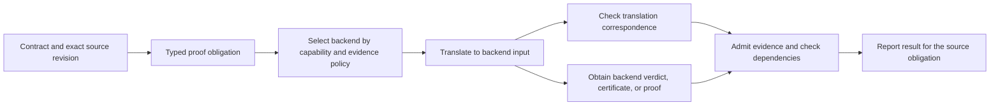

# ADR-018 — Formal verification backends

- **Status** — Accepted
- **Date** — 2026-11-25
- **Decision owners** — LLMLang project
- **Scope** — Toolchain backend selection and evidence admission for the initial verification profile

## Context

LLMLang needs automatic contract checks for sequential code and checkable proofs for semantic claims such as preservation through translation. A proof obligation is a specific claim derived from a contract and the semantics of its implementation. Each obligation may require a different kind of evidence.

RT-07 compared one modular call across Boogie + Z3, Lean, and cvc5 + Logos. It demonstrated the difference between checking a caller under an assumed contract, checking the exact provider body, and composing a closed proof. The study covers a specific example. The LLMLang adapters and comparative performance remain to be evaluated.

## Decision

Keep the meaning of contracts and typed obligations independent of the backend. Select a backend per obligation using its versioned capabilities and the evidence required by policy.

| Obligation | Backend | Initial scope |
|---|---|---|
| Preconditions, postconditions, arithmetic and overflow | **Boogie + Z3** | Sequential scalar code with an explicit numeric model. Boogie generates verification conditions and Z3 solves them. |
| Loop invariants, read/write frames and termination | **Boogie + Z3** | Add after scalar contracts. Require declared invariants and frames where relevant. Generate termination obligations for an explicit bounded-below, strictly decreasing measure. |
| Modular calls | **Boogie + Z3**, **Lean** | Check the caller under the callee contract and check the exact provider separately. Use Lean when a kernel-checked composition proof is required. |
| Semantic equivalence, translation and ordered effects | **Lean** | Check proofs against the reference semantics for one supported fragment. |
| Ownership, cleanup, recursive termination and resource bounds | **Lean** | Expand as the relevant semantic and cost models become available. |
| Arithmetic or relational claims requiring a checked certificate | **cvc5 + Logos** | Use a separate route for supported formulas and bind each checked certificate to the exact query. |
| Concurrent protocols and progress | **TLA+** (candidate) | Evaluate with explicit model bounds and scheduling assumptions. |

The diagram shows the selected workflow. A backend result supports a source claim only when the translation correspondence and evidence meet policy. Record the exact subject revision, numeric or execution profile, assumptions, provider and dependency identities, backend and translator versions, and evidence artifact.

Report a claim as proved once its mandatory obligations and assumptions are discharged. Report open premises as conditional when the implication has been established. Confirm a counterexample against source semantics before reporting a source violation. Use `UNKNOWN` for inconclusive runs, including exhausted solver limits, `UNSUPPORTED` when no eligible route exists, and `ERROR` for tool or pipeline failures. Report finite-model results with their bounds.

## Alternatives and consequences

A Boogie + Z3-only profile would simplify the initial integration and rely on the admitted translator and solver. A Lean-only profile would give a uniform kernel-checking interface and require more proof construction and semantic modeling for routine checks. The selected combination gives routine checks and semantic proofs separate routes. It requires validating each translation, documenting its trust assumptions, and defining how evidence composes.

## Rollout and reconsideration

Start with Boogie + Z3 for scalar contracts and overflow. Check one shared family in Lean against the same source claim, then add an annotated loop and a modular call with a separate provider obligation. Validate positive and negative cases, including an incorrect provider, a translation mismatch, an unresolved premise, unsupported semantics, and solver-limit exhaustion.

Revisit backend priorities after comparing obligation coverage, counterexample quality, inconclusive outcomes, and verification cost on the same fixtures with pinned tools and limits. Exact adapter versions, comparative performance, and the production trust policy remain open.

## References

- [LLMLang verification coverage and backend matrix](../../research/formal-verification/VERIFICATION-COVERAGE.ru.md)
- [RT-07 modular proof closure comparison and replay](../../research/formal-verification/RT-07/RT-07-DAFNY-MODULAR-PROOF-CLOSURE-2026-11-25.md)
- [RT-33 backend selection and orchestration](../../research/formal-verification/RT-33/RT-33-PROOF-BACKEND-SELECTION-AND-ORCHESTRATION.md)
- [LL-028 backend-independent proof selection](../../PLAN.md#ll-028--define-backend-independent-proof-selection-and-evidence-orchestration)
