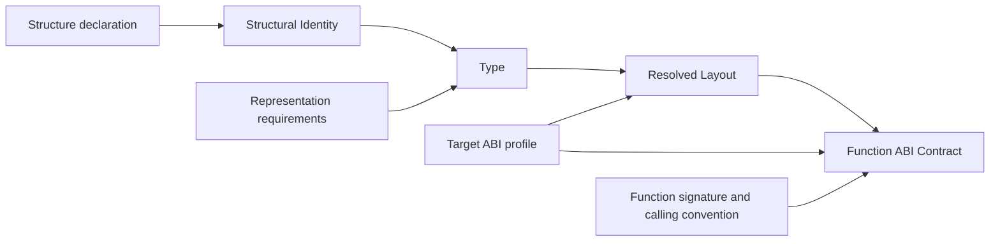

# ADR-021 — Structures and target data layout

- **Status** — Accepted
- **Accepted** — 2026-11-25
- **Date** — 2026-11-25
- **Decision owners** — LLMLang project
- **Scope** — Named-field structures, structural identity, memory representation, and native ABI boundaries
- **Related decisions** — [ADR-019 on native library interoperability](019-bidirectional-native-library-abi.md) · [ADR-020 on immutable objects and implementation identity](020-immutable-objects-and-implhash-calls.md)

## Context

A structure groups typed fields. LLMLang needs a portable description of its shape, while a compiler and native libraries need to agree about the bytes used to store or pass a value. Two structures with the same fields may have different target layouts or representation requirements. Even identical memory layout leaves the calling convention and the way a function passes or returns the structure to be checked separately.

The terminology follows the [glossary](../GLOSSARY.md#type-identity-and-abi-terms) and the [RT-09 structural identity and ABI proposal](../../research/compiler-and-translation/RT-09/RT-09-STRUCTURAL-TYPE-IDENTITY-LAYOUT-AND-C-ABI-PROPOSAL.md). Native research provides bounded evidence on [record layout](../../research/compiler-and-translation/RT-13/RT-13-NATIVE-RECORD-LAYOUT-2026-11-25.md) and [by-value calling conventions](../../research/compiler-and-translation/RT-13/RT-13-BY-VALUE-CALL-ABI-2026-11-25.md).

## Decision

1. **Define structures with named, typed fields and a canonical member sequence.** Field names support construction and access. Structural Identity describes the aggregate kind and ordered member types independently of field names and type aliases. Retain names in the declarations and references that use them. Preserve evaluation order wherever the language makes it observable, including effectful field initializers.
2. **Declare representation requirements as part of the Type.** A structure can use the default representation or request a supported representation such as the target C representation. Explicit alignment and packing, where supported, are type requirements. The compiler rejects unsupported combinations. Default layout gives the compiler freedom within the language's observable semantics. Code that requires a particular layout must declare the applicable representation requirement.
3. **Derive Layout for the selected target profile.** Resolve field offsets, total size, alignment, internal and trailing padding, and array stride. Record the resolved layout for layout-sensitive operations and validation. Padding is outside the set of logical fields and carries no portable field value. Access to a packed field must use a lowering valid for its actual alignment on the target.
4. **Check the function ABI separately.** At an import or export boundary, validate the target profile, the aggregate layout, and how the signature passes or returns the value, including register, stack, or indirect passing. Retain the foreign declaration's identity where its language requires it. Use an explicit adapter when supported representations differ. Reject unsupported or incompatible boundaries.
5. **Track identity at the right level.** Identity Hash identifies the structural shape. Type Hash includes representation requirements. Layout Hash binds the Type to the target profile and resolved physical descriptor. Function ABI Hash covers the call boundary. A layout or ABI change affects implementation identity or build evidence where that change is a relevant dependency under ADR-020.

**Hash dependency order:** Identity Hash → Type Hash → Layout Hash. Type Hash combines structural identity with representation requirements. Layout Hash combines Type Hash, the target ABI profile identity and version, and the resolved layout descriptor. A change to representation requirements changes Type Hash without changing the structural shape. A change to the ABI profile changes Layout Hash even if the resolved offsets match.

The diagram shows which inputs determine each description. The same structural shape can produce different Types, and the same Type can resolve to different Layouts on different profiles. Layout describes a stored value. The function signature, calling convention, and target rules determine how it crosses a call boundary.

## Alternatives and consequences

A single fixed layout for all structures would simplify some low-level assumptions but constrain target-specific representations and optimization. Using the host language's default layout would simplify initial code generation while making the public representation depend on that backend. This separation allows portable structure semantics and explicit native layouts at the cost of target-specific layout computation and conformance checks.

Wire and persistence encodings, unions, bit-field rules, and the canonical byte encoding of hashes require separate specifications. The proposal leaves the surface syntax and supported alignment and packing forms open.

## Implementation validation

- Compare size, alignment, field offsets, and array stride with an independent native compiler for a pinned C ABI profile. Include nested structures and cases with internal and trailing padding.
- Exercise import and export by value and by pointer with independently built callers and callees. Include a negative case where the layout matches but the calling convention differs.
- Check that changing a representation requirement changes Type identity without changing the shape. Check that changing the target profile changes the layout identity where applicable and prevents reuse of incompatible ABI evidence.
- Check that physical field placement preserves observable initialization order. For profiles that admit packing, validate correct unaligned access or rejection.
