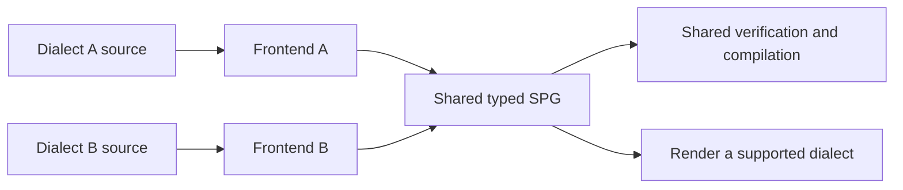

# ADR-022 — Syntax dialects with shared semantics

- **Status** — Accepted
- **Accepted** — 2026-11-25
- **Date** — 2026-11-25
- **Decision owners** — LLMLang project
- **Scope** — Source syntax dialects, frontend conformance, and semantic identity
- **Related research** — [RT-31 layer boundaries](../../research/language-design/RT-31/RT-31-SYNTAX-AND-SEMANTIC-LAYER-BOUNDARIES-2026-11-25.md) · [Cross-profile SPG comparison](../../research/language-design/RT-31/RT-31-CROSS-PROFILE-SPG-2026-11-24.md) · [Frontend contract](../../research/language-design/RT-31/RT-31-FRONTEND-CONTRACT-2026-11-25.md)

## Context

Humans and agents may benefit from different ways of writing LLMLang programs. Several syntaxes can share the same type rules, contracts, and execution model if their frontends map source constructs to one semantic representation. Here a dialect is a versioned source syntax with a declared subset of an LLMLang semantic profile. The semantic profile specifies which constructs are available and what they mean.

## Decision

1. **Allow multiple source dialects for one semantic profile.** A dialect may change notation and offer syntactic sugar whose desugaring is defined in shared constructs. It may support a declared subset. Unsupported constructs and ambiguous inputs require diagnostics. A change to language behavior requires a change to the shared semantic specification.
2. **Make the dialect and its version explicit in the build inputs.** Each frontend parses its declared dialect and produces a typed Semantic Program Graph (SPG) under the shared rules for name resolution, types, effects, contracts, and bindings. A build may use multiple conforming dialects through the same module and interface model.
3. **Preserve observable behavior and semantic identity.** With the semantic profile and relevant build inputs fixed, alternate spellings of the same canonical semantic object produce the same semantic identity, including the same `ImplHash` where applicable. Preserve exact call bindings and observable behavior, including evaluation order, effects, and errors. Source spans, comments, and formatting may be retained for diagnostics and editing. Include dialect and frontend versions in the parsing action key and provenance.
4. **Translate through the shared representation.** Where a target dialect can express the source constructs, a renderer may emit that dialect. Reparse and validate the emitted program against the original canonical SPG. Report constructs the target dialect cannot express. Formatting and comment preservation depend on source tooling.

The diagram shows two frontend paths meeting at the typed SPG. Verification and compilation operate on the shared graph. Rendering is available where the selected dialect covers that graph.

## Alternatives and consequences

A single fixed syntax reduces frontend and tooling work. Multiple syntax dialects allow different authoring conventions while keeping one semantic model, at the cost of versioning, diagnostics, rendering, and conformance tests for each dialect. Variants with different execution rules require their own semantic profiles. This ADR leaves the default syntax and first supported dialects open.

## Implementation validation

- Parse equivalent programs in at least two dialects with pinned frontends and build inputs. Compare canonical SPG, bindings, semantic hashes, and reference observations.
- Include negative controls that alter precedence, binding, evaluation order, errors, or effects. Check that the frontend surfaces the change or rejects the input.
- Render and reparse across dialects for their shared subset. Check diagnostics for unsupported constructs, unknown dialect versions, and ambiguous input.
