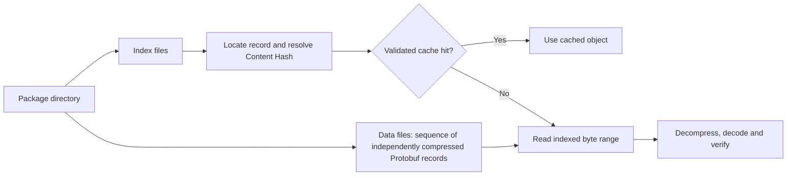

# ADR-024 — Package directories and indexed Protobuf dumps

- **Status** — Accepted
- **Date** — 2026-11-26
- **Decision owners** — LLMLang project
- **Scope** — Authoritative package representation in the repository

## Context

LLMLang needs a repository representation that can reconstruct a program from a checkout, aggregate many Semantic Program Graph (SPG) objects into a small number of files, and locate an individual object without decoding the preceding records. Git remains the authoritative source for the program and its checked-in package metadata. [ADR-014](014-git-semantic-merge.md)

## Decision

1. **A program is stored in a package.** A package is represented by a directory in the repository. Its files include data dumps and separate indexes for those dumps. A package can declare dependencies on other packages.
2. **Data files store sequences of compressed Protocol Buffers (Protobuf) records.** A record represents one stored SPG object. The Toolchain serializes the record as a Protobuf message, compresses it independently, and writes it in a frame with an explicit boundary. Each record must be independently readable and decompressible. The initial compression codec is LZ4.
3. **Indexes locate and identify records before payload access.** An index lookup yields the data file, byte offset, compressed length, and Content Hash for the requested object. The Toolchain can look up the hash in a validated cache before reading the record. On a miss, it reads the indexed range, decompresses and decodes the record, and verifies its logical content against the indexed hash.
4. **The package directory carries enough information to reconstruct the committed state.** The Toolchain validates that indexes describe the selected data files. Framing allows a sequential scan and deterministic index rebuild when an index is missing or invalid. If the data or declared dependencies cannot be verified, import fails explicitly.
5. **Physical format and semantic identity have separate roles.** A versioned repository profile defines deterministic export, including record order, framing, compression and index bytes. For the same logical package and profile, export is byte-identical. File paths, offsets and compressed bytes do not define SPG identities.

The diagram shows package reads. The index identifies the record and its location before the Toolchain opens the payload range. Independent framing also allows different ranges of the same data file to be read in parallel.

## Alternatives and consequences

Indexed JSONL offers direct human inspection. Indexed CBOR produced a smaller Git pack and a lower median restoration time in the synthetic RT-27 comparison. Protobuf gives the selected repository representation an explicit numbered-field schema and a typed record interface. Independent record compression supports bounded reads. The Toolchain provides a readable semantic diff for review. [RT-27 codec comparison](../../research/toolchain-and-collaboration/RT-27/RT-27-DUMP-FORMAT-COMPARISON.md) · [RT-27 LZ4 comparison](../../research/toolchain-and-collaboration/RT-27/RT-27-DUMP-FORMAT-LZ4.md)

The data format specification still needs the exact Protobuf schemas, frame fields and limits, LZ4 framing and encoder profile, index encoding, naming and partitioning rules, and version migration rules. A manifest schema and package identity policy are governed by the package design. The transport format for MCP remains governed by ADR-017. [RT-12 package design](../../research/packages-and-ecosystem/RT-12/PACKAGE-MANIFEST-AND-IDENTITY.md) · [ADR-017](017-mcp-agent-object-format.md)

## Implementation checks

Verify byte-identical export under a fixed profile, clean-checkout reconstruction, index rebuild and corruption rejection, cache hits without payload reads, and independent reads of multiple record ranges in one data file. Check canonical encoding across the supported Toolchain implementations and measure the resulting format on representative SPG workloads. [RT-27 storage requirements](../../research/toolchain-and-collaboration/RT-27/RT-27-SPG-REPOSITORY-STORAGE-FORMAT-REQUIREMENTS.md)
