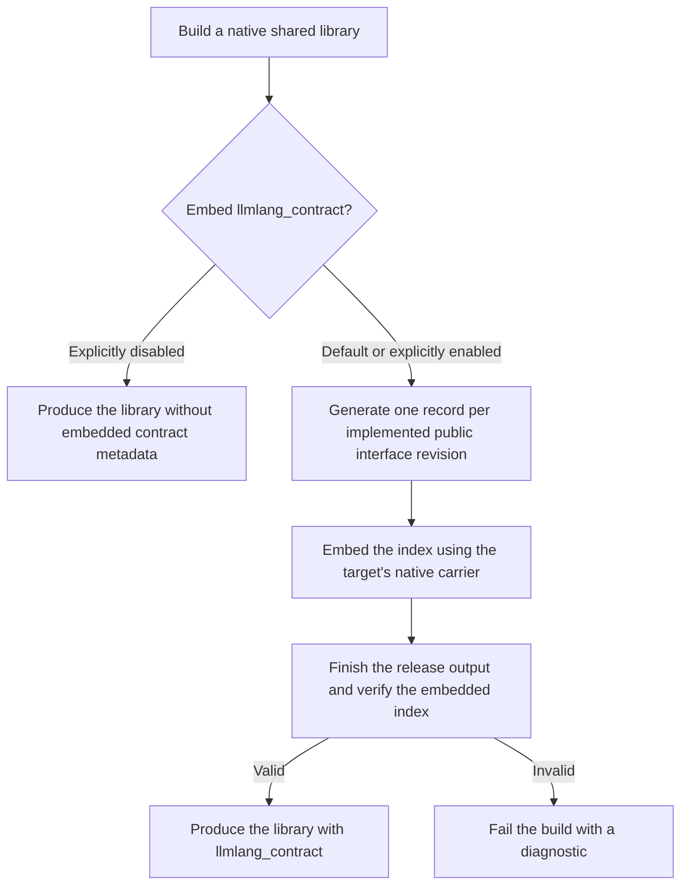

# ADR-025 — Optional embedded library contracts

- **Status** — Accepted
- **Accepted** — 2026-11-26
- **Date** — 2026-11-26
- **Decision owners** — LLMLang project
- **Scope** — Native shared-library build outputs
- **Related architecture** — [ADR-019 — Bidirectional native library interoperability](019-bidirectional-native-library-abi.md)
- **Related research** — [RT-12 — Public contracts inside native shared libraries](../../research/packages-and-ecosystem/RT-12/RT-12-NATIVE-LIBRARY-CONTRACT-CARRIERS-2026-11-26.md)
- **Related design question** — [LL-022 — Package content, index, and dynamic-provider model](../../PLAN.md#ll-022--define-the-package-content-index-and-dynamic-provider-model)

## Context

A consumer may receive a shared library as a standalone file and need to inspect the contracts of its public interfaces before loading its code. Native binary formats provide places to store arbitrary bytes, while LLMLang supplies the contract and its meaning. RT-12 recovered the same two interface records from ELF, PE and Mach-O fixtures. Distributors may choose to publish contracts separately or distribute a library without this metadata.

## Decision

**The LLMLang build toolchain must embed `llmlang_contract` by default in each supported native shared-library output.** Build authors can explicitly disable embedding per library output.

1. When enabled, embed one index with a record for every public interface revision the build implements. Each record identifies the interface revision, includes the public contract and the public definitions needed to interpret it offline, and identifies how its operations bind to the target application binary interface (ABI). The build derives the records from the same interface inventory and declarations it uses to build the library.
2. Store `llmlang_contract` as metadata in the native library file. The logical name is shared across platforms. The initial carriers are an ELF note for Linux `.so`, a PE `RCDATA` resource for Windows `.dll`, and a Mach-O section for macOS `.dylib`. In a universal Mach-O library, each architecture slice carries the records and bindings for that slice.
3. Embed before signing and verify the metadata in the final output after any release transformations. An enabled build fails with a diagnostic if the target lacks support, the interface inventory is incomplete, or the final file lacks valid embedded metadata.
4. When explicitly disabled, produce the library without `llmlang_contract`. Toggling the setting changes the artifact bytes and build cache key. Public exports, the callable ABI and contract identity are independent of the packaging choice.

The diagram shows the two paths for a supported target. The default path checks the final artifact so that a strip or packaging step cannot silently remove the contract.

## Alternatives and consequences

Always embedding the index would make every artifact self-describing and would require every distribution to carry the contract bytes. Sidecar-only publication allows separate delivery and requires the consumer to obtain and match a second artifact. Embedding by default lets consumers inspect a standalone library in the usual build. An explicit opt-out lets build authors omit the metadata for a particular distribution.

A reader can extract the declared contract before loading library code. A successfully extracted contract describes the publisher's claims. Evidence of implementation conformance is checked separately. The build option's exact CLI or manifest syntax, the serialized metadata schema and locator IDs, and support for static archives and additional targets require separate specification. The RT-12 fixture checks carrier feasibility. Toolchain implementation, native signing validation and platform release coverage remain to be verified.
