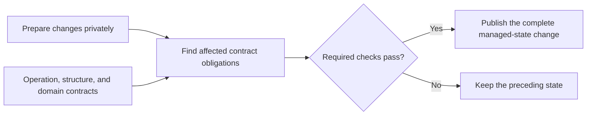

# ADR-026 — Structure contracts and invariant verification

- **Status** — Accepted
- **Accepted** — 2026-11-26
- **Date** — 2026-11-26
- **Decision owners** — LLMLang project
- **Scope** — Behavioral contracts for managed structures and their runtime state
- **Related architecture** — [ADR-021 — Structures and target data layout](021-structures-and-data-layout.md)
- **Related features** — [F-REQ-003–006 and F-LANG-006–012](../../FEATURE-REGISTRY.md)

## Context

Several functions may create or modify values of the same structure. Some operations must update multiple related values before their result is consistent. LLMLang needs a declaration shared by those functions that describes valid state, legal transitions, and when each check is due. This decision draws on the [structure contract model](../../research/toolchain-and-collaboration/RT-20/STRUCTURE-CONTRACTS-AND-ATOMIC-COMMIT-VERIFICATION.md) and the [inheritance and composition model](../../research/packages-and-ecosystem/RT-12/STRUCTURE-INHERITANCE-COMPOSITION-AND-TEMPLATE-SPECIALIZATION.md).

## Decision

1. **Attach behavioral contracts to structure declarations.** A contract can define invariants over fields and related managed instances, permitted transitions, and when to check each invariant. An invariant is a predicate that must hold at its applicable check boundary. A domain contract can express rules spanning several structures, such as agreement between a balance and its transaction history. External assumptions such as service availability belong in operation or interaction contracts.
2. **Check both the operation and its affected structures.** An ordinary function may update several structures where ownership, borrowing, and authority permit. Verify the function's own preconditions, postconditions and effects alongside the applicable structure obligations. Field visibility and invariant verification serve separate purposes. Establish applicable invariants before exposing a newly constructed instance as valid.
3. **Combine applicable invariants and retain their provenance.** All obligations that are due must hold together. Reject proven contradictions. If static compatibility analysis is inconclusive, reject by default. A contract may explicitly request runtime compatibility checking or disable compatibility analysis where the supported profile permits it. Individual invariant obligations still apply. Equivalent declarations remain independently traceable and may share proof evidence when equivalence and evidence applicability are established.
4. **Allow explicit deferral and verify before atomic publication.** A contract may defer a check to an explicit boundary, such as return from a function, completion of an enclosing operation, or commit of a managed-state transaction. A deferred violation may exist in private preparation state. Any applicable invariant must hold whenever that state can be observed through a callback or by a concurrent reader. Use conservative dependency analysis to identify all affected obligations, including cross-structure rules. At a transaction commit, publish the entire verified change or keep the preceding state. Stage irreversible external effects until verification succeeds in the default profile. Atomicity across external systems requires a separate protocol.
5. **Preserve guarantees through structure composition.** When a profile supports inheritance, a child satisfies all inherited guarantees and may add compatible obligations. An embedded component retains its own contract, and its enclosing structure may add relationships involving that component. A template contract applies to every specialization, which may add compatible requirements while preserving the template guarantees.

The diagram illustrates a multi-structure update at a transaction boundary. A bank transfer can prepare changes to two balances and a transaction record in private. Publication requires the account invariants, the domain consistency rule, and the operation contract to hold together.

## Alternatives and boundaries

Operation-only contracts require every mutating entry point to restate or reference shared obligations. Constructor and method encapsulation can centralize checks, with a narrower mutation interface. Checking all invariants on every write simplifies timing and can rule out valid multi-step updates. The chosen model permits coordinated updates and requires explicit observation boundaries and conservative dependency tracking.

The surface syntax, effect and observation model, supported check boundaries, proof calculus, and runtime implementation remain open. In particular, nested transactions, aliases, reentrant callbacks, isolation, and recovery require explicit semantics. The commit described here applies to managed runtime state. Git publication and native ABI layout follow their own specifications.

## Validation before claiming support

- Check construction, direct and indirect mutation, contradictory and unknown compatibility, and preservation of declarations and evidence across inheritance, composition, and specialization.
- Exercise valid deferred updates, observable invalid intermediate states, and failed commits. Include independently valid writes that jointly violate an invariant.
- Use the bounded [callback study](../../research/language-design/RT-04/RT-04-CALLBACK-CONTRACT-INVARIANT-2026-11-25.md) and the [runtime commit review](../../research/research-management/RT-00/RT-00-B-COMPONENT-IMMUTABILITY-AND-RUNTIME-COMMIT-2026-11-25.md) as starting cases. They cover particular observation and publication failures. End-to-end LLMLang validation is pending.
