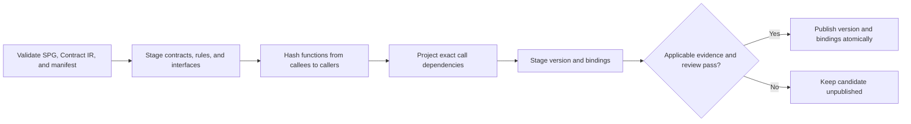
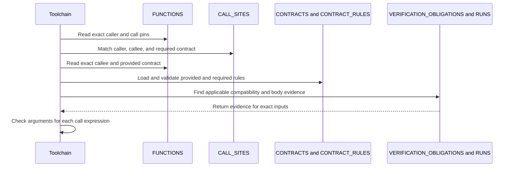

# ADR-027 — Relational projection for the scalar SPG

- **Status** — Accepted
- **Accepted** — 2026-11-26
- **Date** — 2026-11-26
- **Decision owners** — LLMLang project
- **Scope** — Logical database schema, data resolution, and evidence for the scalar MVP
- **Design sources** — [ER diagram](../../research/semantic-representation/RT-35/MVP-RELATIONAL-SCHEMA-DIAGRAM.md) · [Earlier relational candidate](../../research/semantic-representation/RT-35/PREFERRED-FUNCTION-RELATIONAL-SCHEMA.json) · [ADR-020 on immutable objects and exact calls](https://github.com/aivibeflow/LLMLang/blob/090a89668a669c2bf8f676855ac1df1701bf65b7/draft/adr/020-immutable-objects-and-implhash-calls.md) · [ADR-024 on repository packages](https://github.com/aivibeflow/LLMLang/blob/090a89668a669c2bf8f676855ac1df1701bf65b7/draft/adr/024-package-directory-and-protobuf-dumps.md)

## Context and scope

The Toolchain needs to find the implementation behind an exported name, identify every caller of a pinned implementation, verify the precise behavioral guarantees consumed by each caller, and reproduce an approval. The scalar MVP already supplies a typed Semantic Program Graph (SPG), Contract IR, a binding manifest, verifier reports, and signed review receipts. The earlier relational candidate groups dependencies by caller and contract and records one current verification state. The proposed projection indexes the exact callee as well, retains separate proof runs, and stores user requests and review records with contracts. The repository package and canonical SPG remain the authoritative build inputs. [Scalar Contract IR](https://github.com/aivibeflow/LLMLang/blob/090a89668a669c2bf8f676855ac1df1701bf65b7/tools/llmlang_mvp/CONTRACT-IR.md) · [MVP release evidence](https://github.com/aivibeflow/LLMLang/blob/090a89668a669c2bf8f676855ac1df1701bf65b7/tools/llmlang_mvp/RELEASE.md)

A **pin** is an exact hash reference. The **public contract** belongs to an interface. The **provided contract** belongs to an implementation. The **required contract** records what the caller expects from a dependency. These roles can point to the same contract value. The initial profile covers scalar, acyclic direct calls. Separate inner functions without public interfaces are supported by the proposed schema. The current MVP verifier expects a public and provided contract pair for every function. [Current verifier](https://github.com/aivibeflow/LLMLang/blob/090a89668a669c2bf8f676855ac1df1701bf65b7/tools/llmlang_mvp/verify.py#L246-L269)

## Decision

Use the nine tables described below as a relational projection. Build it from validated artifacts and use it for exact resolution, dependency navigation, and evidence lookup. Store individual call expressions and their arguments in the canonical body. Store one database edge for each distinct caller, callee, and required contract. Represent a scalar contract by its profile, signature, and set of normalized rules. Keep source texts and review records on the contract row.

## Tables and fields

PK means primary key and FK means foreign key. All fields are required unless marked optional. Collection fields can be empty. Types describe logical values. Physical SQL types and indexes are open. [Entity–relationship diagram](../../research/semantic-representation/RT-35/MVP-RELATIONAL-SCHEMA-DIAGRAM.md#entityrelationship-diagram)

### VERSIONS

| Field | Purpose |
|---|---|
| `version_hash` | PK. Compute `hash(version)` from the version string using the version identity domain. |
| `version` | Exact string supplied for a published version. Its meaning and uniqueness are scoped to a project catalog. |
| `binding_hash` | Digest identifying the exact binding manifest for the version. The manifest or its canonical inputs must be available so the digest can be verified and the selection reconstructed. |

Publishing a different selection requires a new version string. Reimporting the same version and manifest is idempotent. Reusing a version string with a different manifest is a conflict. Reachability from the selected public bindings through `CALL_SITES` identifies internal dependencies in this profile. An additional build root must be explicitly selected by the build input.

### INTERFACES

| Field | Purpose |
|---|---|
| `interface_hash` | PK. Identifies the exact interface declaration, including its name and public contract under the applicable identity encoding. |
| `name` | Catalog lookup name. Use the qualified name where the profile supports one. The same name can occur on multiple historical interface rows. |
| `public_contract_hash` | FK to `CONTRACTS.contract_hash`. Identifies the behavioral guarantees published with this interface. |

At most one interface with a given name can be selected in a single version. Check this across the join with `BINDINGS` at import. Changing the public contract creates a new interface hash.

### FUNCTIONS

This table describes the in-memory scalar projection. The repository dump stores source bodies according to ADR-033.

| Field | Purpose |
|---|---|
| `impl_hash` | PK. Identifies the typed body, provided contract, and exact hash-relevant dependencies. |
| `typed_signature` | Ordered parameter declarations and result type used to check calls and contract attachment. |
| `canonical_body` | Typed SPG body. Each resolved call records its callee pin and required contract pin, with its argument expressions. |
| `provided_contract_hash` | FK to `CONTRACTS.contract_hash`. Identifies the exact behavior the implementation claims to provide. |

Changing a pinned requirement or callee changes the caller's canonical body and consequently its `impl_hash`. In the acyclic profile, compute implementation hashes from callees toward callers.

### CONTRACTS

| Field | Purpose |
|---|---|
| `contract_hash` | PK. Digest of the profile, typed signature, and sorted unique rule hashes using a versioned canonical encoding. |
| `profile` | Semantic profile used to interpret the signature and rule predicates. |
| `typed_signature` | Ordered parameter names and types and the result type. It defines the binders that rules may use. |
| `user_request_texts` | Verbatim originating requests or conditions. Retain multiple originals when they normalize to the same contract. |
| `review_records` | Collection of review records with the reviewed version hash, exact packet bytes and digest, and signed decisions with reviewer, key identity, decision, and signature. |

Source texts and review records are metadata outside the semantic hash. Import merges distinct metadata idempotently. Semantic identity or successful proof alone cannot establish approval of a particular user statement.

### CONTRACT_RULES

| Field | Purpose |
|---|---|
| `contract_hash` | Part of PK and FK to `CONTRACTS`. Owns the rule. |
| `rule_hash` | Part of PK. Digest of the normalized kind, applicable error label, and typed predicate when present. |
| `kind` | `requires`, `ensures`, `error_declaration`, or `error_guard`. |
| `error_label` | Required for error declarations and guards. A guard must name a declaration in the same contract. Absent for other kinds. |
| `predicate` | Canonical typed Boolean expression for a precondition, postcondition, or error guard. Absent for an error declaration. |

Use `(contract_hash, rule_hash)` as the PK. A declared error with no guards still has a row, preserving the scalar IR's empty-conjunction behavior. Canonicalize rules independently, deduplicate identical normalized rules, and sort hash bytes before hashing the contract. The order of signature parameters and operators' operands follows the profile. Swapping top-level clauses preserves the proposed contract hash. Moving a predicate from a precondition to a postcondition changes its rule hash. Logical equivalence between different predicates would require a separate proof.

### BINDINGS

| Field | Purpose |
|---|---|
| `version_hash` | Part of PK and FK to `VERSIONS`. Selects the catalog context. |
| `interface_hash` | Part of PK and FK to `INTERFACES`. Selects the exact public declaration. |
| `impl_hash` | FK to `FUNCTIONS`. Selects the exact implementation admitted for that interface in this version. |

The PK `(version_hash, interface_hash)` selects one provider. Check callable signature compatibility, body conformance, and refinement against the exact public contract before publishing a binding as admitted.

### CALL_SITES

| Field | Purpose |
|---|---|
| `caller_impl_hash` | Part of PK and FK to `FUNCTIONS`. Identifies the implementation whose canonical body owns the dependency. |
| `callee_impl_hash` | Part of PK and FK to `FUNCTIONS`. Identifies the pinned implementation that will be invoked. |
| `required_contract_hash` | Part of PK and FK to `CONTRACTS`. Identifies the behavioral requirement the caller relies on for this dependency. |

The three columns form the PK. Two calls from one implementation to the same callee with the same requirement give one row. A different requirement gives a distinct edge. Extract the complete edge set from the typed body and compare it with the stored projection. Runtime execution and argument-level proof obligations use the underlying call expressions.

### VERIFICATION_OBLIGATIONS

| Field | Purpose |
|---|---|
| `obligation_hash` | PK. Digest over obligation kind, exact subject and relevant contracts, and the verification context. |
| `kind` | `body_conformance`, `public_refinement`, or `call_compatibility`. |
| `subject_impl_hash` | FK to `FUNCTIONS`. Identifies the checked implementation. For call compatibility this is the callee. |
| `provided_contract_hash` | FK to `CONTRACTS`. Must equal the subject's provided contract. |
| `public_contract_hash` | FK to `CONTRACTS`, present only for public refinement. |
| `required_contract_hash` | FK to `CONTRACTS`, present only for call compatibility. |
| `verification_context_hash` | Digest of the reproducible context, including semantic profile, assumptions, and the exact dependency or binding premises consumed by the check. Retain the context payload with the relevant verification input or evidence artifact. |

Body conformance leaves both comparison-contract fields empty. For each refinement kind the applicable comparison field is required and the other is absent. Canonical context encodings retain only the relevant inputs. A body proof that consumes call contracts must record those exact premises. A call compatibility proof can be reused across callers if its subject, contracts, profile, and assumptions match.

### VERIFICATION_RUNS

| Field | Purpose |
|---|---|
| `run_id` | PK. Identifies a recorded attempt. |
| `obligation_hash` | FK to `VERIFICATION_OBLIGATIONS`. Identifies the obligation being checked. |
| `status` | Result under the verifier profile, such as proved, conditional, disproved, inconclusive, unsupported, or tool error. Keep empirical results distinguishable from proofs. |
| `toolchain_digest` | Digest of the actual translator and checker identities, versions, and applicable configuration. |
| `evidence_ref` | Exact report, certificate, proof, or diagnostic artifact reference. An admission claim requires its applicable evidence to be available. |
| `checked_at` | Time the attempt finished, used for audit and ordering runs. |

Multiple attempts can belong to one obligation. Admission uses a run accepted by the applicable evidence policy. Timestamps alone establish no applicability.

## Data resolution and write sequences

### 1. Normalize, import, and publish a program version

1. Read the immutable SPG, Contract IR, and manifest. Check versions, exact digests, and the manifest's name selections. Keep original inputs for reproducibility.
2. Type-check each contract. Build rule values by kind, validate error declarations and guards, and deduplicate and sort rule hashes. Compare canonical content on hash reuse. Stage `CONTRACTS` and `CONTRACT_RULES` together and attach available original requests.
3. Stage `INTERFACES` from names and public contracts. Visit the acyclic call graph from leaves toward roots. For each function, read its provided contract and resolve the callee and required-contract pins before computing `impl_hash`. Stage the function with its canonical body.
4. Walk each canonical body and stage the unique `CALL_SITES` triples. Verify the complete outgoing edge set and reject missing targets or requirements. Check that public resolutions agree with the candidate manifest.
5. Stage `VERSIONS` and `BINDINGS` using the verified manifest digest. Check name uniqueness and run the body, binding, and dependency checks described below. Publish the version and its bindings in one transaction after applicable verification and review gates pass. On failure, the candidate version stays unpublished. Other admitted versions retain their exact selections.

The diagram shows the write order as logical stages. An implementation can share immutable rows between versions while publishing the new selection atomically.

### 2. Resolve a public name

1. Look up `VERSIONS` by the selected version's hash and verify the exact version string when supplied. Use its manifest to establish the catalog scope.
2. Join `BINDINGS` to `INTERFACES` in that version and filter by name. Reject zero or multiple matches. Keep the selected interface and implementation hashes.
3. Read the public contract from `INTERFACES` and the provided contract from the bound `FUNCTIONS` row. Load their rules from `CONTRACT_RULES` and verify their identities. Check the callable signature.
4. Resolve applicable body and public refinement evidence in `VERIFICATION_OBLIGATIONS` and `VERIFICATION_RUNS`. Return the exact interface, contracts, and implementation. A call lowered through this interface must agree with that implementation pin.

### 3. Resolve a pinned call and verify compatibility

1. Read the caller in `FUNCTIONS` by `caller_impl_hash`, examine the call expression, and read both explicit pins from the canonical body. Match its triple in `CALL_SITES`. A private direct call resolves from these pins and can use the callee's provided contract as its explicit requirement. A public call also validates the selected binding through the preceding sequence.
2. Read `FUNCTIONS[callee_impl_hash]` for the callee signature and `provided_contract_hash`. Get the required hash from the dependency edge. Load both `CONTRACTS` rows and their `CONTRACT_RULES`.
3. Check the callable signature. Then check that the provided contract accepts every input admitted by the required contract and that its admitted outcomes meet the required guarantees on those inputs, within the declared scalar profile and assumptions. Look up the exact `call_compatibility` obligation and an applicable run or obtain fresh evidence.
4. Verify the caller body using the required contract as the call assumption. Check each call expression's arguments against its precondition even when several expressions share one dependency edge. Track the callee body evidence separately. Reuse public refinement evidence for the comparison when both contract roles identify the same value and the proof covers the same subject, profile, and assumptions.

The sequence illustrates the database reads for a compatibility check. Successful public binding admission and caller compatibility can share evidence under matching inputs.

### 4. Record a verification run

1. Read the subject function and its provided contract. For public refinement, read the public contract through the exact interface and binding. For call compatibility, use the required contract from the exact dependency edge.
2. Read any dependency premises needed for the body check. Canonicalize the obligation context and find or insert its exact `VERIFICATION_OBLIGATIONS` row.
3. Run the eligible verifier and preserve the input and evidence artifacts, then append a `VERIFICATION_RUNS` row with the actual toolchain digest and status. When reading later, verify the artifact and recheck that the obligation and policy still apply. Changed inputs resolve to a different obligation or require new evidence under the applicable policy.

### 5. Record and validate a signed review

1. Resolve the version and applicable bindings, read all reviewed contracts and rules, and collect source-input digests and scenario results. Preserve the exact bytes presented to the reviewer. Include verbatim request text in those bytes when it is part of the material being approved.
2. After signing, recompute the packet digest and verify the decision against the configured reviewer and public key. Store the packet and signed decision in each applicable contract's `review_records`, with the version hash and scope retained in the packet. Preserve the same packet bytes when a packet covers multiple contracts.
3. On build admission, read the contract's records and find the applicable approval by exact packet digest, trusted identity, and context. A different request, scenario set, or binding can require a fresh packet. Check verifier evidence through the obligation and run tables.

### 6. Publish a replacement or inspect its impact

1. From a changed callee, read incoming `CALL_SITES` rows by `callee_impl_hash` and public selections from `BINDINGS` by `impl_hash`. For a particular version, start with that version's bound roots and traverse exact outgoing edges to filter reachable callers.
2. To migrate a caller, load its required contracts, check each replacement against those exact requirements, and update the intended canonical call pins. Compute new caller hashes and propagate changed callee references toward roots. Old callers and their proofs continue to address their original pins.
3. Publish revised bindings under a new version string. A public-contract-only change yields a new interface identity and may retain the provider hash. A caller keeps its old required contract until it explicitly adopts the new requirement. Evidence is assessed against the resulting exact subjects and contexts.

For example, if `calculate` calls the same `add` implementation twice under contract `C1`, there is one triple `(calculate_hash, add_hash, C1)`. Both argument lists remain in the body. A third call with requirement `C2` adds a second triple and a distinct compatibility obligation when applicable.

## Migration, alternatives, and validation

The current MVP hashes ordered contract clauses and derives required call contracts from the old binding manifest. Verify those inputs under the existing hash rules first. Then derive the proposed set-based contract hashes, resolve each required contract from the exact imported manifest, and compute new caller hashes with the explicit requirement pins. Keep original digests and verified artifact references as import provenance. Existing proofs and signatures remain bound to their original artifacts. Evidence reuse across identities requires an explicit correspondence check.

Storing every call occurrence would support finer database-only navigation at the cost of duplicate compatibility edges. Storing only caller and callee would lose the requirement needed for compatibility. The selected triple preserves the proof-relevant dependency and reads occurrence details from the body. Keeping exact review packets on contract rows can duplicate bytes for a multi-contract review. A physical implementation can evaluate deduplication while preserving retrieval by exact packet digest. The SQL engine, canonical byte encodings, collision handling, retention policy, and generalization beyond this scalar profile remain open.

Before claiming support, test an import and reconstruction from Calculator, rule permutation and deduplication, exact error declaration recovery, repeated calls and distinct requirements, public name ambiguity, direct internal resolution, stale evidence, and rollback on failed import. Exercise proof reuse on matching inputs and refusal after a changed premise. Check that distinct request texts survive contract deduplication and that mismatched or stale signatures fail admission. The linked MVP evidence predates this database projection. SQL execution and migration validation are pending.

## Proposed extension

[ADR-028](028-structure-relational-projection.md) proposes the additional relations for structure declarations, target layouts, and state contracts.
