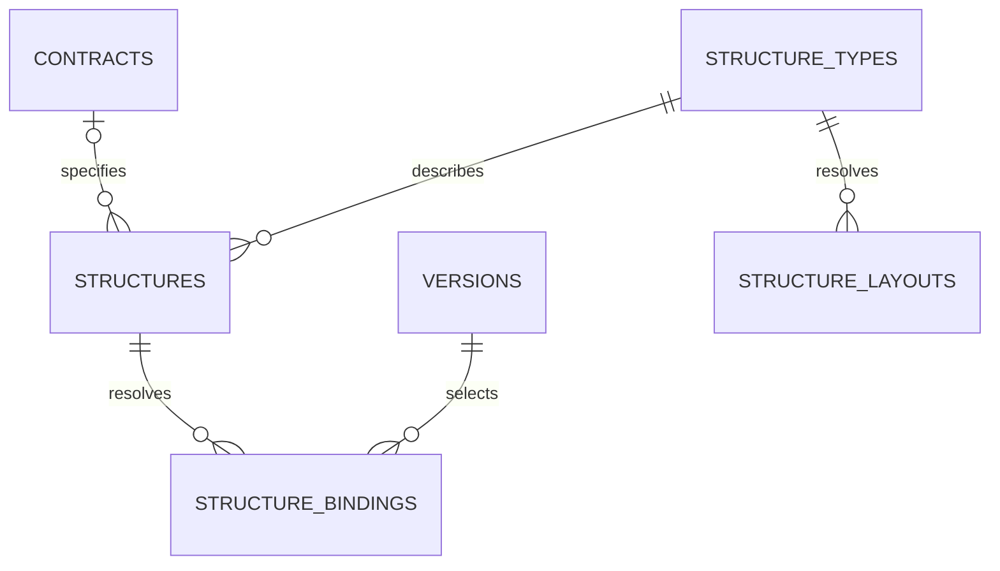

# ADR-028 — Relational projection for structures

- **Status** — Proposed
- **Date** — 2026-11-26
- **Scope** — Structure declarations and their dependencies in the logical SPG database
- **Related decisions** — [ADR-021](021-structures-and-data-layout.md) · [ADR-026](026-structure-contracts-and-invariant-verification.md) · [ADR-027](027-scalar-spg-relational-projection.md)

## Context

The scalar projection can resolve a function and reproduce the evidence for its calls. A function that uses structures also needs to resolve exact declarations, ordered fields, applicable contracts, and any target layout it relies on. ADR-021 permits two declarations to share structural identity and representation while using different field names. ADR-026 gives structure contracts their own obligations and check boundaries. A database key for an exact declaration must distinguish revisions that change those names or contract attachments.

## Proposed decision

Extend the derived relational projection of ADR-027 with the following relations. PK means primary key and FK means foreign key. Each hash is interpreted in its identity domain and encoding version. Git package records and pinned dependencies supply the canonical SPG inputs for rebuilding these rows. [ADR-014](014-git-semantic-merge.md) · [ADR-024](024-package-directory-and-protobuf-dumps.md)

| Relation | Keys and stored values |
|---|---|
| `STRUCTURE_TYPES` | PK `type_hash`. Store `identity_hash`, aggregate kind, ordered member type descriptors, and representation requirements. Identical shape with different representation requirements produces distinct type rows. |
| `STRUCTURES` | PK `struct_impl_hash`, the exact declaration hash. FK `type_hash` to `STRUCTURE_TYPES`. Optional FK `contract_hash` to `CONTRACTS.contract_hash` for the structure's own contract. Store `canonical_declaration` with the qualified name, an ordered sequence of field names and canonical type descriptors, and exact semantic dependency pins and the optional contract pin. Each field type descriptor includes exact structure references where applicable. |
| `STRUCTURE_LAYOUTS` | PK `layout_hash`. FK `type_hash` to `STRUCTURE_TYPES`. Store the exact target ABI profile and version and the resolved descriptor, including field offsets by ordinal, size, alignment, internal and trailing padding, and array stride. Resolve by type and target profile. Reject differing descriptors for the same pair under a fixed layout profile. |
| `STRUCTURE_BINDINGS` | PK `(version_hash, name)`. FKs `version_hash` to `VERSIONS` and `struct_impl_hash` to `STRUCTURES`. Index version-selected names from the verified manifest or its canonical inputs. Private declarations resolve through exact references. |

Compute `StructImplHash` (stored as `struct_impl_hash`) over the canonical declaration, including its Type Hash, named fields, and exact semantic pins, including `contract_hash` when present. Compute Identity Hash, Type Hash, and Layout Hash according to ADR-021. Read fields directly from the canonical declaration, as the scalar projection reads individual call expressions from a function's canonical body. For dependencies of a state contract, resolve the exact typed references in its canonical payload and validate them as part of the same dependency closure.

The diagram shows how a selected version reaches a declaration, how declarations share a type and its target layouts, and how a declaration references its optional contract.

### Shared contract storage

Extend the existing `CONTRACTS` and `CONTRACT_RULES` relations from ADR-027. Add `contract_kind` with values `function`, `structure`, and `domain`. Function contracts retain their typed signature. Structure and domain contracts use a `state_signature` that declares the names and types of the state variables used by their rules. A structure contract can declare `self` by its required named fields and their types, so its hash can be computed before the owning `StructImplHash`. Validate that requirement against the declaration at attachment time. Apply the same acyclic dependency requirement to any other state variables.

Store normalized invariant and transition rules in `CONTRACT_RULES` with a typed predicate and a check boundary where required by the profile. A transition predicate can refer to the before and after state declared by the profile. Preserve scalar contract and rule hashes using the ADR-027 encoding. Use a distinct versioned hash domain for state contracts and their rules. State contract identity includes kind, profile, state signature, and the sorted unique rule hashes. Rule identity includes kind, typed predicate, and any check boundary. Preserve clause provenance according to ADR-026.

Each declaration has at most one directly attached contract of kind `structure`. That contract can contain multiple rules. Inherited, embedded, specialized, and domain obligations continue to apply through the relevant SPG relations under ADR-026. A domain contract can cover several structures.

### Import and resolution

1. Validate the canonical declarations, exact type references, field order, and contract attachments under the selected profile. Compare canonical content on hash reuse. Require unique field names. Check that the optional `STRUCTURES.contract_hash` agrees with the declaration, resolves to a structure contract, and has a compatible state signature. Function contract references in ADR-027 must resolve to contracts of kind `function`. Check that every field's structural type agrees with its corresponding member in the type row and that every referenced declaration pin resolves. Validate nested type references even when they occur inside a composite type descriptor.
2. Derive target layouts when required by the build. Check the exact type and target profile before consuming a layout. Check function ABI compatibility separately under ADR-021. Padding belongs to the layout descriptor.
3. Store the exact `StructImplHash` at each resolved structure reference in the canonical function signature or body. Resolve it directly against `STRUCTURES.struct_impl_hash` and reject missing or mismatched declarations. Validate these references embedded in the canonical payload during import. Include the pins in the function identity so adopting a different structure revision changes `ImplHash`. A reverse dependency index can be derived from those references if impact queries need it. Apply ADR-020 to the remaining function dependencies.
4. Validate that version bindings agree with the canonical selection and that the complete dependency closure resolves, including private nested structures. Publish the selection atomically with the function bindings after the existing admission checks and structural import validation pass. Earlier versions keep their original pins. Scalar imports have empty structure relations.

For example, declarations with fields `x: i32, y: i32` and `row: i32, column: i32` can share a type and target layout when their representation requirements match. The declarations have distinct hashes and canonical declarations. A function using `row` resolves its field through the second declaration even when the physical layout is identical.

## Alternatives and boundaries

A single table keyed by Type Hash would merge declarations that share a representation and would lose the field names or contract attachments needed for exact resolution. A separate row per field would support SQL queries over field names and types and would duplicate the declaration data. The canonical declaration supplies field access when loaded by hash. A field index can be derived from declarations if cross-structure queries need it.

The projection covers declarations and compiler metadata. Managed runtime values and their persistence protocol are outside this schema. Physical SQL types, canonical hash encodings, and recursive type profiles need separate specifications. Verification obligations and result lookup remain open work.

## Validation before claiming support

- Rebuild the projection from the same package and check the recovered declarations, ordered fields, bindings, and dependency pins.
- Exercise shared type identity with distinct names or contracts, distinct representation requirements, nested declarations, and multiple target layouts. Reject missing references, duplicate names, field sequences that disagree with the type, and inconsistent layouts.
- Import two function revisions pinned to different revisions of a structure with the same name and confirm that each resolves its own declaration. Reject a missing pin.
- Import declarations with and without a direct contract. Reject a missing contract reference, a contract of the wrong kind, or an incompatible state signature. Verify that scalar contract hashes survive import.
- Exercise failed import rollback and reimport of an existing scalar package. Implementation and database validation are pending.
