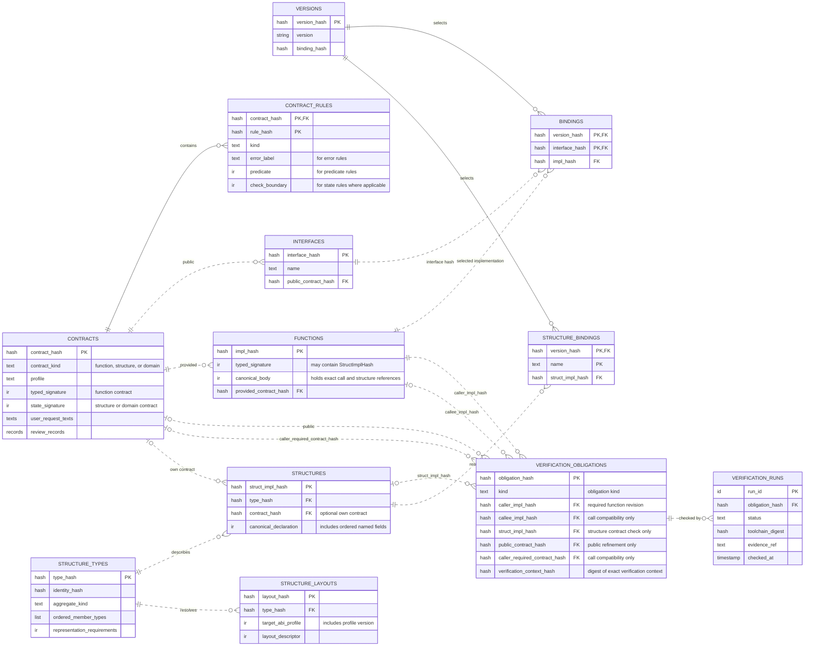

# ADR-029 — Caller-scoped verification obligations

- **Status** — Accepted
- **Accepted** — 2026-11-26
- **Date** — 2026-11-26
- **Scope** — Stage 2 of the logical SPG database design
- **Related decisions** — [ADR-026](026-structure-contracts-and-invariant-verification.md) · [ADR-027](027-scalar-spg-relational-projection.md) · [ADR-028](028-structure-relational-projection.md)

## Context

The Toolchain needs to report verification status for an exact function revision and resolve dependencies even when no verification attempt exists. The canonical typed function already carries the call expressions, their callee and required contract pins, and structure references. ADR-026 also requires an obligation for a function that directly updates managed state, including a function with no outgoing calls.

## Decision

Remove the `CALL_SITES` projection. Resolve forward dependencies, version reachability, and reverse dependency queries from canonical signatures and bodies. Any reverse index can be rebuilt from those inputs. Verification coverage may be incomplete while the dependency graph is already complete.

Store verification obligations in `VERIFICATION_OBLIGATIONS` and retain attempt history in `VERIFICATION_RUNS`. This changes the call projection and obligation shape from ADR-027 and uses the structure storage defined in ADR-028.

| Field | Meaning |
|---|---|
| `obligation_hash` | Primary key. Digest of the versioned canonical obligation inputs. |
| `kind` | Required obligation kind. |
| `caller_impl_hash` | Required FK to `FUNCTIONS.impl_hash`. Identifies the function whose use or behavior is checked. For call compatibility it is the caller. For public refinement it is the selected provider. |
| `callee_impl_hash` | FK to `FUNCTIONS.impl_hash`. Exact callee pinned by the caller. |
| `struct_impl_hash` | FK to `STRUCTURES.struct_impl_hash`. Exact structure revision involved in the state check. |
| `public_contract_hash` | FK to `CONTRACTS.contract_hash`. Public contract of the selected interface. |
| `caller_required_contract_hash` | FK to `CONTRACTS.contract_hash`. Exact contract pinned by the caller for this dependency. |
| `verification_context_hash` | Required digest of the canonical verification context. Retain the context with the verification input or evidence artifact. |

| Kind | Required references in addition to `caller_impl_hash` |
|---|---|
| `body_conformance` | None |
| `public_refinement` | `public_contract_hash` |
| `call_compatibility` | `callee_impl_hash` and `caller_required_contract_hash` |
| `structure_contract_check` | `struct_impl_hash` |

Other kind-specific references are absent. Read the provided function contract from `FUNCTIONS.provided_contract_hash` using the callee for call compatibility and the caller for the other kinds. Read a structure's directly attached contract from `STRUCTURES.contract_hash`. Include exact applicable state contract hashes, rule identities, structure bindings, and check boundaries in the verification context, including inherited and domain obligations. Derive due obligations from uses and effects as defined in ADR-026. A check deferred to an enclosing boundary must be discharged there before publication.

For call compatibility, validate that the pinned callee and requirement occur together in the caller's canonical body. Individual call argument checks remain part of verification of the caller's body. For public refinement, validate the exact interface and binding in context. Compute the obligation hash from its kind, applicable references, resolved contracts used in the check, and context hash. Context includes the applicable profile and assumptions. Read attempt outcomes by obligation hash. An obligation with no applicable result is unchecked for admission. A change to a consumed premise requires evidence applicable to the new obligation.

## Complete logical schema

The logical schema below covers all twelve tables. PK and FK denote primary and foreign keys. Multiple PK labels form a composite key. `hash` identifies a digest, `ir` a typed intermediate representation, and collection fields hold the listed values. Fields are required unless marked optional or restricted to an obligation or rule kind.

## Alternatives and consequences

ADR-027's call projection supports direct reverse lookups and a caller-independent compatibility obligation supports sharing one row across callers. With this design callers have distinct obligations and their statuses can be queried directly. Proof artifacts may be reused only after checking that all premises required for the new obligation match. Traversal can reconstruct dependencies from canonical bodies without waiting for verification. The cost of that traversal and any derived index remains to be measured.

## Migration and validation

Preserve original evidence and its input identities. Recompute caller-scoped obligations from canonical bodies, applicable contracts, and the exact verification context. An earlier callee-scoped result can support a new obligation only after verifying its correspondence. Keep old results traceable under their original identities.

- Reconstruct dependencies before any verification runs exist. Cover repeated calls, distinct requirements for one callee, and two callers with identical or different premises.
- Check a function that updates a structure without calling another function. Cover multiple contracted structures, domain contracts, and deferred check boundaries.
- Reject invalid field combinations and mismatched pins. Check unchecked status, multiple attempts, and stale evidence after a changed premise.

Physical SQL and implementation validation are pending.
