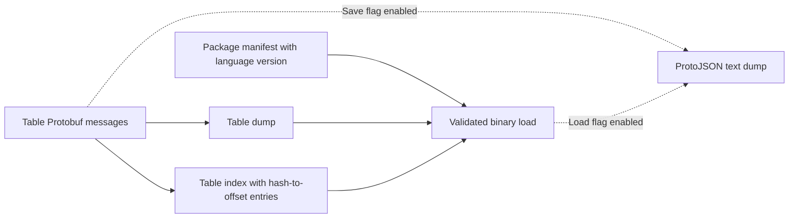

# ADR-030 — Per-table package dumps and optional JSON text dumps

- **Status** — Accepted
- **Accepted** — 2026-11-26
- **Date** — 2026-11-26
- **Scope** — Physical layout of the table-based repository dump profile and options of the persistence library
- **Related decisions** — [ADR-024](024-package-directory-and-protobuf-dumps.md) · [ADR-027](027-scalar-spg-relational-projection.md) · [ADR-028](028-structure-relational-projection.md) · [ADR-029](029-caller-scoped-verification-obligations.md)

## Context

ADR-024 defines indexed, independently compressed Protobuf records and leaves their partitioning across files open. The table-based profile needs a deterministic mapping from tables to files. Tests also need a readable representation of the Protobuf messages produced by save and decoded by load so they can compare the two paths.

## Decision

1. **Use one dump and one index per table in each package.** Each table declared by the selected dump profile has its own table-specific data file and separate index file, including an empty pair for a table with no rows. Each data file contains only that table's framed Protobuf records. The profile defines stable file names and record order. Record framing and independent compression follow ADR-024.
2. **Store the exact LLMLang language version in a separate package manifest file.** The package has one manifest with a required `language_version` field. The loader reads it before loading table records and selects the supported language semantics for that version. Reject a missing, invalid, or unsupported version. Table indexes use the package-wide version from the manifest. The physical index and Protobuf encoding remain governed by the repository profile.
3. **Index records by Content Hash and byte offset.** Each entry maps the record's Content Hash to its zero-based byte offset from the beginning of that table's data file. The offset points to the start of the record frame. The table file is determined by the index's companion file, and the compressed length is read from the frame header. This refines ADR-024's lookup rule for this profile. A validated cache can be checked by hash before opening the data file. On a cache miss, validate the offset and frame bounds, decode the record, and verify its Content Hash. A frame scan must reproduce the index from the verified records and the profile selected from the package manifest.
4. **Expose an opt-in JSON text dump on both save and load.** Both operations accept a Boolean option, `write_text_dump`, defaulting to `false`. When enabled on save, emit an additional JSON file per table from the same Protobuf messages used to write the binary dump. When enabled on load, emit the corresponding files from the successfully decoded and validated Protobuf messages. Use the Protobuf JSON mapping (ProtoJSON) and preserve table record order. Use a separate output destination on load so that a text export never edits the input package. With the option disabled, neither operation emits JSON. JSON text dumps are auxiliary outputs and do not affect canonical package bytes, indexes, semantic hashes, or binary loading.

The diagram shows the binary save and load paths and the optional outputs. The manifest supplies the language version, and each index entry points to one frame in its companion file.

## Alternatives and consequences

A shared dump can reduce file count, at the cost of tracking the table or record kind for each lookup. Per-table files allow independent reads and index rebuilds and increase the number of files in a package. An always-on JSON export would make every save and load perform additional serialization and I/O. The flag lets tests and debugging tools request the readable output explicitly.

Exact file names and extensions, manifest and index encodings, and JSON formatting beyond the ProtoJSON mapping belong in the repository profile specification.

## Validation before claiming support

- Round-trip a package with several tables, including an empty table. Verify that each index resolves only records in its companion file and that rebuilding it yields the same entries.
- Reject a missing manifest or an invalid or unsupported manifest language version. Reject offsets outside the file, malformed frames, and record hash mismatches.
- Check both flag settings on save and load. Confirm that the flag is off by default, that enabled exports represent the same messages in the same order, and that enabling JSON leaves the manifest, binary dump, and index bytes identical.

Implementation and format conformance are pending.
