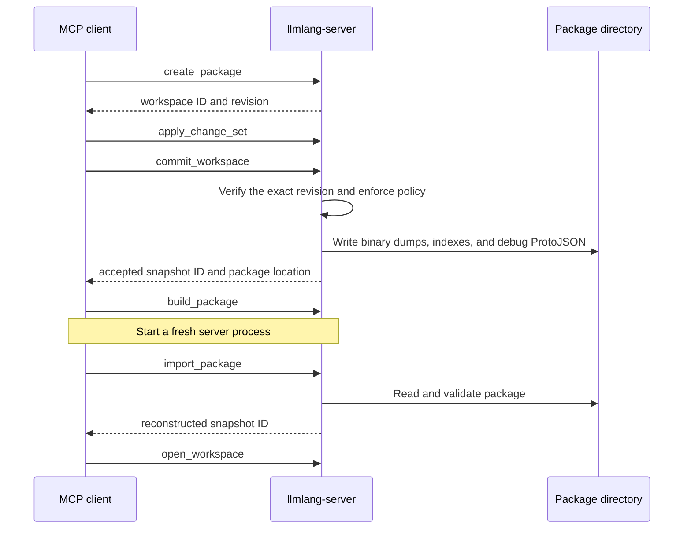

# ADR-031 — LLMLang Server and MCP package authoring for the MVP

- **Status** — Accepted
- **Accepted** — 2026-11-26
- **Date** — 2026-11-26
- **Scope** — The minimum server and MCP capabilities needed to create, edit, verify, build, export, and reopen a supported LLMLang package
- **Related decisions** — [ADR-015](015-toolchain-server-semantic-api.md) · [ADR-017](017-mcp-agent-object-format.md) · [ADR-020](020-immutable-objects-and-implhash-calls.md) · [ADR-024](024-package-directory-and-protobuf-dumps.md) · [ADR-030](030-per-table-package-dumps.md)

## Context

The scalar compiler and verifier exercise typed functions and exact call bindings. The SPG persistence library can save and restore graph tables. The MCP prototype opens a workspace on a seeded snapshot and accepts changes to it. The authoring MVP needs to connect these capabilities so an agent can start from an empty package and produce a portable artifact that it can reopen in another process. [Scalar MVP](../../tools/llmlang_mvp/README.md) · [MCP prototype](../../research/toolchain-and-collaboration/RT-19/MCP-STDIO-01/server.py)

## Decision

`llmlang-server` shall expose a transport-neutral Toolchain API for package authoring and an MCP adapter for that API. The first profile shall support scalar `Bool` and `I64`, typed functions, local bindings, branching, checked arithmetic, explicit error outcomes, and acyclic direct calls. It shall support packages that export callable interfaces and executable packages that select an entry point supported by the target profile. A package can contain private implementations referenced by exact call pins.

A **snapshot** identifies an immutable program state. A **workspace** is an isolated working state rooted at a snapshot. Its revision changes when a mutation succeeds. A **Change Set** groups typed semantic edits applied to one workspace revision. A **package version** names a published selection of interfaces, implementations, and entry points within the package catalog. The manifest holds the exact `language_version` and dependency package pins. Package version and language version are independent. A dependency pin selects an exact package identity and version or snapshot as defined by the package profile.

### MCP interface

The MCP adapter shall expose the following tools. Tool discovery shall provide input and output schemas. Successful calls shall return structured JSON. Graph references shall use identifiers with an explicit scope, and read-only Resources shall expose the corresponding views and reports. A durable workspace handle shall remain usable by an authorized caller after reconnecting. Server-side authorization shall cover each operation and the workspace, snapshot, or destination it acts on.

| Tool | Required input | Required result or effect |
|---|---|---|
| `create_package` | Package name, exact language version, and supported semantic profile | Create an empty base snapshot and return an open workspace handle, base snapshot ID, and initial revision. |
| `import_package` | Package location and applicable dependency resolution context | Validate the manifest, table dumps, indexes, semantic references, and declared pins. Return the exact reconstructed snapshot ID and available package versions. |
| `open_workspace` | Base snapshot ID | Return an isolated workspace handle, base snapshot ID, and initial revision. |
| `inspect_workspace` | Workspace handle | Return its state, revision, manifest, dependencies, exports, entry points, and Resource references for object and diagnostic views. |
| `apply_change_set` | Workspace handle, expected revision, idempotency key, and typed operations | Return the new revision, final identities for newly created objects, and affected dependent functions. Validate the resulting candidate and apply all operations atomically only if validation succeeds. |
| `verify_workspace` | Workspace handle and expected revision | Preview verification for the requested revision. Return a revision-bound report for body conformance, public contract refinement, and call compatibility. Include exact obligation identities, outcomes, and evidence references. |
| `commit_workspace` | Workspace handle and expected revision | Run the same verification as `verify_workspace` on that exact revision and enforce the configured review and verification policy. After the required checks pass, write the package to its configured destination and publish the immutable snapshot. Return the snapshot ID and package location only after both succeed. |
| `build_package` | Accepted snapshot ID and a supported target profile | Build the exact selected program and return an artifact reference and diagnostics. |

Object views shall support lookup by scoped ID and navigation of direct references and dependents. Diagnostic views shall identify the snapshot or workspace revision, affected object or operation, and the location within that object when available. Tool failures shall have stable, machine-readable codes for malformed inputs, unsupported profiles, missing references or dependencies, stale revisions, conflicts, validation or verification failures, policy denial, and I/O failures.

### Change Set requirements

| Operation family | Required behavior |
|---|---|
| Package selection | Set a package version, set or clear an executable entry point, and add, replace, or remove exact dependency pins. |
| Contracts | Create a contract or a new revision with typed preconditions, postconditions, declared errors, and applicable error guards. |
| Implementations | Create a function with a typed signature, canonical body, and provided contract. Editing produces a new immutable implementation with a server-computed `ImplHash`. |
| Interfaces and exports | Create a named interface with a public contract. Add, replace, or remove a version-selected binding to an exact implementation. A changed declaration produces a new interface revision. |
| Calls | Specify an exact callee implementation and a required contract in each resolved call. Changing the selected implementation or public interface requires an explicit call edit to change existing pins. |
| Removal | Remove a selection or an object from the candidate package when no retained reference requires it. Return the remaining references on conflict. Accepted snapshots retain their objects. |

Mutations shall require the expected workspace revision and, for edits to existing objects or selections, the expected Content Hash or current binding identity. Additions shall have an explicit absence precondition where they occupy a unique key. A batch may refer to new objects through identifiers scoped to that request. The server shall resolve these references and compute canonical identities before validating the candidate. Every application attempt shall check types, references, call pins, dependencies, exports, and entry points for the complete candidate before advancing the revision. It shall reject unresolved or cyclic identity dependencies, stale preconditions, and invalid candidate references without advancing the workspace revision.

The server shall record the principal and operation provenance. The same idempotency key and request in the same workspace shall return the stored result on retry. Reusing the key with a different request shall return a conflict. An accepted package version and its selection are immutable. A different selection requires a different package version.

### Verification, persistence, and export

The verifier shall check the body against its provided contract, the provided contract against the public contract at each selected export, and the exact callee's provided contract against the contract required at each call. Evidence applies to its exact obligations, assumptions, profile, and object identities. A standalone `verify_workspace` call provides an early report. `commit_workspace` shall invoke verification as part of the commit even if the caller already requested a report. Before publishing, it shall check that the workspace is still at the verified revision. A stale revision, insufficient evidence, a required obligation that is unchecked, failed, or unsupported, or a policy denial leaves the accepted catalog unchanged. The workspace commit is a semantic operation. Git commit and push are outside the MVP authoring tools.

The current scalar profile provides in-memory editing and verification. The server keeps scalar revisions and receipts for the lifetime of its process and rejects scalar commits with `UnsupportedProfile`. Source-backed packages can be imported and built. A successful commit requires verification for the workspace profile. Durable workspace revisions, accepted snapshots, and their idempotency results persist across restart. Every successful `commit_workspace` shall write the exact verified selection to the configured package directory using the persistence library. The directory shall contain a manifest and one Protobuf/LZ4 dump and Content Hash index per table, including empty tables. The server shall enable `write_text_dump` by default for debugging in the MVP so that commit also writes one ProtoJSON file per table. This default applies to server commits. The persistence library and the canonical package format retain their own defaults and semantics. Import shall reproduce exact pins and semantic identities.

The server shall stage the package before publication and reject a destination changed since its baseline was established. A failed commit shall leave the previous package and accepted catalog intact. Following interruption the server shall recover to a consistent package and catalog before serving either as committed. The portable directory produced by the commit can be imported by another server and tracked in Git directly.

The sequence below shows the publication path for a profile with source-backed authoring and commit-time verification. IDs and revisions let the client address the same program state at each step.

## Alternatives and scope

A file-editing API would require the client to manage textual placement and semantic consistency across objects. A dedicated tool for every row type would make edits that span multiple entities harder to submit atomically. A typed batch allows one request to create the contract, private implementation, exported implementation, public interface, and binding. Raw source import may serve interoperability through a separate Toolchain path.

The first profile targets scalar authoring and a single coherent Toolchain version. Later work can extend language profiles, native providers, and collaboration transports. This decision specifies the required MCP tool capabilities and domain behavior. Protocol version negotiation and the final JSON Schema definitions remain implementation work.

## Acceptance criteria

1. Through an independent MCP client, create a package at a supported language version with no preseeded program objects. Add a private `add` function, an exported `main`, contracts, an interface, a binding, and an entry point in one Change Set. Verify the pinned call and inspect both direct dependencies and dependents.
2. For a persistable source-backed workspace, commit without a prior standalone verification call. Verify that the commit returns a snapshot ID and a package location with binary dumps, indexes, and per-table debug ProtoJSON enabled by default. Build the committed snapshot. Import the exported directory in a fresh server process. Verify that the manifest, graph identities, exports, and exact pins match. Compare the canonical package bytes with those from another write of the same snapshot.
3. For a persistable source-backed workspace, open a workspace after import. Change `add`, explicitly repin the call in `main`, and commit a new package version. Verify that both accepted versions remain addressable with their original bindings, and that the package directories written by the two commits round-trip independently.
4. Check that stale revisions, stale object hashes, an invalid type, a dangling reference, an unresolved dependency pin, and a reused request key with different inputs fail without partial mutation. Retry a successful request within the workspace lifetime and verify that it creates no second mutation.
5. Check that a passing preview for an earlier revision cannot authorize a commit and that a failed commit-time verification leaves the accepted catalog unchanged. Check that an unauthorized caller cannot edit or commit a workspace and that an interrupted or conflicting package write leaves the prior destination and accepted catalog intact.
