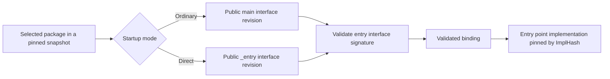

# ADR-032 — Program packages with bound `main` or `_entry` interfaces

- **Status** — Accepted
- **Date** — 2026-11-26
- **Scope** — Program classification and entry point resolution
- **Related decisions** — [ADR-020](020-immutable-objects-and-implhash-calls.md) · [ADR-024](024-package-directory-and-protobuf-dumps.md)

## Context

ADR-024 defines how a package is stored. ADR-020 defines how a public interface is bound to a concrete implementation. The Toolchain needs to resolve an entry point for both ordinary program startup and environments where a host or platform transfers control directly to package code.

## Decision

A package is a program for the selected startup mode if and only if it declares the required public interface in its own namespace with a signature permitted for that mode and the interface revision has a valid binding to a concrete implementation in the selected snapshot.

- **Ordinary program startup uses `main`.** The package declares one of the two signatures below. After any required runtime initialization, startup invokes the bound implementation according to the declared signature.
- **Direct entry uses `_entry`.** For embedding and other systems that transfer control directly, the host or platform invokes the bound `_entry` implementation without an additional LLMLang runtime initialization step. The selected startup profile specifies the exact signature, calling convention, return or termination behavior, and native symbol when required. The Toolchain checks the declaration and its binding against that profile at build time.

The two `main` signatures are shown in notation independent of the source dialect.

```text
main() -> ExitStatus
main(args: LaunchArgs) -> ExitStatus
```

`LaunchArgs` is an ordered sequence of user-supplied arguments, each represented as a byte sequence. It excludes the program name and preserves argument boundaries and the original bytes on platforms that supply byte arguments. Conversion to text is explicit. `ExitStatus` is a numeric exit status. The runtime maps it to the platform's process exit code.

In both modes the binding pins the implementation by `ImplHash` and satisfies the signature and contract checks in ADR-020. The entry interface must be public and declared by the selected package. Its implementation may come from a declared dependency. A package may declare both interfaces. The selected startup mode determines which one to resolve. The Toolchain rejects a program build with a diagnostic if the required interface is absent, its signature is incompatible with the selected mode or profile, or its binding is missing, ambiguous, or invalid.



The diagram shows how the startup mode selects a public interface for signature validation and how the same binding rules resolve either interface to its implementation.

## Alternatives and open questions

One interface name for both modes would require a separate convention to tell callers whether startup initializes the runtime. Using `main` for ordinary startup follows a familiar naming convention, and `_entry` identifies the direct handoff. An explicit manifest setting could support arbitrary interface names. A fixed name for each mode keeps resolution within the existing public interface and binding model.

The byte encoding for platforms that supply arguments in another representation, the text conversion API, the supported numeric range for `ExitStatus` and its mapping on each platform, and the initial direct-entry profiles remain open.

## Validation before claiming support

- Resolve `main` and `_entry` to their pinned implementations for the corresponding startup modes, including when an implementation has a different name or comes from a declared dependency. For a package exposing both interfaces, check that each mode selects its expected implementation.
- Exercise both forms of `main` after any required runtime initialization. Check that `LaunchArgs` preserves argument order, boundaries, and non-UTF-8 bytes on Unix and that the runtime maps the numeric status to the platform's process exit code.
- Check that direct entry invokes `_entry` without an additional LLMLang runtime initialization step. Reject a signature that the selected startup mode or profile does not permit.
- Reject program builds when the selected mode's interface is absent, private, only declared by a dependency, unbound, or bound ambiguously or invalidly.
- Resolve the same package in two snapshots with different valid bindings and confirm that each snapshot selects its own pinned implementation.
