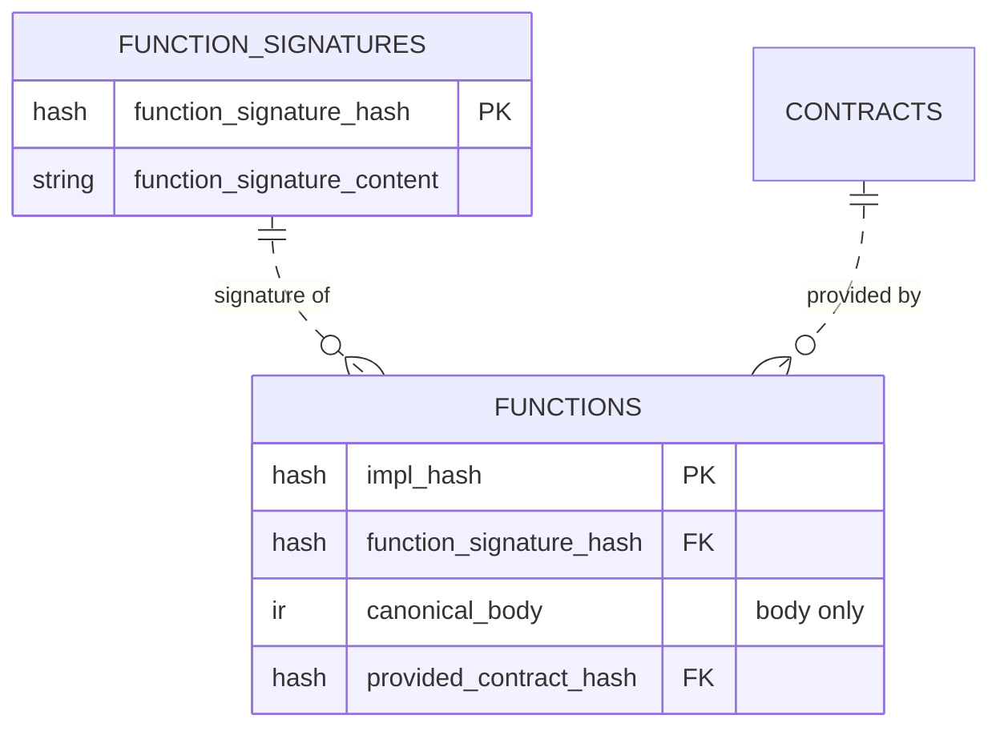

# ADR-033 — Store function signatures in a separate table

- **Status** — Accepted
- **Accepted** — 2026-11-27
- **Date** — 2026-11-27
- **Scope** — Function signatures in the relational SPG projection and table-based package storage
- **Related decisions** — [ADR-020](020-immutable-objects-and-implhash-calls.md) · [ADR-027](027-scalar-spg-relational-projection.md) · [ADR-028](028-structure-relational-projection.md) · [ADR-030](030-per-table-package-dumps.md)

## Context

The relational projection embeds a typed signature in each function implementation row. Several implementations can have the same ordered parameter declarations, result type, and exact type references. A separate signature table lets those implementations share one stored representation across bodies and revisions.

## Decision

Replace `FUNCTIONS.typed_signature` with a required `function_signature_hash` reference to `FUNCTION_SIGNATURES`. Store the canonical textual representation of the complete signature as a string in `FUNCTION_SIGNATURES.function_signature_content`. The function row obtains its signature exclusively through this reference.

The tables below give the complete affected logical schema. All columns are required. A digest identifies content in its versioned hash domain.

### FUNCTIONS

| Column | Logical type | Constraint and meaning |
| --- | --- | --- |
| `impl_hash` | Digest | Primary key. Identifies the canonical implementation with its typed signature, body, provided contract, and exact hash-relevant dependencies. |
| `function_signature_hash` | Digest | Foreign key to `FUNCTION_SIGNATURES.function_signature_hash`. Every implementation resolves to one signature. |
| `canonical_body` | Typed SPG IR | Body only, including its statements, expressions, and exact call and structure references. Parameter references in the body resolve against the separately loaded signature. |
| `provided_contract_hash` | Digest | Foreign key to `CONTRACTS.contract_hash`. Must resolve to the function contract provided by the implementation. |

### FUNCTION_SIGNATURES

| Column | Logical type | Constraint and meaning |
| --- | --- | --- |
| `function_signature_hash` | Digest | Primary key. Hash the UTF-8 bytes of `function_signature_content` in a signature-specific domain that identifies the semantic profile and the canonical signature encoding version. |
| `function_signature_content` | String | Canonical signature text. It encodes the ordered parameter declarations with names and types, the result type, and any exact type references, including `StructImplHash` pins. |

One signature row can serve multiple implementation rows. The provided contract is referenced independently by each implementation. The diagram shows both required references.

### Write and resolve signatures

1. Render the resolved typed signature in the canonical notation for the selected profile and compute its hash. Stage the signature row before the implementation row and publish them atomically. Reuse an existing row only after its canonical text matches byte for byte. Reject conflicting content for an existing hash.
2. Resolve the hash from the selected package and its pinned dependencies. Verify the hash against the stored string, parse the text into the typed signature, and validate its exact references. Reject missing rows, invalid or noncanonical text, and unresolved pins. Validate `canonical_body` against the body IR schema, which excludes the function's parameter declarations and result type declaration. Use the recovered signature for body checking, contract attachment, and callable compatibility. For example, a scalar profile can render a one-parameter signature as `(value: I64) -> I64`. Two implementations of that signature can share one signature row and have distinct `impl_hash` values.
3. Compute `ImplHash` from the reconstructed canonical implementation using the existing semantic hash inputs. A changed semantic signature or type pin changes that identity. Function contracts continue to define their own typed signatures and rule binders.

### Package storage and migration

Under the per-table package layout, a profile adopting this schema includes a `FUNCTION_SIGNATURES` dump and companion index, including an empty pair when the table is empty. Select the record layout and signature text encoding through the repository profile. To upgrade existing packages, validate their records under the original profile, render signature text from each inline typed signature, and rebuild the function rows with verified references. Publish the converted package only after it reconstructs the same typed signatures, implementation identities, and exact bindings.

## Alternatives and consequences

Inline typed signatures give readers direct access to each signature and duplicate its representation across implementations. Shared signature rows deduplicate the text and add a lookup and parse step when loading a function. The repository profile must specify the exact text grammar, digest encoding, and physical record format before implementations can exchange these packages.

## Validation before claiming support

- Save and reload two distinct implementations with the same signature and verify that they resolve through one signature row.
- Verify deterministic text and hashes across repeated writes, and verify that a change in parameter order, a result type, or an exact structure pin yields a distinct signature hash.
- Reject missing signature rows, invalid or noncanonical signature text, hash mismatches, and conflicting content for the same hash.
- Reject a `canonical_body` payload that embeds the function signature. Accept a valid body that references parameters declared in the separately resolved signature.
- Convert a package with inline signatures and compare recovered typed signatures, implementation hashes, and bindings with the original.
