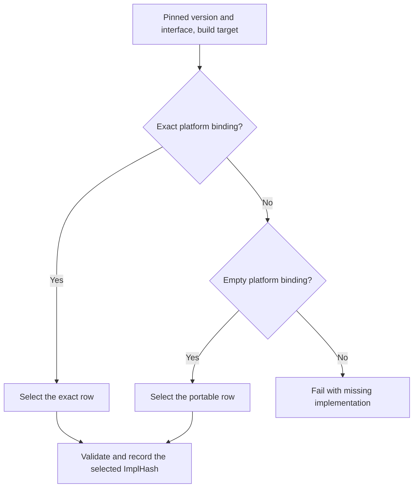

# ADR-035 — Select platform-specific implementations through bindings

- **Status** — Accepted
- **Accepted** — 2026-11-27
- **Date** — 2026-11-27
- **Scope** — Function bindings, direct calls, and build-time resolution of platform-specific calls
- **Related decisions** — [ADR-020](020-immutable-objects-and-implhash-calls.md) · [ADR-021](021-structures-and-data-layout.md) · [ADR-027](027-scalar-spg-relational-projection.md) · [ADR-029](029-caller-scoped-verification-obligations.md)

[ADR-036](036-canonical-platform-identifiers.md) amends the platform column
and binding selection rules below.

## Context

A public interface can have implementations that use different system calls,
calling conventions, or operating-system behavior. For example, Linux assigns
different numbers to `write` under its i386, x86-64, and AArch64 syscall ABIs.
A source package may be built for a different platform from the machine
running the Toolchain. The Toolchain needs a deterministic way to select a
provider from the dependencies of an immutable source snapshot and record
the provider that it used.

## Decision

Use `BINDINGS` as the selection point for platform-specific function
implementations. The build request supplies the target. The Toolchain resolves
it to a canonical platform identifier for the target operating system and ABI.
The target identifier remains independent of the dependency version. Source
callers can use the same interface reference for cross-compilation.

### Logical schema

All columns in `BINDINGS` are required.

| Column | Logical type | Key and meaning |
| --- | --- | --- |
| `version_hash` | Hash | Part of the primary key and foreign key to `VERSIONS.version_hash`. Selects the package version. |
| `interface_hash` | Hash | Part of the primary key and foreign key to `INTERFACES.interface_hash`. Selects the exact interface revision and its public contract. |
| `platform` | ASCII string | Part of the primary key. The empty string `""` denotes a platform-independent implementation. A nonempty value identifies one canonical target platform. |
| `impl_hash` | Hash | Foreign key to `FUNCTIONS.impl_hash`. Identifies the exact implementation selected by the row. |

The entire `platform` value must match `[A-Za-z0-9_]*`. The allowed
characters are ASCII letters, digits, and underscores.

The primary key is `(version_hash, interface_hash, platform)`. Reject
duplicate keys. Use a single empty string representation for a portable row.
Within one version, a qualified public name resolves to one interface revision
across all its platform rows.
The version's `binding_hash` covers all its rows, including each platform
value and corresponding implementation hash. The repository profile specifies
the physical field encoding, key ordering, and digest encoding.

For each row, check the callable signature and the implementation's refinement
of the public contract on the applicable targets. An empty `platform` asserts
that the implementation identified by `impl_hash` is platform-independent and
can serve every supported target for the interface. A target-specific row can
refine the same public contract with a different implementation.

### Select a binding at build time

Given the exact interface revision, pinned package version, and target:

1. Select the row whose `platform` exactly equals the canonical target
   platform identifier, if present.
2. Otherwise select the row with `platform = ""`, if present.
3. If neither row exists, fail the build with a missing implementation
   diagnostic that names the interface, version, and target.

An exact match takes precedence even if the two rows have different
implementations. Validate the selected row for this build. An invalid
selected row fails validation.

The same selection applies to public entry points and calls through public
interfaces. For example, bindings for `linux.syscalls.write` can share one
interface revision and one kernel version while selecting these providers:

| `platform` | Selected provider's syscall number |
| --- | --- |
| `linux_i386` | 4 |
| `linux_x86_64` | 1 |
| `linux_aarch64` | 64 |

The identifiers in the example illustrate distinct Linux ABIs. The particular
set of supported build targets and provider availability belong to the
Toolchain and package.

An interface such as `checksum` can have an empty-platform binding and a
`linux_x86_64` binding in the same version. A Linux x86-64 build selects its
specific implementation. A Linux AArch64 build selects the portable one
when the package supplies no AArch64 row.

### Calls and verification

A direct call pins a platform-independent callee by `ImplHash` and its
required contract. The Toolchain resolves the same implementation on every
target. A portable function can call an interface through a binding. Target
selection then occurs at that call boundary.

For a call through a binding, the source graph identifies the interface
revision, its pinned version context, and the caller's required contract.
The build resolves the binding and records the exact `callee_impl_hash` in
the resulting call compatibility obligation. The verification context
identifies the target ABI and exact selected binding. Evidence can be reused
only when it applies to those inputs. Building the same source snapshot for
another target leaves its source call references intact and resolves them
against the new target.

This decision extends the binding key from ADR-027 and specifies when a
call through an interface acquires the concrete callee required by ADR-029.
Direct calls retain the exact identity rule from ADR-020.

## Alternatives and consequences

An implementation could branch on the target inside its source body. Selecting
through a binding instead exposes the selected implementation in the resolved
graph and gives each platform-specific provider its own contract evidence.
The package must supply a portable implementation or an explicit variant for
each intended target.

Encoding the platform in the package version would let versions select
providers with the existing key. A separate platform column lets one package
version express several target bindings and lets callers retain a single
version pin.

## Implementation validation

- Reject `platform` values containing hyphens, whitespace, or non-ASCII
  characters.
- Reject duplicate `(version_hash, interface_hash, platform)` rows.
- Select the exact row when it coexists with an empty-platform row and select
  the empty-platform row on a target that lacks an exact match.
- Reject missing and incompatible selections. Check that an incompatible exact
  selection produces an error even when a portable row exists.
- Resolve `linux.syscalls.write` for two targets from the same source snapshot
  and verify that each build records its selected callee and target ABI.
- Cross-build with a host and target of different architectures. Confirm that
  a direct call retains the same callee and an interface call selects the
  target's binding.
