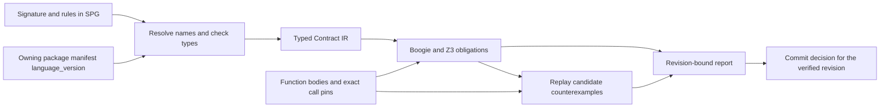

# ADR-037 — Define the scalar function contract language

- **Status** — Accepted
- **Accepted** — 2026-11-28
- **Date** — 2026-11-28
- **Scope** — Function contracts, predicate syntax, typed Contract IR, and proof obligations for `scalar-v1`
- **Related decisions** — [Formal verification backends](018-formal-verification-backends.md) · [Caller-scoped obligations](029-caller-scoped-verification-obligations.md) · [MCP package authoring](031-llmlang-server-mcp-package-authoring.md) · [Composite language version](038-composite-language-version.md)
- **Design sources** — [Package manifest and table dumps](030-per-table-package-dumps.md) · [Function signature storage](033-function-signature-storage.md) · [RT-18 language versioning](../../research/packages-and-ecosystem/RT-18/LANGUAGE-VERSIONING.md)

The signature storage described here reflects the accepted v8 design.
[ADR-039](039-unified-compilation-and-contract-verification.md) specifies
the updated v9 contract and interface records.

## Context

A coding agent needs to state what a function guarantees, inspect the exact
contract a caller relies on, and see why a proposed change violates it.
The draft server already implements a scalar contract checker and verifier.
This decision specifies that language at the SPG boundary so that the
meaning of a contract is shared by the editor, verifier, and report.

## Decision

Use a typed function signature and a set of rules. The signature has an
ordered list of distinct parameter names and their types, followed by a
success result type. The interface types are `I64` and `Bool`.
Both `put_function` and `put_contract` accept a `signature` string such as
`(left: I64, right: I64) -> I64`. Store that same canonical text without a
profile prefix. The empty parameter list is
`()`. Separate each parameter name and type with `: `, separate parameters
with `, `, and place a single space on each side of `->`. Use the same
parser that resolves stored function signatures. A contract
attached to an implementation must match its parameter names, order, types,
and result type. Identifiers follow `[A-Za-z_][A-Za-z0-9_]*` and exclude
Python keywords in the current parser. Parameter names also exclude
`result`, `quotient`, and the `builtin__` prefix.

Read the owning package's manifest `language_version` before parsing its
signatures. Use that version to select the applicable signature grammar and
type rules and to resolve the semantic context used by the signature digest.
The repository profile defines the physical encoding. For a dependency,
use the dependency's manifest. Reject missing and unsupported language
versions. A verifier can separately identify the subset it supports and
version its IR and reports.

RT-18 models a language version as ordered component revisions for syntax,
core semantics, the type system, effects and execution, and modules and
packages. This decision needs an exact language definition selected at the
package boundary. It leaves the component tuple encoding and compatibility
rules to the language versioning work. Repository profile v8 reads the composite language version and registry digest
from the manifest. The v6 and v7 migration rebuilds affected signature rows
and references.

| Rule kind | Required fields besides `kind` | Meaning |
| --- | --- | --- |
| `requires` | `predicate` | Defines which inputs the caller may supply. |
| `ensures` | `predicate` | Constrains the successful result for admitted inputs. |
| `error_declaration` | `error_label` | Declares one named error outcome. |
| `error_guard` | `error_label`, `predicate` | Constrains when an already declared error is allowed. |

A predicate is a Boolean expression string or a JSON Boolean.
Preconditions and error guards can read parameters. Postconditions can
also read `result`, with the type specified by the signature. Each group
of predicates is a conjunction. An empty conjunction is true. A declared
error without guards is allowed throughout the input domain. When its
guards hold, the error is permitted. The implementation can also succeed
if its result satisfies the postconditions. Outcomes consist of either a
typed success value or a declared error label without a value.

### Predicate expressions

| Form | Operands | Result |
| --- | --- | --- |
| Integer literal | Decimal digits, with optional digit separators | Mathematical integer |
| `True`, `False` | Boolean literals | `Bool` |
| Parameter, `result` | Name in scope | Mathematical integer or `Bool` |
| `-x` | Integer | Integer |
| `x * y`, `x + y`, `x - y` | Integers | Integer |
| `quotient(x, y)` | Integers | Integer |
| `<`, `<=`, `>`, `>=` | Integers | `Bool` |
| `==`, `!=` | Two operands of the same sort | `Bool` |
| `not`, `and`, `or` | Booleans | `Bool` |

Parentheses group expressions and delimit quotient arguments. Precedence
from strongest to weakest is literals, names, groups and quotient calls,
unary minus, multiplication, addition and subtraction, comparisons,
`not`, `and`, then `or`. Binary arithmetic at the same precedence
associates to the left. A comparison chain is a conjunction of adjacent
comparisons, so `0 <= x < 10` means `(0 <= x) and (x < 10)`. The expression
checker rejects names outside the clause scope, mismatched operands, and
other expression forms. The current checker uses a Python expression parser
with a restricted set of checked nodes. The table specifies the expression
forms of this profile.

Values of type `I64` at the function boundary range from `-2^63` through
`2^63 - 1`. Predicates interpret these values and all intermediate
arithmetic as mathematical integers. The total function `quotient`
truncates toward zero and returns zero when its divisor is zero. Program
arithmetic remains checked and can produce `ArithmeticOverflow` or
`DivisionByZero`. Predicate evaluation has no program side effects.

For example, the rules below allow division of a nonnegative `left: I64`
by a `right: I64`. The outcome on zero is declared separately from the
success formula. The signature's result type is `I64`.

```json
[
  {"kind":"requires","predicate":"left >= 0"},
  {"kind":"ensures","predicate":"result == quotient(left, right)"},
  {"kind":"error_declaration","error_label":"DivisionByZero"},
  {"kind":"error_guard","error_label":"DivisionByZero","predicate":"right == 0"}
]
```

### SPG representation and Contract IR

Use the existing `CONTRACTS` and `CONTRACT_RULES` tables with the following
logical fields for `scalar-v1`.

| Table | Column | Type and constraint |
| --- | --- | --- |
| `CONTRACTS` | `contract_hash` | Hash and primary key. |
| | `contract_kind` | String equal to `function`. |
| | `profile` | String equal to `scalar-v1`. |
| | `typed_signature` | Required canonical signature string, interpreted under the package's manifest language version. |
| | `state_signature` | Optional typed state signature, absent for this profile. |
| | `user_request_texts` | List of strings. May be empty. |
| | `review_records` | List of review metadata records. May be empty. |
| `CONTRACT_RULES` | `contract_hash` | Hash and foreign key to `CONTRACTS.contract_hash`. First component of the primary key. |
| | `rule_hash` | Hash and second component of the primary key. |
| | `kind` | Required rule kind from the rule table above. |
| | `error_label` | Identifier string present only for declarations and guards. Labels are declared once per contract. |
| | `predicate` | Boolean or expression string present for `requires`, `ensures`, and `error_guard`. |
| | `check_boundary` | Optional state check boundary, absent for this profile. |

The server hashes each rule's `kind` and applicable payload fields
using the `llmlang-server-rule-v1` domain. The contract hash covers an
object with `profile`, the canonical string `signature`,
`language_version`, `language_component_registry_digest`, and `rules`.
The rules are a lexicographically sorted array of distinct rule hashes. It uses the
`llmlang-server-contract-v1` domain. Both are lowercase hexadecimal SHA-256
digests over the bytes `llmlang-spg-content/v1\0` followed by compact UTF-8
JSON of `{"key":DOMAIN,"content":OBJECT}`, with object keys sorted
recursively and array order preserved. Here `\0` denotes a single zero
byte. The `profile` field scopes the contract to its rule semantics and is
separate from the signature text. Duplicate rules in a Change Set are rejected. Metadata and rule
submission order have no effect on the contract hash. Predicate spelling
participates in SPG identity. Equivalent predicates can have different SPG
hashes even when they lower to the same checked expression.

Lower the checked rules to `llmlang-contract-ir/scalar-v1`. This is the
proof input and can be reconstructed from the signature and rules.

| IR object | Required fields |
| --- | --- |
| Contract | `schema` with value `llmlang-contract-ir/scalar-v1`, ordered `parameters` as `{name,type}` objects, `returns`, `requires` and `ensures` as lists of Boolean terms, and `errors` as a map from declared labels to lists of Boolean guard terms. Interface types are `I64` or `Bool`. |
| Literal | `op: "literal"`, `type` (`Bool` or `Int`), and `value` (JSON Boolean or a decimal string for `Int`). |
| Variable | `op: "variable"`, `type` (`Bool` or `Int`), and `name` in clause scope. |
| Operation | `op`, `type` of the result, and ordered `args`. Use `not` and `negate` for unary operators, `and` and `or` for two or more Boolean terms, and the predicate spelling for the remaining binary operators, including `quotient`. |

The lowering maps `I64` operands to `Int` terms, flattens nested
conjunctions or disjunctions of the same kind, and expands comparison
chains. The verifier separately enforces the interface range. Contracts in
reports are keyed by the SPG contract hash for navigation to the exact rules.
The derived IR requires no new package tables or record columns.

### Verification and publication

The implementation pins its **provided** contract. An interface pins its
**public** contract. A direct call pins both the callee implementation and
the **required** contract its caller assumes. All three roles can refer to
the same contract.

1. For every admitted input, the body must produce an outcome allowed by its
   provided contract.
2. For each selected export and exact call dependency, the public or required
   input domain must imply the provider's precondition. On that domain,
   every outcome admitted by the provided contract must satisfy the public
   or required contract.
3. At each call, the actual arguments must satisfy its pinned required
   precondition. The caller may assume the guarantees of that contract for
   the call's outcome.
4. The verifier must establish that each checked input domain is inhabited.
   An empty domain rejects verification.

`apply_change_set` checks and resolves candidate rules before advancing the
revision. Boogie and Z3 check the resulting obligations. A reference
evaluator independently replays candidate counterexamples. A timeout,
unsupported check, or missing proof has insufficient evidence for
publication. `verify_workspace` previews the exact revision, and
`commit_workspace` runs the same verification again before publication.



The diagram follows one revision from stored rules to a commit decision.
Each contract reference resolves to its exact SPG rules. Confirmed failures
identify the function and violated contract so an agent can revise either.

## Alternatives and consequences

A host-language assertion would reuse executable expression syntax and its
machine arithmetic. Mathematical predicates keep specifications total and
let a rule describe overflow or division errors explicitly. Free-form prose
can accompany contracts as request metadata. Typed rules define the proof
obligations.

The current implementation verifies finite scalar bodies with acyclic direct
calls. Scalar workspaces remain in memory, and the native profile has no
behavioral verifier in this server. State contracts retain their own typed
signatures and check boundaries. Extending this expression language to
memory, effects, recursion, or native providers requires a separate decision
about their semantics and evidence.

## Implementation validation

The MCP integration test checks type errors at edit time, typed IR for
comparison chains, checked arithmetic outcomes, and exact callee pins.
It exercises body conformance, provider refinement, and call precondition
failures at commit time. The verifier tests exercise independent
counterexample replay. The language reference and server guide document the
authoring syntax and report shape. [MCP test](../server/tests/mcp_e2e.py) ·
[Replay test](../server/scalar_verification/test_counterexamples.py) ·
[Language reference](../docs/lang.md#contract-rules) · [Server guide](../docs/server.md)

To validate the signature encoding, verify that function and
contract signatures round-trip without a profile prefix, that dependency
signatures use their owning manifest, and that unknown language versions
are rejected before interpreting signatures. Check migrated graph references
and recovered types against the original packages.
