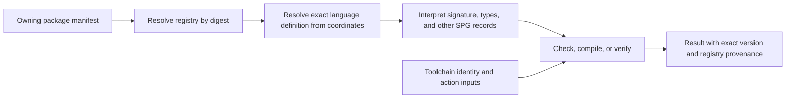

# ADR-038 — Version LLMLang through language components

- **Status** — Accepted
- **Accepted** — 2026-11-28
- **Date** — 2026-11-28
- **Scope** — Language version representation, component registry, package interpretation, and version provenance
- **Design sources** — [RT-18 language versioning](../../research/packages-and-ecosystem/RT-18/LANGUAGE-VERSIONING.md) · [Package Identity prototype](../../research/packages-and-ecosystem/PROTOTYPES/PACKAGE-IDENTITY-01/README.md)
- **Related decisions** — [Source dialects](022-syntax-dialects-and-shared-semantics.md) · [Toolchain compatibility](023-immutable-components-and-toolchain-compatibility.md) · [Package manifests](030-per-table-package-dumps.md)

## Context

The same LLMLang package can be processed by different builds of the
toolchain. Its grammar, types, and execution rules must come from an exact
language definition. Syntax and the type system can evolve on different
schedules, and build targets and library releases have separate lifecycles.
RT-18 describes composite language versions and an ordered registry whose
coordinates stay stable as the language grows.

## Decision

### Component registry

The repository root contains [`language-components.toml`](../../language-components.toml).
Its sole key is `components`, a nonempty array of unique identifiers matching
`[a-z][a-z0-9_]*`. The initial order is as follows.

| Position | Component | Definition selected by its revision |
| --- | --- | --- |
| 1 | `syntax` | Canonical language syntax and grammar. |
| 2 | `core_semantics` | Core constructs and their observable meaning. |
| 3 | `type_system` | Types and their static rules. |
| 4 | `effects_execution` | Effects and execution rules. |
| 5 | `modules_packages` | Module and package semantics. |

Registry changes require review and an append-only check. Existing entries
keep their names and positions, including retired entries. An identifier
always refers to the same component. New identifiers go at the end. The
registry contains identifiers only. An immutable language definition
associates a component identifier and revision with its specification.
Toolchains declare which combinations of component revisions they support.

Compute the registry digest over the ordered identifiers. Begin with the
ASCII bytes `LLMLANG`, one zero byte, the ASCII bytes
`language-component-registry`, and one zero byte. For each identifier,
append its byte length as an unsigned 32-bit big-endian integer and then its
ASCII bytes. Use SHA-256 and write the digest as `sha256:` followed by 64
lowercase hexadecimal digits. TOML formatting and comments have no effect
on this digest. This adopts the encoding used by the RT-18 prototype.

### Composite version

A language version is a string of dot-separated coordinates. Each
coordinate matches `0|[1-9][0-9]*` and denotes the non-negative integer
revision of the corresponding registry component. For example, under the
initial registry `1.3.2.1.0` selects syntax revision 1, core semantics
revision 3, type system revision 2, effects and execution revision 1, and
module and package revision 0.

Writers emit one coordinate per component in the registry snapshot they
identify. Readers reject empty or interior missing coordinates, extra
coordinates, leading zeroes, signs, surrounding whitespace, and unsupported
combinations. When an older registry is a verified prefix of the current
registry, interpret its complete tuple in the extended coordinate space
by appending zeros. For example, `1.3.2.1.0` under a five-entry registry
normalizes to `1.3.2.1.0.0` for comparison in its six-entry extension.
Normalization preserves the original registry identity for provenance.
Numerical ordering and zero extension alone do not establish language or
evidence compatibility.

### Package manifest and resolution

A repository profile adopting this decision requires these two manifest fields.

| Field | Type | Requirement |
| --- | --- | --- |
| `language_version` | String | Exact composite version under the identified registry snapshot. Required. |
| `language_component_registry_digest` | String | Registry digest in the encoding above. Required. |

The loader resolves the digest against registry snapshots supported by the
toolchain and verifies the ordered identifiers. It validates the tuple
before reading language-dependent table records. A missing registry,
invalid digest, malformed tuple, or unsupported combination rejects the
load. Interpret each dependency using its own manifest. When composing
packages, apply the toolchain's compatibility checks to the resolved
definitions and exact interfaces. The repository profile continues to
select the physical storage encoding.

Canonical signatures can use their owning package's language definition
for grammar and type rules. For example, a signature can be stored as
`(value: I64) -> Bool` and interpreted using the manifest that owns it.
The signature encoding and any hash migration are specified by the
signature and repository format decisions.

The diagram shows that resolving the manifest supplies the interpretation
of the package. Tool and action identities are recorded when producing
results such as verification evidence.

### Identity and cache reuse

Keep the language version and registry digest distinct from the exact
toolchain identity, target profile, standard-library version, package
release, and repository encoding. A toolchain upgrade leaves the language
definition selected by the package manifest intact. A target profile
supplies architecture, ABI, runtime, and platform inputs when they affect
the action. A package or standard-library version identifies a selected
release.

Every cached action result records the language version, registry digest,
and toolchain identity, as well as target, configuration, and tool component
identities where relevant. Include these inputs in the Action Key whenever
they affect the result. Reuse across different result-determining identities
requires explicit, validated compatibility evidence. The same principle
applies to verification evidence admitted for an exact obligation. These
cache and provenance fields do not themselves redefine semantic package or
object identities.

## Alternatives and consequences

A single monotonically increasing language release can pin a full
definition, while its coordinates remain implicit in a release catalog.
The composite format makes independently revised components visible and
requires a stable registry and supported combinations. An immutable release
descriptor could carry the registry digest indirectly. Storing the digest
directly in the manifest lets the loader resolve the coordinate system
before interpreting package records.

Previously published v6 and v7 draft packages declared `0.1.0`. The
v8 migration maps that exact release context to `0.1.0.0.0` under the
initial registry. It verifies the old snapshot and signature identities,
rebuilds canonical signatures and their references, refreshes call
obligations, and regenerates managed packages. The migrated catalog preserves
package versions, implementation identities, and interface bindings and
returns a mapping for changed snapshot IDs. A profile adopting the new manifest fields rejects
an old version string without its registry digest. Compatibility evidence
format, the authority that admits it, and the initial normative component
releases remain open.

## Validation before claiming support

- Accept a supported complete tuple and reject malformed or unsupported
  tuples before decoding language-dependent records.
- Compute the same registry digest across TOML formatting changes and
  reject reordering, renaming, deletion, reuse, and duplicate identifiers.
- Load an old tuple using a verified registry prefix and test zero extension.
  Reject a registry mismatch even when the tuple text matches.
- Resolve a dependency under its own manifest and reject combinations
  without applicable compatibility evidence.
- Check that cached and verification results track version, registry, and
  toolchain inputs independently.
- Test explicit migration of existing packages and reject unmapped versions.

The [prototype tests](../../research/packages-and-ecosystem/PROTOTYPES/PACKAGE-IDENTITY-01/test_language_version_cache_index.py)
exercise the registry encoding, coordinate parsing, and cache provenance.
The v8 package and server migration implement the initial registry and the
single supported combination `0.1.0.0.0`. Additional registry snapshots
and combinations need their own supported definitions.
