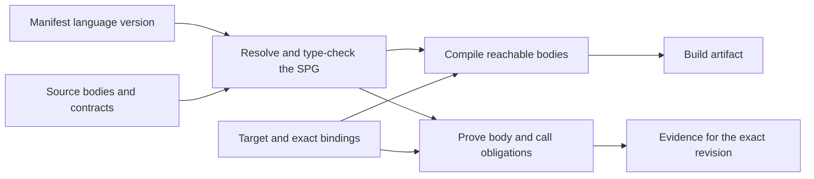

# ADR-039 — Compile and verify one versioned LLMLang program

- **Status** — Proposed
- **Date** — 2026-11-28
- **Scope** — Language semantics, semantic graph construction, compilation, and body conformance
- **Related decisions** — [MCP package authoring](031-llmlang-server-mcp-package-authoring.md) · [Platform bindings](036-canonical-platform-identifiers.md) · [Scalar function contracts](037-scalar-contract-language.md) · [Composite language version](038-composite-language-version.md)

## Context

The draft server currently gives two packages with the same
`language_version` different treatment based on a label in their contract
rows. One path proves scalar contracts. The other lowers native source to
Rust and can produce an executable. In particular, a change to the label
can affect whether a body reaches the verifier. A checked body and the
body used for code generation need the same semantics, resolved signatures,
and call relationships.

## Decision

### One language definition and one compiler pipeline

Resolve the owning package's `language_version` and
`language_component_registry_digest` before interpreting its code or
contracts. Read the kind of contract from `contract_kind`. Remove the
semantic `profile` field from contract records and from package creation.
The repository format identifier continues to identify the encoding.

Validate and lower function source and contract rules under that definition
to typed representations in the SPG. The canonical body remains a source
string. The compiler and verifier consume the same resolved function
semantics, including checked operations, control flow, exact call pins, and
observable outcomes. This decision preserves canonical signatures and their
manifest-scoped interpretation.

Use a single package compilation path. It selects the public roots and
reachable functions, resolves target-specific providers through bindings,
and emits the target artifact. Target selection supplies the architecture
and OS to that pipeline. It does not change how contract predicates are
interpreted. The first implementation can retain the Rust emitter. LLMLang
arithmetic, errors, and effects must follow the resolved language
semantics through that emitter.

The graph is common to both operations. When verification relies on a
target-specific implementation, its obligation identifies the exact target,
resolved binding, and provider used by the build.

### Body conformance

For each function, prove that executions from admitted inputs produce
outcomes allowed by its provided contract. At each call, prove the required
precondition for the actual arguments. A caller can use guarantees from
the exact required contract once the provider has been checked for
conformance and refinement. Check public refinement at exports and
applicable invariants at their declared state boundaries.

Determine verification support from the typed constructs and available
evidence. A system-facing primitive needs a model or evidence expressing
the guarantees available to callers. Record assumptions at that boundary
and propagate them to the result. Report an unproved obligation with its
source and contract references. Missing support results in `UNSUPPORTED`,
and an unresolved proof results in `UNKNOWN`. Confirmed counterexamples
reject the relevant obligation.

Validate the complete candidate SPG during `apply_change_set`. Run
verification for the exact revision in `verify_workspace` and rerun it
within `commit_workspace` before publishing any package. Publication
requires evidence for every required obligation under the applicable
policy. Preserve the prior snapshot and dump when that check fails.

### Storage and migration

The `CONTRACTS` row has `contract_hash` (digest and primary key),
`contract_kind` (required string, one of `function`, `structure`, or
`domain`), `state_signature` (typed state signature, present only for a
structure or domain), `user_request_texts` (list of strings), and
`review_records` (list of records). Rule ownership and the
`CONTRACT_RULES` composite key `(contract_hash, rule_hash)` stay the same.
The contract identity covers its kind, state signature when applicable,
sorted rule identities, and language definition. Request texts and review
records remain package metadata.

For function contracts, use the checked function's signature to type-check
its provided contract, the applicable public contract, and any required
contract at a call. A rule may refer to a subset of the parameters and to
`result` in a postcondition. A contract can apply to multiple signatures
when its rules type-check in each context. Report typed Contract IR by
`ImplHash` and `ContractHash`. Verification evidence applies to the exact
implementation and obligation.

The `INTERFACES` row has `interface_hash` (digest and primary key), `name`
(required string), and `public_contract_hash` (required foreign key to a
function contract). Its identity covers the name and public contract hash.
A binding selects the implementation and supplies its callable signature.
Bindings of the same interface can have different signatures. Applying a
binding type-checks public rules against the selected implementation for
supported signatures. Verification checks refinement in that same context
before publication. Through MCP, `put_contract` takes rules and
`put_interface` takes a name and public contract reference.

Repository profile v9 introduces the new record and identity encoding.
Migration combines function contracts with identical rules under the same
language definition. Callable signatures remain in the signature table
referenced by function records. Rebuild affected hashes, references,
indexes, and snapshot IDs. Preserve package versions and validate the
resolved dependency graph and bindings after conversion. Recheck proof
evidence for the migrated identities and semantics.

## Alternatives and consequences

A package-level switch would retain two independent definitions of how
bodies reach compilation and verification. Using the same typed bodies
instead makes compiler and verification coverage explicit and allows
effect-free code and platform-bound calls to coexist in one package.
Extending proof support for mutable state and external effects requires
semantic models at those boundaries.

## Validation before claiming support

- Create one source-backed package whose exact revision can be verified,
  committed, reloaded, and built through MCP. Check that the executable
  observes the proved return and error semantics.
- Introduce a body that violates its provided contract and check that the
  verifier identifies the function and contract before any package write.
- Put a provable function and an external call in the same package. Check
  the supported obligation and report the exact external obligation when
  its evidence is missing.
- Use the balance transfer example to check nonnegative balances, journal
  reconciliation, conservation, and unchanged state on refusal. Include a
  mutation that publishes an inconsistent state and require a counterexample.
- Verify migrated package references and compare previous and migrated
  executable behavior on the same target.

The v9 draft removes the labels and supports a shared checked body for
`I64`, `U64`, and `Bool` code. The balance transfer proves the private
function used to compute both resulting balances. The entry point checks
journal reconciliation at runtime. Proof support for the full entry point,
mutable state, and external effects remains open.
