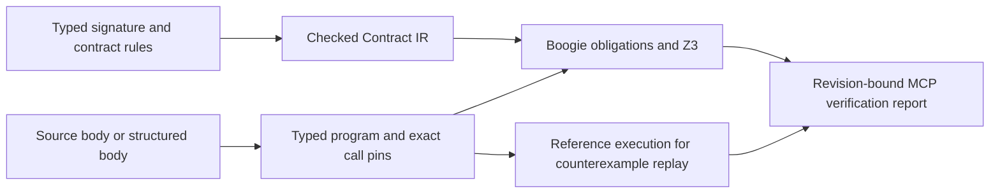

# LLMLang syntax

This reference covers the syntax implemented in the current checkout. The scalar verifier accepts braced source bodies and structured bodies through MCP Change Sets. The native profile uses Rust-shaped syntax with braced function bodies. A semantic profile defines the available constructs and their meaning. A dialect defines their source spelling. LLMLang supports versioned dialects that lower to a shared typed Semantic Program Graph (SPG), and the architecture leaves a default dialect open. [Architecture RFC](../RFC.md) · [Syntax dialects](../adr/022-syntax-dialects-and-shared-semantics.md)

## Scalar MCP authoring

The server accepts typed Change Set objects. Signatures use `i64` and `bool`. For example, a function taking a signed 64-bit integer and returning a Boolean has this signature.

```json
{"params":[["value","i64"]],"result":"bool"}
```

A `canonical_body` is a braced source string or a nonempty array of structured statements. The notation below uses `EXPR`, `THEN`, `ELSE`, and `REF` as placeholders for the structured form.

| Kind | JSON shape |
| --- | --- |
| Integer or Boolean | `["i64", -7]` or `["bool", true]` |
| Variable | `["var", "value"]` |
| Binary expression | `["bin", "<", EXPR, EXPR]`. Uses the operators described below. |
| Call | `{"callee_impl_hash": REF, "required_contract_hash": REF, "arguments": [EXPR]}`. Use an empty array for zero arguments. |
| Local binding | `["let", "name", EXPR]` |
| Return | `["return", EXPR]` |
| Explicit error | `["fail", "DivisionByZero"]`. Represents `builtin__fail` and is allowed by the server only in `builtin`. Supported labels are `ArithmeticOverflow`, `DivisionByZero`, and `InvalidInput`. |
| Branch | `["if", EXPR, THEN, ELSE]`. Each branch is an array of statements. `THEN` is nonempty and `ELSE` may be empty. |

Use an existing server identity (64 lowercase hex digits) or `{"local":"request-id"}` for an object created in the same Change Set. A call pins both the callee implementation and the contract the caller relies on. A function separately pins its provided contract. An exported interface names its public contract, and a version binding selects the implementation. Use the identities returned by the server for MCP calls and resource reads. Direct calls must form an acyclic graph. [Server schemas](../src/server/main.rs) · [Runnable MCP examples](server.md)

### Source bodies

Pass the body string to `put_function` and pass the typed signature separately.
For a function with signature `(value: I64) -> I64`, this body returns
`value + 1` on the declared input domain `0 <= value <= 10`.

```rust
{
    let shifted = value + 1;
    if value == 0 { return 1; }
    return shifted;
}
```

The braced scalar dialect supports decimal I64 literals with optional digit
separators, negative integer literals, Boolean literals `true` and `false`,
parentheses, names, binary operators, immutable `let` bindings, explicit `return`,
and `if` with optional `else` or `else if`. A `let` or `return` ends with a semicolon.
Direct calls use `call("implementation_hash", "required_contract_hash", args...)`,
where the two quoted values are existing 64-digit lowercase scalar hashes.
Structured bodies additionally support local references in the same batch and
the explicit error statement for the `builtin` package. The server retains
source text in `canonical_body` and uses its typed lowering for validation,
verification, and dependency analysis. [MCP example](server.md#verify-a-scalar-workspace)

### Executable scalar semantics

For an input tuple of the declared types, a function evaluates to either
`Return(value)` of the declared result type or `Error(label)`. The executable
profile has no mutable state, loops, recursion, or foreign effects. Evaluation
of a supported typed body terminates because statement blocks are finite and
the direct-call graph is acyclic. Each input value is a Boolean or a signed
64-bit integer in `[-2^63, 2^63-1]`. There are no implicit conversions between them.

1. Evaluate expressions left to right. A local initializer binds an immutable
   value in the remainder of its block. A local name cannot shadow an existing
   binding. Branch-local bindings disappear when control leaves the branch.
2. Evaluate a binary expression's left operand and then its right operand.
   Propagate the first error. Integer `+`, `-`, `*`, and `/` compute their
   mathematical result and produce `ArithmeticOverflow` if it is out of range.
   Division by zero produces `DivisionByZero`. Nonzero division truncates toward
   zero, including the range check for `(-2^63) / -1`. Equality requires operands
   of the same type. Ordering comparisons require integers.
3. For a branch, evaluate its Boolean condition and then only the selected
   block. A return or error exits the function immediately. Fallthrough is
   allowed from a branch to the remainder of its function. A complete typed
   function must return or fail on every path.
4. A direct call evaluates arguments left to right, then runs the exact callee
   with those values in a fresh environment. Its outcome propagates through
   the caller's expression. Verification requires the arguments to satisfy
   the exact caller-required contract before the call.

The scalar reference evaluator replays reported counterexamples using these
outcomes and exact callee pins. [Reference evaluator](../server/scalar_verification/runtime.py)

### Contract rules

A `put_contract` operation takes a typed signature and an array of rules. `requires` and `ensures` have a `predicate`. `error_declaration` has an `error_label`. An `error_guard` has both and refers to a declared error. Multiple predicates for one outcome are conjoined. An error declaration with no guards admits that error anywhere in the contract's input domain. Optional `user_request_texts` records the request prose alongside the formal rules. Use parameter names in all predicates and `result` in `ensures`. The contract parser reserves `result` and `quotient` as parameter names.

```json
[
  {"kind":"requires","predicate":"left >= 0"},
  {"kind":"ensures","predicate":"result == quotient(left, right)"},
  {"kind":"error_declaration","error_label":"DivisionByZero"},
  {"kind":"error_guard","error_label":"DivisionByZero","predicate":"right == 0"}
]
```

Predicate values can be JSON Booleans or Boolean expression strings. The predicate language supports comparisons, including chains, `and`, `or`, `not`, and mathematical integer `+`, `-`, `*`, and unary minus. Use `quotient(a, b)` for the totalized quotient, which truncates toward zero and returns zero when `b` is zero. Program arithmetic can fail. The example rules apply to the `divide` signature with `left` and `right` as `i64`. The precondition excludes the signed division overflow case. [Historical Scalar Contract IR](https://github.com/aivibeflow/LLMLang/blob/138ba12f754967c9fbc6c0adbf29fc8d591836a3/draft/llmlang_mvp/CONTRACT-IR.md) · [Server rule adapter](../server/scalar.py)

### Contract IR and verification

The server checks each rule against the function signature and produces
`llmlang-contract-ir/scalar-v1`. It contains ordered `parameters`, the
`returns` type, `requires` and `ensures` predicate lists, and an `errors` map
from declared labels to guard lists. Each list is a conjunction, including
the empty conjunction, which is true. A declared error admits just that
label when its guards hold. Preconditions and error guards may read only
inputs. Postconditions can also read `result` for a successful return.

Each expression has an `op` and a `type` of `Bool` or mathematical `Int`.
Literals carry `value` and integer literals use decimal strings. Variables
carry `name`. Other operators carry ordered `args`. I64 parameters and
results are range-bounded at the program boundary. Predicate arithmetic can
refer to mathematical integers outside that range. Comparison chains are
lowered to conjunctions of adjacent comparisons.



The verifier checks three properties. For every input admitted by the
provided contract, execution must return a value satisfying the success
clauses or produce a declared error whose guards hold. For refinement, the
public input domain must imply the provided input domain, and every outcome
admitted by the provided contract on public inputs must satisfy the public
contract. At each direct call, the checked argument values must satisfy the
caller-required precondition, with a refinement check for the selected callee.
The verifier checks that the public and provided domains are inhabited.

`verify_workspace` reports the Contract IR keyed by SPG contract hash in
`report.report.contract_ir`, alongside the verified revision and the exact
caller/callee pins. `VERIFIED` is a result for the scoped profile and backend.
Timeout, unsupported constructs, and solver failures retain their respective
statuses. Scalar source workspaces currently support in-memory verification.
[Verifier](../server/scalar_verification/verify.py) · [Verification architecture](../adr/018-formal-verification-backends.md)

## Native source syntax

Place imports before function declarations. In an import, the last dot separates the package name from the function name. For example, write `import builtin.write` and call `builtin::write(...)`, or write `import linux.syscalls.write` and call `write(...)` in the function body. [Hello World](../examples/0001-hello-world/functions.json) · [Syscall Hello World](../examples/0009-syscall-hello-world/functions.json)

Function declarations use `fn`, parameter types follow their names, and a return type follows `->`. The public entry point is `pub fn main() -> ExitStatus` or `pub fn main(args: LaunchArgs) -> ExitStatus`. The function body is enclosed in braces. [Entry point](../adr/032-program-package-main.md) · [Copy example](../examples/0005-syscall-copy/functions.json)

Built-in function names start with `builtin__`. Only code in the `builtin` package can reference them directly. Native calls such as `builtin::syscall` resolve through exact package bindings. [Built-in names and visibility](../adr/034-built-in-function-prefix.md)
