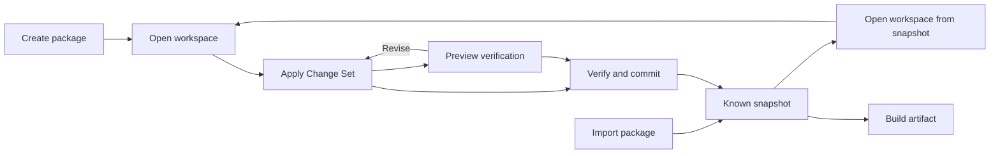

# LLMLang Server over MCP

The Linux MVP edits and verifies LLMLang `0.1.0` scalar workspaces in memory and imports and builds supported native packages over MCP stdio. The client launches a local subprocess. The server validates structured changes against the semantic graph, verifies a specific workspace revision, and registers immutable snapshots on native package import. The current transport is stdio, and the build target is `linux-x86_64`. [Server README](../server/README.md) · [MVP requirements](../adr/031-llmlang-server-mcp-package-authoring.md)

## Build and connect

Use Linux x86-64, Rust 1.85.1 or newer with Cargo and a native linker, Python 3.10 or newer, Boogie with its .NET runtime, and Z3. The scalar CI setup uses Python 3.12, Boogie 3.5.5 on .NET 8, and Z3 4.13.3. The Boogie and Z3 executables are required for scalar verification. The native package backend compiles with `rustc`. [Scalar CI setup](../../.github/workflows/llmlang-mvp.yml)

From the repository root, build both executables.

```sh
cargo build --locked --manifest-path tools/llmlang_mvp/stage0/Cargo.toml
cargo build --locked --manifest-path draft/server/Cargo.toml
```

Add a local stdio server in your MCP client. The example uses the common `mcpServers` JSON layout. Replace the absolute path placeholders with paths visible to the launching client.

```json
{
  "mcpServers": {
    "llmlang": {
      "command": "/path/to/LLMLang/draft/server/target/debug/llmlang-server",
      "args": ["--state-dir", "/path/to/private/llmlang-state"],
      "env": {
        "LLMLANG_STAGE0": "/path/to/LLMLang/tools/llmlang_mvp/stage0/target/debug/llmlang-stage0",
        "BOOGIE": "/path/to/boogie",
        "Z3": "/path/to/z3"
      }
    }
  }
}
```

The server can create the state directory. An existing directory must be private to its owner, typically mode `0700`. One server process holds an exclusive lock on each state directory. Use a separate directory for an independent server. The client delegates the launching OS user's authority to the server. Package paths and artifact paths are local to that process.

The default backend is `draft/server/scalar.py` at the checkout path recorded during the build. Pass `--backend /absolute/path/to/scalar.py` after moving a checkout, and use `--python /absolute/path/to/python3` to choose the interpreter. The command inherits the environment supplied by the client. Set `RUSTC` or provide `rustc` on `PATH` for builds. `BOOGIE` and `Z3` can be omitted if `boogie` and `z3` are on `PATH`. [CLI and stdio adapter](../src/server/main.rs) · [Scalar backend](../server/scalar.py)

### Check the connection from a terminal

The server reads and writes one JSON-RPC 2.0 message per line. A client sends `initialize`, accepts the negotiated version, then sends the `notifications/initialized` notification without an ID. The server accepts protocol versions `2025-11-25` and `2025-06-18` and offers `2025-11-25` for other requests. The following smoke test uses a temporary state directory and sends a fixed handshake followed by discovery.

```sh
state_dir=$(mktemp -d)
draft/server/target/debug/llmlang-server --state-dir "$state_dir" <<'EOF_MCP'
{"jsonrpc":"2.0","id":1,"method":"initialize","params":{"protocolVersion":"2025-11-25","capabilities":{},"clientInfo":{"name":"terminal","version":"1.0"}}}
{"jsonrpc":"2.0","method":"notifications/initialized"}
{"jsonrpc":"2.0","id":2,"method":"tools/list"}
{"jsonrpc":"2.0","id":3,"method":"resources/templates/list"}
EOF_MCP
```

The three responses contain server capabilities, tool schemas, and resource URI templates. EOF closes the process. `resources/list` returns an empty list because the resources are addressed through templates.

## Tools and resources

For a raw client, invoke tools with `tools/call`. This request creates an empty package and opens a workspace at revision 0.

```json
{"jsonrpc":"2.0","id":4,"method":"tools/call","params":{"name":"create_package","arguments":{"name":"answer","language_version":"0.1.0","profile":"scalar"}}}
```

Read successful values from `result.structuredContent`. The result also includes a text rendering. For a tool error, check `result.isError` and decode the JSON in `result.content[0].text` for the domain code and message. Protocol and resource errors use the top-level JSON-RPC `error` field. Use the live schemas from `tools/list` when constructing requests.

| Tool | Arguments | Use |
| --- | --- | --- |
| `create_package` | `name`, `language_version`, `profile` | Create a scalar package and open an empty workspace. |
| `import_package` | `path` | Load a package directory and register its snapshot. Load and validate a native source package and register its snapshot. |
| `open_workspace` | `snapshot_id` | Open an isolated working revision from a known snapshot. |
| `inspect_workspace` | `workspace_id` | Read the revision, package version, manifest, exports, and entry point. |
| `apply_change_set` | `workspace_id`, `expected_revision`, `idempotency_key`, `operations` | Validate a batch, derive caller-scoped call compatibility obligations, and apply it atomically. Returns the new revision, local-to-canonical identity mappings, and affected function identities. |
| `verify_workspace` | `workspace_id`, `expected_revision` | Preview the verification report for an exact open revision. Check `report.report.status` for `VERIFIED`. The outer `report` is the backend reply, with `ok` and a nested verifier `report`. A returned reply can describe failed or inconclusive verification. |
| `commit_workspace` | `workspace_id`, `expected_revision` | Commit a persistable workspace after verification. Scalar workspaces return `UnsupportedProfile`. |
| `build_package` | `snapshot_id`, `target` | Build a committed or imported snapshot for `linux-x86_64`. Returns an `artifact` path, `verification_status`, and an `exports` map of public names to Rust symbols. |

Call `resources/read` with a URI. Parse the JSON in `result.contents[0].text`.

| URI | Contents |
| --- | --- |
| `llmlang://workspace/{workspace_id}` | Current workspace selection and revision. |
| `llmlang://workspace/{workspace_id}/object/{table}/{id}` | Current row, `content_hash`, and incoming and outgoing graph links. |
| `llmlang://snapshot/{snapshot_id}/object/{table}/{id}` | The corresponding object view in a fixed snapshot. |
| `llmlang://workspace/{workspace_id}/verification/{revision}` | A report saved by preview or successful commit for that revision. |

For a function use the `functions` table and its implementation identity as `id`. Follow the returned links to inspect signature, call, and contract references. Stored functions reference shared canonical signature text in the `function_signatures` table. Keep sending typed signatures in scalar Change Sets. A stored call compatibility obligation records the caller, callee, and caller-required contract. Its presence records an obligation to check. Use percent encoding for URI path segments where needed.

## Usage scenarios

The lifecycle below shows where verification, publication, and build occur. An imported snapshot can be built immediately or used to open another workspace.



### Verify a scalar workspace

Create package `answer` using `profile: "scalar"` and `language_version: "0.1.0"`. Call `apply_change_set` with the arguments below, replacing `WORKSPACE_ID` with the returned ID. The Change Set selects package version `1.0.0` independently of language version `0.1.0`. The example exposes `answer` publicly and selects the same parameterless function as the executable entry point.

```json
{
  "workspace_id": "WORKSPACE_ID",
  "expected_revision": 0,
  "idempotency_key": "answer-v1",
  "operations": [
    {"op":"set_version","version":"1.0.0","expected_version":null},
    {
      "op":"put_contract","id":"spec",
      "typed_signature":{"params":[],"result":"i64"},
      "rules":[{"kind":"ensures","predicate":"result == 42"}]
    },
    {
      "op":"put_function","id":"answer",
      "typed_signature":{"params":[],"result":"i64"},
      "canonical_body":[["return",["i64",42]]],
      "provided_contract":{"local":"spec"}
    },
    {
      "op":"put_interface","id":"public","name":"answer",
      "public_contract":{"local":"spec"}
    },
    {
      "op":"bind","interface":{"local":"public"},
      "implementation":{"local":"answer"},"expected_implementation":null
    },
    {
      "op":"set_entry_point","implementation":{"local":"answer"},
      "expected_implementation":null
    }
  ]
}
```

Pass the returned `revision` as `expected_revision` to `verify_workspace` with
the workspace ID. A successful preview has `report.report.status` set to
`VERIFIED`. Change the returned literal to `41` while keeping the
postcondition to exercise a verification failure. The workspace and its report
remain available until the server process exits.

### Build an existing native program

1. Import [`draft/stdlib`](../stdlib/README.md) with `import_package`.
2. Call `import_package` with the absolute path to the checkout's [Linux syscall package](../examples/linux.syscalls/README.md) at `draft/examples/linux.syscalls`. This registers the dependency at version `v6.12`.
3. Call `import_package` with the absolute path to `draft/examples/0004-syscall-echo`. Use its returned `snapshot_id` and `target: "linux-x86_64"` in `build_package`.
3. Run the returned `artifact` and pass input on stdin. For example, `printf '%s\n' 'hello' | /path/to/artifact` prints the input unchanged. Building the dependency snapshot itself produces a Rust `rlib`.

The native build resolves `<package>.main` through the selected version's bindings. The supported entry signatures are `main() -> ExitStatus` and `main(args: LaunchArgs) -> ExitStatus`. `LaunchArgs` excludes the program name and preserves each Unix argument's bytes. Native import and build return `verification_status: "unchecked"`. They check package storage, graph references, and supported bindings and lowering. Scalar Change Sets serve the scalar authoring workflow. [Native examples](../examples/README.md#linux-syscall-program-packages) · [Native MCP test](../server/tests/native_build_e2e.py)

### Recover from a conflict or interrupted request

- After a lost `apply_change_set` response, retry with the same workspace, expected revision, key, and operations. The server returns the saved receipt when the original request was applied. Reusing a key for different input produces `Conflict`.
- On `StaleRevision` or an object precondition conflict, inspect the current workspace and affected objects, reconcile the changes, and send the revised batch with a new key. A rejected batch leaves the workspace revision unchanged.
- On `MissingDependency`, import the required snapshot or named version and its transitive dependencies. On a verification failure, inspect the preview report and revise the contract or implementation according to the intended behavior. Check the Boogie and Z3 paths if the report indicates a tool error.
- After an interrupted commit, reconnect to the same state directory and inspect the workspace for `state: "committed"` and its `snapshot_id`. The server recovers pending publication on startup. For further edits, open a workspace from the committed snapshot.

Run the repository's end-to-end check from the root with `LLMLANG_STAGE0`, `BOOGIE`, and `Z3` set for the test process. The tests cover scalar editing, verification, and in-memory lifetime, as well as import, build, and execution of native package examples.

```sh
python3 -B draft/server/tests/mcp_e2e.py draft/server/target/debug/llmlang-server
python3 -B draft/server/tests/native_build_e2e.py draft/server/target/debug/llmlang-server
```

[End-to-end client and fixtures](../server/tests/mcp_e2e.py)
