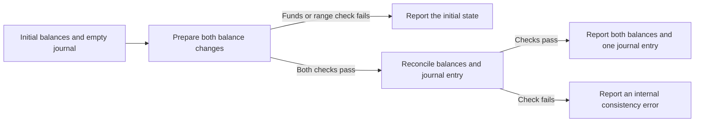

# 0010 — Balance Transfer

This SPG v8 package implements [Task 0010](../../../examples/0010-balance-transfer.md).
The program body is stored as `canonicalBody` in [functions.json](functions.json).
The package exports `main(args: LaunchArgs) -> ExitStatus` and pins
`builtin` version `0.1.0` for writing the report and diagnostics.

## Build and run

Start the [MCP server](../../docs/bootstrap.md#build-and-run-native-examples)
on Linux x86-64. Call `import_package` with `draft/builtin` and then with
`draft/examples/0010-balance-transfer`. Pass the second import's
`snapshot_id` and the target `linux-x86_64` to `build_package`. Run its
returned artifact.

```console
$ /path/to/artifact 100 50 30
committed 70 80 1
$ /path/to/artifact 20 50 30
insufficient funds 20 50 0
```

## State and checks

The initial state contains both input balances and an empty journal. The
program computes a candidate debit, credit, and journal entry. Before
selecting the candidate state, it reconciles both balance changes against
the entry and checks that the recorded debit equals the recorded credit.
This establishes conservation without adding the two balances in machine
arithmetic. Each refusal reports the initial state.



| Requirements | Implementation |
| --- | --- |
| R-0010-01 | Parse exactly three ASCII decimal arguments with checked accumulation and require a positive amount. |
| R-0010-02 and R-0010-03 | Prepare both balances and the journal entry, then reconcile the debit and credit before selecting the new state. |
| R-0010-04 | Return the initial state on failed subtraction or addition, in that order. |
| R-0010-05 | Report the selected state via `builtin.write` and propagate a report write failure as status 2. |

The [native MCP test](../../server/tests/native_build_e2e.py) builds the
package, checks the exact call pin to `builtin.write`, and exercises all
task scenarios, including a sum above the balance type's range. The example
checks invariants at runtime in a single process. Native verification status
is `unchecked`.
