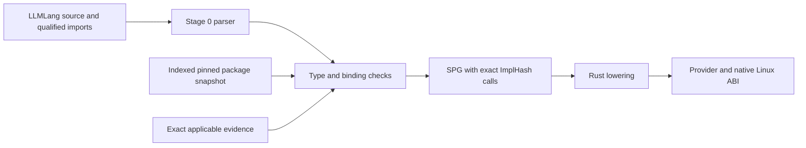

# Linux syscall package

`linux.syscalls` provides typed profiles for all 358 active native x86-64 syscalls in the pinned Linux v6.12 table. The catalog also records 17 historical entries, reserved numbers, kernel configuration and separately listed command variants. [Development plan §8.2](../../PLAN.md#82-linux-syscall-package-implementation-plan)



The binding checks use the immutable public interface revision, required, public and provided Contract identities, and a content-derived provider implementation identity. Syscall numbers and the register convention belong to the native provider. The Rust checker validates types, moves and borrow lifetimes on the lowered code. Each call keeps its selected `ImplHash` in the graph. The available source profile is the bounded Stage 0 I/O dialect illustrated by the examples. [ADR-016](../../draft/adr/016-compiler-bootstrap.md) · [ADR-020](../../draft/adr/020-immutable-objects-and-implhash-calls.md) · [ADR-023](../../draft/adr/023-immutable-components-and-toolchain-compatibility.md)

## Build and run

From a clean checkout on native Linux x86-64, use Python 3.12, Rust 1.85.1 targeting `x86_64-unknown-linux-gnu`, and a native linker. Install the storage dependencies and fetch the locked Stage 0 dependencies once. The CLI's Cargo invocations then run offline.

```sh
python3 -m venv /tmp/llmlang-syscalls-venv
. /tmp/llmlang-syscalls-venv/bin/activate
python3 -m pip install -r packages/linux.syscalls/requirements-storage.txt
rustup toolchain install 1.85.1 --profile minimal
rustup run 1.85.1 cargo fetch --locked --manifest-path tools/llmlang_mvp/stage0/Cargo.toml

rustup run 1.85.1 python3 -B packages/linux.syscalls/package.py review packages/linux.syscalls/examples/echo.llmlang
rustup run 1.85.1 python3 -B packages/linux.syscalls/package.py check packages/linux.syscalls/examples/echo.llmlang
rustup run 1.85.1 python3 -B packages/linux.syscalls/package.py spg packages/linux.syscalls/examples/echo.llmlang
rustup run 1.85.1 python3 -B packages/linux.syscalls/package.py build packages/linux.syscalls/examples/echo.llmlang -o /tmp/llmlang-syscall-echo
printf 'LLMLang\n' | /tmp/llmlang-syscall-echo
```

The examples exercise byte-exact Echo, copying with partial writes and descriptor cleanup, pipe readiness and timeout, child execution and waiting, and TCP Echo on loopback. The child example uses a scoped `fork_execve` operation, which confines the child path between `fork` and successful `execve` or immediate exit. The parent waits for the child and passes its exit code to the bound `exit_group` provider. The socket example uses the IPv4 loopback profile. The verification reports distinguish bounded observations, model obligations and assumptions about external kernel behavior. [Example sources](examples/)

```sh
rustup run 1.85.1 python3 -B packages/linux.syscalls/examples/check.py --report /tmp/llmlang-syscall-examples.json
python3 -B packages/linux.syscalls/catalog/catalog.py check --require-complete
python3 -B packages/linux.syscalls/catalog/catalog.py report --json > /tmp/llmlang-syscall-coverage.json
python3 -B packages/linux.syscalls/catalog/catalog.py diff /path/to/proposed/syscall_64.tbl
```

The catalog compares `common` and `64` native rows against the pinned Linux table. Check its reported kernel configuration conditions when an operation returns `ENOSYS`. Package availability is a separate field. The `512–547` x32 rows have no native binding. [Pinned Linux v6.12 table](https://github.com/torvalds/linux/blob/adc218676eef25575469234709c2d87185ca223a/arch/x86/entry/syscalls/syscall_64.tbl)

The §8.2.5 release gate requires an intended public provider with applicable evidence for each active ABI row. A compound provider needs a named witness for the native entry it covers. Every listed command variant has its own contract profile and must pass the same admission checks. The catalog reports the limits of those profiles.

## Snapshot format and updates

The checked-in `snapshot/` stores indexed package objects, including independently readable operation contracts and provider source records. Each object is serialized as one deterministic [Protobuf Record](storage.proto), compressed as an independent LZ4 block, and written after its little-endian length fields and SHA-256 Content Hash. The index maps a qualified key to the dump, compressed-block byte offset, compressed length and logical Content Hash. It supports checking a content-addressed cache before opening the dump. On a miss, storage reads the indexed frame, decodes it, and verifies the hash. A sequential validating scan rebuilds a missing or corrupt index. Frame offsets and compression are outside the logical hash. [ADR-024](../../draft/adr/024-package-directory-and-protobuf-dumps.md)

```sh
python3 -B packages/linux.syscalls/storage.py verify packages/linux.syscalls/snapshot
python3 -B packages/linux.syscalls/storage.py load packages/linux.syscalls/snapshot linux.syscalls.read
python3 -B packages/linux.syscalls/package.py export-lock /tmp/llmlang-syscall-proposed-snapshot
```

Supply `--lock PATH` explicitly to use another snapshot. Export proposes a snapshot that includes the provider sources and contract inputs. Build admission checks the evidence subject before selecting the provider. Stale or unresolved identities cause the build to fail. A retained snapshot for this kernel and Toolchain profile can be used with its retained exact admission. For an earlier profile, use the matching checkout and tools.

## Verification and release evidence

Run `cargo test --locked --offline --manifest-path packages/linux.syscalls/provider/Cargo.toml` under Rust 1.85.1 for native contract scenarios. The return decoder has separate Boogie/Z3 conformance and refinement model checks, a Lean cross-check, and native boundary replay. The evidence replay also compiles a C check against the host headers for selected ABI layouts. Rust tests independently check the provider representations. Case-level coverage and limitations are recorded in the evidence output. [Return-envelope checks](evidence/README.md) · [ADR-018](../../draft/adr/018-formal-verification-backends.md)

With those verification tools on `PATH`, replay the exact current admission manifest with `python3 -B packages/linux.syscalls/evidence/freeze.py --verify` under Rust 1.85.1. When updating the package, use `freeze.py --output NEW --retain PREVIOUS` to preserve the earlier exact admissions in the new evidence ledger. Preserve the original package snapshot with the matching provider inputs. The hosted replay validates the hashes and cases of the privileged VM evidence. [Admission manifest](admissions.json)

The Linux x86-64 workflow verifies deterministic snapshot reconstruction, catalog and kernel-table changes, native provider tests, decoder evidence, and the five program builds and runs. The artifacts record the checked source revision, runtime kernel and tool versions, SPG, review, coverage, and runtime results. The kernel catalog carries its own independent source pin. The scalar MVP workflow continues to exercise Calculator through its reference and native paths. [Linux syscall CI](../../.github/workflows/llmlang-linux-syscalls.yml) · [Scalar MVP CI](../../.github/workflows/llmlang-mvp.yml)

The catalog is the per-call and command coverage record. Public contracts and the command inventory specify the supported inputs and states. Stage 7 state-changing validation uses disposable VMs. The guest replays cover permissions, namespaces and mounts, Linux security modules, process state, and feature-specific paths such as NUMA relocation and hardware shadow stacks. Host tests also record kernel access and availability errors. [Guest replays and recorded results](guest/README.md) · [Command profiles](contracts/commands.json)

The current build profile outputs native Linux x86-64 executables. [ADR-019](../../draft/adr/019-bidirectional-native-library-abi.md) · [ADR-021](../../draft/adr/021-structures-and-data-layout.md) · [ADR-025](../../draft/adr/025-optional-embedded-library-contract.md) · [ADR-026](../../draft/adr/026-structure-contracts-and-invariant-verification.md)
