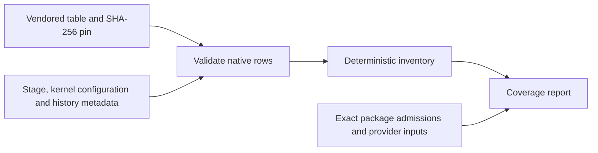

# Linux x86-64 syscall inventory

The package is pinned to Linux **v6.12**, commit
`adc218676eef25575469234709c2d87185ca223a`. The vendored
[`syscall_64.tbl`](syscall_64.tbl) is byte-identical to the upstream
[table at that commit](https://github.com/torvalds/linux/blob/adc218676eef25575469234709c2d87185ca223a/arch/x86/entry/syscalls/syscall_64.tbl).
Its SHA-256 is
`980ce3115028c71c5618e7864d262017bde8103bcfe7b413147a14fd312c92ac`.
The table retains its upstream SPDX identifier. Its license and syscall
exception are included. [GPL-2.0](GPL-2.0.txt) · [Linux-syscall-note](Linux-syscall-note.txt)

The inventory covers the Linux native x86-64 `common` and `64` rows. There are
375 named entries, including 17 with no native handler. All 36 `x32` rows are
excluded. Empty entry points and explicit `sys_ni_syscall` entries are marked
`historical-enosys`. Gaps in the native numbering window identify unallocated
slots, numbers reserved by the table comment and x32-only allocations. Native
dispatch uses the ENOSYS handler for these slots.
[Table header generator](https://github.com/torvalds/linux/blob/adc218676eef25575469234709c2d87185ca223a/arch/x86/entry/syscalls/syscalltbl.sh) ·
[Native dispatch](https://github.com/torvalds/linux/blob/adc218676eef25575469234709c2d87185ca223a/arch/x86/entry/syscall_64.c) ·
[ENOSYS handler](https://github.com/torvalds/linux/blob/adc218676eef25575469234709c2d87185ca223a/kernel/sys_ni.c)

`classifications.json` supplies the plan stage and the conditions and
history dispositions that require additional sources. Its source paths refer
to the pinned Linux tree. Availability rules record known build conditions
for the handler. Behavior rules record selected additional conditions for
command, parameter or boot-time availability. The inventory covers the ABI
at the exact revision. Runtime results also depend on the booted kernel,
permissions, seccomp profile, hardware, and arguments. A runtime ENOSYS is
an operation result and does not change package coverage.
[Plan §8.2](../../../PLAN.md#82-linux-syscall-package-implementation-plan) ·
[ADR-020](../../../draft/adr/020-immutable-objects-and-implhash-calls.md)

The generated `catalog.json` inventories the kernel interface. The coverage
report adds exact package admissions after verifying the currently selected
provider identity and the recorded evidence inputs. A row is `ready` when an intended public provider has an exact admission and every declared command variant is admitted. A compound provider needs the named witness for that particular native call. A row with an admitted profile can remain `scoped-admission` when these readiness checks are unresolved. Supported commands, unavailable declarations and profile limits appear in the report. Native provider numbers derive from the pinned data.



The inventory can be verified, regenerated and compared entirely offline
with Python 3.

```sh
python3 packages/linux.syscalls/catalog/catalog.py check
python3 packages/linux.syscalls/catalog/catalog.py report
python3 packages/linux.syscalls/catalog/catalog.py report read fcntl socket
python3 packages/linux.syscalls/catalog/catalog.py report --json
python3 packages/linux.syscalls/catalog/catalog.py diff path/to/proposed/syscall_64.tbl
python3 packages/linux.syscalls/catalog/catalog.py diff --before path/to/previous/syscall_64.tbl
python3 packages/linux.syscalls/catalog/test_catalog.py
```

The native LLMLang declarations can also be checked against a checkout of the pinned Linux commit. The signature generator reads the native `SYSCALL_DEFINE` parameters and applies the x86-64 configuration for `clone`. `--write` regenerates the declarations for the checked pin. [Native declarations](../provider/src/native.llmlang)

```sh
python3 packages/linux.syscalls/catalog/generate_native.py /path/to/pinned/linux --check
```

### Native pointer contracts

The generator requires a reviewed classification for every pointer containing C `char` in the active catalog. It applies named refinements for NUL-terminated strings, read and write buffers with a separate byte count, and nullable or input-only pointers. Pointers to command-specific layouts retain their ABI type so the caller can apply the selected command's contract. [Reviewed parameters](native_pointer_contracts.py)

- `statx` and `newfstatat` accept a null pathname along the descriptor path selected by `AT_EMPTY_PATH`, subject to their flag checks. `futimesat` and `utimensat` accept a null pathname for a descriptor other than `AT_FDCWD`. [Linux stat implementation](https://github.com/torvalds/linux/blob/adc218676eef25575469234709c2d87185ca223a/fs/stat.c) · [Linux timestamp implementation](https://github.com/torvalds/linux/blob/adc218676eef25575469234709c2d87185ca223a/fs/utimes.c)
- `mount` accepts a null device, filesystem type or data when the operation allows it. `quotactl` accepts a null device for `Q_SYNC`. `fsconfig` selects the key and value requirements by command. [Linux mount implementation](https://github.com/torvalds/linux/blob/adc218676eef25575469234709c2d87185ca223a/fs/namespace.c) · [Linux quota implementation](https://github.com/torvalds/linux/blob/adc218676eef25575469234709c2d87185ca223a/fs/quota/quota.c) · [Linux fsconfig implementation](https://github.com/torvalds/linux/blob/adc218676eef25575469234709c2d87185ca223a/fs/fsopen.c)
- `openat2` reads the `open_how` record using the supplied structure size. `readlink` uses an output capacity and returns bytes without a trailing NUL. `execve` and `execveat` allow null argument or environment vectors. A supplied vector ends with a null pointer, and each string ends with a NUL byte. [Linux open implementation](https://github.com/torvalds/linux/blob/adc218676eef25575469234709c2d87185ca223a/fs/open.c) · [Linux exec implementation](https://github.com/torvalds/linux/blob/adc218676eef25575469234709c2d87185ca223a/fs/exec.c)
- `getsockopt` takes capacity through an in/out pointer. `syslog` uses its buffer and length for the read commands. A nonzero `kexec_file_load` command-line length includes a final NUL byte. [Linux socket implementation](https://github.com/torvalds/linux/blob/adc218676eef25575469234709c2d87185ca223a/net/socket.c) · [Linux syslog implementation](https://github.com/torvalds/linux/blob/adc218676eef25575469234709c2d87185ca223a/kernel/printk/printk.c) · [Linux kexec-file implementation](https://github.com/torvalds/linux/blob/adc218676eef25575469234709c2d87185ca223a/kernel/kexec_file.c)

Run `catalog.py check --require-complete` for the plan's coverage exit gate. To change the pin, update the commit, table hash and table bytes together, review all changed row assignments and regenerate `catalog.json` with `catalog.py generate`.
