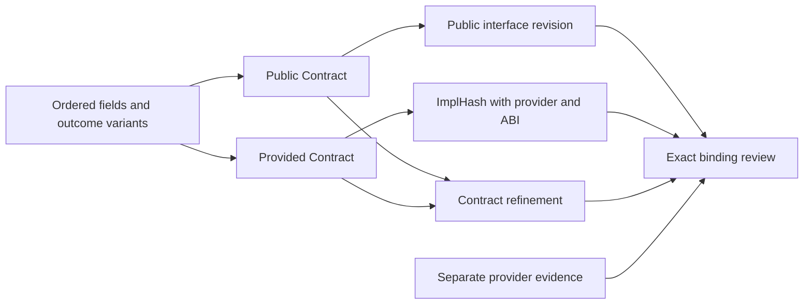

# Linux syscall contracts

The contract inventory describes the typed `linux.syscalls` operations in the native x86-64 profile. Each operation links to its Linux semantics and defines a typed signature, caller obligations, result guarantees, possible effects, and open assumptions. [`syscalls.json`](syscalls.json) is the authoring input to the package builder. [`commands.json`](commands.json) accounts for the supported operations of multiplexed interfaces against immutable v6.12 UAPI references.



A public interface revision follows its public Contract. Changes to the provided Contract affect implementation binding and evidence. The diagram shows where the separate contract refinement and provider conformance results enter binding review. See [ADR-020](../../../draft/adr/020-immutable-objects-and-implhash-calls.md) and [ADR-018](../../../draft/adr/018-formal-verification-backends.md).

## Types, ownership, and evidence

The profile declares the exact order of fields and variant data in each logical signature. A native adapter is responsible for translating those types to kernel arguments and result storage. For instance, logical IPv4 endpoint data is distinct from the target `sockaddr_in` bytes, and the ordered epoll events have a packed native representation. Owned resources give the caller responsibility for release. A borrowed descriptor stays live for the call and ownership stays with its caller. Structure invariants describe valid publicly observable values in this scope. See [ADR-021](../../../draft/adr/021-structures-and-data-layout.md) and [ADR-026](../../../draft/adr/026-structure-contracts-and-invariant-verification.md).

`contracts.py` checks the closed schema and every referenced type. It includes transitively referenced type definitions in the contract identity. It hashes logical data with SHA-256 and separates the public, provided, and interface identity domains. Contract clause collections are sorted by identifier for identity. Ordered fields and outcome variants retain their declared order.

Refinement conservatively checks inclusion of identical clauses. The provider may require fewer caller obligations and external assumptions, must carry every public guarantee, and must stay within the public effect set. An atom consists of its identifier and its exact clause text. This supports identical modeled premises and guarantees and rejects new preconditions, missing guarantees, and additional effects. Semantic equivalence of differently worded formulas and the full truth of opaque clauses remain outside this check. The review identifies external assumptions and the separate conformance scope. The scalar [read/write evidence](../evidence/README.md) and native tests support specific adapter claims with their recorded boundaries.

Every listed command links to a typed operation and pinned Linux ABI source. For example, `fcntl_getfl` applies `F_GETFL` without a third argument. The ioctl scope includes the generic unread-byte query and the fixed requests used by the private pseudoterminal lifecycle. BPF covers one array map profile. Perf covers a fixed software task clock and a return probe on a fixed provider function. The return probe's command record names the sysfs selector that supplies its runtime PMU type to distinguish its config value from the software task-clock config. io_uring covers capability queries and a one-shot NOP on a fresh private ring. Legacy AIO covers descriptor fsync and cancellable private-pipe polls, with a separate completion operation for each profile. The command report declares unlisted variants unsupported. See the [ABI catalog](../catalog/catalog.json).

## Readiness boundary

An admitted interface binds exact public and provided Contract identities to one provider revision and its applicable evidence. The native observations cover the documented input shapes, success and error cases, and host or guest configuration. The clauses describe additional kernel premises used when interpreting those observations. The verifier checks the read and write return model within the scope documented by the evidence runner. Full proofs of kernel behavior, generalized ownership and effects, and all command and configuration cases remain open. [Evidence scope](../evidence/README.md) · [Guest replay](../guest/README.md)

The strict catalog check requires complete readiness for every active native table entry. The detailed report shows partial interfaces and unresolved rows. Run both from the repository root.

```sh
python packages/linux.syscalls/catalog/catalog.py report
python packages/linux.syscalls/catalog/catalog.py check --require-complete
```

Run the contract regression tests from the repository root.

```sh
python -B -m unittest discover -s packages/linux.syscalls/contracts -p 'test_*.py'
```
