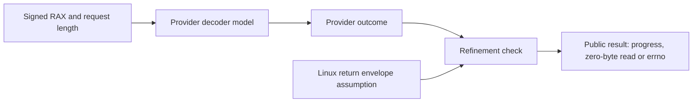

# Read and write return-envelope evidence

These checks cover the scalar Linux x86-64 `read` and `write` return decoder. The native adapter receives signed RAX and has the original nonnegative slice length. The checked model preserves positive errno values from raw returns in `[-4095, -1]`, preserves the exact progress from `0` to the requested length, and gives a nonempty read returning zero the `Eof` result tag. A raw value outside that envelope produces an adapter ABI violation.

The `Eof` tag preserves the zero-byte result. Its interpretation depends on the underlying descriptor. It represents EOF when the file or byte-stream semantics define zero that way, for example at the current end of a regular file or on a drained pipe after its writers close. Other descriptors may return zero for reasons such as a terminal read timeout or a zero-size datagram.



The body obligation establishes that the modeled decoder meets the provider return relation for signed 64-bit inputs. The separate refinement obligation assumes the Linux return envelope and checks that every corresponding provider result meets the public outcome relation. The Lean theorems check the corresponding relations independently. Boogie negative controls reject a decoder that reports `EINTR` as transfer progress and a refinement argument with the Linux premise removed.

Use the same Boogie 3.5.5, Z3 4.13.3 and Lean 4.36.0 versions as the [scalar MVP](../../../tools/llmlang_mvp/README.md). From the repository root, after building the provider's `decoder` example, run:

```sh
python -B packages/linux.syscalls/evidence/check.py \
  --decoder packages/linux.syscalls/provider/target/debug/examples/decoder \
  --subject packages/linux.syscalls/provider/src/io.rs \
  --report /tmp/llmlang-read-write-evidence.json
```

Passing `--decoder` replays finite boundary cases against the functions called by the native provider. The report identifies the exact replay executable, model inputs and optional subject files by SHA-256. Boundary replay covers positive and zero-length reads and writes, partial progress, `EINTR`, `ENOSYS`, both ends of the errno range, signed register extremes and an excessive return count. The report retains every raw input and observation. Omit `--decoder` for a model-only check.

The report records source-level claims as conditional even when the model and replay both pass. Universal Rust-to-model correspondence and the real kernel's return envelope remain open premises. The checks do not model memory frames, descriptor validity or state, signal delivery, or kernel progress. Those are separate contract and scenario evidence. The result schema distinguishes model checks, finite source observations, tool errors and inconclusive runs, as required by [ADR-018](../../../draft/adr/018-formal-verification-backends.md).
