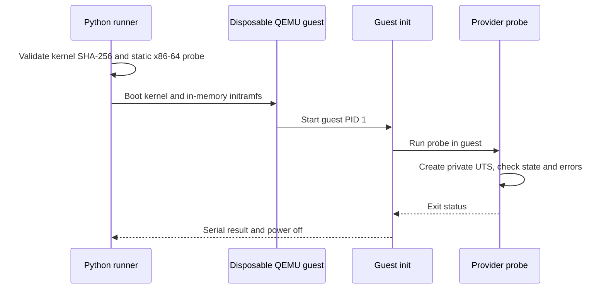

# Disposable Linux x86-64 guest checks

The UTS probe exercises the bounded `unshare_uts` and `sethostname` provider
profiles. The probe first confirms that a new UTS namespace inherits its
hostname. It changes the hostname inside that namespace and observes that
the parent namespace retains its original hostname. It checks empty, 64-byte
and embedded-NUL inputs, rejection of 65 bytes before entry into the kernel,
and kernel permission denial after dropping privileges. The test uses
`uname` to observe the C-string view of the hostname, so the embedded-NUL
case covers the visible prefix. [Provider probe](../provider/examples/uts_guest.rs) ·
[Recorded results](uts-evidence.json) · [Plan §8.2](../../../PLAN.md#82-linux-syscall-package-implementation-plan)

The QEMU runner packages a statically linked init and probe into an in-memory initramfs. It starts a new QEMU machine with TCG, no disk or host filesystem
share, no guest NIC, and the QEMU seccomp sandbox. The guest init forks and
waits for the probe, reports its exit status on the serial console and
powers the guest off. The runner matches the expected case set and exit
status. The isolated process starts as guest root because Linux requires
the relevant capability to create a UTS namespace. The test never requires
host root or a host namespace change.



The evidence was produced with Rust 1.85.1
(`4eb161250e340c8f48f66e2b929ef4a5bed7c181`, LLVM 19.1.7), GNU C
14.2.0 (Debian 14.2.0-19), QEMU 10.0.13
(Debian `1:10.0.13+ds-0+deb13u1`) and SeaBIOS `1.16.3-2`. The guest image
is Debian `6.12.117-1` and has `CONFIG_UTS_NS=y`. The v6.12 upstream
catalog pin defines the ABI inventory. This replay measures a distinct
Debian stable-kernel build. It covers only the recorded configurations,
inputs and process states.

| Debian input | SHA-256 |
| --- | --- |
| [Guest kernel package](https://deb.debian.org/debian/pool/main/l/linux-signed-amd64/linux-image-6.12.117+deb13-cloud-amd64_6.12.117-1_amd64.deb) | `e9893e5295d0549b8852611f12a4b8b5f6cc4b8128dcc2086b9847793b904ab7` |
| [QEMU x86 package](https://deb.debian.org/debian/pool/main/q/qemu/qemu-system-x86_10.0.13+ds-0+deb13u1_amd64.deb) | `5e841d0723a657fd8bc2e9e1a085d24f47fcb3e4a0f94762e6c38b429f22fbb1` |
| [SeaBIOS package](https://deb.debian.org/debian/pool/main/s/seabios/seabios_1.16.3-2_all.deb) | `2b590534250b940f43222eeab9a8f57f337a9d9a73fc412a43ab8cd07a7e56f6` |

Extract the guest package into a temporary directory with
`dpkg-deb -x`. With QEMU and its firmware installed and the pinned compiler
on `PATH`, run the following from the toolchain repository. The kernel
path points to the extracted `vmlinuz-6.12.117+deb13-cloud-amd64`.

```sh
vm_build=$(mktemp -d)
RUSTFLAGS='-C target-feature=+crt-static' cargo build --locked --offline \
  --release --example uts_guest \
  --manifest-path packages/linux.syscalls/provider/Cargo.toml \
  --target-dir "$vm_build"

python3 packages/linux.syscalls/guest/run.py \
  --kernel /path/to/extracted/boot/vmlinuz-6.12.117+deb13-cloud-amd64 \
  --kernel-sha256 ed8f0dbdbefe3994093937f5ee934818ae902b88cb0b6bc423811c10d55b87b0 \
  --probe "$vm_build/release/examples/uts_guest" \
  --provider-root packages/linux.syscalls/provider \
  --expect-case domain_name_permission_denied \
  --expect-case domain_name_updates_only_private_namespace \
  --expect-case hostname_embedded_nul \
  --expect-case hostname_empty \
  --expect-case hostname_exact_64 \
  --expect-case hostname_overlength_rejected \
  --expect-case hostname_permission_denied \
  --expect-case uts_inheritance_and_isolation \
  --expect-case uts_permission_denied
```

For unpacked QEMU packages, pass the executable as `--qemu`, the
`bios-256k.bin` image as `--bios`, and the unpacked QEMU firmware directory
as `--firmware`. The replay used the explicit SeaBIOS image whose digest
appears in the recorded results.

Run all registered guest suites in fresh VMs with one command. Use the extracted kernel module directory and mke2fs 1.47.0 or 1.47.2. The module and quota probes use pinned fixture bytes that the runner verifies before boot. The shadow-stack suite uses a Bochs 2.7 Tiger Lake CPU with CET. The output records the observed cases, environment and exact provider and probe input digests for each suite.

```sh
guest_work=$(mktemp -d)
python3 -B packages/linux.syscalls/guest/replay.py \
  --kernel /path/to/extracted/boot/vmlinuz-6.12.117+deb13-cloud-amd64 \
  --bios /path/to/bios-256k.bin \
  --module-archive-root /path/to/extracted/usr/lib/modules/6.12.117+deb13-cloud-amd64/kernel \
  --bochs-root /path/to/extracted/bochs \
  --iso-root /path/to/extracted/iso-tools \
  --video-bios /path/to/vgabios-isavga.bin \
  --output "$guest_work/reports"
```

Extract the Bochs binary, terminal plugin and BIOS together with `dpkg-deb -x` into the Bochs root. Extract the ISO generator and both SYSLINUX packages together into the ISO root. The Bochs replay verifies the individual boot-file digests and boots the same kernel from read-only CD-ROM media. Use the VGA BIOS from the SeaBIOS package above. [Bochs runner and boot-file pins](run_bochs.py) · [Shadow-stack results](shadow_stack-evidence.json)

| Debian input | SHA-256 |
| --- | --- |
| [Bochs binary](https://deb.debian.org/debian/pool/main/b/bochs/bochs_2.7+dfsg-4+deb12u1_amd64.deb) | `50a363747f0c7c35cb83ce32ada5302dfb1717185903aa18230226478ba9c6f8` |
| [Bochs terminal plugin](https://deb.debian.org/debian/pool/main/b/bochs/bochs-term_2.7+dfsg-4+deb12u1_amd64.deb) | `d77dae3fc1fa12e829f73d1fb757832df89991fe1956e921c790299e007dc07a` |
| [Bochs BIOS](https://deb.debian.org/debian/pool/main/b/bochs/bochsbios_2.7+dfsg-4+deb12u1_all.deb) | `ab91713fab14c3ad27146fa60ad9f1ce3750fdb6f9e21bef0d5aa0d4af2ff429` |
| [ISO generator](https://deb.debian.org/debian/pool/main/c/cdrkit/genisoimage_1.1.11-3.4_amd64.deb) | `43581533b042ae9ef86cbfb040a394772c412f4c005e77d252302c2c76fc5fe8` |
| [ISOLINUX loader](https://deb.debian.org/debian/pool/main/s/syslinux/isolinux_6.04~git20190206.bf6db5b4+dfsg1-3_all.deb) | `cb14af88adc2c3844976cd2de61571d2af94d2fb65c277fe4acf3dc8a5d25aae` |
| [SYSLINUX modules](https://deb.debian.org/debian/pool/main/s/syslinux/syslinux-common_6.04~git20190206.bf6db5b4+dfsg1-3_all.deb) | `f7e4ead7fdfe5cb6117d8d2485d75e53570a8cf680c81a432f92c1774f878875` |

## Task clock and bounded io_uring

The same guest harness checks that the software task clock exposes a readable
counter, the flag-zero ring setup returns an owned descriptor, and the fixed
register probe reports NOP among supported opcodes. A separate fresh ring
submits one fixed NOP and observes its tagged completion. This enter call
waits for completion without a userspace deadline. The provider requests
kernel and hypervisor exclusion flags. Numeric counter semantics come from the
Linux task-context clock. The ring profile reports queue depths and features
and exposes opcode metadata. A fresh private ring also submits one NOP and checks its completion tag. [Provider probe](../provider/examples/complex_guest.rs) · [Recorded results](complex-evidence.json) · [Task-clock implementation in v6.12](https://github.com/torvalds/linux/blob/adc218676eef25575469234709c2d87185ca223a/kernel/events/core.c#L11373-L11451)

Build the static probe and replay it with the same guest, ABI profile and tools
as above.

```sh
vm_build=$(mktemp -d)
RUSTFLAGS='-C target-feature=+crt-static' cargo build --locked --offline \
  --release --example complex_guest \
  --manifest-path packages/linux.syscalls/provider/Cargo.toml \
  --target-dir "$vm_build"

python3 packages/linux.syscalls/guest/run.py \
  --kernel /path/to/extracted/boot/vmlinuz-6.12.117+deb13-cloud-amd64 \
  --kernel-sha256 ed8f0dbdbefe3994093937f5ee934818ae902b88cb0b6bc423811c10d55b87b0 \
  --probe "$vm_build/release/examples/complex_guest" \
  --provider-root packages/linux.syscalls/provider \
  --provider-example complex_guest \
  --expect-case perf_task_clock_ticks \
  --expect-case io_uring_setup_returns_owned_ring \
  --expect-case io_uring_probe_reports_nop \
  --expect-case io_uring_nop_completes
```

Native integration tests also check local depth validation and report exact
availability errors from the host kernel. The hosted workflow preserves those
outputs with the test logs. The guest record establishes the positive paths
for its declared configuration. [Native integration tests](../provider/tests/complex.rs)

## Private mount namespace and tmpfs

The namespace operation calls `unshare(CLONE_NEWNS)` and marks the copied
mount tree recursively private. Linux also unshares the calling thread's
filesystem information, including its working directory. A propagation
failure reports that the namespace switch has occurred and withholds the
token needed by the package mount operation. [Linux v6.12 namespace entry](https://github.com/torvalds/linux/blob/adc218676eef25575469234709c2d87185ca223a/kernel/fork.c#L3288-L3292)

The mount operation takes an exclusive borrow of the thread-affine namespace
token and an open target directory. It attaches a fresh 1 MiB tmpfs with mode
0700 and `nosuid,nodev,noexec`. Linux checks that the destination mount
belongs to the current namespace. The owned handle pins the new mount's root.
Detachment temporarily changes into that exact directory using its descriptor,
detaches `"."` with `MNT_DETACH`, and restores the saved working directory.
The profile assumes that external code leaves the namespace and attachment
unchanged while the token is in use. A failed restoration records whether the
detach occurred and disables further operations through that token.
[Provider implementation](../provider/src/mounts.rs) · [Linux v6.12 mount namespace check](https://github.com/torvalds/linux/blob/adc218676eef25575469234709c2d87185ca223a/fs/namespace.c#L3294-L3306)

The guest opens a directory before entering the private namespace and confirms
that the new namespace cannot use its descriptor as a target. It checks the
filesystem mode, size and flags, verifies that the new content is visible
only while attached, and checks explicit detachment, cwd restoration and
best-effort detachment when the handle is dropped. Run the mounted-state
probe through the batch replay above. [Provider probe](../provider/examples/mounts_guest.rs) · [Recorded results](mounts-evidence.json)

## Landlock read access

The Landlock probe queries the kernel ABI and creates a ruleset for
`READ_FILE` and `READ_DIR`. It allows reads beneath a chosen directory, enters
the ruleset with `no_new_privs`, and observes denied opens outside that
directory. A descriptor opened before entry remains usable. A second ruleset
with wider read access leaves the earlier restriction in force. The guest
also tests rule validation against a non-filesystem descriptor and the
close-on-exec flag of the ruleset. The host fixture accepts kernel availability
errors and the guest records positive behavior for its kernel configuration.
[Provider probe](../provider/examples/landlock_guest.rs) · [Recorded results](landlock-evidence.json)


## Credentials, LSM, and NUMA

The credential probe checks real, effective, saved, and filesystem IDs, and
supplementary groups before and after an unprivileged transition. It also
checks that clearing all three capability sets or enabling `no_new_privs`
in one thread leaves the sibling thread's state intact. The probe confirms
that attempts to regain privilege after the drop return the expected kernel
errors. [Credential probe](../provider/examples/credential_changes_guest.rs) · [Credential results](credential_changes-evidence.json)

The LSM probe lists active module IDs and reads bounded records for the
calling thread's current context. It checks the required byte count when the
provided capacity is too small. The host fixture records availability
errors without changing credentials. [LSM probe](../provider/examples/lsm_queries_guest.rs) · [LSM results](lsm_queries-evidence.json)

The NUMA probe observes the allowed nodes, changes the calling thread's
policy, and assigns a policy to an owned anonymous mapping. It verifies
that changing mapping policy with migration disabled preserves the bytes and
thread policy. It also checks the result of binding an unavailable node.
[NUMA probe](../provider/examples/numa_guest.rs) · [NUMA results](numa-evidence.json)
