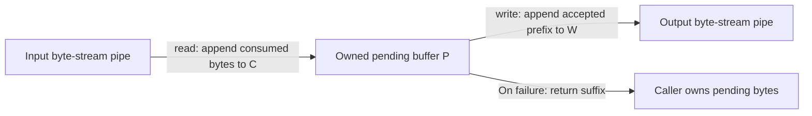
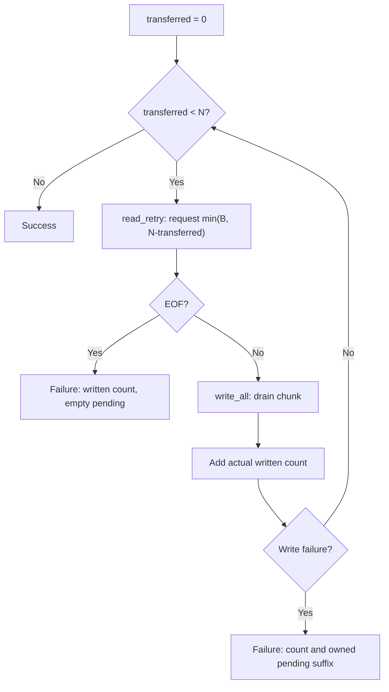
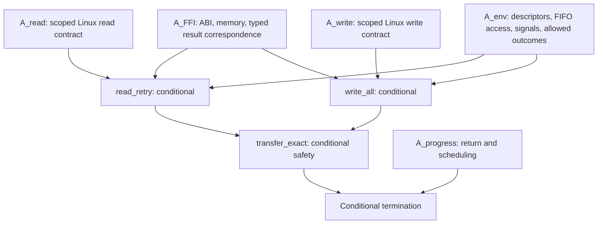

# CF-008 — Linux pipe transfer with assumed syscall contracts

**Case ID:** CF-008  
**Title:** Exact bounded Linux pipe transfer with partial I/O and explicit trust assumptions  
**Revision:** 1  
**Status:** Proposed evaluation case; analytical conditional argument, not a machine-checked proof  
**Focus:** Byte-sequence preservation, loop invariants, partial results, interruption, error recovery, FFI correspondence, and safety versus termination  
**Related research:** [CF-007](CF-007-compositional-bank-transfer.md), [RT-36](../../RT-36/RT-36-FORMAL-VERIFICATION-ASSUMPTIONS-AND-TRUST.md), [POSIX runtime architecture](../../RT-10/POSIX-RUNTIME-ARCHITECTURE.md), [RT-10 read interruption](../../RT-10/RT-10-POSIX-READ-INTERRUPTION.md), [RT-10 nonblocking pipe I/O](../../RT-10/RT-10-POSIX-NONBLOCKING-PIPE-IO.md), [formal verification](../../RT-07/LLMLang-FORMAL-VERIFICATION.md), [proof-obligation benchmark](../../RT-33/PROOF-OBLIGATION-BENCHMARK.md).

## 1. Source request

> Transfer exactly N bytes from an input Linux pipe into an output Linux pipe without changing their content or order, losing bytes, or duplicating bytes. Handle short reads and writes and retry calls interrupted before progress. Never consume more than N input bytes. If a specified failure prevents completion, return the precise number of bytes accepted by the output pipe and the contiguous suffix of input already consumed but not written. Assume the external system calls obey their declared contracts.

The objective is to derive application correctness from precise external contracts without pretending to verify the kernel. A syscall returning an allowed error satisfies its contract.

## 2. Clarifications and scope

The following are proposed fixture choices, not universal Linux semantics:

- N is a nonnegative mathematical integer; block size B=8192 is a positive example constant, not a claim about pipe capacity or PIPE_BUF.
- Distinct ordinary blocking byte-stream pipes (not packet-mode pipes); stable valid descriptors, exclusive input reader and output writer throughout the call, no descriptor reuse, competing consumers of input, or competing producers of output. External producers of input and consumers of output are allowed.
- Positive requests are at most B and representable as size_t and ssize_t; valid initialized write buffers, valid writable read buffers, no concurrent mutation, and safe slice bounds. N and progress counters require a representation without overflow (or separately checked arithmetic).
- SIGPIPE is ignored and remains so during the operation. No cancellation, fatal signals, exceptions, allocation failure, or process crash. Result buffers retain ownership until returned to the caller.
- Modeled read outcomes: positive partial/full read, EOF, EINTR. Modeled write outcomes: positive partial/full write, EINTR, EPIPE. A defensive zero-progress write result is also modeled as a no-effect failure, without asserting Linux must produce this for a positive request. Other errors are excluded by an explicit outcome-coverage assumption; an implementation must not silently classify arbitrary errors as no-progress. Nonblocking EAGAIN, packet modes and recovery across process crashes require distinct contracts.
- No guarantee that the peer consumes or processes the accepted output bytes. Bytes accepted before peer closure can cease to exist in the kernel; this fixture accounts for historical accepted bytes, not durable delivery.
- Blocking and infinite EINTR retries are permitted by safety-only assumptions. Termination needs additional progress assumptions, not just correct syscall behavior.

The normative interface and supporting references for the model are [Linux read(2)](https://man7.org/linux/man-pages/man2/read.2.html), [write(2)](https://man7.org/linux/man-pages/man2/write.2.html), [pipe(7)](https://man7.org/linux/man-pages/man7/pipe.7.html), [signal(7)](https://man7.org/linux/man-pages/man7/signal.7.html), [syscall(2)](https://man7.org/linux/man-pages/man2/syscall.2.html), [POSIX read](https://pubs.opengroup.org/onlinepubs/9799919799/functions/read.html) and [POSIX write](https://pubs.opengroup.org/onlinepubs/9799919799/functions/write.html). Short results and pre-progress EINTR are documented; exact observation/frame and outcome coverage below are explicit scoped model assumptions, not deductions about all descriptors or all errors. Existing RT-10 experiments are related empirical evidence, not proof of this fixture.

## 3. Interface and semantic domain

Let C be the historical sequence of bytes consumed by this invocation, W the historical sequence of bytes accepted by the output pipe from this invocation, and P the currently owned pending suffix. All begin empty. Concatenation is written ++, length as |S|, and slices are half-open. These histories are ghost observations, not current pipe occupancy. Exclusive access plus FIFO semantics makes C a prefix of the logical input stream available to this reader, and W ordered within the output stream; it does not require that either pipe is initially empty.



*Figure 1. Illustrative data flow. The histories count consumed and accepted bytes, not the remaining contents of kernel buffers.*

### 3.1 External contracts and binding boundary

Linux libc-facing signatures are conceptually `ssize_t read(int fd, void *buf, size_t count)` and `ssize_t write(int fd, const void *buf, size_t count)`. A raw Linux syscall binding must instead correctly interpret the architecture-specific ABI and error convention. The pseudocode uses a typed adapter, not raw libc or a selected LLMLang syntax.

```text
read(src, m) -> Data(bytes) | EOF | Interrupted
  requires stable readable pipe, exclusive reader
  requires 0 < m <= B; valid writable buffer
  ensures Data(b): 0 < |b| <= m
                    b is the next input prefix; delta C = b
                    b initialized in returned owned memory
  ensures EOF: delta C = empty; no input bytes remain and all writers closed
  ensures Interrupted: delta C = empty
  frame: no output append by this call; no unrelated application memory changes
  assurance: assumed external contract + adapter correspondence

write(dst, b) -> Written(k) | Interrupted | BrokenPipe | NoProgress
  requires stable writable pipe descriptor, exclusive writer
  requires 0 < |b| <= B; valid initialized immutable buffer slice
  ensures Written(k): 0 < k <= |b|; delta W = b[0:k]
  ensures Interrupted / BrokenPipe / NoProgress: delta W = empty
  frame: b unchanged; no input consumption by this call;
         no unrelated application memory changes
  assurance: assumed external contract + adapter correspondence
```

EOF means the input is empty and no write-end references remain, not merely that the pipe is temporarily empty. A writable descriptor can remain valid after the peer closes its end. For positive writes larger than PIPE_BUF a short write may arise, e.g. if interrupted after progress; a smaller blocking write has stronger atomicity constraints. The proof intentionally admits an overapproximation of short positive counts; a counterexample intended to demonstrate a real Linux behavior must separately establish trace feasibility. EINTR denotes an interruption before the modeled transfer; if the operation has already made progress it must account for that progress through the applicable positive result. Automatic restart may hide EINTR from the application.

The adapter must correctly distinguish signed success counts and errors, capture errno immediately on libc failure (not on success), or decode raw syscall errors, enforce memory/initialization and ownership, preserve exact byte ranges, and satisfy its frame and normal-return conditions. These are separate obligations or explicit assumptions, not established by kernel documentation alone.

### 3.2 Read wrapper

```python
def read_retry(src, m):
    while True:
        r = linux_read(src, m)
        if r is Interrupted:
            continue
        return r                    # Data(bytes) or EOF
```

Contract (partial correctness): on any normal return, no EINTR is exposed; Data has positive length at most m and equals the exact consumed prefix; EOF consumes nothing. Each interrupted iteration consumes nothing, so any finite number of retries leaves the effective read unchanged. No unconditional termination claim.

### 3.3 Write wrapper

```python
def write_all(dst, data):
    offset = 0
    while offset < len(data):
        r = linux_write(dst, data[offset:])
        match r:
            case Interrupted:
                continue
            case BrokenPipe | NoProgress:
                return Failure(offset, data[offset:], r)
            case Written(k):
                offset += k
    return Success(offset)
```

Requires a stable exclusive output writer and an immutable owned initialized byte sequence of length at most B. Empty data is permitted and makes no syscall. Every normal return satisfies:

```text
0 <= written <= |data|
delta W = data[0:written]
Success -> written = |data|; pending = empty
Failure -> pending = data[written:]; reason in {BrokenPipe, NoProgress}
delta W ++ pending = data
```

The loop invariant is `0 <= offset <= |data|` and `delta W = data[0:offset]`. Each Written(k) advances exactly k and preserves the remaining suffix; EINTR stutters; specified failure leaves the suffix available for return. The rank |data|-offset decreases on positive progress only.

### 3.4 Top-level composition

```python
def transfer_exact(src, dst, n):
    transferred = 0
    while transferred < n:
        m = min(8192, n - transferred)
        chunk = read_retry(src, m)
        if chunk is EOF:
            return Failure(transferred, b"", UNEXPECTED_EOF)
        result = write_all(dst, chunk.bytes)
        transferred += result.written
        if result is Failure:
            return Failure(transferred, result.pending, result.reason)
    return Success(transferred)
```

This restricted typed pseudocode is exhaustive over its modeled outcomes. Other error variants require explicit handling and justified effects; do not deploy this example as a general I/O wrapper. Returning the pending suffix transfers its ownership to the caller; it must not alias a destroyed local buffer.



*Figure 2. Illustrative caller control flow. No next read occurs until the current chunk is completely accepted.*

## 4. Accepted semantic oracle

For all permitted executions, including finite prefixes of nonterminating executions, the logical byte accounting at the modeled call boundaries satisfies:

```text
C = W ++ P
0 <= |W| <= |C| <= N
```

At a normal return, `written = |W|` and:

- Success: |C|=|W|=N, P=empty, C=W.
- Failure: written<=N, pending=P=C[|W|:], reason is one of the specified failures. EOF has empty P and |C|<N; a write failure returns the unaccepted suffix of the last chunk. No further input is consumed after a terminal failure.
- N=0 succeeds without any read/write. No zero-count syscall is issued.
- All call preconditions, memory and frame conditions hold; each EINTR is retried without advancing progress. No claim of exactly-once delivery to the receiving application or progress across a new invocation is made.

The oracle constrains observable behavior and necessary retry/progress protocol, not a particular buffer size or algorithm. The chosen B is a fixture configuration; other positive safe sizes, or a verified equivalent implementation, are allowed.

### 4.1 FRETish-inspired observational clauses

As in CF-007, these are illustrative, unparsed sketches. A trace adapter must bind counters and Boolean sequence predicates to the same invocation, including snapshots after each modeled operation; it must prove the predicates faithfully reflect actual byte equality, not merely count equality.

```text
PipeTransfer shall always satisfy
    invocation_observed ->
    (written_count >= 0 & written_count <= consumed_count &
     consumed_count <= requested_count & sequence_partition_ok)

PipeTransfer shall always satisfy
    (completed & success) ->
    (written_count = requested_count &
     consumed_count = requested_count & pending_empty)

PipeTransfer shall always satisfy
    (completed & !success) -> returned_pending_is_exact_suffix
```

These do not establish termination, memory safety, or source-to-observation correspondence by themselves. See [NASA FRET](https://github.com/NASA-SW-VnV/fret). The sequence oracle and loop proof are separate from the temporal observation sketches; a completed-only trace could be vacuous.

## 5. Required contract properties and conditional analytical proof

Initially C=W=P=empty and transferred=0. At the top of each outer iteration P is empty and transferred=|C|=|W|. Therefore m is positive, at most B and at most N-|C|, so the read preconditions hold. A positive read returns b with length k<=m; then C'=C++b, P'=b and |C'|<=N. EOF leaves histories unchanged and returns the empty suffix.

For a positive write of j bytes, the write contract implies W'=W++P[0:j] and P'=P[j:]. Hence W'++P'=W++P=C'. Bounds hold since j<=|P|. EINTR and modeled zero-effect failures preserve the histories and pending data. The write wrapper returns the exact accepted length and remainder; adding this length to transferred preserves transferred=|W|. On its success P is empty and the outer invariant is restored. On its failure the owned P is returned, satisfying the failure postcondition. If the outer loop exits normally then |W|=N and P=empty, proving exact ordered transfer. There is no write outside the initialized slice or read beyond the remaining budget under the adapter assumptions.

At internal kernel execution instants a call may be in flight; the proof uses abstract call-boundary observations (or a refinement that accounts for in-flight bytes), not a claim that user-space counters reflect all instantaneous kernel state.

### 5.1 Safety versus progress

The safety argument does not require that a blocked read or write returns. For total correctness add a separate progress assumption: every outstanding read_retry and write retry eventually yields Data, EOF, Written or a specified terminal failure, rather than blocking/retrying forever, and the caller is scheduled to process it. With this assumption, inner rank |data|-offset decreases on each nonterminal effective write; on every successful outer iteration N-transferred decreases by at least one. Since N is finite, all executions terminate with success or a specified failure. Progress alone does not imply success: EOF and broken pipes remain legal. Guaranteed successful transfer requires sufficient input and a functioning output environment as additional assumptions.

### 5.2 Proof dependency and trust boundary



*Figure 3. Candidate proof dependencies, not a serialized PDG or a machine-checked verdict. The kernel is outside the application proof. Progress is an extra dependency for termination only.*

A_read AND A_write AND A_FFI AND A_env entail the stated safety property by the analytical argument above. Add A_progress for termination. Independently verified exact bindings or platform proofs may discharge corresponding assumptions; a successful syscall test or man-page reference cannot by itself discharge them.

Illustrative evidence envelope (not adopted schema; logical result not machine-checked):

```yaml
property: transfer_exact.byte_sequence_preservation
evidence: analytical_argument
assurance: conditional
assumptions:
  - linux.blocking_pipe.read.v1
  - linux.blocking_pipe.write.v1
  - linux.ffi_adapter_correspondence.v1
  - linux.pipe_environment_and_outcome_coverage.v1
termination:
  additional_assumption: linux.pipe_progress.v1
```

Each assumption requires exact contract identity, scope (kernel/ABI and adapter revision, pipe modes, signal policy, buffer and access model), provenance, binding and discharge status. Invalidation must propagate when any relevant assumption or binding changes. See RT-36 for the candidate result and policy model; do not promote this illustration into an unconditional verified claim.

### 5.3 Counterexample with a correct kernel

A mutant returns Success(|data|) after just one positive write. Suppose a blocking write of 8192 bytes returns 4096 after interruption following progress (for example a large write with insufficient capacity and an interruption). The kernel contract is satisfied, but the mutant reports 8192 while only the first 4096 bytes were accepted and discards the remaining suffix. A finite abstract trace is:

| Operation | C length | W length | P length |
|---|---:|---:|---:|
| read returns 8192 | 8192 | 0 | 8192 |
| write returns 4096 | 8192 | 4096 | 4096 |
| write returns EINTR | 8192 | 4096 | 4096 |
| write returns EPIPE; return failure | 8192 | 4096 | 4096 |

The correct return is Failure(4096, original[4096:], BrokenPipe). The trace is an illustrative permitted abstract schedule, not a recorded kernel execution or evidence that every numeric sequence is reachable under every pipe configuration. If the mutant instead returns Success immediately after the first write, its own actual pending bytes are unaccounted for.

## 6. Negative controls

| ID | Incorrect candidate | Expected detection |
|---|---|---|
| NC-01 | Compare lengths only | Reordered or corrupted equal-length bytes pass; compare sequences |
| NC-02 | Assume positive result means full transfer | Legal short result refutes success |
| NC-03 | Assume any error consumes/writes nothing | Unsupported strengthening outside scoped outcome set |
| NC-04 | Treat empty blocking pipe as EOF | Ignore open writers and blocking behavior |
| NC-05 | Require pending empty on every failure | Discards read-but-unwritten bytes |
| NC-06 | Infer unconditional termination from decreasing rank on successful I/O | Infinite EINTR or blocking witness |
| NC-07 | Report kernel or adapter as verified | Undischarged external assumptions |
| NC-08 | Conflate output acceptance with peer delivery | Observation/semantic boundary violation |
| NC-09 | Require a fixed internal buffer algorithm | Unjustified strengthening; permit equivalent chunking |

## 7. Mutation challenges

| ID | Mutated behavior | Expected outcome |
|---|---|---|
| MUT-01 | Return full success after short write | Refute count, sequence and success |
| MUT-02 | Retry write from beginning after partial result | Refute sequence, duplicate prefix |
| MUT-03 | Advance offset by requested rather than actual count | Refute accounting and potentially bounds |
| MUT-04 | Always read B even when less than B remains | Refute input bound |
| MUT-05 | Treat EOF as retry forever | Violates terminal protocol; conditional progress alone does not save mutant |
| MUT-06 | Discard pending bytes on EPIPE | Refute exact failure suffix |
| MUT-07 | Treat EINTR as EOF | Refute retry protocol, even if conservation holds |
| MUT-08 | Use wrong slice offset with same length | Refute byte equality, not necessarily count |
| MUT-09 | Misdecode negative raw syscall return as unsigned count | Adapter correspondence, bounds/memory safety |
| MUT-10 | Remove assumption dependencies or claim progress without A_progress | Evidence/policy failure, not necessarily a program counterexample |
| MUT-11 | Use another safe chunk size or equivalent retry structure | Permit if all observable/protocol requirements hold |

## 8. Boundary scenarios

Illustrative abstract outcomes; Data and Written refer to actual typed adapter results.

| N | Scripted relevant outcomes | Required result |
|---:|---|---|
| 0 | No calls | Success(0) |
| 1 | Data(A), Written(1) | Success(1), W=A |
| 4 | Data(AB), Written(2), Data(CD), Written(2) | Success(4), W=ABCD |
| 4 | Data(AB), Written(2), EOF | Failure(2, empty, EOF) |
| 4 | EINTR, Data(ABCD), EINTR, Written(4) | Success(4), W=ABCD |
| 8192 | Data(8192), Written(4096), EPIPE | Failure(4096, exact second half, EPIPE) |
| 1 | Data(A), EPIPE | Failure(0, A, EPIPE) |
| 1 | Endless read EINTR or blocked read | No normal return required; safety holds |
| 8193 | First full 8192 block accepted; next read requests 1 | Never request more than remaining budget |
| -1 | Outside precondition | No required behavior |

Short-read and short-write schedules are abstract inputs to the oracle. A real Linux trace generator must respect capacity, PIPE_BUF, signal timing and reader/writer lifetime constraints; no timing or performance measurements are claimed.

## 9. Evaluation rubric and evidence limitations

Separate (1) natural-language formalization fidelity; (2) adapter/source correspondence and memory safety; (3) loop invariant induction and call-precondition obligations; (4) proof of exact byte-sequence preservation and failure suffix; (5) separate termination/progress dependencies; (6) assumption registry, policy, and transitive closure; (7) feasibility of concrete kernel traces. Use sequence theory or an equivalent inductive list model rather than just integer counters; bounded exploration may find counterexamples but cannot prove unrestricted sequence induction by itself.

Compare a modular Hoare/SMT or theorem-prover proof with trace-based FRET-style monitoring and real Linux conformance tests. These techniques address different evidence boundaries: monitoring observes concrete traces; conformance tests assess selected kernel behavior; a checked modular proof establishes the logical consequence under explicitly modeled contracts. None proves the other automatically.

**Validation:** analytical proof and illustrative witnesses only; no FRET parser, SMT/theorem prover, real syscall experiment or Mermaid rendering performed for this case. The referenced RT-10 reports are separate historical experiments. No measured coverage, normative LLMLang syntax, unconditional verification, peer-delivery guarantee, or production-ready implementation is claimed. Future research should extend to nonblocking readiness, cancellation, concurrent access, descriptor ownership, other errors and durable recovery with independent contracts and evidence. This case remains proposed pending independent adjudication.

## 10. Revision history

| Revision | Change | Reason |
|---|---|---|
| 1 | Initial pipe transfer case | Illustrate useful application proofs under explicitly scoped Linux syscall assumptions |
