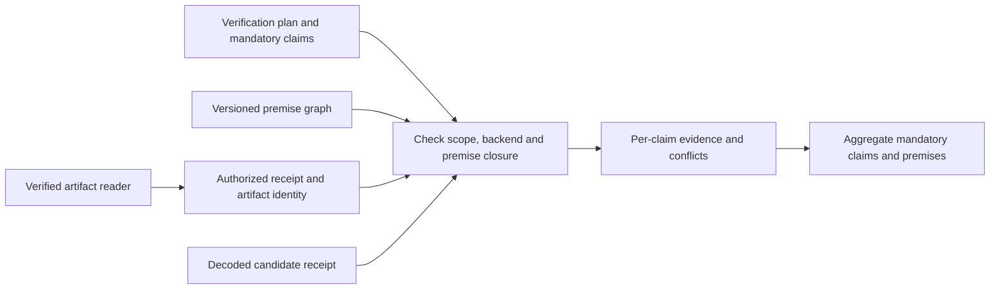

# Composing exact backend evidence in RT-33

A backend verdict can apply to a different source revision, observation, bound or premise graph than the one that needs checking. [RT-33 / #397](https://github.com/aivibeflow/LLMLang/issues/397) needs an explicit composition rule for LLMLang's verification pipeline. This experiment compares a receipt identity that includes those inputs with weaker alternatives, such as using a backend status or the top-level obligation ID alone.

## Model



The plan is the trusted source of mandatory claims and their premise edges. A receipt cannot supply its own assumptions or choose which claims are mandatory. A claim identity binds the source revision, obligation, subject, domain, projection and finite or unbounded scope. The domain of a fixture binds its initial registers, action order and expected state sequence. The premise closure hash includes the exact claim and all transitively required claims with their edge identities. Changing an indirect dependency invalidates a cached receipt even when its direct claim text is identical.

A backend identity binds its tool, translator, configuration and supported scopes. A receipt binds the exact claim, premise closure, backend identity, artifact and verdict. Parsing checks the receipt shape. The experiment also requires authorization of the full receipt identity by a separate verification path. The artifact reader in the fixture run pins the four recorded input byte strings by SHA-256 and checks their exact case alignment. This is an experimental trust boundary. A production verifier still needs to establish the receipt from actual checked results, with trusted provenance, resource limits and artifact validation.

A claim with both authenticated support and counterexample reports a conflict. Either polarity with an unresolved required premise remains conditional. Unknown, timeout and unsupported results remain visible as observations and cannot close a claim. A bounded agreement cannot close an unbounded premise. An aggregate requires status for each mandatory claim and only reports `proven` when they are all proven. A direct unbounded proof procedure is an explicit trusted capability in the plan and was exercised only in the synthetic tests.

This design is conservative about reuse. Hashing the effective dependency closure permits reuse across unrelated plan changes. Including observation scope and the checked backend configuration costs more identity bookkeeping than a backend-only key. In return it prevents scope substitution, stale closure reuse and promotion of a finite run to proof. A refinement rule that admits a related claim would require a separately checked implication. The current experiment uses exact equality for admission.

## Results

The [cvc5](SMT-TRANSITION-STATE.md), [Lean](LEAN-TRANSITION-STATE.md) and [TLC](https://github.com/aivibeflow/LLMLang/pull/421) artifacts yielded 2,394 admitted receipts for 798 exact case claims. The [machine-readable result](evidence/transition-result.json) records the fixture revision, all artifact hashes and a digest of all per-case statuses.

| Status | Exact finite claims |
| --- | ---: |
| Bounded agreement | 712 |
| Refuted by an observed mismatch | 86 |
| Conflict or insufficient evidence | 0 |

The conjunction of all 798 fixture claims is refuted because the corpus deliberately includes counterexamples. The table gives exact categorical counts. A chart would repeat those counts. The result does not measure backend independence. All three paths share fixture inputs, and replay is used at their evidence boundaries.

Eleven synthetic tests cover transitive revision changes, bound and projection changes, backend configuration and translator versions, a missing mandatory claim, scope conflicts, missing or finite premises for unbounded claims, incompatible exact verdicts, unavailable outputs, receipt tampering and invalid receipt shape. The tests separate authorization of the receipt from parsing and observe that a modified artifact cannot stand in for the pinned one.

The prototype demonstrates exact identity and aggregation on finite state fixtures. It leaves production adapter trust, semantic correspondence, dynamic discovery of proof dependencies, persistent invalidation and independently checked wider obligations open.

## Reproduce

Use CPython 3.9+ and the audited runs described in the three adapter reports. The fixture code was introduced by commit `991c053ffbc9e3ed0885763e3034f0d3c9354c2a`. The test uses the exact produced case data for reproducible offline comparison. The four required input hashes are in the recorded result. Run from the repository root.

```sh
evidence=research/PROOF-OBLIGATION-BENCHMARK/evidence
python3 "$evidence/test_composition.py"
python3 "$evidence/transition_experiment.py" \
  --smt /tmp/llmlang-rt33-smt/observations.jsonl \
  --lean /tmp/llmlang-rt33-lean/observations.jsonl \
  --tlc /tmp/path/to/tlc-output > /tmp/llmlang-rt33-composition.json
cmp "$evidence/transition-result.json" /tmp/llmlang-rt33-composition.json
```

Two runs with the pinned artifacts produced the same output bytes. Mermaid rendering was not checked locally.

## RT-36 follow-up: explicit assumptions (proposed)

Extend future composition fixtures with explicit scoped premises, residual premises after discharge, authorization/closure separation, hidden axioms, inconsistent premises and stale provider bindings. Preserve historical results. See [RT-36 — Formal Verification Assumptions, Trust Boundaries and Conditional Proof Management](../RT-36-FORMAL-VERIFICATION-ASSUMPTIONS-AND-TRUST.md). This cross-reference does not change adopted rules or previously reported evidence.
