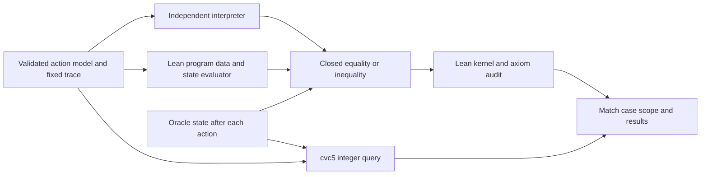

# Comparing Lean and cvc5 on bounded transition state claims

RT-33 needs to distinguish a solver observation from a theorem about the same observation. This experiment checks that distinction on the exact 798 cases in the [cvc5 state comparison](https://github.com/aivibeflow/LLMLang/pull/415). Both backends use one parameter per family (2–10 in generator order), all three variants, and every input and trace enumerated by the selected fixtures. Traces have up to four actions. Case scope includes model identity, initial register values, action order and oracle state after each action.

## Evidence paths



The interpreter proposes the polarity of each Lean claim by comparing its replay to the oracle. The generated theorem asks whether the Lean evaluator's actual state sequence equals that oracle sequence. Lean independently checks the proposed equality or inequality. The cvc5 route checks for a mismatch using a separate translation to integer constraints. Their outputs are compared only on matching case scope.

The Lean adapter uses a deep embedding. It translates the input AST into typed Lean constructor data and gives it a fixed evaluator. Each register name maps to an index in lexicographic order. Each assignment evaluates its right-hand side in the current state, conditionals execute only the selected branch, and the evaluator records the state after each action. Validated register lookups stay within the supplied vector. Event emission leaves the vector unchanged in this projection. Equality uses definitional reduction via `rfl`, and inequality uses `decide` so the kernel sees a proof of the closed proposition. Each theorem's reported axiom dependencies are checked against an explicit allowlist.

## Results and implications for LLMLang

| Case result | cvc5 and replay | Lean |
| --- | ---: | ---: |
| Every observed state equals the oracle | 712 `unsat` with matching replay | 712 checked equalities |
| At least one observed state differs | 86 `sat` with reproduced mismatch | 86 checked inequalities |
| Conflict or abstention among the 798 cases | 0 | 0 |

Both backends matched on all 798 cases, including the exact model hash, trace, expected states and replay. All 800 Lean theorems (798 case claims and two controls) reported only the standard Lean axioms `propext`, `Classical.choice` and `Quot.sound`. The exact counts and corresponding [per-case data](lean-transition-state-results/outcomes.csv) provide a direct comparison. A chart would repeat those counts.

The control writes `x := -1` and restores `x := 0`. Lean checks that the full sequence differs from `[[0], [0]]` and that the final state is `[0]`. Asking Lean to prove the incorrect full-sequence equality produced the [expected rejection](lean-transition-state-results/false-claim-output.txt). This is the same observation-scope error exposed by the final-state-only cvc5 control.

SMT supplies a small executable constraint query and a result that needs interpretation and correspondence evidence. The Lean route supplies a kernel-checked claim about an independently implemented evaluator at the cost of generating and checking case-specific source. A shallow Lean embedding that emits native expressions directly would be smaller, but would remove the explicit program representation used in this experiment. The shared fixture validation and Python-to-backend translators remain assumptions. Agreement on these cases can guide backend selection for finite state observations. It leaves open source-to-backend correspondence, symbolic inputs, effects, noninterference, concurrent system properties, certificates for SMT and the TLA+/TLC comparison. No latency or throughput comparison was run.

## Reproduce

Use CPython 3.9+, Lean 4.36.0 (commit `611c117bfaf7b7ae1cfcf246ce6fba31e8f509e9`) and cvc5 1.4.2 (commit `282d5e0`). The fixture code was introduced at `991c053`. The cvc5 adapter and comparison inputs are from [#415](https://github.com/aivibeflow/LLMLang/pull/415). Run from a checkout containing both adapters for the cross-backend comparison.

```sh
bench=research/PROOF-OBLIGATION-BENCHMARK/generative/transition
python3 "$bench/test_lean_adapter.py"
python3 "$bench/smt_adapter.py" --cvc5 /path/to/cvc5 --output /tmp/llmlang-rt33-smt
python3 "$bench/lean_adapter.py" --lean /path/to/lean --output /tmp/llmlang-rt33-lean \
  --smt-observations /tmp/llmlang-rt33-smt/observations.jsonl
cd /tmp/llmlang-rt33-lean
sha256sum TransitionClaims.lean observations.jsonl stdout.txt outcomes.csv summary.json
```

Omit `--smt-observations` to run Lean independently. The adapter writes the exact generated Lean source, case scope and results, axiom audit, deliberate false claim and its diagnostic. The [machine-readable summary](lean-transition-state-results/summary.json) records the input observation digest and output identities. The generated case JSONL has SHA-256 `c7b75d69b8b5751dd41ffa3042838b500188c057b127c6548b2bffa8c94af5cd`. The recorded CSV has SHA-256 `793a26b75064b070c32fd0080c380b26c7061ac21748b79e344711880a918d19`. Mermaid rendering was not checked locally.
