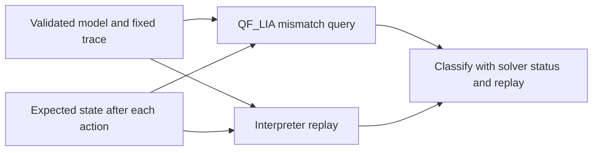

# Bounded transition state comparison with cvc5

This experiment for [RT-33 / #395](https://github.com/aivibeflow/LLMLang/issues/395) compares states after individual actions in the typed finite transition corpus. It covers nine families, one deterministic parameter per family (2–10 in generator order), all three model variants, and every input and schedule enumerated by each selected fixture. Some families enumerate only schedules satisfying a fixture-specific ordering constraint. The adapter accepts at most eight actions. The selected fixtures exercise at most four.

## Query and replay

Each solver query fixes the exact initial register values and action trace. The translator uses SMT-LIB integer arithmetic for registers, SSA definitions for sequential assignments, and `ite` to join register states under conditional guards. `emit` is projected away because it leaves registers unchanged. Each query asks whether any register differs from the independent oracle at any action boundary. An empty trace has no action-boundary observation. Each query has its own assertions and definitions within one incremental solver process.



The register mismatch query and the interpreter use the same trace and expected states through separate execution paths. Classification requires agreement between the two paths.

Replay evaluates the same validated model with the existing interpreter and compares its state observations to the oracle. A solver `sat` is a counterexample only if replay shows a state difference. An `unsat` with agreeing replay records bounded agreement. A disagreement between either answer and replay records a translation or solver conflict. Unknown, version mismatch, timeout, or malformed solver responses abstain. The process limit applies to the complete batch. Partial output from a failed batch is retained for diagnosis and grants no accepted result.

## Results

| Family | Bounded agreements | Replayed counterexamples |
| --- | ---: | ---: |
| Transfer | 102 | 33 |
| Lifetime | 120 | 0 |
| Reservation | 237 | 18 |
| Authorized effect | 34 | 11 |
| Cancellation and cleanup | 38 | 7 |
| Retry | 35 | 10 |
| Deadline | 42 | 3 |
| Interleaving | 14 | 4 |
| Security trace | 90 | 0 |
| **Total** | **712** | **86** |

All 798 case queries agreed with interpreter replay. The table shows exact counts by family, so a chart would duplicate the tabulated comparison. The lifetime and security-trace results cover only state equality. Events, invariants and paired-trace noninterference each require their own observations. There is no certificate check in this experiment. Even agreement on all fixture inputs remains evidence about the finite corpus and trusted translation, solver and replay path.

The weakened-translation control writes `x := -1` and later restores `x := 0`, against an oracle that specifies `x = 0` at both boundaries. Observing both boundaries gives `sat` and replay shows the first mismatch. Observing only the last gives `unsat` and replay flags a conflict. This control motivates binding the observed boundaries to evidence identity. Exact agreement on this corpus still cannot establish correspondence for other input domains.

## Reproduce

From the repository root, with CPython 3.9+ and cvc5 1.4.2 (commit `282d5e0`). The selected fixture code was introduced in commit `991c053`. Mermaid rendering was not checked locally.

```sh
python3 research/PROOF-OBLIGATION-BENCHMARK/generative/transition/test_smt_adapter.py
python3 research/PROOF-OBLIGATION-BENCHMARK/generative/transition/smt_adapter.py \
  --cvc5 /path/to/cvc5 --output /tmp/llmlang-rt33-smt
cd /tmp/llmlang-rt33-smt
sha256sum queries.smt2 stdout.txt stderr.txt observations.jsonl summary.json
```

The runner writes the SMT-LIB batch, verbatim solver output, per-query observations and a summary. The observed [solver transcript](smt-transition-state-results/stdout.txt) and [machine-readable summary](smt-transition-state-results/summary.json) can be compared byte for byte. The corresponding artifacts have these SHA-256 digests:

| Artifact | SHA-256 |
| --- | --- |
| `queries.smt2` | `25ac10266d5f2106d37ea93f5c5d5fa2e4683a3e8f65185d633c9eb6f2acc3ef` |
| `stdout.txt` | `c41a8cacac14641d6744c766e0a45825b42ccbacef8e6dd663371a05dcb4ad7a` |
| `stderr.txt` | `e3b0c44298fc1c149afbf4c8996fb92427ae41e4649b934ca495991b7852b855` |
| `observations.jsonl` | `bfbad3ebff85bdda5d832bb04e3efdf21ebcdbe11029ab1c50d7b7bd0f7bd3e4` |
| `summary.json` | `e235c9008ceb2e35db885fa23ff4fb3311e6b627192b7870cfbf68b8efdb3c79` |

The next comparison requires a second backend to consume the same fixture inputs and observations. Concurrent systems, symbolic inputs and checked certificates require separate profiles.
