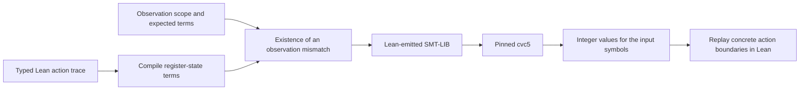

# RT-33 SMT-LIB queries from the checked symbolic transition model

The [symbolic correspondence theorem](SYMBOLIC-TRANSITION-CORRESPONDENCE.md) relates the Lean transition evaluator to symbolic register terms. This experiment assembles a mismatch predicate from those terms, checks it inside Lean, and sends the emitted SMT-LIB bytes to cvc5 for three query controls. The initial values are symbolic integers. The trace is fixed and consists of a conditional absolute-value assignment followed by a reset of the second register.

## Query and replay



`mismatch_correct` proves that evaluating the emitted predicate's **typed AST** on any initial register vector agrees with comparing the selected concrete state vectors to the specified symbolic vectors. The proof uses both row and trace equality and applies the previous symbolic correspondence theorem. A length difference is itself a mismatch. The theorem covers complete action boundaries and a separately selected final boundary.

For the three fixed queries, the Lean driver renders integer terms, Boolean connectives and conditional terms to QF_LIA SMT-LIB, with two declarations for the initial vector. The Python driver sends those exact bytes on standard input. A successful counterexample requires an ordered pair of integer model values and a replay with the same input and expected trace. Exact emitted query bytes are recorded. The study does not prove that the textual printer and cvc5 parser preserve denotation for every typed predicate.

## Results

| Claim for the two-step trace | Observation scope | cvc5 mismatch result |
| --- | --- | --- |
| The first action writes the absolute value and the second resets it. | Every boundary | `unsat` |
| The second register equals zero throughout. | Every boundary | `sat`, replayed |
| The second register equals zero throughout. | Final boundary only | `unsat` |

cvc5 returned `v0 = -1` and `v1 = 0` for the complete zero claim. Lean replay observed `[-1, 1]` after the first action and `[-1, 0]` after the second, against the expected `[-1, 0]` at both positions. The final-only result illustrates why the observation scope must remain part of evidence identity. The raw solver replies, replay and digests are recorded with the summary. The table gives the complete three-case comparison. [Result summary](symbolic-smt-results/summary.json) · [CVC5 model](symbolic-smt-results/zero-all-stdout.txt) · [Lean replay](symbolic-smt-results/replay.json)

The earlier Python cvc5 adapter enumerates concrete inputs. This prototype quantifies through free integer symbols for the fixed action trace. The alternative improves coverage of initial values and adds trust in the concrete printer and solver parser. It does not widen the action language or prove properties of arbitrary schedules, LLMLang source parsing, or SMT solver correctness. The `unsat` rows are solver observations. Independently checked certificates remain open under [#395](https://github.com/aivibeflow/LLMLang/issues/395).

## Reproduce

Use CPython 3.9+, Lean 4.36.0 commit `611c117bfaf7b7ae1cfcf246ce6fba31e8f509e9` and cvc5 1.4.2 commit `282d5e0`. The prior Lean symbolic proof entered `main` at `f80aac4`.

```sh
transition=research/PROOF-OBLIGATION-BENCHMARK/generative/transition
expected=research/PROOF-OBLIGATION-BENCHMARK/symbolic-smt-results
python3 "$transition/test_symbolic_dual_check.py"
scratch=$(mktemp -d)
python3 "$transition/symbolic_dual_check.py" --lean /path/to/lean --cvc5 /path/to/cvc5 \
  --output "$scratch/result"
for file in absolute.smt2 absolute-stdout.txt zero-all.smt2 zero-all-stdout.txt \
  zero-final.smt2 zero-final-stdout.txt replay.json axioms.txt summary.json; do
  cmp "$expected/$file" "$scratch/result/$file"
done
```

The kernel proof, solver reply validation and replay run on every invocation. The theorem audit lists only the standard Lean axioms. No performance measurement was made. Mermaid rendering was not checked locally. [Axiom audit](symbolic-smt-results/axioms.txt)
