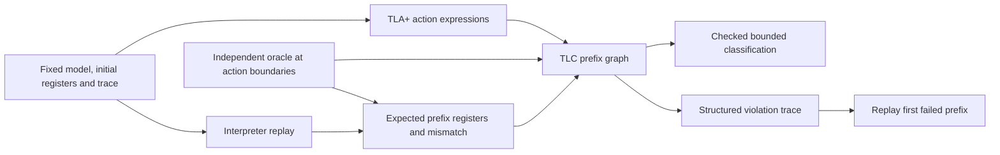

# TLC comparison for bounded transition state claims

RT-33 compares evidence from different backends on the same observation scope. The TLC adapter uses the same 798 finite cases as the [cvc5 experiment](SMT-TRANSITION-STATE.md) and the [Lean experiment](https://github.com/aivibeflow/LLMLang/pull/419). Both the typed model and expected observations enter the comparison. Fixture inputs include one parameter per family (2–10), three variants, and each initial register state and trace enumerated by the selected generator fixtures. Trace length ranges from zero to four actions.

## Model and evidence



The generator maps registers to tuple indices in lexicographic order, emits TLA+ actions with functional tuple updates and evaluates guards in the current state. The initial relation chooses a case identifier and starts at position zero. Each step executes the next action, records the updated register tuple, and accumulates whether any observed position differed from the oracle. The terminal step stutters. An invariant requires the register tuple and cumulative mismatch to agree with the interpreter's expected values at every position. This catches a register difference even after an earlier mismatch already determined the case classification.

Each case identifier and position is distinct, so the input requires exactly `sum(1 + trace length)` reachable prefix states. The runner requires the expected distinct count, an empty frontier and a successful invariant check. This is a run of a model checker on a finite graph. The trusted inputs include the fixture validator, TLA+ translator, interpreter, and TLC implementation. TLC uses state fingerprints. The run used one worker and fixed seed and fingerprint selections. The observed state count matched the cardinality derived from the explicit case and position identifiers.

The default requires the whole trace. A weakened trial compares only the final state of a model that writes `x := -1` and then restores `x := 0`. That check passes. When the same claimed equality is extended to every action boundary, TLC returns an invariant violation. The adapter verifies the structured trace's case, positions, registers and mismatch values against an interpreter replay of the same prefix, including the mismatch at position one.

## Findings and backend comparison

| Observation | TLC | Lean | cvc5 and replay |
| --- | ---: | ---: | ---: |
| Same register state at every observed boundary | 712 | 712 | 712 |
| At least one difference | 86 | 86 | 86 |
| Conflict or abstention among 798 cases | 0 | 0 | 0 |

TLC generated 3,576 states including terminal stutters, explored 2,778 distinct prefix states and left zero on the frontier. The maximum search depth was five states including the initial state. The three backends matched case scope and result, including exact model hashes, traces, expected states and replay. The full-boundary control's [raw JSON witness](tlc-transition-state-results/counterexample.json) and the [per-case results](tlc-transition-state-results/outcomes.csv) support exact lookup, so the table provides the direct comparison without a separate chart.

TLC can validate a common state-transition invariant over a reachable graph and return a trace. This experiment supplies fixed traces and leaves native schedule generation, schedule completeness and temporal properties for another profile. Lean checks closed propositions about a typed evaluator. cvc5 checks integer constraints for each supplied observation. The experiment neither measures throughput nor determines a universal backend. It covers fixture-sized arithmetic only and establishes no general correspondence theorem for the source language. Effects, symbolic inputs, noninterference, liveness and regular-infinite properties remain open.

## Reproduce

Use CPython 3.9+, OpenJDK 21 (run with 21.0.13) and the [TLC v1.8.0 release JAR](https://github.com/tlaplus/tlaplus/releases/tag/v1.8.0) with SHA-256 `fdffef247f563ef6edbfd44958d2a82db79e7564e07cb673262d896353fa6713`. The upstream fixture code was introduced at `991c053`. Obtain the SMT and Lean observations using their pinned commands for a three-way comparison.

```sh
bench=research/PROOF-OBLIGATION-BENCHMARK/generative/transition
python3 "$bench/test_tlc_adapter.py"
scratch=$(mktemp -d)
python3 "$bench/tlc_adapter.py" --jar /path/to/tla2tools.jar --output "$scratch/tlc" \
  --smt-observations /tmp/llmlang-rt33-smt/observations.jsonl \
  --lean-observations /tmp/llmlang-rt33-lean/observations.jsonl
cd "$scratch/tlc"
sha256sum summary.json outcomes.csv cases/Cases.tla false-claim/trace.json
```

TLC also runs without the optional comparison inputs. A new output directory prevents a stale trace from entering replay. The runner retains each generated TLA+ module, configuration, stdout and stderr. The [recorded summary](tlc-transition-state-results/summary.json) binds both input observation files and the generated module digests. Two local runs produced byte-identical case tables, summaries, TLA+ modules and JSON witnesses. TLC's raw logs include process-specific values. Mermaid rendering was not checked locally.
