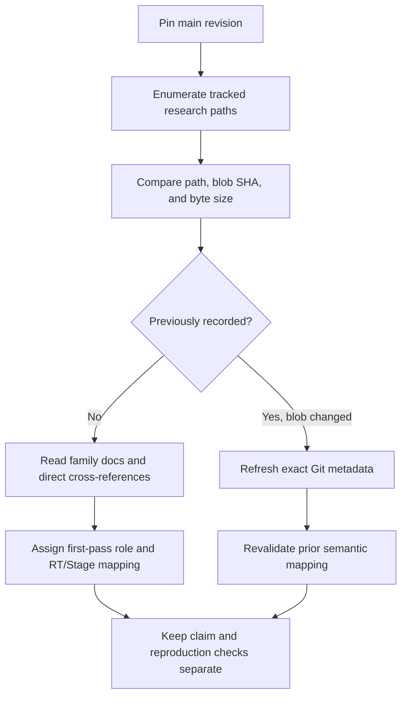

# RT-00 A — Current-main inventory reconciliation

**Date:** 2026-11-24  
**Exact main baseline:** `a010679ce3d023dcc20d3a0b4b39c8b06f1e1995` (PR #427 merged; includes #421)
**Prior manifest revision:** `9135dfbe7724e12f2bbd664b53d860ec2f428d8b`  
**Scope:** exact tracked research path/blob/size reconciliation and first-pass individual role triage for paths absent from the prior inventory.  
**Disposition:** metadata reconciliation complete for this pinned main; this is not claim-level validation, experiment reproduction, or completion of PLAN §0.1.

## Question and method

Did the corpus inventory still describe current `main`, and can newly added research files receive explicit, evidence-backed roles without guessing their research-area ownership? Checked the fresh `origin/main` head and open PRs before updating. Enumerated the exact Git tree with `git ls-tree -r --full-tree <revision> research`, excluded the inventory manifest itself, took sizes from `git cat-file -s`, and compared every path, blob SHA, and byte size with the prior manifest. Read family READMEs, file headers, direct PLAN/index links, and paired evidence for added paths; assigned categories and RT/Stage mappings only when those sources supported them. Existing semantic metadata was preserved for unchanged paths.



## Exact inventory results

At main `a010679ce3d023dcc20d3a0b4b39c8b06f1e1995`, the tree contains **769 tracked research artifacts**, excluding its manifest. The prior manifest had 610 records. Exact comparison to that prior snapshot found **159 paths absent** and **17 existing paths with stale blob SHA and/or byte size**, with **zero manifest-only paths**. This PR adds its own reconciliation report, so its tree has 770 inventory records. All 160 new paths in the PR tree received a first-pass category, RT/stage mapping, and role basis. The 17 existing changed paths retain their prior semantic fields pending content-role revalidation; exact Git metadata does not validate those mappings.

Main counts at the pinned revision: 379 Markdown, three MDX, 261 Python, 70 JSON, 35 Lean, seven text, three Rust, three C, three MJS, two CSV, one `lean-toolchain`, one TOML, and one Proto file; 294 prototype paths, 136 strict scenario-named documents, 29 registered taxonomy areas, and 136 dependency-map edges. The PR tree inventory has 770 records including this report. Its category counts sum to 770. Registration and inventory classification do not imply acceptance or correctness.

The 159 added paths include a 102-file RT-33 Proof Obligation Benchmark family, seven RT-02 contract corpus files, RT-25 allocator measurement assets and report, current RT-00 review/evidence files, and newly registered RT-29–RT-35 briefs. The POB README explicitly describes public development fixtures and bounded passes; the contract corpus distinguishes semantic-fidelity review from downstream proof; RT-25 records a single-host, eight-sample-per-provider synthetic comparison with overlapping time ranges. These are role assignments and evidence boundaries, not independent adjudications of every result.

## Link-coverage recheck

Ran:

```sh
python3 .github/scripts/audit_research_index_coverage.py --revision a010679ce3d023dcc20d3a0b4b39c8b06f1e1995
```

The auditor scanned 384 documents (383 research Markdown/MDX plus `PLAN.md`), 21 designated indexes, and 2,543 local-link occurrences. It reported 23 research documents with zero inbound links, 57 without a designated-index inbound link, and 38 unresolved local targets. This report is itself indexed by `research/README.md` in the PR tree; the counts above are pinned to the main baseline before this PR report is added. The target provenance behind those 38 is carried forward from earlier bounded audits and has not been independently reclassified at this revision. Link counts nominate review candidates; they do not establish orphan status.

## Open PR boundary

PRs #421 and #427 merged during this reconciliation and are included in the final main baseline. At the latest open-PR check, #428, #423, #424, and #426 remained open and behind `main`; their branch-only RT-07/RT-33 paths are not included. Refresh the inventory again after any of them merges.

## Remaining work and decision relevance

The refreshed manifest closes the exact metadata and first-pass role gap for this pinned main. It does **not** close Stage 0.1: 17 changed existing paths need content-role revalidation; corpus-wide semantic duplicate/supersession/orphan/contradiction review remains incomplete; prototype claims, generated outputs, exact tool versions, and experiment environments still need validation; and external snapshot URL availability/completeness remains unverified. Consequently this study improves navigation and makes evidence scope explicit but does not itself select an LLMLang implementation option. The pending requirements are recorded in `PLAN.md` §0.1.
