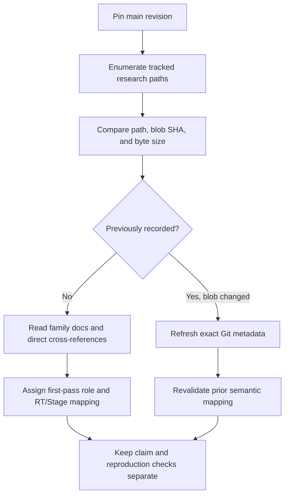

# RT-00 A — Current-main inventory reconciliation

**Date:** 2026-11-24  
**Exact main baseline:** `aba2fd1e1989f668c31eab3b6f4ce90e961ce22f` (PR #414 merged)  
**Prior manifest revision:** `9135dfbe7724e12f2bbd664b53d860ec2f428d8b`  
**Scope:** exact tracked research path/blob/size reconciliation and first-pass individual role triage for paths absent from the prior inventory.  
**Disposition:** metadata reconciliation complete for this pinned main; this is not claim-level validation, experiment reproduction, or completion of PLAN §0.1.

## Question and method

Did the corpus inventory still describe current `main`, and can newly added research files receive explicit, evidence-backed roles without guessing their research-area ownership? Checked the fresh `origin/main` head and open PRs before updating. Enumerated the exact Git tree with `git ls-tree -r --full-tree <revision> research`, excluded the inventory manifest itself, took sizes from `git cat-file -s`, and compared every path, blob SHA, and byte size with the prior manifest. Read family READMEs, file headers, direct PLAN/index links, and paired evidence for added paths; assigned categories and RT/Stage mappings only when those sources supported them. Existing semantic metadata was preserved for unchanged paths.



## Exact inventory results

At `aba2fd1e1989f668c31eab3b6f4ce90e961ce22f`, the tree contains **760 tracked research artifacts**, excluding its manifest. The prior manifest had 610 records. Exact reconciliation found **150 paths absent** from that snapshot, **16 existing paths with stale blob SHA and/or byte size**, and **zero manifest-only paths**. The refreshed manifest now has 760 records and exact path/blob/size metadata for every tree path. All 150 added paths received an individual first-pass category, RT/stage mapping, and role basis. The 16 changed paths retain their previous semantic fields pending content-role revalidation; exact Git metadata does not validate those mappings.

The recursive tree contains 760 artifacts. The manifest records 380 Markdown, 259 Python, 68 JSON, 34 Lean, three Rust, three C, three MJS, six text, one CSV, one `lean-toolchain`, one TOML, and one Proto file; Markdown includes the three MDX documents. It also records 292 prototype paths, 136 strict scenario-named documents, 29 registered taxonomy areas, and 136 dependency-map edges. There are 292 paths under `research/PROTOTYPES/`, 136 strict scenario-named documents, 29 registered taxonomy areas, and 136 dependency-map edges. Category counts in the manifest sum to 760, including 150 newly reviewed paths across existing categories. Registration and inventory classification do not imply acceptance or correctness.

The 150 added paths include a 96-file RT-33 Proof Obligation Benchmark family, seven RT-02 contract corpus files, RT-25 allocator measurement assets and report, current RT-00 review/evidence files, and newly registered RT-29–RT-35 briefs. The POB README explicitly describes public development fixtures and bounded passes; the contract corpus distinguishes semantic-fidelity review from downstream proof; RT-25 records a single-host, eight-sample-per-provider synthetic comparison with overlapping time ranges. These are role assignments and evidence boundaries, not independent adjudications of every result.

## Link-coverage recheck

Ran:

```sh
python3 .github/scripts/audit_research_index_coverage.py --revision aba2fd1e1989f668c31eab3b6f4ce90e961ce22f
```

The auditor scanned 382 documents (381 research Markdown/MDX plus `PLAN.md`), 21 designated indexes, and 2,534 local-link occurrences. It reported 23 research documents with zero inbound links, 57 without a designated-index inbound link, and 38 unresolved local targets. This report is itself indexed by `research/README.md`. The target provenance behind those 38 is carried forward from earlier bounded audits and has not been independently reclassified at this revision. Link counts nominate review candidates; they do not establish orphan status.

## Open PR boundary

At the check, #421, #423, #424, and #426 were open and behind `main`. They add RT-33/RT-07 artifacts that are not part of the pinned tree. This inventory must be refreshed again after any of them merges; no branch-only paths are represented here.

## Remaining work and decision relevance

The refreshed manifest closes the exact metadata and first-pass role gap for this pinned main. It does **not** close Stage 0.1: 16 changed existing paths need content-role revalidation; corpus-wide semantic duplicate/supersession/orphan/contradiction review remains incomplete; prototype claims, generated outputs, exact tool versions, and experiment environments still need validation; and external snapshot URL availability/completeness remains unverified. Consequently this study improves navigation and makes evidence scope explicit but does not itself select an LLMLang implementation option. The pending requirements are recorded in `PLAN.md` §0.1.
