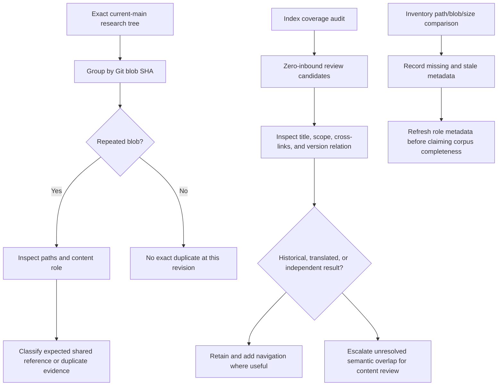

# RT-00 B9 — Current-main corpus relationship delta

**Date:** 2026-11-24
**Baseline:** `41bd03e1f0ce3f93afc52f177aeeab519be5b662` (`main`)
**Scope:** exact-content grouping for the full tracked `research/` tree; current index-auditor counts; bounded review of the newly surfaced zero-inbound concept document and reconciliation of inventory freshness.
**Status:** bounded delta audit; corpus-wide semantic duplicate, contradiction, and claim-reproduction review remains open

## Question and relevance

Do the previous exact-duplicate and zero-inbound candidate findings still describe current main, and did the latest additions expose a research document with no navigation or an out-of-date inventory? These checks matter because implementation choices should be based on discoverable, revision-bound evidence; an unindexed translation or stale manifest can hide scope and evidence changes.

## Relationship audit path

The diagram shows the audit's decision boundary. Link counts and byte identity surface candidates; content role and provenance decide how to classify them. A candidate is never deleted or called an orphan from link count alone.



## Exact-content result

Enumerated all tracked blobs below `research/` at the pinned revision, excluding the inventory manifest itself. The tree contained **756 artifacts and 755 distinct Git blobs**. The only repeated blob was `d645695673349e3947e8e5ae42332d0ac3164cd7`, shared by the OCI and REAPI Apache-2.0 license snapshots. The copies are intentional attribution material for separate upstream snapshots. No exact duplicate research report or prototype implementation was found.

This exhaustive byte-identity check does not identify semantically overlapping text with different blobs. The previous RT-00 B4 semantic-candidate review was pinned to an older, 488-artifact tree. Since its recorded baseline `f09047a65bc77e8756d9d36def836c193a500dfa`, current main has **268 added and 33 modified research paths, with no deletions**. Earlier B5/B6 and focused reports cover some later work, but there is no assertion here that all changed paths have been compared claim by claim. Content-level comparison across the remaining candidate families and a current cross-cutting contradiction register are still required.

## Zero-inbound candidate delta

Ran `.github/scripts/audit_research_index_coverage.py --revision 41bd03e1f0ce3f93afc52f177aeeab519be5b662`. It scanned 378 documents (377 research Markdown/MDX plus `PLAN.md`), 21 designated indexes, and 2,503 local-link occurrences. The exact current-main results were 24 research documents with zero inbound links, 58 without a direct inbound link from a designated index, 645 links to non-Markdown targets, and 38 unresolved local targets. The six zero-inbound Scenario reports and the 23 prior candidates match the scope of RT-00 B8; the additional zero-inbound document is `LLMLang-CONCEPT.ru.md`.

The Russian concept file has 85 headings, matching the heading count of `LLMLang-CONCEPT.md`, and its title/version identify it as a language companion. The pair is therefore treated as a translated-document relationship, not a duplicate research result. This check does **not** establish sentence-level translation completeness or synchronization. Added reciprocal links at the top of both documents so readers can discover the companion while keeping translation parity an explicit open maintenance issue.

After adding reciprocal links and linking this report from the research index, reran the auditor on the PR working tree: 379 documents (378 research Markdown/MDX plus `PLAN.md`), 2,512 local-link occurrences, 23 zero-inbound documents, and 57 documents without a designated-index link. The Russian concept is no longer an orphan candidate by link count; the remaining 23 are the previously reviewed B8 set. There are still 38 unresolved upstream-snapshot targets.

The remaining no-index-link count includes historical material, reference snapshots, and scenario reports; it is a review queue, not a list of proven orphans. No content was removed. The known 38 unresolved targets remain within intentionally partial upstream snapshots (OCI and Alive2), as noted by previous audits; external URL reachability and missing-source completeness are outside this local path scan.

## Inventory freshness discrepancy

The current inventory manifest identifies revision `9135dfbe7724e12f2bbd664b53d860ec2f428d8b` and contains 610 artifact records. Comparing every non-manifest path, blob SHA, and byte size in the exact `41bd03e` tree found:

| Measure | Count |
|---|---:|
| Current research artifacts excluding manifest | 756 |
| Manifest records | 610 |
| Current paths missing from manifest | 146 |
| Manifest paths absent from current tree | 0 |
| Existing path records with stale SHA or size | 14 |

The existing inventory-freshness workflow preserves this comparison as an artifact but does not fail merely because missing/stale records are nonzero. Its green CI status therefore does not mean the manifest is current. The missing entries need content-role, RT/stage traceability, and evidence-review metadata before Stage 0.1 inventory completeness can be claimed. I have not added synthetic placeholder records to the manifest.

## Reproduction

From the repository root at the pinned commit:

```sh
python3 -B .github/scripts/audit_research_index_coverage.py \
  --revision 41bd03e1f0ce3f93afc52f177aeeab519be5b662
git ls-tree -r 41bd03e1f0ce3f93afc52f177aeeab519be5b662 research
```

For the exact-blob grouping, group the `blob` SHA field from the recursive tree listing by path, excluding `research/RESEARCH-CORPUS-INVENTORY-2026-11-20.json`; compare non-singleton groups by content role. Inventory counts were checked by comparing those same recursive-tree paths, Git blob SHAs, and `git cat-file -s` byte sizes with the manifest's `artifacts` records.

Machine-readable counts and the sole exact-repeat group are recorded in [the companion audit data](RT-00-B-09-CURRENT-MAIN-CORPUS-RELATIONSHIP-DELTA-2026-11-24.json).

## Disposition and remaining work

- Retain both license snapshots and the two concept-language documents; their relationships have different purposes (shared upstream license versus translated concept companion).
- Add reciprocal concept-document links; do not imply verified translation parity.
- Treat the 58 no-index-link documents as candidates for content/navigation review, not automatic orphans.
- Reconcile the 146 absent inventory entries and 16 stale records through content review, preserving unknown RT mappings rather than guessing.
- Continue semantic near-duplicate/supersession analysis, cross-cutting contradiction reconciliation, exact experiment provenance, and external snapshot validation. These are prerequisites to selecting among implementation proposals when their evidence conflicts or has become stale.

This report updates one current-main relationship slice; it does not close PLAN.md §0.1 or certify that every necessary implementation-choice claim has been validated.
