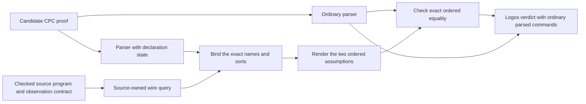

# RT-07 exact CPC assumptions and the Logos verdict

The source-wire gate requires the Lean-generated version-2 query and two exact CPC assumptions. SCW-33 also needs a single evidence chain from that query to the actual parsed proof passed to Logos. A successful check now retains the binding and the ordinary parser's exact assumption and command values. [Scenario 34](RESEARCH-SCENARIO-34-SOURCE-TO-QUERY-SEMANTIC-CORRESPONDENCE.md#76-qf_lia-admissibility-and-external-wirechecker-boundary)

## Verification path



The parser that preserves declaration state must agree with the ordinary Logos parser on the full assumption list. The ordinary parser supplies the command stream used for the verdict. The witnessed binding resolves the selected factor, checks the declaration set and compares the two rendered terms with those same assumptions in order. A successful public check therefore carries the source-owned query, declaration binding, assumption equality and complete Logos verdict.

`check_exact` exposes the acceptance evidence for the existing public entry point. It proves that the accepted JSON is the generated source envelope and that the proof's ordinary Logos verdict is `correct`. Its returned witness states that the ordinary parser produced exactly the assumptions that were independently rendered from the source-bound query, and the exact commands passed to Logos. The existing state-preserving API still supplies its command stream to its original callers. The source-wire route uses the ordinary stream and consumes the retained query directly instead of decoding it again.

Reparsing the CPC file before calling Logos would keep the checker interface simple, but would leave the binding and checker calls linked only by the input string. Passing the already parsed commands makes the relationship explicit and allows a Lean theorem about the values used by the runtime checker. The checker still resolves obligations over the Logos term representation. The semantics of that representation relative to the source evaluator and application of the upstream checker soundness theorem are separate boundaries.

## Controls

| Control | Result |
| --- | --- |
| Matching query and complete CPC derivation | Accepted and bound to both ordered assumptions. |
| Query with exact assumptions and no complete derivation | Rejected as incorrect. |
| Missing, extra or reordered assumption of the admitted sorts | Rejected during assumption binding. |
| A valid proof of a substituted assumption | Accepted by standalone Logos for those assumptions. Rejected by the source route. |
| Original proof used against a changed source program | Rejected during assumption binding. |

All five existing test entry points passed with the new evidence path. This result applies to the existing Bool/Int query profile. It supplies the exact source-query-to-ordinary-CPC acceptance binding for SCW-33. Interpretation preservation at SCW-32 and the full checker trust boundary at SCW-34 still determine how far that result can be carried back to source semantics. There was no performance measurement. The diagram and table document the proof flow and discrete controls.

## Reproduce

The source-wire adapter was checked on baseline `22ea9a2` with Lean 4.36.0 commit `611c117bfaf7b7ae1cfcf246ce6fba31e8f509e9` and Logos commit `cf18742973861b3718d04c5f25775448098ff474`.

```sh
cd research/PROTOTYPES/DEPENDENCY-GRAPH-01/logos_binding
lake update --keep-toolchain
lake build --fail-fast LLMLangLogosBinding
for fixture in Main.lean SourceQueryEnvelopeTests.lean SourceWireRefutationTests.lean \
  SourceCpcRefutationTests.lean CpcNullaryAliasesTests.lean; do
  lake env lean -DwarningAsError=true --run "$fixture"
done
```

The [axiom audit](PROTOTYPES/DEPENDENCY-GRAPH-01/logos_binding/evidence/bound-cpc/axioms.txt) lists only the standard Lean axioms for the acceptance and ordinary-verdict theorems. To reproduce it, import `SourceWireRefutation` and print the axioms of `LLMLang.SourceWireRefutation.check_exact` and `LLMLang.SourceWireRefutation.CheckedRefutation.ordinaryVerdict`. Mermaid rendering was not checked locally.
