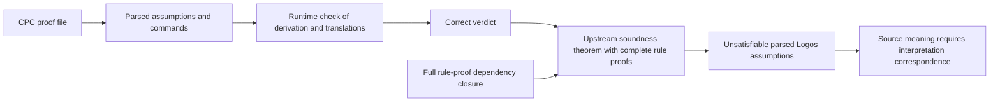

# RT-07 runtime verdicts and the Logos soundness boundary

SCW-34 separates the guarantee of LLMLang's runtime checker from the proof that a successful Logos verdict implies unsatisfiability. The runtime adapter uses the Logos commit `cf18742973861b3718d04c5f25775448098ff474`. That commit packages the executable and the soundness development separately. [Scenario 34](RESEARCH-SCENARIO-34-SOURCE-TO-QUERY-SEMANTIC-CORRESPONDENCE.md#76-qf_lia-admissibility-and-external-wirechecker-boundary)

## What the runtime checks



The [Lean runtime proof](PROTOTYPES/DEPENDENCY-GRAPH-01/logos_binding/LogosVerdictConditions.lean) checks the following conditions for any assumptions and commands accepted by the pinned Logos API.

| Verdict | Exact runtime condition |
| --- | --- |
| `correct` | The checker accepted the refutation, the assumptions are translatable, and the command list passes the translation check. |
| `incorrect` | The refutation check failed. |
| `incomplete` | The refutation passed and at least one translation check failed. |

The file-level theorem retains the exact ordinary parser result for a `correct` verdict. The runtime theorem and the normal LLMLang package built with Lean 4.36. The [axiom audit](PROTOTYPES/DEPENDENCY-GRAPH-01/logos_binding/evidence/logos-verdict/runtime-axioms.txt) lists only the standard Lean axioms. A result at this level describes the executed checks. It does not turn those checks into a semantics proof.

## Upstream verification project

The pinned upstream source states `correct___logos_verdict` and `correct___logos_check_proof` in its verification project. Their conclusion is unsatisfiability of the parsed Logos assumptions under the upstream semantics. The verification project pins Lean 4.34.0 and Mathlib commit `5ed2965256430c3649e86755f9576b54eca72435`. The library's runtime package omits those dependencies. The proof dispatcher names 614 distinct rule modules at this revision. [Logos verification configuration](https://github.com/cvc5/logos/blob/cf18742973861b3718d04c5f25775448098ff474/verification/lakefile.toml) · [Declared theorem](https://github.com/cvc5/logos/blob/cf18742973861b3718d04c5f25775448098ff474/Cpc/ApiCorrect.lean)

The upstream import audit passed with 28 runtime source modules and no semantic or external imports. Its proof-hygiene scanner passed on 943 Lean sources. The isolated runtime build completed all 76 Lake jobs under Lean 4.36, including both checker executables with model semantics and verification sources removed. The upstream proof harness had started and its dependency cache downloaded and unpacked. The complete rule proof had not been checked at this checkpoint. [Recorded observations](PROTOTYPES/DEPENDENCY-GRAPH-01/logos_binding/evidence/logos-verdict/observations.json)

Upstream's routine CI check substitutes two rule-dispatch proof obligations, elaborates the remaining proof, and verifies that a deliberately invalid declaration fails. The upstream full rule build and `Cpc.ApiCorrect` target are separate. The Lean 4.34 proof artifacts also cannot simply be imported into the repository's Lean 4.36 build. [Upstream build and verification instructions](https://github.com/cvc5/logos/blob/cf18742973861b3718d04c5f25775448098ff474/README.md#checking-the-correctness-proof)

The current integration can evaluate a pinned runtime Logos verdict for exactly bound source-derived assumptions. A stronger release claim needs the complete upstream rule-proof build, a compatible proof toolchain or a separately justified artifact bridge, and interpretation correspondence from the rendered Logos assumptions to the source program. This distinguishes two implementation choices. Running the checker needs only the runtime dependency. Importing and applying the full soundness theorem needs the verification dependency and an explicit toolchain decision.

## Reproduce

Build the LLMLang runtime theorem with Lean 4.36.0 commit `611c117bfaf7b7ae1cfcf246ce6fba31e8f509e9` and the pinned Logos revision:

```sh
cd research/PROTOTYPES/DEPENDENCY-GRAPH-01/logos_binding
lake update --keep-toolchain
lake build --fail-fast LLMLangLogosBinding
lake env lean -DwarningAsError=true LogosVerdictConditions.lean > /tmp/rt07-runtime-axioms.txt
cmp evidence/logos-verdict/runtime-axioms.txt /tmp/rt07-runtime-axioms.txt
```

From an independent checkout of Logos at the pinned commit, run the executable boundary build with Lean 4.36.0 and the proof-project harness with Lean 4.34.0 commit `293d5d0c0c3f3dded4688b3ccd6a33939ac5102b`. Use an independently writable Mathlib cache directory if needed.

```sh
lean --version
python3 scripts/check-checker-boundary.py --build
# Select the upstream verification toolchain, Lean 4.34.0, for these commands.
lean --version
export MATHLIB_CACHE_DIR="$(mktemp -d)"
bash scripts/cache-mathlib.sh
bash scripts/check-checker-soundness.sh
```

The complete upstream check uses `scripts/build-all-cpc-rules.sh` followed by `scripts/build.sh Cpc.ApiCorrect` under the verification toolchain. The upstream estimate for the complete rule build exceeds two hours. The diagram documents dependencies, and the table records categorical runtime outcomes. No timing comparison was run. Mermaid rendering was not checked locally.
