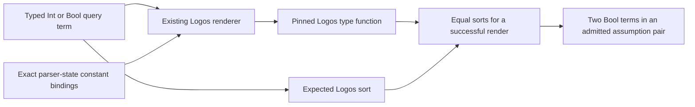

# RT-07 sort preservation at the Logos rendering boundary

The SCW-32 adapter renders the typed QF_LIA query into Logos terms. The Lean index fixes the expected sort before rendering, while Logos represents the resulting expression in its own term AST. This experiment proves that every successfully rendered term has the expected sort according to the pinned Logos type function itself. [Scenario 34](RESEARCH-SCENARIO-34-SOURCE-TO-QUERY-SEMANTIC-CORRESPONDENCE.md#76-qf_lia-admissibility-and-external-wirechecker-boundary)

## Proof and checks



`renderQueryTerm_sort` reasons about the renderer the repository already runs. At a symbol, successful lookup supplies the unique bound constant with the right sort. At arithmetic and Boolean operators, the proof applies the actual Logos type equations to the recursively rendered operands. It also covers both branches and the guard of a conditional. Conjunction, disjunction, addition and multiplication use right-associated lists. The proof checks the identity at the end of each list and shows that every fold step preserves the sort.

`renderRelationalAssumptions_sorts` carries the result through the entry point that emits the two ordered query assumptions. The first term compares the selected constants of the same sort. The second is the rendered observation-difference term. The output is exactly a two-element list of Boolean sorts on success.

The proof covers all constructors of the typed query AST and every binding list for a successful render. An unbound, ambiguously bound or wrong-sort symbol can fail before rendering. The theorem does not require the renderer to succeed on every input. Three compile-time controls check a nested arithmetic and Boolean term, a wrong-sort binding and a repeated binding. The existing CPC parser-state and structural AST comparison fixture also passed.

## Implications for LLMLang

A runtime sort assertion could detect mismatches at individual calls. Proving the property of the existing renderer avoids adding such a check to every call and covers all successful executions of that renderer. The property connects the LLMLang query sort to the sort consumed by Logos. It leaves the separate interpretation-preservation proof open, along with the complete source-to-CPC assumptions theorem and the solver/checker trust boundary. There was no performance measurement. The diagram identifies the static proof boundary.

## Reproduce

The renderer was checked on baseline `c2f9f7f` using Lean 4.36.0 commit `611c117bfaf7b7ae1cfcf246ce6fba31e8f509e9` and the pinned Logos commit `cf18742973861b3718d04c5f25775448098ff474`.

```sh
set -euo pipefail
cd research/PROTOTYPES/DEPENDENCY-GRAPH-01/logos_binding
lake update --keep-toolchain
lake build --fail-fast LLMLangLogosBinding
lake env lean -DwarningAsError=true LogosRenderedSorts.lean > /tmp/rt07-logos-sorts.txt
cmp evidence/logos-sorts/axioms.txt /tmp/rt07-logos-sorts.txt
lake env lean -DwarningAsError=true --run Main.lean
```

The proof module is part of the existing required Lake build. The audit of both theorem entry points lists only the standard Lean axioms `propext`, `Classical.choice` and `Quot.sound`. Mermaid rendering was not checked locally. [Proof and controls](PROTOTYPES/DEPENDENCY-GRAPH-01/logos_binding/LogosRenderedSorts.lean) · [Axiom audit](PROTOTYPES/DEPENDENCY-GRAPH-01/logos_binding/evidence/logos-sorts/axioms.txt)
