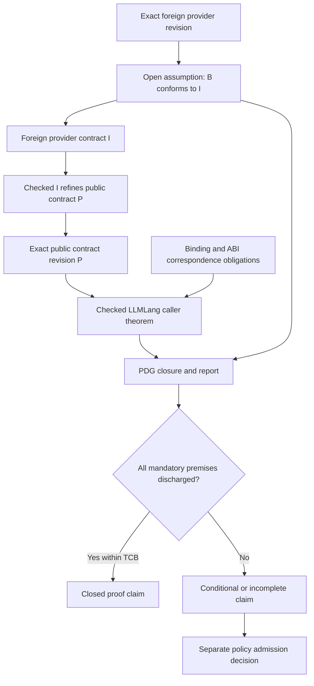
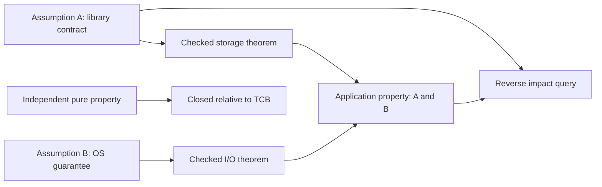
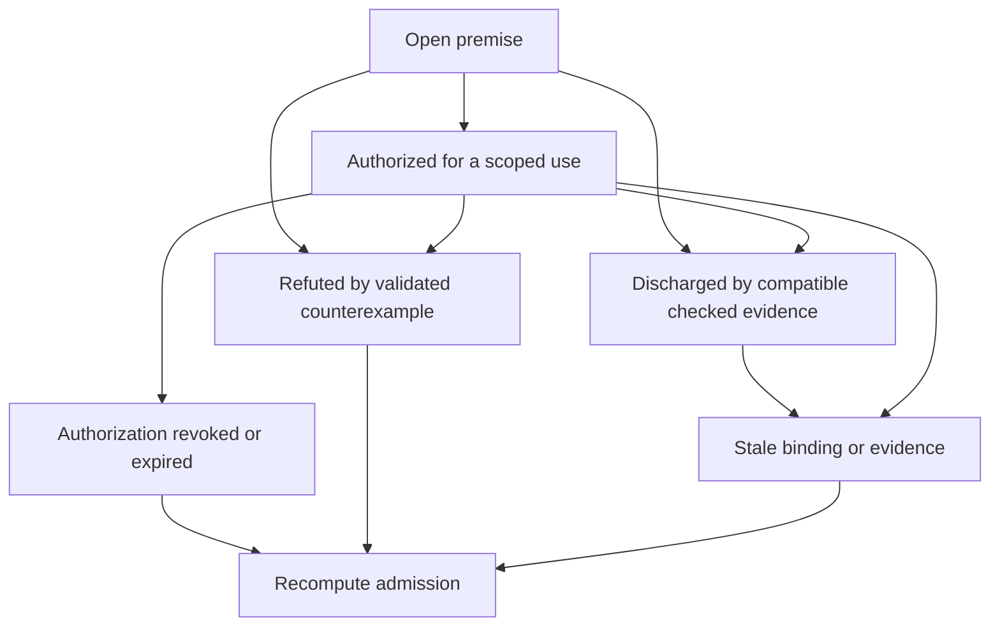

# RT-36 — Formal Verification Assumptions, Trust Boundaries and Conditional Proof Management

**Status:** Research brief and candidate architecture; not adopted language semantics or implemented capability.  
**Priority:** P0  
**Date:** 2026-11-24  
**Tracking:** [Issue #436](https://github.com/aivibeflow/LLMLang/issues/436)  
**Baseline:** `789ff65923d55d6ea803f322b0f261010026b477`  
**Primary:** RT-07/32/33; cross-cutting RT-03/04/05/06/08/09/10/11/12/13/16/18/19/20/23/24/28/34.

## 1. Problem, objective and hypotheses

A foreign library (C, C++, Rust, Python, binary or service), OS, device, compiler or runtime can expose a meaningful contract without a checked proof that its implementation meets it. Rejecting all such components makes incremental verification impractical; treating declarations, tests or trust approval as proofs is unsound. The objective is to establish exactly which program properties follow from which explicit premises, preserve them through composition, and allow incremental discharge or revocation without laundering evidence.

H1: formal theorem parameters tied to exact contract claims and provider bindings support sound modular proof reuse. H2: orthogonal evidence, closure, freshness and admission dimensions avoid misleading success. H3: property-specific dependency closure is more precise than call-graph contagion while remaining sound if alias, effect, control and termination coverage are complete. H4: explicit policy-governed assumptions allow incremental migration without calling an executable closure fully proved.

Existing [concept §18A](LLMLang-CONCEPT.md) and [formal verification §§6–8](LLMLang-FORMAL-VERIFICATION.md) require explicit premises, property-scoped propagation and proof context. [RT-32](RT-32-VERIFIED-SPG-TO-LEAN-PIPELINE.md) proposes PDG and conditional evidence; [RT-33](RT-33-PROOF-BACKEND-SELECTION-AND-ORCHESTRATION.md) proposes backend-neutral obligations and fail-closed aggregation. RT-36 refines these rather than creating a second evidence or semantic authority. No accepted rule is silently changed.

## 2. Logical model and foreign boundary

Let S be the semantic/observation profile, T the declared foundational trust base, A the set of named typed open premises, and P an exact property. A checked judgment is T; S; A ⊢ P, or a checked theorem of the form (A1 ∧ ... ∧ An) ⇒ P. Neither judgment proves any Ai. An executable claim requires source/model/target correspondence and provider conformance under the same semantics. The implication may be valid even if Ai is false, but must not be used to assert P for that execution.

Distinguish caller obligations (preconditions, capabilities, valid inputs) from provider guarantees (postconditions, frame/effect/ownership, error outcomes, progress/termination, resource bounds, protocol/history or hyperproperties where modeled). A caller establishes preconditions at each call, not by arbitrary assumption. A foreign guarantee is a scoped proposition about actual selected behavior, not an unrestricted axiom. Quantification, abstraction, aliasing, exceptional paths, nontermination, numeric/ABI model, environment and concurrency assumptions must be explicit. Partial correctness is not total correctness.

A refinement theorem can establish that provider contract I implies public contract P in the applicable precondition, abstraction and observation model, while actual provider behavior B satisfies I only by assumption A. Separately establish binding/adapter, marshaling, ABI, lifetimes, effects, callbacks, errors and target correspondence. A matching signature is not proof. The executable claim retains unresolved provider and correspondence premises.



*Illustrative proof structure:* refinement and caller proof can be checked even when provider conformance is assumed. Binding correspondence may itself be conditional. Policy admission does not discharge a premise. See [public interfaces](PUBLIC-INTERFACES-AND-CONTRACT-REFINEMENT.md).

### Example (illustrative, not a checked proof)

A foreign sort accepts a valid writable int32 buffer and length; its contract promises sorted output, permutation preservation, no writes outside the buffer, and termination within a stated cost model. A LLMLang wrapper validates length and ownership and invokes the foreign symbol. A consumer proof uses sortedness and permutation plus applicable memory/execution assumptions. A pure independent computation before that call need not depend on sort correctness; a proof that a returned result exists may depend on termination. A malicious native library can corrupt memory or never return, so apparent independence after the call needs sound frame/isolation/control evidence. Runtime sortedness checks detect some bad outputs; they cannot retroactively prevent memory corruption or establish universal termination.

## 3. Candidate typed assumption model

AssumptionClaim is an immutable typed proposition: canonical statement, quantified parameters and context, exact subject and contract clause identity, semantic/observation profile, scope, origin and dependencies. Distinguish claim identity from versioned authorization (authority, policy revision, scope, validity/revocation, justification and audit record), supporting evidence and deployment binding. The same claim may be approved in one project and prohibited in another. Names are labels, not identity. Research canonical serialization, domain-separated hashes, privacy and existing SPG/evidence storage.

Kinds include foreign conformance, adapter/ABI/translation correspondence, environment/service behavior, runtime/OS/hardware, scheduler/fairness, numeric/resource models, imported theorem/axiom and abstraction/finite-domain restriction. Separate model restrictions and proved caller preconditions from undischarged implementation premises. Separate foundational TCB (logic/kernel and explicitly accepted trusted machinery) from contingent application assumptions; moving a premise into TCB requires reviewed policy, not relabeling.

Illustrative schema, not language syntax:

```yaml
claim:
  kind: foreign_contract_conformance
  subject:
    provider_artifact_digest: "sha256:..."
    symbol_identity: sort_int32
    binding_revision: "..."
    abi_profile: "..."
    dependency_manifest_digest: "..."
  contract_clause_ids: [sorted, permutation, frame]
  proposition_id: "..."
  semantic_profile_id: "..."
  scope_id: "..."
  origin: vendor specification and binding review
  discharge_condition: checked proof of exact claim or implication
authorization:
  claim_id: "..."
  project_policy_revision: "..."
  approved_by: authorized principal
  scope_id: "..."
  validity: "..."
  status: active
supporting_evidence:
  kind: tested
  artifact_id: "..."
```

Pin transitive loaded dependencies, target, flags, resolution and environment when relevant. For remote services bind protocol, deployment identity, authenticated endpoint and configuration where possible; mutable/unidentifiable providers cannot silently inherit evidence. Hashes establish identity, not authenticity or conformance.

## 4. Candidate status dimensions

| Dimension | Candidate values | Meaning |
|---|---|---|
| Check outcome | PROVEN, DISPROVEN, UNKNOWN, NOT_SUPPORTED, NOT_CHECKED, ERROR | Exact local proposition under declared context |
| Closure | CLOSED, CONDITIONAL, INCOMPLETE | All required premises closed relative to TCB; checked theorem with open premises; or missing mandatory evidence |
| Evidence kind (per obligation) | CHECKED_PROOF, ASSUMED, TESTED, RUNTIME_CHECKED, BOUNDED_CHECK, UNVERIFIED | Distinct bases, not an ordinal scale |
| Freshness | CURRENT, STALE, REVOKED | Exact input and authorization validity; retain history |
| Admission | ALLOWED, DENIED, REVIEW_REQUIRED | Policy decision for a named use and snapshot, not proof |

A local theorem with A open is PROVEN + CONDITIONAL; render as “checked under assumptions”, never bare “verified”. A pending artifact without checked theorem is INCOMPLETE (RT-32 pending_dependencies); investigate independent flags because checked conditional theorems can also have pending closure evidence. An actual unproved foreign implementation is NOT_CHECKED (or UNKNOWN/NOT_SUPPORTED after applicable attempts), evidence ASSUMED only when explicitly recorded. A validated counterexample under an abstract contract may show insufficient contract strength, rather than actual provider failure. Refuting a premise blocks dependent executable claims without refuting the implication itself.

Concept PROVEN under stated premises and RT-32/33 end-to-end proven differ in scope. Candidate UI/API reserve unqualified system “proven” for current closed required obligations within declared TCB. Preserve all dimensions, scope and assumptions. Do not silently change existing enums; design migrations, serialization and legacy rendering with fail-closed handling.

## 5. PDG, registry, discharge and invalidation

Use SPG canonical meaning and RT-32 PDG typed evidence projections. Record theorem parameters, obligation/subject IDs, consumed clauses, substitution, evidence/checker, source correspondence, assumption edges and closure. A registry is a queryable projection over claims, versioned authorizations and evidence—not a second authority. Support property-to-open-premise and premise-to-affected-property/deployment queries, provenance, trust-policy diffs, explanations and coverage information.



*Illustrative PDG:* application inherits A and B; independent property does not. Edges derive from proof dependencies including implicit control/effect/alias/termination facts, not syntactic reachability alone.

For checked discharge D proving Ai under premises B, replace Ai by compatible proof D; the resulting open set is (A minus Ai) union B after substitution, semantic/profile checks and deduplication. Residual premises remain visible. Never close by matching names or accepting cycles. Recursive/mutual proofs require justified induction/fixed-point rules with progress/guardedness when necessary, or a joint proof.



*Illustrative lifecycle:* transitions affect claim use/closure records, not immutable propositions. Authorization and discharge are independent; revocation blocks policy use and does not erase mathematical facts. A new provider revision needs a new scoped claim or proved equivalence and fresh authorization. Old pinned builds retain historical evidence.

Body change with identical public theorem and hypotheses may allow abstract caller theorem reuse, after verifying compatible binding and evidence closure. Contract/profile/axiom change invalidates affected dependencies. Recompute admission on policy/revocation changes even if proof term is unchanged. Separate local proof key, closure key and admission key. Missing edges are not proof of independence.

## 6. Policy and security

Compare strict (no open contingent premises outside declared TCB), explicitly trusted external (authorized scoped claims permitted), guarded (required runtime checks plus residual assumptions), permissive development (unverified code allowed with explicit limitations). These are proposed policy vectors, not adopted profiles or proof levels. Strict verified provider admission remains fail-closed; trusted external admission must be separately labeled conditional. Admission for build, execution, publishing, reuse and high-assurance properties may differ. Require explicit authority, scope and audit. LLMs may propose claims/proofs but cannot grant trust or manufacture evidence.

Alternatives: no assumption abstraction (simple but hides provenance); global unrestricted axioms (easy integration but high blast radius); typed scoped premise + authorization + PDG (preferred hypothesis, tracking cost); proof-only isolation (strong boundary, limited interoperability); runtime monitoring/sandboxing (complement, not universal proof). Compare verification effort, trust surface, precision, false admission, auditability, performance and reuse.

Detect hidden admitted lemmas, unexpected axioms, forged certificates, stale provider resolution, unauthorized/revoked grants, inconsistent contracts and vacuous preconditions. Check satisfiability and realizability when supported; report UNKNOWN when not. Check combined assumptions, not just each separately. Proof checker acceptance under contradiction does not establish operational correctness. Record actual transitive axioms (e.g. Lean theorem parameters and `#print axioms`); allowlists do not prove correspondence. Runtime checks state coverage, timing, failure semantics and bypass risk; sandbox enforcement needs evidence.

## 7. Research program and benchmark

| Work package | Deliverable and exit gate |
|---|---|
| A1 Logic/status model | Typed judgments, composition/failure rules, reconcile existing vocabulary |
| A2 Identity/schema | Candidate claim, authorization, evidence and PDG schemas; round-trip and mismatch controls |
| A3 Foreign adapter | Representative C ABI library with correct/incorrect providers, wrapper, refinement and memory/error/progress obligations |
| A4 Proof pilot | Kernel-checked conditional theorem and discharge, residual assumptions, axiom extraction and source/target correspondence boundary |
| A5 Registry/closure | Deterministic queries, property dependency, rebind/revocation/invalidation, incomplete graph and recursion controls |
| A6 Policy/security | Compare profiles, authorization, threat controls, trust reports and policy replay |
| A7 Benchmark | Integrate multi-label cases with RT-33 POB; independent oracle, raw results, pinned versions, reproducible CI and review |

Proposed cases (reserve unique POB IDs at fixture design; no results claimed):

| Case | Expected classification |
|---|---|
| Foreign contract only; valid abstract caller | Checked theorem conditional; provider unproved |
| Exact checked provider evidence | Closed only when all required correspondence and other premises closed |
| Provider proof itself conditional | Inherit residual premises |
| Correct refinement; unknown provider body | Conditional; no proof-required admission |
| Stronger foreign precondition, wrong frame/effect, missing termination | Refute/reject applicable clause or abstain |
| Actual provider violates premise | Refute validated premise; retain implication; block affected executable claim |
| Wrong artifact digest/ABI/contract/profile or substituted certificate | Mismatch/stale, refuse binding |
| Transitive A+B and independent property | Exact open set; independent property unchanged if justified |
| Opaque memory write, callback, divergence | No unsupported independence claim |
| Missing proof or dependency edge | Incomplete, never closed |
| Combined contradictory axioms, impossible precondition, hidden axiom | Flag inconsistency/vacuity/unknown; no operational claim |
| Circular chain without induction | Refuse discharge |
| Recursion with checked induction | Close only under valid rule |
| Runtime check passes/fails or guard bypass | Bounded observation/failure/residual assumptions, not universal proof |
| Grant/expiry/revoke/policy change | Admission changes, logical theorem unchanged |
| Provider replacement, identical contract | Abstract proof reusable; recompute binding/closure/admission |
| Contract or premise change | Recheck affected theorem/context |
| Environment/fairness/resource/service identity change | Relevant evidence invalidated |
| Backends with different assumptions | Compose by checked rules; no premise loss |
| Forged grant or unchecked LLM candidate | Denied or unverified |

Start with independent finite enumeration of provider relations and a small explicit effect model. Compare PDG closure against reference oracle and adversarial mutations. Then use pinned Lean explicit hypotheses and checked discharge; extend to backend-neutral evidence and foreign target correspondence. Measure false closed claims (target zero on fixtures), false denials, dependency precision/recall, reuse/revalidation counts, runtime/memory and audit coverage. Preserve raw inputs, commands, versions, logs and results; independent review before adoption. Finite cases do not establish unbounded soundness.

A concrete proposed assume-guarantee fixture is [CF-007 — compositional bank transfer](CONTRACT-FORMALIZATION-CORPUS/cases/CF-007-compositional-bank-transfer.md). It distinguishes the proof of the caller from independent evidence for each of its five callees, and treats the unspecified risk policy separately from financial correctness. A declared but unproved external settlement contract must remain an explicit assumption tied to the binding. The analytical proof and mutation witnesses are illustrative, not checked RT-36 evidence.

[CF-008 — Linux pipe transfer with assumed syscall contracts](CONTRACT-FORMALIZATION-CORPUS/cases/CF-008-linux-pipe-transfer.md) extends the proposed composition fixtures to real external interfaces: scoped read/write contracts, explicit ABI/adapter and environment assumptions, sequence invariants, and a separate progress assumption for termination. Its short-write counterexample obeys the external contract but refutes caller correctness. The proof and trace are analytical/illustrative, not checked RT-36 evidence.

## 8. Open decisions and dependencies

Decide claim canonicalization; actual premise extraction across backends; satisfiability/realizability criteria; recursion/compositional liveness; TCB governance; authorization granularity; guarded claim scope; deployment identity; user-visible reports; public admission; privacy of vendor evidence.

Related: [behavioral refinement](RESEARCH-SCENARIO-14-FORMAL-BEHAVIORAL-CONTRACTS-AND-REFINEMENT.md), [proof reuse](RESEARCH-SCENARIO-04-VERIFICATION-REUSE.md), [SPG](RT-05-TYPED-SEMANTIC-PROGRAM-GRAPH.md), [RT-32](RT-32-VERIFIED-SPG-TO-LEAN-PIPELINE.md), [RT-33](RT-33-PROOF-BACKEND-SELECTION-AND-ORCHESTRATION.md), [POB](PROOF-OBLIGATION-BENCHMARK.md), [libraries](LIBRARIES-AND-TEMPLATES.md), [POSIX](POSIX-RUNTIME-ARCHITECTURE.md), [security](RT-16-THREAT-MODEL-01.md), [migration](RT-28-INCREMENTAL-POLYGLOT-MIGRATION-AND-SEMANTIC-MIRRORING.md), [complexity](RT-34-AUTOMATIC-COMPLEXITY-INFERENCE.md), [development engine](RFC-DEVELOPMENT-ENGINE.md), [semantic cache](SEMANTIC-COMPILATION-CACHE.md).

**Validation boundary:** Documentation and candidate hypotheses only. No executable experiment, measurement, kernel proof, independent review, rendering check or normative decision is claimed. Diagrams depict proposed architecture. Research remains open in #436.
