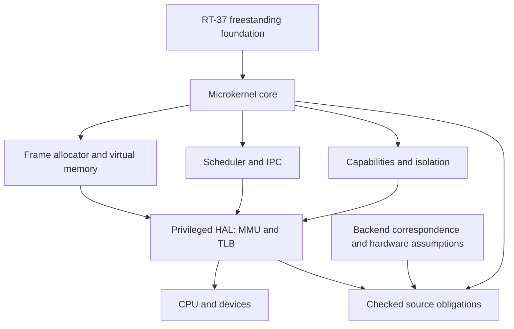

# RT-38 — Operating-system kernels and verified microkernel feasibility

**Status:** Proposed research brief; no normative semantics, bootable LLMLang kernel or proof result.  
**Priority:** P1 feasibility; P0 prerequisite compatibility questions through RT-37.  
**Date:** 2026-11-24  
**Tracking:** [Issue #441](https://github.com/aivibeflow/LLMLang/issues/441)  
**Baseline:** `bd774c1af4496652169e8d939b6e3dd0b2e6eede`

## 1. Objective and hypotheses

Investigate whether LLMLang can express and compile an OS kernel, and whether a small capability-oriented microkernel can be verified compositionally down to an explicit hardware/translation trust boundary. Reuse [RT-37](../RT-37/README.md) for freestanding startup, layouts, pointers, MMIO, interrupts and runtime closure. Unlike [hosted POSIX](../RT-10/POSIX-RUNTIME-ARCHITECTURE.md), the kernel supplies OS services rather than consuming them.

H1: shared freestanding semantics plus privileged target capabilities suffice for a small kernel. H2: ownership, frame/effect contracts and typed capabilities can express memory isolation and IPC invariants. H3: separate source, translation and device premises permit honest modular proofs. Counterexamples include accepted double allocation, unauthorized mapping/IPC, interrupt reentrancy violating invariants or a hidden hosted dependency.

The initial kernel keeps drivers and services outside privileged code when practical. The hardware abstraction is an explicit trust boundary, not a proof by declaration.

## 2. Work packages

| ID | Question / deliverable |
|---|---|
| KRN-01 | Reuse RT-37 freestanding profile; identify kernel-specific privilege, initialization and runtime restrictions |
| KRN-02 | Physical frames, virtual addresses, pointer provenance, aliases, page alignment and memory-map contracts |
| KRN-03 | Privileged instructions, hardware interfaces, trap/syscall ABI, typed capabilities |
| KRN-04 | MMU/page-table updates, TLB invalidation, MMIO and memory barriers; distinguish hardware visibility from software state |
| KRN-05 | Interrupt, exception, preemption and reentrancy semantics; bounded critical sections |
| KRN-06 | Boot image, linker script, entry/stack setup, relocations, no hosted imports and explicit compiler support |
| KRN-07 | Verified frame allocator, ownership conservation, zeroing and failure rollback |
| KRN-08 | Virtual-memory mapping, permissions, address-space isolation, stale mappings and concurrency |
| KRN-09 | Scheduler/context switch, runnable-state invariants, fairness and blocking policies |
| KRN-10 | IPC, capability delegation/revocation, syscall validation, user/kernel boundary |
| KRN-11 | SPG-to-IR-to-binary semantic preservation; pinned compiler and hardware premises; distinguish checked/conditional/incomplete |
| KRN-12 | Reproducible bootable single-core microkernel in emulator, user-mode isolation and IPC demonstration |
| KRN-13 | SMP memory model, locks/atomics, interrupt routing, DMA/IOMMU and cross-core TLB shootdown |
| KRN-14 | Independent reference models; code size, latency, throughput, proof effort and change/reverification cost benchmarks |

## 3. Candidate architecture and contract discriminator

Compare monolithic versus minimal microkernel (smaller initial privileged proof scope, but IPC overhead); foreign assembly/HAL with scoped assumptions versus checked intrinsics and verified lowering; LLVM versus generated freestanding Rust. Do not require a production Linux-compatible kernel. Candidate first target: pinned RV64 QEMU, single hart, explicit boot firmware/privilege configuration. Firmware initialization is an assumption unless separately checked.

Illustrative page allocation: reserve a free frame, zero it, install mapping with appropriate rights, publish ownership and synchronize translation state. Success must preserve global frame conservation, non-overlapping ownership, kernel protection and user isolation; failures must restore modeled state or return an explicit residual obligation. Intermediate states require a lock/critical-section or other proved protocol. Zeroing, mapping and TLB behavior must be represented by checked implementations or scoped RT-36 premises. A source proof alone does not prove binary behavior.

Negative controls: double allocation, premature publication, stale TLB, wrong permission, unauthorized IPC/capability transfer, interrupt while holding incompatible lock, incorrect context-save/restore and hidden runtime imports. Include independent reference model, source/target trace comparison and rejected operations. Later SMP experiments must cover weak ordering and DMA outside CPU ownership assumptions.

## 4. Dependencies, evidence and gates

- RT-37 profile and pilot gate; [core](../RT-03/CORE-LANGUAGE-SEMANTICS.md), [RT-04](../RT-04/RT-04-TYPE-EFFECT-OWNERSHIP-AND-CAPABILITY-ALTERNATIVES.md), [memory model](../RT-04/RESEARCH-SCENARIO-61-CONCURRENT-MUTABLE-STATE-AND-MEMORY-MODEL.md), [atomic lowering](../RT-13/RESEARCH-SCENARIO-116-ATOMIC-BACKEND-LOWERING-OBLIGATIONS.md), [layout/ABI](../RT-09/RT-09-STRUCTURAL-TYPE-IDENTITY-LAYOUT-AND-C-ABI-PROPOSAL.md), [LLVM](../RT-13/LLVM-BACKEND-ARCHITECTURE.md), [LLVM preservation](../RT-13/RESEARCH-SCENARIO-96-LLVM-UB-POISON-AND-SEMANTIC-PRESERVATION.md).
- [Public interfaces](../RT-05/PUBLIC-INTERFACES-AND-CONTRACT-REFINEMENT.md), [RT-34 resources](../RT-34/RT-34-AUTOMATIC-COMPLEXITY-INFERENCE.md), [RT-36 assumptions](../RT-36/RT-36-FORMAL-VERIFICATION-ASSUMPTIONS-AND-TRUST.md), RT-07/08/13/16/32/33: compositional proof, explicit authority and target evidence. Keep proof closure separate from policy admission.
- Pin exact target/emulator/firmware/ABI, linker/compiler, source/SPG, hardware models, checker, assumptions and commands. Archive binary/import/link-map and trace evidence, proof obligations, negative controls and failed/UNKNOWN cases.
- Exit: documented feasible or falsified profile with explicit gaps; reproducible bootable minimal kernel (or documented blocking discriminator), independently checked frame-allocation/isolation/IPC properties for the declared model, trust and translation boundaries explicit; no claim of complete kernel verification without corresponding evidence.

No experiments have been executed for this brief. Single-core target and architecture are hypotheses, not selected normative decisions.
