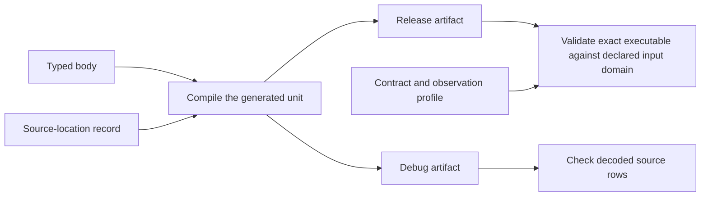

# RT-09 Selective translation and validation invalidation

**Issue** [#327](https://github.com/aivibeflow/LLMLang/issues/327)

An incremental translator needs to know which changes invalidate emitted code, debug metadata, or the evidence that an artifact meets its contract. Using a single source identity for all three can discard reusable outputs. Using only machine-code identity can miss a source-location or validation-scope change. This fixture independently rebuilds release and debug artifacts after three isolated changes and checks the exact validation subject. [Incremental translation architecture](../RT-13/TRANSLATION-AND-TARGET-BACKENDS.md#9-incremental-translation)

## Model and comparison

A C emitter generates one function from a typed fixture body. It returns the input plus a constant modulo 256. The emitter uses a separate source-location record to generate the C line directive. GCC emits both an optimized release artifact without debug information and an optimized artifact with DWARF 5 line information. Other compiler settings are identical. A distinct contract selects an inclusive input interval and gives the required modulo result. A hand-written executable observer calls the linked function on all 256 inputs. The Python validator checks the required result on the contract interval; the validator has no dependency on the emitter's chosen addend.

The experiment compares separate identities for translation and evidence. It checks the exact emitted object and executable, their machine text, and the decoded source location. The validation key binds the exact release executable, contract, observer source and oracle version. A release receipt is evidence for that build and declared interval. A changed debug line would also require a fresh source-mapping check with its own subject.



The diagram shows dependencies exercised in the fixture. The same compile command processes both the body and location directive. The trial establishes when outputs produced from changed inputs are exactly equal, so a cache can use that distinction in this profile. It does not infer that every source-location directive is code-neutral for arbitrary C.

## Observations

Every profile and variant runs 256 native inputs. The [ledger](SELECTIVE-TRANSLATION-01/evidence.json) records all 2,048 outputs, exact artifact digests, debug source rows, validation inputs and mismatches. The table compares each change with the unchanged baseline. It reports deterministic values and counts. This experiment does not benchmark compile time or cache latency.

| Changed input | Release executable | Debug executable | Machine text | Release validation key | Checked / mismatches |
| --- | --- | --- | --- | --- | ---: |
| Source filename and line | Same | Changed | Same | Same | 128 / 0 |
| Contract maximum input 127 to 255 | Same | Same | Same | Changed | 256 / 0 |
| Body addend 1 to 2 | Changed | Changed | Changed | Changed | 128 / 128 |

Changing the source map changes the decoded position from `old.llm:10` to `new.llm:40`. Exact release reuse is supported for the observed version of this emitter and toolchain. The original 128-observation receipt leaves the additional 128 obligations uncovered when the domain expands, even though both artifacts remain byte-identical. The wider fresh check covers all 256 inputs. Changing the body forces a new executable and the fresh scope check rejects it at all 128 required inputs.

An exact verification key should bind the subject and the validation scope. Finer-grained verification could keep independently scoped evidence for the unchanged input region and add evidence for the new region. This fixture records one aggregate receipt and does not exercise such composition. In production, the selected runtime, dependencies and target assumptions would also enter the applicable keys. General dependency discovery, untrusted receipts, debug semantics beyond line positions, retention, concurrent caching and wider backends remain open. [Artifact identity inputs](RT-09-STATIC-LINK-ARTIFACT-IDENTITY-2026-11-25.md)

## Reproduction

Use x86-64 Linux, Debian GCC 14.2.0-19, GNU binutils 2.44 and CPython 3.12.14 at repository root. The branch baseline is `aed8cd10deda5e60764774aacf22f40a48fa928f`. The runner pins the temporary compiler directory to `/fixture`, sets the locale, time zone and source date epoch, and records source hashes and exact tool versions. Independent temporary roots with hash seeds 1 and 2 produced byte-identical ledgers. Local relative links and the Mermaid block structure were checked. GitHub rendering was not manually verified.

```sh
study=research/compiler-and-translation/RT-09/SELECTIVE-TRANSLATION-01
PYTHONHASHSEED=1 python -B "$study/run.py" >/tmp/llmlang-selective-translation.json
cmp "$study/evidence.json" /tmp/llmlang-selective-translation.json
```
