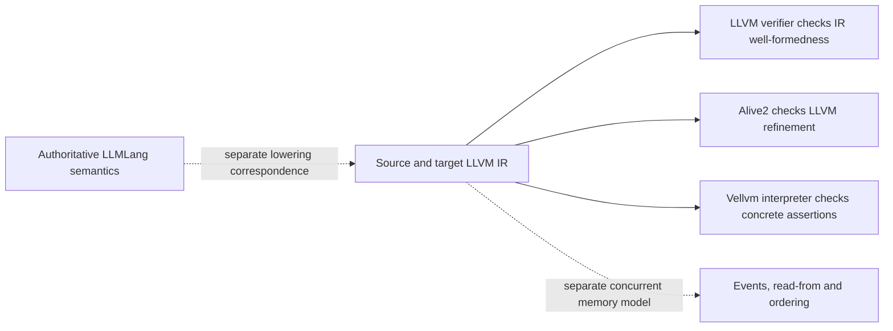

# RT-13 — Alive2 and Vellvm on LLVM scalar, memory and ordering fixtures

- **Evidence** — Exact LLVM verifier, translation-validator and interpreter observations over five small modules.
- **Plan** — [§2.5](../../../PLAN.md#25-correctness-of-optimization-and-translation) · [§6.3](../../../PLAN.md#63-llvm-backend).
- **LLMLang baseline** — `254352ee8cc635014a139811fd1f68ef2ce09777`.
- **LLVM subject** — Debian LLVM 19.1.7, 64-bit little-endian pointer layout, with checked source and target LLVM functions.

## Decision under study

LLVM accepts well-formed functions even when a transformation changes their meaning. LLMLang needs evidence at two distinct boundaries. Source-to-LLVM correctness compares the authoritative LLMLang operations and observations with the generated LLVM program. LLVM-to-LLVM correctness compares an input function with a transformed one, including defined behavior, poison and memory observations. This fixture tests the latter boundary and compares it with concrete observations from an extracted formal LLVM semantics.



The semantic tools answer different questions about the same input pair. Alive2 can search for a witness to failure of refinement for its modeled fragment. Vellvm can execute selected assertions through its extracted interpreter, and its definitions supply a starting point for formal claims in Rocq. Agreement on concrete inputs provides cross-checking evidence for those inputs. A checked proof that a source program refines its LLVM IR requires a model and a theorem at that boundary.

## Fixture and scope

The five modules cover a correct scalar transformation, an unjustified signed no-overflow flag, reordering two stores which may alias, replacement of a byte atomic read–modify–write by ordinary operations on a local allocation, and removal of an acquire fence with no other memory event. The atomic fixture packs the old and new byte values into one observed integer. Vellvm's two store arguments are bound to one allocation in the alias witness and to distinct allocations in the control.

All LLVM inputs use one data layout and are assembled and verified before testing. The modules include Vellvm test assertions alongside the functions. The same module bytes are passed to both tools. Alive2 evaluates the pair named `src` and `tgt`. The alias fixture's extra wrapper functions set up concrete memory layouts for Vellvm.

Vellvm's current extracted interpreter has a sequential atomic update path. The pinned denotation branch for `fence` returns unit and includes a note that the concurrency model needs revisiting. The `atomicrmw` observation checks scalar and local-memory behavior in that execution. Fences, multi-thread visibility, release sequences and synchronization need an explicit concurrent model and target evidence. [Pinned denotation](https://github.com/vellvm/vellvm/blob/7f0610c38d829b79bf6e867edf410c9e6f928f98/src/rocq/Semantics/Denotation.v#L670-L677) · [Native atomic lowering](RT-13-ATOMIC-BYTE-WORD-LOWERING-2026-11-24.md)

## Results

| Case | LLVM structural verifier | Alive2 verdict | Vellvm observations |
| --- | --- | --- | --- |
| Add zero → identity | Accepted | Correct | 4/4, source and target agree at inputs 0 and −128. |
| Add 1 → signed no-wrap add | Accepted | Refuted | 4/4. At signed input 127 the source returns −128 and the flagged target produces poison. At input 126 both return 127. |
| Reorder two stores through potentially aliasing pointers | Accepted | Refuted | 4/4. At one shared allocation the source returns 9 and the target 7. At distinct allocations both return 7. |
| Replace byte atomic read–modify–write and fence with ordinary local operations | Accepted | Unsupported atomic instruction | 4/4. The local byte changes 0→1 and 255→0 in both sequential executions. The old byte also agrees. |
| Remove an acquire fence | Accepted | Unsupported fence instruction | 2/2. Both sequential executions return 42. |

Alive2 returns process code 0 for the two recorded counterexamples as well as the correct case. The runner therefore checks the printed verdict and exact values. It recognizes unsupported instruction results separately. A deliberately false Vellvm identity assertion fails one of four checks and returns process code 1. The five original modules passed all 18 concrete checks. [Evidence](LLVM-VALIDATORS-01/evidence.json)

## Applicability and evidence gates

| Path | Where it can help | Additional criteria |
| --- | --- | --- |
| LLVM verifier | Validate basic IR structure, types and constraints before comparing semantics. | Require a separate comparison for transformation correctness. |
| Alive2 translation validation | Check LLVM refinement for supported instruction and attribute combinations, including supported scalar poison and alias cases. | Bind the exact module, tool source, LLVM build and solver. Treat unsupported instructions and incomplete solver results as unknown coverage. |
| Vellvm extracted interpreter | Replay concrete values, poison and selected memory setups through a formal semantics implementation. | Record the interpretation profile and exact assertions. Linking to its formal semantics for a universal claim requires a theorem, including source and target observations where applicable. |
| LLMLang source observations and concurrent evidence | Establish what lowering must preserve and test behavior the LLVM tools in this experiment do not cover. | Source semantics, abstraction relation, architecture premises and linked-code or solver evidence remain explicit. |

For a supported optimization, combine the structural gate with a refinement result and replay discriminating witnesses in an independent model. This comparison favors testing Alive2 as an optional LLVM-to-LLVM gate, using Vellvm for concrete reference checks and as a possible basis for selected formal correspondence. Backend adoption, floating-point behavior, unsupported instruction families and shared-memory ordering remain open.

## Reproduction

[Source and dependency pins](LLVM-VALIDATORS-01/BUILD.md) describe the observed builds. Debian LLVM reports exception handling disabled. Stock Alive2 refused that configuration, so the executable in this experiment uses the archived build-only CMake adjustment. LLVM's packaged libraries retain their original configuration. The fixture results apply to this exact experimental build. Repeating them against the unmodified Alive2 build with an exception-enabled LLVM is a separate release-quality check.

[Verifier and test runner](LLVM-VALIDATORS-01/run.py) · [Modules](LLVM-VALIDATORS-01) · [Machine-readable results](LLVM-VALIDATORS-01/evidence.json)

```sh
study=research/compiler-and-translation/RT-13/LLVM-VALIDATORS-01
python3 -B "$study/run.py" \
  --alive /absolute/path/to/alive-tv --vellvm /absolute/path/to/vellvm \
  --output /tmp/llmlang-rt13-validators.json
cmp "$study/evidence.json" /tmp/llmlang-rt13-validators.json
```
