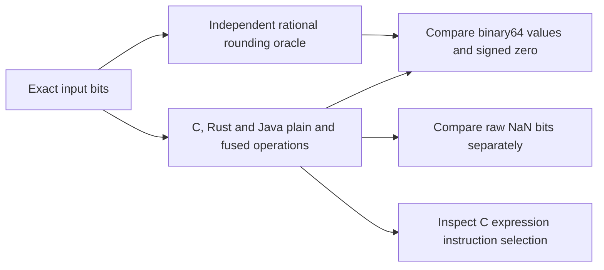

# RT-13 — Separate and fused binary64 rounding across C, Rust and Java

Explicit fused multiply-add matched the one-rounding reference across all six tested profiles. The plain expression matched the two-rounding reference in five profiles. GCC with contraction enabled emitted a fused instruction and changed 77 of 6,859 outcomes. Raw NaN bits differed across profiles for 114 of the explicit fused operation's NaN results.

## Method

The [floating-point prior-art study](../../language-design/RT-03/RESEARCH-SCENARIO-78-FLOATING-POINT-REPRODUCIBILITY-AND-IEEE-EDGES.md) distinguishes a strict reproducible profile, platform latitude and explicit relaxed operations. This study compares the same handwritten arithmetic in C, Rust and Java. It exercises a plain `a * b + c` expression and each route's explicit fused multiply-add. A separate-rounding operation computes an IEEE binary64 product and rounds it before adding the third input. A fused operation computes the combination before a single rounding.

The corpus crosses 19 exact operand bit patterns in all three positions. It includes positive and negative zero, subnormal boundaries, a normal boundary, finite extremes, infinities and NaNs with distinct payloads. A Python reference decodes each finite input into an exact rational number, rounds explicitly to nearest with ties to even, and handles infinities and zeros with explicit rules. Its NaN comparisons use one canonical category. The probes preserve the raw observed bits for examining payload behavior separately.



C uses GCC 14.2.0 on x86-64 with FMA support. The C fixture checks the process rounding mode and inspects compiler assembly for the expression. Rust uses 1.85.1 with opt-level 3. Java uses OpenJDK 21.0.13 in default VM and interpreter-only modes. The default VM experiment leaves actual compilation tier and timings outside the result.

## Results

| Profile | Triples | Expression differences from separate rounding | Explicit FMA differences from fused rounding |
| --- | ---: | ---: | ---: |
| C-O0-split | 6,859 | 0 | 0 |
| C-O3-contract | 6,859 | 77 | 0 |
| C-O3-split | 6,859 | 0 | 0 |
| Java-VM | 6,859 | 0 | 0 |
| Java-interpreted | 6,859 | 0 | 0 |
| Rust-O3 | 6,859 | 0 | 0 |

The counts compare exact non-NaN bits and a common NaN category. The separate C profiles emit `vmulsd` and `vaddsd`. The contraction profile emits `vfmadd132sd` and matches the fused reference in every plain-expression row. For `(1 + 2⁻²⁷) * (1 - 2⁻²⁷) - 1`, two roundings produce positive zero and the fused instruction produces `-2⁻⁵⁴`. The largest finite value times two minus itself overflows under separate rounding and returns the largest finite value when fused. The corpus also checks a subnormal tie and exact negative zero. The ledger includes the exact input and observed output bits for these cases.

The explicit fused operation produces a NaN category in 2,943 rows. At least two profiles report different raw bits in 114 of those rows. This comparison keeps the sign and payload within the raw representation and distinguishes them from the common classification. It leaves exception flags and signaling side effects unmeasured.

## Implications for implementation choice

A language profile that promises separate rounding must carry that requirement into lowering and optimization. An explicit fused operation gives a different reproducible value contract on the tested inputs. A raw NaN-bit guarantee needs a specified payload rule and validation that every permitted backend meets it, or explicit canonicalization at the defined observation boundary. Canonicalizing NaNs in the reference comparison leaves signed zero and all finite bits observable.

The experiment covers one binary64 expression, one rounding mode and the recorded target environment. It leaves LLVM IR flag equivalence, other architectures, other rounding modes, exception state, conversions, transcendental libraries and full source-to-target correspondence open.

## Reproduce

Use Linux x86-64 with FMA, CPython 3.12.14, GCC 14.2.0, Rust 1.85.1 and OpenJDK 21.0.13 from the repository root. The Java compiler runs through the `jdk.compiler` module.

```sh
fixture=research/compiler-and-translation/RT-13/BINARY64-CONTRACTION-01
output=$(mktemp)
python3 "$fixture/run.py" --output "$output"
cmp "$fixture/evidence.json" "$output"
python3 "$fixture/chart.py"
```

[Runner and reference](BINARY64-CONTRACTION-01/run.py) · [Evidence ledger](BINARY64-CONTRACTION-01/evidence.json)
