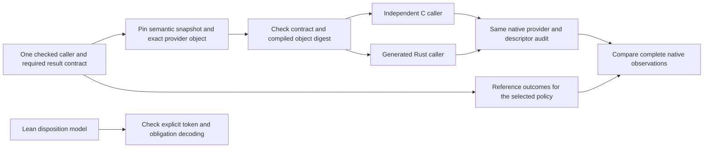

# RT-13 — Exact provider binding for owned results across C and Rust

An unchanged caller and public contract can produce different owned-result traces after an exact provider rebind. On the common fixture, the rebind changes 5,720 of 20,992 observations for each transfer order. An independent C caller and generated Rust agree with the reference for both provider bindings.

## Question and method

The previous COR-13 native ABI experiment checked one C implementation of the foreign resource protocol behind generated Rust. The implementation creates Linux event descriptors and reports an explicit cleanup disposition. This study keeps the fixture source and its admissible result shapes, binds the foreign operation through an immutable snapshot, and compares a second native execution route on the same inputs. [Native owned-result ABI](RT-13-NATIVE-OWNED-ABI-2026-11-24.md)

The two separately compiled C provider objects export the same four functions and the same result layout. The scripted provider returns the requested admissible disposition. The second provider converts a requested retained error to a consumed error and closes the associated descriptor. Both obey the fixture contract, which admits either disposition. Both retain roles after an indeterminate close, regardless of whether the descriptor is physically open. The contract here is the fixture's declared outcome shape and resource scope.

The reference executes one checked COR-13 recovery caller with an aliased second role. For each provider it applies the selected disposition rule before executing the existing source model. The experiment compiles the existing Rust lowering with its native ABI adapter. A separate C caller implements the same operation sequence and receives the checked source-derived argument positions, transfer order and recovery action through a small generated header. The provider object is common to both native routes for each binding.



Each native comparison includes the result tag and obligations, ordered events and cleanup errors, second-call admission, forwarded roles and descriptor-state audit. The inputs cover 82 role assignments, both domain outcomes, four requests for each of three closes, and the two physical implementations of an indeterminate close. This gives 20,992 input rows per provider, native route and transfer order. All binaries use the same input ordering.

## Results

| Transfer | Rows per provider and target | Changed language traces | Changed descriptor audits | Changed combined rows |
| --- | ---: | ---: | ---: | ---: |
| before_cleanup | 20,992 | 5,720 | 5,720 | 5,720 |
| after_cleanup | 20,992 | 5,720 | 5,720 | 5,720 |

Both routes match the independent source and descriptor-state oracle in all 167,936 comparisons. Across the paired rebind, the old and new snapshots retain the caller and contract identities and select different exact provider objects. Reusing a per-input cached outcome keyed only by caller and contract gives the changed combined rows above. Checking the compiled object digest and required contract against the pinned snapshot rejects substitution of the other provider in all four transfer-and-provider cases.

The [Lean model](BOUND-OWNED-PROVIDERS-01/Disposition.lean) checks two propositions. Under either fixture policy, decoding a reply for a nonzero token preserves the prescribed retained, reconciliation or absent obligation. For a retained request the scripted policy gives a usable token, and the other policy discharges that obligation. Lean 4.36.0 reports `propext` for both propositions. The model compares disposition and token fields. Native compilation and dynamic traces provide the separate evidence for the tested implementations.

## Implications for implementation choice

Content-addressed caller bodies can support either direct provider pins or scoped operation bindings. A scoped call needs the selected implementation and relevant binding context in execution and evidence identities. C and Rust are viable routes for the tested owned-result ABI profile when the full disposition and token are carried through. Their matched results share one provider object, so agreement between native callers is supplemented by the reference rather than used as the provider oracle.

The result is bounded to one recovery caller, one sequential Linux resource guard and two scripted provider policies. The C caller is an independent implementation configured through the checked fixture. A general C emitter, general ownership and FFI correspondence, independent provider contracts, concurrent cleanup and reconciliation, and portability remain open. The Lean propositions do not establish source-to-binary correspondence.

## Reproduce

Use Linux x86-64, CPython 3.12.14, GCC 14.2.0, Rust 1.85.1, Lean 4.36.0 and GNU `nm` from the repository root. The runner compiles C providers and the C caller at O2 and generated Rust at opt-level 3.

```sh
fixture=research/compiler-and-translation/RT-13/BOUND-OWNED-PROVIDERS-01
output=$(mktemp)
python3 "$fixture/run.py" --output "$output"
cmp "$fixture/evidence.json" "$output"
python3 "$fixture/chart.py"
```

[Runner](BOUND-OWNED-PROVIDERS-01/run.py) · [C caller](BOUND-OWNED-PROVIDERS-01/caller.c) · [Evidence ledger](BOUND-OWNED-PROVIDERS-01/evidence.json) · [Toolchain option matrix](../../research-management/RESEARCH-OPTION-MATRIX-01.md#54-owned-result-provider-binding-on-a-common-workload)
