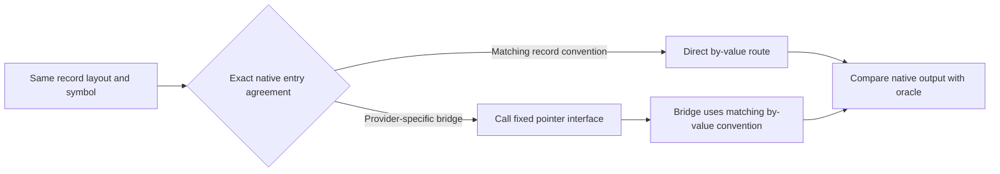

# Bind by-value record calls to the native calling convention

This RT-13 experiment compares direct by-value calls and a fixed pointer bridge on the same aggregate type. It asks whether two native providers that expose the same symbol, field types and layout can be interchangeable at an existing direct call site. System V AMD64 and Microsoft x64 calling conventions are both emitted in one x86-64 Linux environment.

## Interface and alternatives

The fixture passes a 16-byte record of two unsigned 64-bit fields and one unsigned 64-bit salt. It returns the same record type. Field offsets are 0 and 8 with alignment 8 in both languages and profiles. The operation computes two wrapping expressions. A C caller uses the compiler's explicit convention attribute through the shared header. A Rust caller uses `#[repr(C)]` and the matching `extern "sysv64"` or `extern "win64"` declaration.

The fixed bridge exposes a separate C call with input and output pointers. The bridge is built with the selected provider and calls it with a matching by-value declaration. Its clients use a single hosted System V entry. A bridge still needs the exact pointer and record-layout contract. The worker always executes a known matching prototype.



Four provider object files cover two conventions at O0 and O3. The ledger keeps the exact object SHA-256 values and disassembly of the selected function. In the System V O3 object the input fields arrive through `rdi` and `rsi`, with salt through `rdx`. The result is returned in `rax` and `rdx`. In the Microsoft O3 object the fields are loaded through `rdx`, the salt comes through `r8`, and the result is written through the hidden output pointer originally in `rcx`. These cues are measured on the pinned generated functions.

## Results

The proposal comparison considers each exact provider artifact with both possible requested direct conventions. The signature-only gate would admit all eight proposals, including four incompatible direct calls. The exact direct gate admits four. The fixed bridge offers a usable entry for each provider regardless of which by-value declaration the client would have required. The eight proposal checks count two possible requests per provider and are separate from execution.

| Binding gate | Eligible proposals | Incompatible direct admissions |
|---|---:|---:|
| Symbol and aggregate type | 8/8 | 4 |
| Matching explicit direct convention | 4/8 | 0 |
| Fixed pointer bridge | 8/8 | 0 |

| Executed route | Native runs | Matching output vectors |
|---|---:|---:|
| Direct | 16 | 1024 |
| Bridge | 16 | 1024 |

Thirty-two executions cross provider convention, provider optimization, C or Rust consumer, consumer optimization and direct or bridge route. Each run checks 64 field/salt combinations against a separate Python oracle using explicit unsigned wrapping. All 2,048 output vectors match. Each execution also checks the record size, alignment, offsets and selected provider profile. The measured direct observations use matching conventions. Incompatibility is a checked admission decision from the fixture profile and object evidence.

## Limits and replay

Both calling conventions run on one x86-64 Linux machine. Library loading, a Windows process ABI, stack unwinding, callbacks, variadic calls, aggregate classes other than this exact layout, and ABI descriptor trust still need separate evidence. The disassembly comparison is specific to this operation and compiler. The bridge's native wrapper is part of the checked build, and the measured result establishes finite correspondence. Independent review remains open.

Use CPython 3.12.14, Debian GCC 14.2.0-19, Rust 1.85.1 and Binutils 2.44. The initial LLMLang base is `10adb81272bf7ca513fc551b7da6d7b6e87bf1c0`. The ledger records the exact sources, compiler versions, provider binaries and output vectors. Run from the repository root.

```bash
fixture=research/compiler-and-translation/RT-13/BY-VALUE-CALL-ABI-01
PYTHONHASHSEED=1 python3 -B "$fixture/run.py" > /tmp/llmlang-rt13-byvalue.json
cmp "$fixture/evidence.json" /tmp/llmlang-rt13-byvalue.json
python3 "$fixture/chart.py"
```

See the [C provider](BY-VALUE-CALL-ABI-01/provider.c), [C declaration and caller](BY-VALUE-CALL-ABI-01/caller.c), [Rust caller](BY-VALUE-CALL-ABI-01/caller.rs), [runner](BY-VALUE-CALL-ABI-01/run.py), [measured ledger](BY-VALUE-CALL-ABI-01/evidence.json), and [table generator](BY-VALUE-CALL-ABI-01/chart.py).
