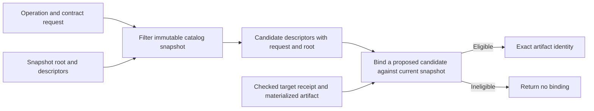

# RT-13 catalog discovery and concrete implementation binding

A catalog may list several implementations for a single operation and contract revision. A listed artifact might still need materialization, target-specific evidence, or a fresh selection after a catalog change. The study checks a two-step boundary. Discovery identifies matching descriptors from a pinned snapshot. Binding takes a proposed descriptor and checks the current discovery result, artifact, target receipt and materialization before returning an implementation identity. It leaves ranking to the separately defined ordered fallback policy. [Operation and implementation identities](../../semantic-representation/RT-05/RESEARCH-SCENARIO-92-OPERATION-IDENTITY-AND-IMPLEMENTATION-BINDING.md) · [Fallback model](RT-13-IMPLEMENTATION-FALLBACK-2026-11-25.md)



Discovery uses exact operation and contract identity in this model. It neither orders by cost nor requires that a descriptor has been materialized for a target. Binding compares the complete supplied discovery record with a fresh result, including root and request. The candidate then needs a matching checked receipt for its exact artifact and target, and an affirmative materialization state. A compatible descriptor can therefore remain visible while selection is unavailable. A descriptor retained across catalog revisions requires a current discovery record even when its bytes are identical. A production incremental index could replace recomputing the list if it can establish the same snapshot-specific membership and completeness.

## Checked results

Lean proves that discovery membership is equivalent to catalog membership and exact request equality. The two binding theorems establish that a binding implies current discovery, candidate membership, request equality and the exact receipt predicates, and that a fresh eligible candidate can bind. All three depend on `propext` only. The proof takes catalog and receipt fields as inputs. [Lean model](DISCOVERY-BINDING-01/Discovery.lean)

The finite Python model covers two snapshots, four requests, six candidate descriptors, two target labels, five cursor states and five receipt states. An independent compatibility table supplies expected membership. Across 2,400 comparisons the complete gate admits 16 and refuses 2,384. Two shortcut rules admit additional invalid cases.

| Rule | Invalid bindings |
| --- | ---: |
| Current discovery and exact target receipt | 0 |
| Reported discovery membership with a matching target receipt | 76 |
| Reported discovery membership alone | 444 |

In snapshot B the new preferred descriptor remains discoverable with a missing materialization, and the available reserve can bind from fresh discovery. The reserve is refused when the supplied discovery came from snapshot A. A fabricated descriptor with a matching receipt is also refused. These are decisions at a pre-invocation binding interface. The model treats snapshot roots as honest identities, target receipts as authenticated inputs and availability as stable for the modeled call. Real materialization races, proof of a substitutable nonidentical contract, authenticated index proofs and policy-driven ranking remain separate research. [Evidence](DISCOVERY-BINDING-01/evidence.json)

## Reproduction

Use Lean 4.36.0 at revision `611c117bfaf7b7ae1cfcf246ce6fba31e8f509e9` and CPython 3.12.14. Two hash-seed runs reproduce the finite cases and the recorded proof dependencies.

```sh
study=research/compiler-and-translation/RT-13/DISCOVERY-BINDING-01
build=$(mktemp -d)
for seed in 37 75; do
  LC_ALL=C PYTHONHASHSEED="$seed" python "$study/run.py" --lean /path/to/lean \
    --output "$build/result-$seed.json"
done
cmp "$build/result-37.json" "$build/result-75.json"
cmp "$build/result-37.json" "$study/evidence.json"
```

[Runner](DISCOVERY-BINDING-01/run.py)
